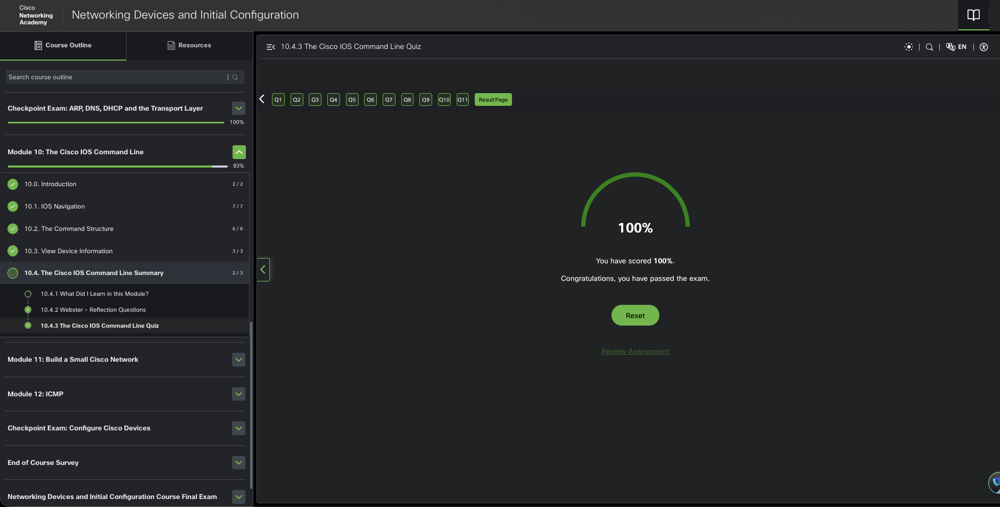

# Cisco IOS Command Line Interface

The Cisco IOS command line interface (CLI) is a text-based program that enables entering and executing Cisco IOS commands to configure, monitor, and maintain Cisco devices. The Cisco CLI can be used with either in-band or out-of-band management tasks.

CLI commands are used to alter the configuration of the device and to display the current status of processes on the router. For experienced users, the CLI offers many time-saving features for creating both simple and complex configurations. Almost all Cisco networking devices use a similar CLI. When the router has completed the power-up sequence and the Router> prompt appears, the CLI can be used to enter Cisco IOS commands.

```code
Router con0 is now available


Press RETURN to get started!


Router> enable
Router# configure terminal
Enter configuration commands, one per line. End with CNTL/Z.
Router(config)# hostname R1
R1(config)# interface gigabitethernet 0/0/0
R1(config-if)#
```

Technicians familiar with the IOS commands and operation of the CLI find it easy to monitor and configure a variety of different networking devices because the same basic commands are used for configuring a switch and a router. The CLI has an extensive help system that assists users in setting up and monitoring devices.

## Primary Command Modes

All network devices require an OS and that they can be configured using the CLI or a GUI. Using the CLI may provide the network administrator with more precise control and flexibility than using the GUI. This topic discusses using CLI to navigate the Cisco IOS.

As a security feature, the Cisco IOS software separates management access into the following two command modes:

- User EXEC Mode - This mode has limited capabilities but is useful for basic operations. It allows only a limited number of basic monitoring commands but does not allow the execution of any commands that might change the configuration of the device. The user EXEC mode is identified by the CLI prompt that ends with the > symbol.
- Privileged EXEC Mode - To execute configuration commands, a network administrator must access privileged EXEC mode. Higher configuration modes, like global configuration mode, can only be reached from privileged EXEC mode. The privileged EXEC mode can be identified by the prompt ending with the # symbol.

```table
| Command Mode | Prompt | Description |
|--------------|--------|-----------------------------|
| User EXEC    | Router> | Limited access, basic monitoring aka "view-only" mode |
| Privileged EXEC | Router# | Full access for configuration and management, user can use any monitoring commands, execution configuration, management commands |
```

## Basic IOS Command Structure

A Cisco IOS device supports many commands. Each IOS command has a specific format, or syntax, and can only be executed in the appropriate mode. The general syntax for a command,is the command followed by any appropriate keywords and arguments.

```figure
Switch> | show |       | ip protocols |
        |      |       |
Prompt  | Cmd  | Space | Keywords/Args |
        |      |       |
Switch> | ping |       | 192.168.10.5  |

```

- Keyword - a specific parameter defined in the operating system (e.g. ip protocols).
- Argument - NOT predefined! can be any user-defined value or variable(e.g. 192.168.10.5).

enter each complete command, including any keywords and arguments
press Enter key to submit command to the command interpreter.

### notes

privileged EXEC mode allows access to all commands. Higher level commands like global configuration mode and subconfiguration modes can only be reached from the privileged EXEC mode.

Global configuration mode is identified by the (config)# prompt.

The > prompt after the device name identifies user EXEC mode.

To return from any prompt, all the way down to privileged EXEC mode, type end command or CTRL+Z

### IOS Command Syntax

A command might require one or more arguments. To determine the keywords and arguments required for a command, refer to the command syntax. The syntax provides the pattern, or format, that must be used when entering a command.

As identified in the table, boldface text indicates commands and keywords that are entered as shown. Italic text indicates an argument for which the user provides the value.

```table
| Command | Description |
|---------|-------------|
| boldface | Commands and keywords that are entered as shown |
| italic | An argument for which the user provides the value |
[x] | Brackets indicate that the argument is optional |
{x} | Braces indicate that the argument is required |
[x{y|z}] | Brackets and braces indicate that the argument is optional, but if used, must be one of the values in braces |
```

the syntax for using the description command is description string.
The argument is a string value provided by the user. The description command is typically used to identify the purpose of an interface.

e.g. entering the command, `description` Connects to the main headquarter office switch, describes where the other device is at the end of the connection.

conventions used to document and use IOS commands:

- ping ip-address - The command is ping and the user-defined argument of ip-address is the IP address of the destination device. For example, ping 10.10.10.5.
- traceroute ip-address - The command is traceroute and the user-defined argument of ip-address is the IP address of the destination device. For example, traceroute 192.168.254.254.

complex commandswith multiple arguments go like:

```code
Switch(config-if)# switchport port-security aging { static | time time | type {absolute | inactivity}}
```

The command will typically be followed with a detailed description of the command and each argument in the Cisco IOS Command Reference.

The `Cisco IOS Command Reference` is the ultimate source of information for a particular IOS command.

### Hotkeys and Shortcuts

Commands and keywords can be shortened to the minimum number of characters that identify a unique selection. For example, the `configure` command can be shortened to `conf` because `configure` is the only command that begins with `conf` but `con` will not work because more than one command begins with `con`. Keywords can also be shortened.

The table lists keystrokes to enhance command line editing.

```table
| Keystroke | Function |
|-----------|----------|
| Tab       | Auto-completes a command or keyword |
| Backspace | Deletes the character to the left of the cursor |
| Delete    | Deletes the character under the cursor |
| Ctrl+A    | Moves the cursor to the beginning of the line |
| Ctrl+B    | Moves the cursor one character to the left |
| Ctrl+C    | Aborts the command and returns to the prompt |
| Ctrl+D    | Deletes the character under the cursor |
| Ctrl+E    | Moves the cursor to the end of the line |
| Ctrl+F    | Moves the cursor one character to the right |
| Ctrl+K    | Deletes all characters from the cursor to the end of the line |
| Ctrl+L    | Clears the screen and redisplays the current line at the top of the screen |
| Ctrl+N    | Recalls the next command from the command history |
| Ctrl+P    | Recalls the previous command from the command history |
| Ctrl+R    | Searches the command history for a command that matches the characters entered |
| Ctrl+U    | Deletes all characters from the cursor to the beginning of the line |
| Ctrl+W    | Deletes the word to the left of the cursor |
| Ctrl+X    | Deletes all characters from the cursor to the end of the line |
| Esc       | Cancels the command and returns to the prompt |
| Esc B     | Moves the cursor one word to the left |
| Esc D     | Deletes the word to the right of the cursor |
| Esc F     | Moves the cursor one word to the right |
```

n.b. Delete key `typically` deletes the character to the right of the prompt, the `IOS command structure does not recognize the Delete key`.

When a command output produces more text than can be displayed in a terminal window, the IOS will display a “--More--” prompt. The following table describes the keystrokes that can be used when this prompt is displayed.

```table
| Keystroke | Function |
|-----------|----------|
| Spacebar  | Displays the next page of output |
| Enter     | Displays the next line of output |
| Q         | Exits the output display and returns to the prompt |
| y         | Displays the next page of output |
| any other key | ends display string, retruns to previous prompt |
```

commands used to exit out of an operation

```table
| Command      | Function                                                                 |
|--------------|--------------------------------------------------------------------------|
| Ctrl+C       | config mode: end, return to priv EXEC; setup mode : abort to cmd prompt  |
| Ctrl+Z       | Exits the current configuration mode and returns to privileged EXEC mode |
| Ctrl-Shift-6 | All purpose break sequence, uses: abort DNS lookup, traceroute, ping, interrupt IOS process |
```

## Packet Tracer - Navigate the IOS

Objectives

- Part 1: Establish Basic Connections, Access the CLI, and Explore Help
- Part 2: Explore EXEC Modes
- Part 3: Set the Clock

### Background / Scenario

- practice skills necessary for navigating the Cisco IOS, such as different user access modes, various configuration modes, and common commands used on a regular basis.
- practice accessing the context-sensitive Help by configuring the clock command.

#### Instructions

Part 1: Establish Basic Connections, Access the CLI, and Explore Help

Step 1: Connect PC1 to S1 using a console cable.

a. Click the Connections icon (the one that looks like a lightning bolt) in the lower left corner of the Packet Tracer window.

b. Select the light blue Console cable by clicking it. The mouse pointer will change to what appears to be a connector with a cable dangling from it.

c. Click PC1. A window displays an option for an RS-232 connection. Connect the cable to the RS-232 port.

d. Drag the other end of the console connection to the S1 switch and click the switch to access the connection list.

e. Select the Console port to complete the connection.

Step 2: Establish a terminal session with S1.

a. Click PC1 and then select the Desktop tab.

b. Click the Terminal application icon. Verify that the Port Configuration default settings are correct.

Question:
What is the setting for bits per second?

Answer: 9600

c. Click OK.

d. The screen that appears may have several messages displayed. Somewhere on the screen there should be a Press RETURN to get started! message. Press ENTER.

Question:
What is the prompt displayed on the screen?

Answer: S1>

Step 3: Explore the IOS Help.

a. The IOS can provide help for commands depending on the level accessed. The prompt currently displayed is called User EXEC, and the device is waiting for a command. The most basic form of help is to type a question mark (?) at the prompt to display a list of commands.

S1> ?
Question:
Which command begins with the letter ‘C’?

Answer: Connect

b. At the prompt, type t and then a question mark (?).

S1> t?
Question:
Which commands are displayed?

Answer: telnet terminal traceroute

At the prompt, type te and then a question mark (?).

S1> te?
Question:
Which commands are displayed?

Answer: telnet terminal

This type of help is known as context-sensitive help. It provides more information as the commands are expanded.

Part 2: Explore EXEC Modes

In this part of the activity, you will switch to privileged EXEC mode and issue additional commands.

Step 1: Enter privileged EXEC mode.

a. At the prompt, type the question mark (?).

S1> ?
Question:
What information is displayed for the enable command?

Answer: turn on privileged commands

b. Type en and press the Tab key.

```code
S1> en<Tab>
```

Question:
What displays after pressing the Tab key?

Answer: enable

This is called command completion (or tab completion). When part of a command is typed, the Tab key can be used to complete the partial command. If the characters typed are enough to make the command unique, as in the case of the enable command, the remaining portion of the command is displayed.

Question:
What would happen if you typed te<Tab> at the prompt?

Answer: more than one command that begins with the letters ‘te’ because ‘te’ does not provide enough characters to make the command unique. The characters will continue to display,

c. Enter the enable command and press ENTER.

Question:
How does the prompt change?

Answer: S1> changes to S1#

d. When prompted, type the question mark (?).

S1# ?
One command starts with the letter ‘C’ in user EXEC mode.

Question:
How many commands are displayed now that privileged EXEC mode is active? (Hint: you could type c? to list just the commands beginning with ‘C’.)

Answer: 5

Step 2: Enter Global Configuration mode

a. When in privileged EXEC mode, one of the commands starting with the letter ‘C’ is configure. Type either the full command or enough of the command to make it unique. Press the <Tab> key to issue the command and press ENTER.

S1# configure
Question:
What is the message that is displayed?

Answer: configuring from terminal, memory or network (terminal)?

b. Press Enter to accept the default parameter that is enclosed in brackets [terminal].

Question:
How does the prompt change?

Answer: enter configuration commands, one per line. End with CNTL/Z

c. This is called global configuration mode. This mode will be explored further in upcoming activities and labs. For now, return to privileged EXEC mode by typing end, exit, or Ctrl-Z.

S1(config)# exit
S1#
Part 3: Set the Clock

Step 1: Use the clock command.

a. Use the clock command to further explore Help and command syntax. Type showclock at the privileged EXEC prompt.

S1# show clock
Question:
What information is displayed? What is the year that is displayed?

Answer: time since device start in UTC date: Mon Mar 1 1993

b. Use the context-sensitive help and the clock command to set the time on the switch to the current time. Enter the command clock and press ENTER.

S1# clock<ENTER>
Question
What information is displayed?

Answer: incomplete command

c. The “% Incomplete command” message is returned by the IOS. This indicates that the clock command needs more parameters. Any time more information is needed, help can be provided by typing a space after the command and the question mark (?).

S1# clock ?
Question:
What information is displayed?

Answer: set date, time

d. Set the clock using the clock set command. Proceed through the command one step at a time.

S1# clock set ?
Questions:
What information is being requested?

Answer: hh:mm:ss Current Time

What would have been displayed if only the clock set command had been entered, and no request for help was made by using the question mark?

Answer: incomplete command

e. Based on the information requested by issuing the clock set ? command, enter a time of 3:00 p.m. by using the 24-hour format of 15:00:00. Check to see if more parameters are needed.

S1# clock set 15:00:00 ?
The output returns a request for more information:

<1-31> Day of the month
MONTH Month of the year
f. Attempt to set the date to 01/31/2035 using the format requested. It may be necessary to request additional help using context-sensitive help to complete the process. When finished, issue the show clock command to display the clock setting. The resulting command output should display as:

S1# show clock
\*15:0:4.869 UTC Wed Jan 31 2035
g. If you were not successful, try the following command to obtain the output above:

S1# clock set 15:00:00 31 Jan 2035
Step 2: Explore additional command messages.

a. The IOS provides various outputs for incorrect or incomplete commands. Continue to use the clock command to explore additional messages that may be encountered as you learn to use the IOS.

b. Issue the following commands and record the messages:

S1# cl<enter>
Questions:
What information was returned?

Answer: ambiguous command

S1# clock
Question:
What information was returned?

Answer: incomplete command

S1# clock set 25:00:00
Question:
What information was returned?

Answer: invalid input bc 25 hours

S1# clock set 15:00:00 32
Question:
What information was returned?

Answer: invalid because 32nd day of month

### Show Commands

The Cisco IOS CLI show commands display relevant information about the configuration and operation of the device. Network technicians use show commands extensively for viewing configuration files, checking the status of device interfaces and processes, and verifying the device operational status.

The status of nearly every process or function of the router can be displayed using a show command.

Commonly used show commands and when to use them are listed in the table.

```table
| Show Command | When to Use |
|--------------|-------------|
| show running-config | Displays the current configuration file in RAM. |
| show interfaces | Displays the status and configuration of all interfaces on the device. |
| show ip interface | verify layer 3 configuration and status of interfaces. |
| show arp | verify list of known hosts on local Ethernet LAN. |
| show ip route | verify layer 3 routing table and routing protocols. |
| show protocols | verify operational protocols |
| show version | verify device information including memory, interfaces, licensing |
```

```table
Key Show Commands
Command	Description
show running-config	Displays the active configuration stored in the device's memory.
show ip interface brief	Provides a summary of the interface status and IP addresses.
show version	Displays the current IOS version and system information.
show vlan brief	Lists VLANs, their statuses, names, and assigned ports.
show mac address-table	Shows the MAC addresses learned on the switch and their associated ports.
show ip route	Displays the routing table for the device.
show interfaces	Provides detailed information about all interfaces.
show cdp neighbors	Lists directly connected Cisco devices using CDP.
show processes cpu	Displays CPU utilization by processes.
show flash	Shows information about the Flash memory.
Additional Useful Commands
show startup-config: Displays the saved configuration that will be loaded on startup.
show port-security: Displays the port security configuration for all interfaces.
show interface trunk: Checks trunking status and native VLAN information.
show ip protocols: Displays routing protocol information and network details.
```

## Packet Tracer - Use Cisco IOS Show Commands

### Objectives

= Use Cisco IOS show commands

### Background / Scenario

The Cisco IOS show commands are used extensively when working with Cisco equipment. In this activity, you will use the show commands on a router located at an ISP.

#### Instructions

Part 1: Connect to the ISP Cisco 4321 router.

In this part, you will use the terminal emulation software on ISP PC to connect to the Cisco 4321 router.

a. Click ISP PC.

b. Click Desktop tab. Select Terminal. Review the terminal configuration and click OK to continue.

c. The ISPRouter > prompt indicates that you are in user EXEC mode. Press Enter if the prompt did not display.

Part 2: Explore the show commands.

Use the information displayed by these show commands to answer the following questions.

Step 1: Explore show commands in User EXEC mode.

### Questions and Answers

a. Type show ? at the prompt.

Question:
List a few more show commands that are available in the user EXEC mode.

Answer:
show startup-config: Displays the saved configuration that will be loaded on startup.
show port-security: Displays the port security configuration for all interfaces.
show interface trunk: Checks trunking status and native VLAN information.
show ip protocols: Displays routing protocol information and network details.

b. Enter show arp at the prompt.

Question:
Record the MAC address and the IP address listed.

Answer: 0001.96CD.2501: 209.165.201.1

c. Enter show flash at the prompt.

Question:
Record the IOS image listed:

Answer: isr4300-universalk9.03.16.05.S.155-3.S5-ext.SPA.bin

d. Enter show ip route at the prompt.

Question:
How many routes are listed in the table?

Answer: 2

e. Enter show interfaces at the prompt.

Question:
Which interface is up and running?

Click to see a couple of examples.

Interface Status Protocol
GigabitEthernet 0/0/0
Up
Answer: Up

GigabitEthernet 0/0/1
Answer:
Admin down
Down
Serial0/1/0
Answer:
down
Answer:
down
Serial0/1/1
Down
Answer:
down

f. Enter show ip interface at the prompt.

Question:
According to the show ip interface output, which interface is connected?

Answer: GigabitEthernet0/0/0

g. Enter show version at the prompt.

Question:
What technology package is enabled currently on the router?

Answer:
securityk9
ipbask9

h. Enter show protocols at the prompt.

Question:
Which protocols are enabled currently on the router?

Answer: Internet Protocol. Line protocol is up for GigabitEthernet0/0/0.

i. Enter show running-config at the prompt.

Question:
What is the output? invalid input detected at '^' marker

Answer:

Step 2: Explore the show commands in privileged EXEC mode.

a. Enter enable at the prompt to enter the privileged EXEC mode.

Question:
List some additional show commands in this mode.

Answer: show aaa, show access-list, show file

b. Enter show running-config at the prompt.

Question:
What is the output?

Answer: current configs and settings

## Learning Outcomes

### Navigate IOS

The Cisco IOS CLI is a text-based program that enables entering and executing Cisco IOS commands to configure, monitor, and maintain Cisco devices. The Cisco CLI can be used with either in-band or out-of-band management tasks.

CLI commands are used to alter the configuration of the device and to display the current status of processes on the router. When the router has completed the power-up sequence and the Router> prompt appears, the CLI can be used to enter Cisco IOS commands.

As a security feature, the Cisco IOS software separates management access into the following two command modes:

- User EXEC Mode - This mode is useful for basic operations. It allows a limited number of basic monitoring commands but does not allow the execution of any commands that might change the configuration of the device. The user EXEC mode is identified by the CLI prompt that ends with the > symbol.

- Privileged EXEC Mode - To execute configuration commands, a network administrator must access privileged EXEC mode. The privileged EXEC mode can be identified by the prompt ending with the # symbol. Higher configuration modes, like global configuration mode, can only be reached from privileged EXEC mode. Global configuration mode is identified by the CLI prompt that ends with (config)#.

The commands used to navigate between the different IOS command modes are:

```table
| Command | Function |
|---------|----------|
| enable | Enter privileged EXEC mode |
| disable | Exit privileged EXEC mode |
| configure terminal | Enter global configuration mode |
| exit | Exit the current configuration mode |
| end | Exit the current configuration mode and return to privileged EXEC mode |
| Ctrl+Z | Exit the current configuration mode and return to privileged EXEC mode |
| line console 0 | Enter console line configuration mode |
| line vty 0 15 | Enter virtual terminal line configuration mode |
| interface vlan 1 | Enter VLAN interface configuration mode |
```

### Command Structure

Each IOS command has a specific format, or syntax, and can only be executed in the appropriate mode. The general syntax for a command is the command followed by any appropriate keywords and arguments. The keyword is a specific parameter defined in the operating system. The argument is not predefined; it is a value or variable defined by the user.

- The syntax provides the pattern, or format, that must be used when entering a command.`Boldface` text indicates commands and keywords that are entered as shown.
- Italic text indicates an argument for which the user provides the value.

- [x] square brackets indicate an optional element (keyword or argument).

- {x} braces indicate a required element (keyword or argument).

## Module Pass


