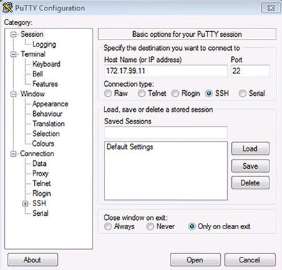
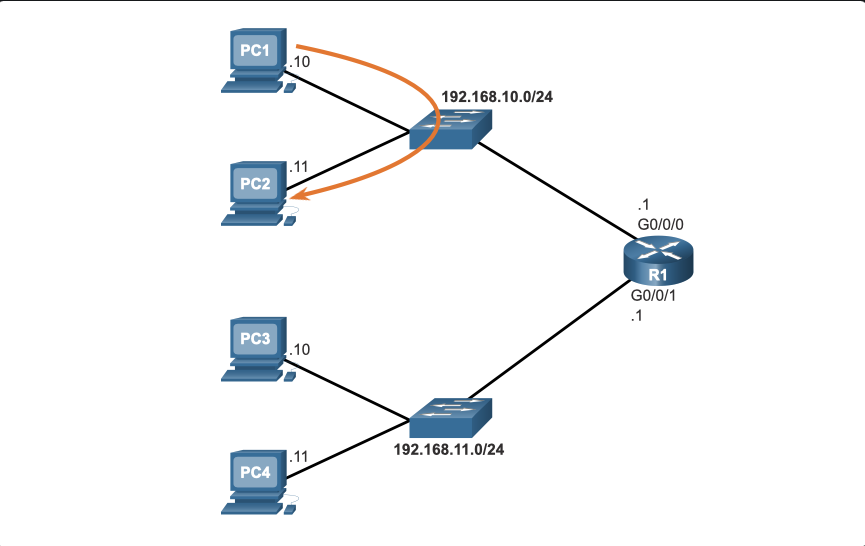
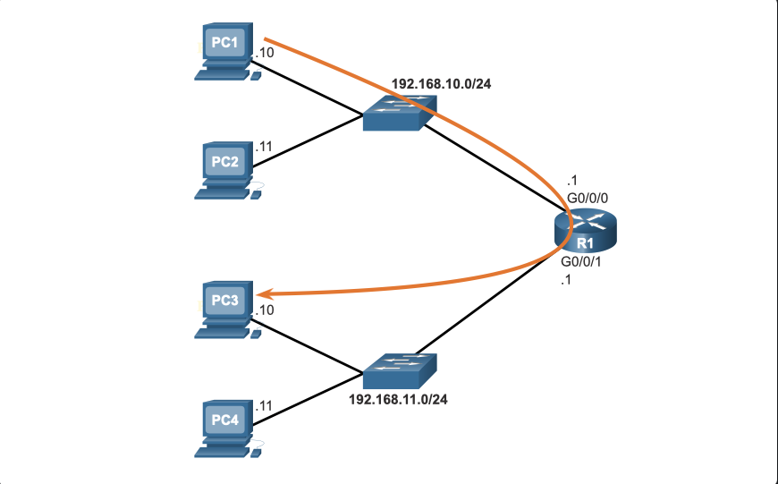
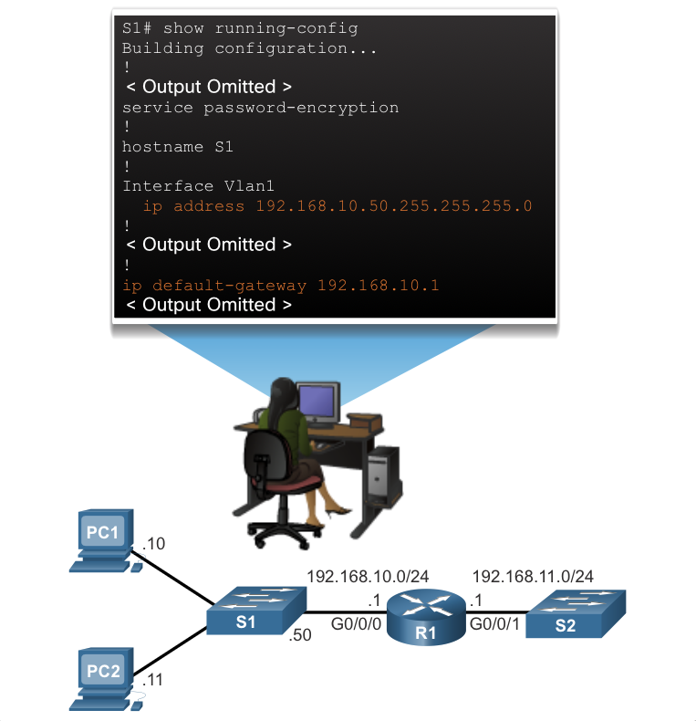
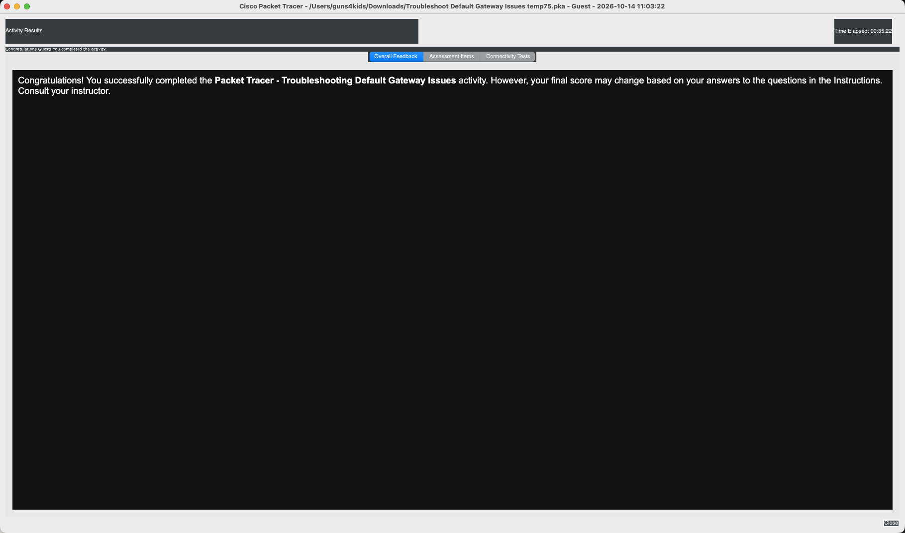

# Build a Small Cisco Network

## Module Objective

- Build a simple computer network using Cisco devices.

```table
| topic                         | objective
| ----------------------------- | ---------------------------------------------- |
| Basic Switch configuration    | configure a Cisco switch with initial settings |
| Set Cisco switch config       | configure initial router settings              |
| Secure Device                 | config devices for secure remote management    |
| Default gateway configuration | configure devices to use default gateway       |
```

## Switch Basic Configuration

### Basic Switch Configuration Steps

The Cisco switch only needs to be assigned basic security information before being connected to the network. Elements that are usually configured on a LAN switch include: host name, management IP address information, passwords, and descriptive information.

The switch host name is the configured name of the device. Just like each computer or printer is assigned a name, networking equipment should be configured with a descriptive name. It is helpful if the device name includes the location where the switch will be installed. An example might be: SW_Bldg_R-Room_216.

A management IP address is only necessary if you plan to configure and manage the switch through an in-band connection on the network. A management address enables you to reach the device through Telnet, SSH, or HTTP clients. The IP address information that must be configured on a switch is essentially the same as you configure on a PC: IP address, subnet mask, and default gateway.

In order to secure a Cisco LAN switch, it is necessary to configure passwords on each of the various methods of access to the command line. The minimum requirements include assigning passwords to remote access methods, such as Telnet, SSH and the console connection. You must also assign a password to the privileged mode in which configuration changes can be made.

N.B. Telnet sends the username and password in plaintext and is not considered secure. SSH encrypts the username and password and is, therefore, a more secure method.

#### initial switch configuration

```list
1. Configure the device name.

- hostname name

2. Secure user EXEC mode.

- line console 0
- password password
- login


3. Secure remote Telnet / SSH access.

- line vty 0 15
- password password
- login

4. Secure privileged EXEC mode.

- enable secret password

5. Secure all passwords in the config file.

- service password-encryption

6. Provide legal notification.

- banner motd delimiter message delimiter

7. Configure the management SVI.

- interface vlan 1
- ip address ip-address subnet-mask
- no shutdown

8. Save the configuration.

- copy running-config startup-config
```

#### sample switch config

```code
Switch> enable
Switch# configure terminal
Switch(config)# hostname S1
S1(config)# enable secret class
S1(config)# line console 0
S1(config-line)# password cisco
S1(config-line)# login
S1(config-line)# line vty 0 15
S1(config-line)# password cisco
S1(config-line)# login
S1(config-line)# exit
S1(config)# service password-encryption
S1(config)# banner motd #No unauthorized access allowed!#
S1(config)# interface vlan1
S1(config-if)# ip address 192.168.1.20 255.255.255.0
S1(config-if)# no shutdown
S1(config-if)# end
S1# copy running-config startup-config
Destination filename [startup-config]?
Building configuration...
[OK]
S1#
```

### Switch Virtual Interface Configuration

To access the switch remotely, an IP address and a subnet mask must be configured on the switch virtual interface (SVI).

N.B. To configure an SVI on a switch, use the interface vlan 1 global configuration command.

Vlan 1 is not an actual physical interface but a virtual one.

Next, assign an IPv4 address using the ip address ip-address subnet-mask interface configuration command.

Finally, enable the virtual interface using the no shutdown interface configuration command.

After the switch is configured with these commands, the switch has all the IPv4 elements ready for communication over the local network.

N.B. Similar to Windows hosts, switches configured with an IPv4 address will typically also need to have a default gateway assigned.

This can be done using the ip default-gateway ip-address global configuration command.

The ip-address parameter would be the IPv4 address of the local router on the network:

```code
Sw-Floor-1# configure terminal
Sw-Floor-1(config)# interface vlan 1
Sw-Floor-1(config-if)# ip address 192.168.1.20 255.255.255.0
Sw-Floor-1(config-if)# no shutdown
Sw-Floor-1(config-if)# exit
Sw-Floor-1(config)# ip default-gateway 192.168.1.1
```

#### Syntax Checker - Configure a Switch Virtual Interface

```code
Switch(config)#interface vlan 1
```

Configure the IPv4 address as 192.168.1.20 and the subnet mask as 255.255.255.0.

```code
Switch(config-if)#ip address 192.168.1.20 255.255.255.0
```

Enable the interface.

```code
Switch(config-if)#no shutdown
%LINK-5-CHANGED: Interface Vlan1, changed state to up
```

You have successfully configured the switch virtual interface for VLAN 1.

#### lab: Packet Tracer - Implement Basic Connectivity

##### Addressing Table

Table Widget
Device

Interface

IP Address

Subnet Mask

S1

VLAN 1

192.168.1.253

255.255.255.0

S2

VLAN 1

192.168.1.254

255.255.255.0

PC1

NIC

192.168.1.1

255.255.255.0

PC2

NIC

192.168.1.2

255.255.255.0

##### Objectives

Part 1: Perform a Basic Configuration on S1 and S2

Part 2: Configure the PCs

Part 3: Configure the Switch Management Interface

##### Background / Scenario

In this activity, you will first perform basic switch configurations. Then you will implement basic connectivity by configuring IP addressing on the switches and PCs. When the IP addressing configuration is complete, you will use various show commands to verify configurations and use the ping command to verify basic connectivity between devices.

###### Instructions

Part 1: Perform SVI Configuration on S1 and S2

Step 1: Configure S1 with a hostname.

a. Click S1, and then click the CLI tab.

b. Enter the privileged EXEC mode. Then enter the global configuration mode.

```
Switch> enable
Switch# configure terminal
```

Enter configuration commands, one per line. End with CNTL/Z.
c. Configure the hostname as S1.

```
Switch(config)# hostname S1
S1(config)#
```

Step 2: Configure S1 with an IP address.

Switches can be used without any configurations. Switches forward information from one port to another based on Media Access Control (MAC) addresses.

Question:
Why does a switch need an IP address?

Answer: IP address is required to connect to a switch remotely. DEFAULT: managed through VLAN1

a. In the global configuration mode, enter the following commands to configure S1 with an IP address in VLAN 1.

```
S1(config)# interface vlan 1
S1(config-if)# ip address 192.168.1.253 255.255.255.0
S1(config-if)# no shutdown
%LINEPROTO-5-UPDOWN: Line protocol on Interface Vlan1, changed state to up
```

Question:
What does the no shutdown command?

Answer: Admin command to enable interface state > active

b. Exit the configuration mode and save the configuration.

```
S1(config-if)# end
S1#
S1# copy running-config startup-config
Destination filename [startup-config]?
Building configuration...
[OK]
```

c. Verify the IP address configuration on S1.

```
S1# show ip interface brief
<output omitted>
 Vlan1 192.168.1.253 YES manual up up
```

Step 3: Configure S2 with a hostname and IP address.

In this step, you will configure S2 with a hostname and IP address.

a. Click S2. In the CLI tab, enter the global configuration mode.

b. Configure the switch S2 with a hostname using the information according to the Addressing Table.

c. Use the information in the Addressing Table, repeat the same process to configure the switch S2 with an IP address.

d. Exit the configuration mode. Verify the IP address configuration on S2.

```
S2# show ip interface brief
<output omitted>
 Vlan1 192.168.1.254 YES manual up up
```

e. Save the configuration file to NVRAM. Enter the copy running-config startup-config command to save the configuration.

Part 2: Configure the PCs

In this part, you will configure PC1 and PC2 with IP addresses and verify network connectivity.

Step 1: Configure both PCs with IP addresses.

a. Click PC1, and then click the Desktop tab.

b. Click IP Configuration. In the Addressing Table above, you can see that the IP address for PC1 is supposed to be 192.168.1.1 and the subnet mask 255.255.255.0. Enter this information for PC1 in the IP Configuration window.

c. Repeat the previous steps for PC2. Use the IP address listed in the Address Table for PC2.

Step 2: Test connectivity from the PCs.

a. Click PC1. Close the IP Configuration window if it is still open. In the Desktop tab, click Command Prompt.

b. Enter the ping command and the IP address for S1.

```
Packet Tracer PC Command Line 1.0
PC> ping 192.168.1.253
```

Question:
Were you successful? Explain.

Answer: 1 failed 3 successful - 1st time IP switch config. then 4/4.

f. From PC1, ping S2 and PC2.

g. Repeat the pings to S1, S2, and PC1 from PC2.

All pings should be successful. If your first ping result is 80%, retry; it should now be 100%. You will learn why a ping may fail the first time later in your studies. If you are unable to ping any of the devices, check your configuration for errors.

Step 3: Verify network connectivity from the switches.

Network connectivity can be verified using the ping command. It is very important that connectivity exists throughout the network.

a. From S1, ping the other devices in the network. The ping to PC1 is displayed below as an example.

```code
S1> ping 192.168.1.1
Type escape sequence to abort.
Sending 5, 100-byte ICMP Echos to 192.168.1.1, timeout is 2 seconds:
!!!!!
Success rate is 100 percent (5/5), round-trip min/avg/max = 0/0/1 ms
```

b. From S2, ping the other devices in the network.

All pings should be successful. If your first ping result is 80%, retry; it should now be 100%. You will learn why a ping may fail the first time later in your studies. If you are unable to ping any of the devices, check your configuration for errors.

## Basic Router Configuration Steps

To configure initial settings on a router.

Step 1. Configure the device name.

```code
Router(config)# hostname hostname
```

Step 2. Secure privileged EXEC mode.

```code
Router(config)# enable secret password
```

Step 3. Secure user EXEC mode.

```code
Router(config)# line console 0
Router(config-line)# password password
Router(config-line)# login
```

Step 4. Secure remote Telnet / SSH access.

```code
Router(config-line)# line vty 0 4
Router(config-line)# password password
Router(config-line)# login
Router(config-line)# transport input {ssh | telnet | none | all}
```

Step 5. Secure all passwords in the config file.

```code
Router(config-line)# exit
Router(config)# service password-encryption
```

Step 6. Provide legal notification.

```code
Router(config)# banner motd delimiter message delimiter
```

Step 7. Save the configuration.

```code
Router(config)# copy running-config startup-config
```

#### Basic Router Configuration Example

In this example, router R1 will be configured with initial settings. To configure the device name for R1, use the following commands.

```code
Router> enable
Router# configure terminal
Enter configuration commands, one per line.
End with CNTL/Z.
Router(config)# hostname R1
R1(config)#
```

N.B.(s)

- the router prompt now displays the router host name.
- All router access should be secured.
- Privileged EXEC mode provides the user with complete access to the device and its configuration, so you must secure it.

The following commands secure privileged EXEC mode and user EXEC mode, enable Telnet and SSH remote access, and encrypt all plaintext (i.e., user EXEC and vty line) passwords.

It is very important to use a strong password when securing privileged EXEC mode because this mode allows access to the configuration of the device.

```code
R1(config)# enable secret class
R1(config)#
R1(config)# line console 0
R1(config-line)# password cisco
R1(config-line)# login
R1(config-line)# exit
R1(config)#
R1(config)# line vty 0 4
R1(config-line)# password cisco
R1(config-line)# login
R1(config-line)# transport input ssh telnet
R1(config-line)# exit
R1(config)#
R1(config)# service password-encryption
R1(config)#
```

The legal notification warns users that the device should only be accessed by permitted users. Legal notification is configured as follows:

```code
R1(config)# banner motd #
Enter TEXT message. End with the character '#'.
***********************************************
WARNING: Unauthorized access is prohibited!
***********************************************
R1(config)#
```

If the router configured with the previous commands lost power, the router configuration would be lost.

N.B. For this reason, it is important to `save the configuration when changes are implemented`. save the configuration to NVRAM:

```code
R1# copy running-config startup-config
Destination filename [startup-config]?
Building configuration...
[OK]
R1#
```

#### Syntax Checker- Initial Router Settings Config

Enter global configuration mode to configure the name of the router as “R1”.

```code
Router>enable
Router#configure terminal
Enter configuration commands, one per line. End with CNTL/Z.
Router(config)#hostname R1
```

Configure 'class' as the secret password.

```code
R1(config)#enable secret class
```

Configure 'cisco' as the console line password, require users to login, and return to global configuration mode.

```code
R1(config)#line console 0
R1(config-line)#password cisco
R1(config-line)#login
R1(config-line)#exit
```

For vty lines 0 through 4, configure 'cisco' as the password, require users to login, enable SSH and Telnet access, and return to global configuration mode.

```code
R1(config)#line vty 0 4
R1(config-line)#password cisco
R1(config-line)#login
R1(config-line)#transport input ssh telnet
R1(config-line)#exit
```

Encrypt all clear text passwords.

```code
R1(config)#service password-encryption
```

Enter the banner 'Authorized Access Only!' and use # as the delimiting character.

```code
R1(config)#banner motd #Authorized Access Only!#
```

Exit global configuration mode.

```code
R1(config)#exit
R1#
```

You have successfully configured the initial settings on router R1.

## Packet Tracer - Configure Initial Router Settings

### Tasks

- Part 1: Verify the Default Router Configuration

- Part 2: Configure and Verify the Initial Router Configuration

- Part 3: Save the Running Configuration File

### Background

In this activity, you will perform basic router configuration tasks. You will secure access to the CLI and console port using encrypted and plain-text passwords. You will also configure messages for users who are logging into the router. These banners warn unauthorized users that access is prohibited. Finally, you will verify and save your running configuration.

### Instruction

- Part 1: Verify the Default Router Configuration

- Step 1: Establish a console connection to R1.

a. Choose a Console cable from the available connections.

b. Click PCA and select RS 232.

c. Click R1 and select Console.

d. Click PCA > Desktop tab > Terminal.

e. Click OK and press ENTER. You are now able to configure R1.

- Step 2: Enter privileged mode and examine the current configuration.

You can access all the router commands from privileged EXEC mode. However, because many of the privileged commands configure operating parameters, privileged access should be password-protected to prevent unauthorized use.

a. Enter privileged EXEC mode by entering the enable command.

```code
Router> enable
Router#
```

Notice that the prompt changed in the configuration to reflect privileged EXEC mode.

b. Enter the show running-config command.

```code
Router# show running-config
```

Questions:
What is the router’s hostname?

Answer: Router

How many Fast Ethernet interfaces does the Router have?

Answer: 0

How many Gigabit Ethernet interfaces does the Router have?

Answer: 2

How many Serial interfaces does the router have?

Answer: 2

What is the range of values shown for the vty lines?

Answer: 4

c. Display the current contents of NVRAM.

```code
Router# show startup-config
startup-config is not present
```

Question:
Why does the router respond with the startup-config is not present message?

Answer: previous config not saved to NVRAM (i.e. non-volatile memory). config saved to RAM will not persist (i.e. volatile memory), retain the configuration across reboots.

Part 2: Configure and Verify the Initial Router Configuration

To configure parameters on a router, you may be required to move between various configuration modes. Notice how the prompt changes as you navigate through the IOS configuration modes.

Step 1: Configure the initial settings on R1.

Note: If you have difficulty remembering the commands, refer to the content for this topic.

a. Configure R1 as the hostname.

b. Configure Message of the day text: Unauthorized access is strictly prohibited.

c. Encrypt all plain text passwords.

Use the following passwords:

1.  Privileged EXEC, encrypted: itsasecret

2.  Console: letmein

Step 2: Verify the initial settings on R1.

a. Verify the initial settings by viewing the configuration for R1.

Question:
What command do you use?

Answer: show running-config

b. Exit the current console session until you see the following message:

```code
R1 con0 is now available
Press RETURN to get started.
```

c. Press ENTER; you should see the following message:

```code
Unauthorized access is strictly prohibited.
User Access Verification
Password:
```

Questions:
Why should every router have a message-of-the-day (MOTD) banner?

Answer: to warn unauthorized users access is prohibited. also used to send network messages (system maintenance, admin contact, etc.)

If you are not prompted for a password before reaching the user EXEC prompt, what console line command did you forget to configure?

Answer: R1(config-line)# login

d. Enter the passwords necessary to return to privileged EXEC mode.

Questions:
If you configure any more passwords on the router, are they displayed in the configuration file as plain text or in encrypted form? Explain.

Answer: all current, future passwords are encrypted. command: service password-encryption

Part 3: Save the Running Configuration File

Step 1: Save the configuration file to NVRAM.

a. You have configured the initial settings for R1. Now back up the running configuration file to NVRAM to ensure that the changes made are not lost if the system is rebooted or loses power.

Questions:
What command did you enter to save the configuration to NVRAM?

Answer: copy running-config startup-config

What is the shortest, unambiguous version of this command?

Answer: cop r st

Which command displays the contents of the NVRAM?

Answer: show start / show startup-config

b. Verify that all the parameters configured are recorded. If not, analyze the output and determine which commands were not executed or were entered incorrectly. You can also click Check Results in the instruction window.

Step 2: Optional: Save the startup configuration file to flash.

Although you will be learning more about managing the flash storage in a router in later chapters, you may be interested to know that, as an added backup procedure, you can save your startup configuration file to flash. By default, the router still loads the startup configuration from NVRAM, but if NVRAM becomes corrupt, you can restore the startup configuration by copying it over from flash.

Complete the following steps to save the startup configuration to flash.

a. Examine the contents of flash using the show flash command:

R1# show flash
Questions:
How many files are currently stored in flash?

Answer: 3

Which of these files would you guess is the IOS image?

Answer: the binary file (.bin)

Why do you think this file is the IOS image?

Answer: because it is a .bin file not .xml file; because the .xml files are very small - images are usually bigger than 227537 bytes.

b. Save the startup configuration file to flash using the following commands:

R1# copy startup-config flash
Destination filename [startup-config]
The router prompts you to store the file in flash using the name in brackets. If the answer is yes, then press ENTER; if not, type an appropriate name and press ENTER.

c. Use the show flash command to verify the startup configuration file is now stored in flash.

## Securing Devices

### Password Recommendations

To protect network devices, it is important to use strong passwords.

#### Standard guidelines

- Use a password length of at least eight characters, preferably 10 or more characters. A longer password is a more secure password.
- Make passwords complex. Include a mix of uppercase and lowercase letters, numbers, symbols, and spaces, if allowed.
- Avoid passwords based on repetition, common dictionary words, letter or number sequences, usernames, relative or pet names, biographical information, such as birthdates, ID numbers, ancestor names, or other easily identifiable pieces of information.
- Deliberately misspell a password. For example, Smith = Smyth = 5mYth or Security = 5ecur1ty.
- Change passwords often. If a password is unknowingly compromised, the window of opportunity for the threat actor to use the password is limited.
- Do not write passwords down and leave them in obvious places such as on the desk or monitor.

The tables show examples of strong and weak passwords.

```table
| Weak Password | Example                                |
| ------------- | -------------------------------------- |
| secret        | simple, easy to guess                  |
| smith         | name, likely own surname or mother nee |
| toyota        | widely recognised brand, easy to guess |
| bob1967       | name and birth year, easy to guess     |
| Blueleaf23    | common word and number, easy to guess  |
```

```table
| Strong Password  | Example                                                 |
| ---------------- | ------------------------------------------------------- |
| b49s32D71q       | alphanumerical, random letters and numbers              |
| wA5mYt h!@p#     | alphanumerical + symbols, space; deliberate misspelling |
```

N.B. On Cisco routers `leading spaces are ignored for passwords, but spaces after the first character are not`.

Therefore, `for Cisco passwords`, one method to create a strong password is:

use the space bar + passphrase (a phrase made of many words).

Passphrases are often easier to remember and are longer (i.e. harder to guess).

### Secure Remote Access

There are multiple ways to access a device to perform configuration tasks. One of these ways is to use a PC attached to the console port on the device. This type of connection is frequently used for initial device configuration.

Setting a password for console connection access is done in global configuration mode. These commands prevent unauthorized users from accessing user mode from the console port.

```code
Switch(config)# line console 0
Switch(config-line)# password password
Switch(config-line)# login
```

When the device is connected to the network, it can be accessed over the network connection using SSH or Telnet. `SSH is the preferred method because it is more secure`. When the device is accessed through the network, it is considered a vty connection. The password must be assigned to the vty port. The following configuration is used to enable SSH access to the switch.

```code
Switch(config)# line vty 0 15
Switch(config-line)# password password
Switch(config-line)# transport input ssh
Switch(config-line)# login
```

An example configuration is shown in the command window.

```code
S1(config)# line console 0
S1(config-line)# password cisco
S1(config-line)# login
S1(config-line)# exit
S1(config)#
S1(config)# line vty 0 15
S1(config-line)# password cisco
S1(config-line)# login
S1(config-line)#
```

By default, `many Cisco switches support up to 16 vty lines that are numbered 0 to 15.` The number of vty lines supported on a Cisco router varies with the type of router and the IOS version. `However, five is the most common number of vty lines configured on a router`. These lines are numbered 0 to 4 by default, though additional lines can be configured. A password needs to be set for all available vty lines. The same password can be set for all connections.

To verify that the passwords are set correctly, use the command

```code
show running-config
```

These `passwords are stored in the running-configuration in plaintext`. It is possible to set encryption on all passwords stored within the router so that they are not easily read by unauthorized individuals. The global configuration command ensures that all passwords are encrypted.

```code
// Enable password encryption //
service password-encryption
```

With remote access secured on the switch, you can now configure SSH.

#### Enable SSH

Before configuring SSH, the switch must be minimally configured with a unique hostname and the correct network connectivity settings.

- Step 1. Verify SSH support.
  Use the `show ip ssh` command to verify that the switch supports SSH. If the switch is not running an IOS that supports cryptographic features, this command is unrecognized.

- Step 2. Configure the IP domain.
  Configure the IP domain name of the network using the `ip domain-name domain-name` global configuration mode command. In the example configuration below, the `domain-name` value is `cisco.com`.

- Step 3. Generate RSA key pairs.
  Not all versions of the IOS default to SSH version 2, and SSH version 1 has known security flaws. To configure SSH version 2, issue the `ip ssh version 2` global configuration mode command. Generating an RSA key pair automatically enables SSH. Use the `crypto key generate rsa` global configuration mode command to enable the SSH server on the switch and generate an RSA key pair. When generating RSA keys, the administrator is prompted to enter a modulus length. The sample configuration in the figure uses a modulus size of 1,024 bits. A longer modulus length is more secure, but it takes more time to generate and to use.

N.B. To delete the RSA key pair, use the `crypto key zeroize rsa` global configuration mode command. After the RSA key pair is deleted, the SSH server is automatically disabled.

- Step 4. Configure user authentication.
  The SSH server can authenticate users locally or use an authentication server. To use the local authentication method, create a username and password pair with the `username username secret password` global configuration mode command. In the example, the `username admin` is assigned the `password ccna`.

- Step 5. Configure the vty lines.
  Enable the SSH protocol on the vty lines using the `transport input ssh` line configuration mode command. The Catalyst 2960 has vty lines ranging from 0 to 15. This configuration prevents non-SSH (such as Telnet) connections and limits the switch to accept only SSH connections. Use the `line vty` global configuration mode command and then the `login local` line configuration mode command to require local authentication for SSH connections from the local username database.

- Step 6. Enable SSH version 2.
  By default, SSH supports both versions 1 and 2. When supporting both versions, this is shown in the `show ip ssh` output as supporting version 1.99. Version 1 has known vulnerabilities. For this reason, it is recommended to `enable only version 2`. Enable SSH version using the `ip ssh version 2` global configuration command.

```code
S1# show ip ssh
SSH Disabled - version 1.99
%Please create RSA keys (of at least 768 bits size) to enable SSH v2.
Authentication timeout: 120 secs; Authentication retries: 3
S1# configure terminal
S1(config)# ip domain-name cisco.com
S1(config)# crypto key generate rsa
The name for the keys will be: S1.cisco.com
...
How many bits in the modulus [512]: 1024
...
S1(config)# username admin secret ccna
S1(config-line)# line vty 0 15
S1(config-line)# transport input ssh
S1(config-line)# login local
S1(config-line)# exit
S1(config)# ip ssh version 2
S1(config)# exit
S1#
```

### Syntax test

- Set the domain name to cisco.com and generate the 1024 bit rsa key.

```code
S1(config)#ip domain-name cisco.com
S1(config)#crypto key generate rsa
The name for the keys will be: S1.cisco.com
Choose the size of the key modulus in the range of 360 to 4096 for your General Purpose Keys. Choosing a key modulus greater than 512 may take a few minutes.
How many bits in the modulus [512]:1024
% Generating 1024 bit RSA keys, keys will be non-exportable...
[OK] (elapsed time was 4 seconds)
S1(config)#
*Mar 1 02:20:18.529: %SSH-5-ENABLED: SSH 1.99 has been enabled
```

- Create a local user admin with the password ccna.

- Set all vty lines to use ssh and local login for remote connections.

- Exit out to global configuration mode.

```code
S1(config)#username admin secret ccna
S1(config)#line vty 0 15
S1(config-line)#transport input ssh
S1(config-line)#login local
S1(config-line)#exit
S1(config)#
%SYS-5-CONFIG_I: Configured from console by console
```

- Configure S1 to use SSH 2.0.

```code
S1(config)#ip ssh version 2
S1(config)#
```

SSH on all VTY lines configured successfully.

### Verify SSH

On a PC, an SSH client such as PuTTY, is used to connect to an SSH server. For the examples, the following have been configured:

- SSH enabled on switch S1
- Interface VLAN 99 (SVI) with IPv4 address 172.17.99.11 on switch S1
- PC1 with IPv4 address 172.17.99.21

In the figure, the technician is initiating an SSH connection to the SVI VLAN IPv4 address of S1.



The figure shows the PuTTY Configuration window. The Host Name (or IP address) box has the IPv4 address 172.17.99.11 and the Port box has 22. The connection type has five options: Raw, Telnet, Rlogin, SSH, and Serial, SSH is selected.

After clicking Open in PuTTY, the user is prompted for `username admin` and `password ccna`. if successful, the user is connected via SSH to the CLI on the Catalyst 2960 switch.

- `show ip ssh` display SSH version, config data for the device configured as an SSH server. e.g. SSH v2 enabled.
- `show ssh` check SSH connections to the device.

```code
Login as: admin
Using keyboard-interactive authentication.
Password: <ccna>

S1> enable
Password: <class>
S1# show ip ssh
SSH Enabled - version 2.0
Authentication timeout: 90 secs; Authentication retries: 2
Minimum expected Diffie Hellman key size : 1024 bits
IOS Keys in SECSH format(ssh-rsa, base64 encoded):
ssh-rsa AAAAB3NzaC1yc2EAAAADAQABAAAAgQCdLksVz2QlREsoZt2f2scJHbW3aMDM8 /8jg/srGFNL
i+f+qJWwxt26BWmy694+6ZIQ/j7wUfIVNlQhI8GUOVIuKNqVMOMtLg8Ud4qAiLbGJfAaP3fyrKmViPpO
eOZof6tnKgKKvJz18Mz22XAf2u/7Jq2JnEFXycGMO88OUJQL3Q==

S1# show ssh
Connection Version Mode Encryption  Hmac        State        Username
0           2.0     IN   aes256-cbc  hmac-sha1 Session started admin
0           2.0     OUT  aes256-cbc  hmac-sha1 Session started admin
%No SSHv1 server connections running.
S1#
```

### lab 3: Packet Tracer - Configure SSH

Addressing Table
Table Widget

#### Objectives

- Part 1: Secure Passwords

- Part 2: Encrypt Communications

- Part 3: Verify SSH Implementation

#### Scenario

SSH should replace Telnet for management connections. Telnet uses insecure plain text communications. SSH provides security for remote connections by providing strong encryption of all transmitted data between devices. In this activity, you will secure a remote switch with password encryption and SSH.

#### Instruction section

- Part 1: Secure Passwords

a. Using the command prompt on PC1, Telnet to S1. The user EXEC and privileged EXEC password is cisco.

```code
PC> telnet 10.10.10.2
Trying 10.10.10.2 ...Open
User Access Verification
Password:
S1> en
Password:
S1#
```

b. Save the current configuration so that any mistakes you might make can be reversed by toggling the power for S1.

```code
S1# copy running-config startup-config
Destination filename [startup-config]?
Building configuration...
[OK]
```

c. Show the current configuration and note that the passwords are in plain text.

d. In the global configuration mode, enter the command that encrypts plain text passwords:

```code
S1(config)# service password-encryption
```

e. Verify that the passwords are encrypted.

#### Part 2: Encrypt Communications

##### Step 1: Set the IP domain name and generate secure keys

It is generally not safe to use Telnet, because data is transferred in plain text. `ALWAYS use SSH whenever it is available.`

a. Configure the domain name to be netacad.pka.

```code
S1(config)# ip domain-name netacad.pka
```

b. Secure keys are needed to encrypt the data. Generate the RSA keys using a 1024 key length.

```code
S1(config)# crypto key generate rsa

The name for the keys will be: S1.netacad.pka
Choose the size of the key modulus in the range of 360 to 2048 for your
General Purpose Keys. Choosing a key modulus greater than 512 may take a few minutes.
How many bits in the modulus [512]: 1024
% Generating 1024 bit RSA keys, keys will be non-exportable...[OK]
```

##### Step 2: Create an SSH user and reconfigure the VTY lines for SSH-only access

a. Create an administrator user with cisco as the secret password.

```code
S1(config)# username administrator secret cisco
```

b. Configure the VTY lines to check the local username database for login credentials and to only allow SSH for remote access. Remove the existing vty line password.

```code
S1(config)# line vty 0 15
S1(config-line)# login local
S1(config-line)# transport input ssh
S1(config-line)# no password cisco
```

##### Part 3: Verify SSH Implementation

- a. Exit the Telnet session and attempt to log back in using Telnet. The attempt should fail.

- b. Attempt to log in using SSH. Type ssh and press Enter without any parameters to reveal the command usage instructions. Hint: The -l option is the letter “L”, not the number 1.

- c. Upon successful login, enter privileged EXEC mode and save the configuration. If you were unable to successfully access S1, toggle the power and begin again at Part 1.

### Default Gateway on a Host

If your local network has only one router, it will be the gateway router and all hosts and switches on your network must be configured with this information. If your local network has multiple routers, you must select one of them to be the default gateway router. This topic explains how to configure the default gateway on hosts and switches.

For an end device to communicate over the network, it must be configured with the correct IP address information, including the default gateway address. The default gateway is only used when the host wants to send a packet to a device on another network. The default gateway address is generally the router interface address attached to the local network of the host. The IP address of the host device and the router interface address must be in the same network.

For example, assume an IPv4 network topology consisting of a router interconnecting two separate LANs. G0/0/0 is connected to network 192.168.10.0, while G0/0/1 is connected to network 192.168.11.0. Each host device is configured with the appropriate default gateway address.

In this example, if PC1 sends a packet to PC2, then the default gateway is not used. Instead, PC1 addresses the packet with the IPv4 address of PC2 and forwards the packet directly to PC2 through the switch.



If PC1 sent a packet to PC3, PC1 would address the packet with the IPv4 address of PC3, but would forward the packet to its default gateway, which is the G0/0/0 interface of R1. The router accepts the packet and accesses its routing table to determine that G0/0/1 is the appropriate exit interface based on the destination address. R1 then forwards the packet out of the appropriate interface to reach PC3.



The same process (not shown in topology) would occur on an IPv6 network. Devices would use the IPv6 address of the local router as their default gateway.

### Default Gateway on a Switch

A switch that interconnects client computers is typically a Layer 2 device. As such, a Layer 2 switch does not require an IP address to function properly. However, an IP configuration can be configured on a switch to give an administrator remote access to the switch.

To connect to and manage a switch over a local IP network, it must have a switch virtual interface (SVI) configured. The SVI is configured with an IPv4 address and subnet mask on the local LAN. The switch must also have a default gateway address configured to remotely manage the switch from another network.

The default gateway address is typically configured on all devices that will communicate beyond their local network.

To configure an IPv4 default gateway on a switch, use the `ip default-gateway ip-address` global configuration command. The ip-address that is configured is the IPv4 address of the local router interface connected to the switch.



In this example, the administrator host would use its default gateway to send the packet to the G0/0/1 interface of R1. R1 would forward the packet to S1 out of its G0/0/0 interface. Because the packet source IPv4 address came from another network, S1 would require a default gateway to forward the packet to the G0/0/0 interface of R1. Therefore, S1 must be configured with a default gateway to be able to reply and establish an SSH connection with the administrative host.

N.B. Packets originating from host computers connected to the switch must already have the default gateway address configured on their host computer operating systems.

N.B. A workgroup switch can also be configured with an IPv6 address on an SVI, BUT the `switch does not require the IPv6 address of the default gateway to be configured manually`.

The switch will automatically receive its default gateway from the ICMPv6 Router Advertisement message from the router.

### Syntax Checker - Configure the Default Gateway

Enter global configuration mode.

```code
S1#configure terminal
Enter configuration commands, one per line. End with CNTL/Z.
```

Configure 192.168.10.1 as the default gateway for S1.

```code
S1(config)#ip default-gateway 192.168.10.1
S1(config)#
```

You have successfully set the default gateway on switch S1.

### Packet Tracer Tutored Activity - Build a Switch and Router Network

ToDo(s):

- connect the devices
- configure the PCs
- configure the router
- configure the switch
- verify end-to-end connectivity

### Packet Tracer - Troubleshoot Default Gateway Issues

ToDo(s):

- Verify Network Documentation and Isolate Problems
- Implement, Verify, and Document Solutions

```table
| test      | works | issues          | solution         | fix |
| --------- | ----- | --------------- | -------------    | --- |
| PC1 > PC2 | no    | PC1 IP address  | PC1 IP config    | yes |
| PC1 > PC3 | yes   |                 |                  | no  |
| PC1 > PC4 | no    | PC4 ip address  | default Gateway  | yes |
| S1 VLAN   |  no   | ip missing      | default gw       | yes |
| S2        | no    | connection down | default gw       | yes |
```

```table
Device | I/O	  | IP Address	  | Subnet Mask	  | Default Gateway
| ---- | ------ | ------------- | ------------- | ------------- |
R1	   | G0/0	  | 192.168.10.1	| 255.255.255.0	| N/A
R1	   | G0/1	  | 192.168.11.1	| 255.255.255.0	| N/A
S1	   | VLAN1	| 192.168.10.2	| 255.255.255.0	| 192.168.10.1
S2	   | VLAN1	| 192.168.11.2	| 255.255.255.0	| 192.168.11.1
PC1	   | NIC	  | 192.168.10.10	| 255.255.255.0	| 192.168.10.1
PC2	   | NIC	  | 192.168.10.11	| 255.255.255.0	| 192.168.10.1
PC3	   | NIC	  | 192.168.11.10	| 255.255.255.0	| 192.168.11.1
PC4	   | NIC	  | 192.168.11.11	| 255.255.255.0	| 192.168.11.1
```



## Learning Outcomes

### Basic Switch Configuration

To access the switch remotely, configure an IP address and a subnet mask on the SVI. Use `interface vlan 1`
global configuration command. Assign an IPv4 address using the
ip address ip-address subnet-mask interface configuration command.
enable the virtual interface using `no shutdown` interface configuration command. After the switch is configured with these commands, the switch has all the IPv4 elements ready for communication over the network.

### Initial Router Settings

- Step 1: configure device name
- Step 2: secure privileged EXEC mode
- Step 3: secure user EXEC mode
- Step 4: secure remote Telnet / SSH access
- Step 5: secure all passwords in the config file
- Step 6: provide legal notification
- Step 7: save the configuration

All router access should be secured. Privileged EXEC mode provides the user with complete access to the device and its configuration, so you must secure it. It is very important to use a strong password when securing privileged EXEC mode because this mode allows access to the configuration of the device. The legal notification warns users that the device should only be accessed by permitted users. The router configuration would be lost if the router lost power. For this reason, it is important to save the configuration when changes are implemented.

### Secure Devices

To protect network devices, it is important to use strong passwords. A strong password combines alphanumeric characters, and if allowed, includes symbols and a space. Another method to create a strong password is to use the space bar and create a phrase made of many words, called a passphrase. A passphrase is often easier to remember than a strong password. It is also longer and harder to guess.

Setting a password for console connection access is done in global configuration mode. This prevents unauthorized users from accessing user mode from the console port. When the device is connected to the network, it can be accessed over the network connection using SSH or Telnet. SSH is the preferred method because it is more secure. When the device is accessed through the network, it is considered a vty connection. The password must be assigned to the vty port. Five is the most common number of vty lines configured on a router. These lines are numbered 0 to 4 by default, though additional lines can be configured. A password needs to be set for all available vty lines. The same password can be set for all connections.

To verify passwords are set correctly, use the command `show running-config`. These passwords are stored in the running-configuration in plaintext. It is possible to set encryption on all passwords stored within the router so that they are not easily read by unauthorized individuals. The global configuration command ensures that all passwords are encrypted. command. These passwords are stored in the running-configuration in plaintext.

the global config command `service password-encryption` ensures that all passwords are encrypted.

### Enable SSH

- step 1: verify SSH support `show ip ssh`
- step 2: configure the IP domain name `ip domain-name domain-name`
- step 3: generate RSA key pairs `crypto key generate rsa`
- step 4: configure user authentication `username username secret password`
- step 5: configure the vty lines `transport input ssh` and `login local`
- step 6: enable SSH version 2 `ip ssh version 2`
- step 7: verify SSH configuration `show ip ssh`

To display the version and configuration data for SSH on the device that you configured as an SSH server, use the show ip ssh command. In the example, SSH version 2 is enabled. To check the SSH connections to the device, use the show ssh command.

### Default Gateway Configuration

If your local network has only one router, it will be the gateway router and all hosts and switches on your network must be configured with this information. If your local network has multiple routers, you must select one of them to be the default gateway router.
The default gateway is only used when the host wants to send a packet to a device on another network. The default gateway address is generally the router interface address attached to the local network of the host. The IP address of the host device
and the router interface address must be in the same network.
To connect to and manage a switch over a local IP network, it must have an SVI configured. The SVI is configured with an IPv4 address and subnet mask on the local LAN. The switch must also have a default gateway address configured to
remotely manage the switch from another network.
To configure an IPv4 default gateway on a switch, use `ip default-gateway ip-address` global configuration command. The ip-address that is configured is the IPv4 address of the local router interface connected to the switch.
The `ip address` configured is the IPv4 address of the local router interface connected to the switch.
