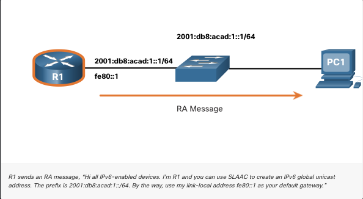
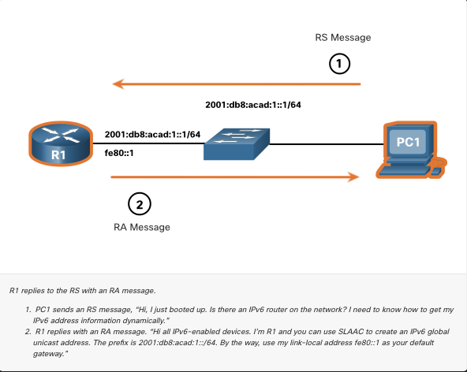
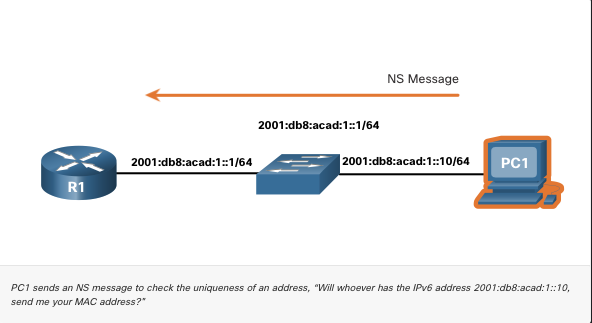
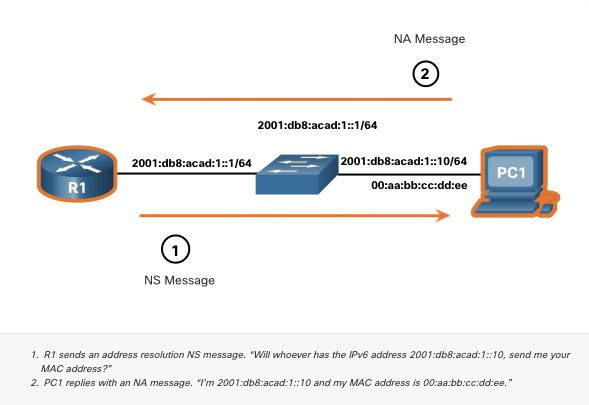
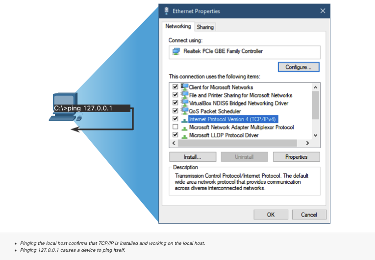
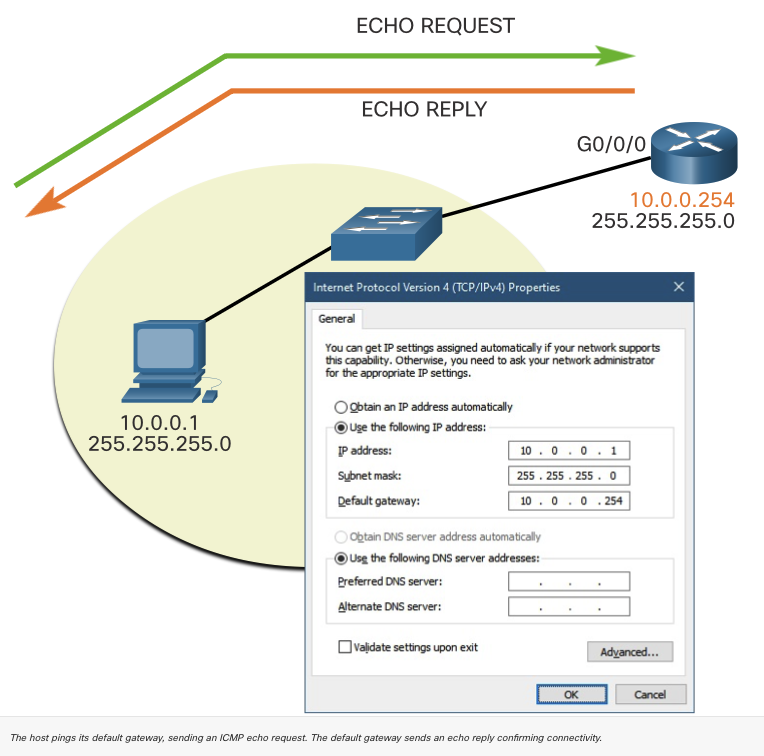
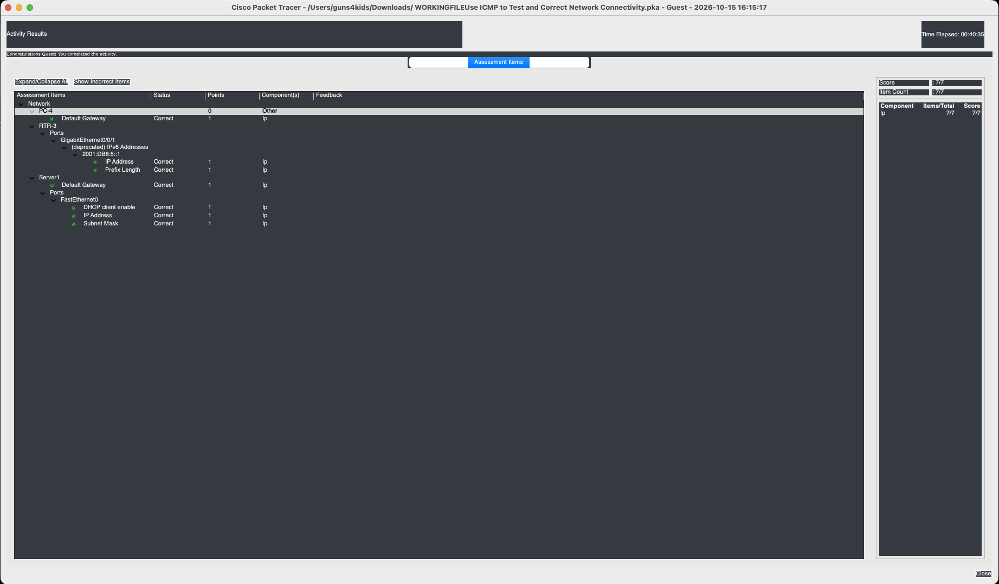
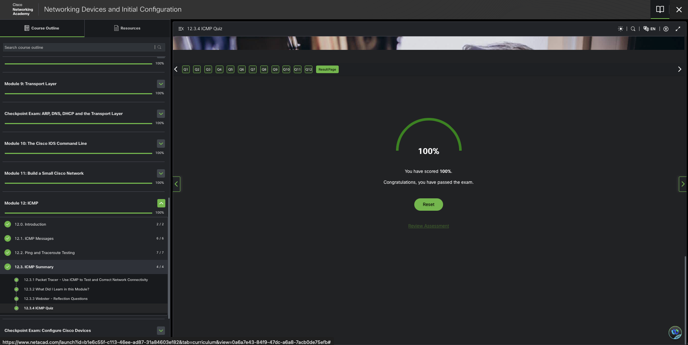
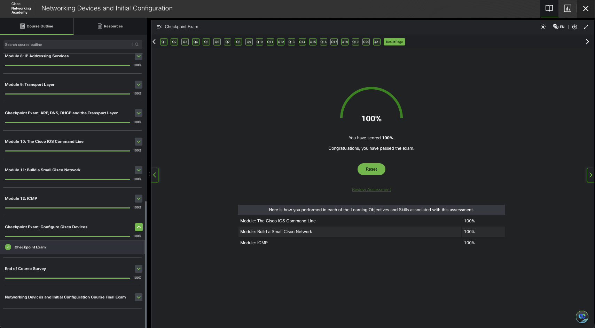

# ICMP

## Module Objective

Use various tools to test network connectivity

```table
topic                    | objective
------------------------ | ------------------------------------------------------
ICMP Messages            | explain how ICMP is used to test network connectivity
Ping, Traceroute testing | use ping and traceroute to test network connectivity
```

## ICMPv4 and ICMPv6 Messages

IP is only a best-effort protocol so the TCP/IP suite provides for error, informational messages when communicating with another IP device. These messages are sent via ICMP services.

The `purpose of these messages is to provide feedback about issues related to the processing of IP packets under certain conditions, not to make IP reliable`.

N.B. ICMP messages are not required and are often not allowed within a network for security reasons.

ICMP is available for IPv4 and IPv6.

ICMPv4 is the messaging protocol for IPv4.

ICMPv6 provides these same services for IPv6 but includes additional functionality. for clarity: the term ICMP will be used when referring to both ICMPv4 and ICMPv6.

The types of and reasons why ICMP messages are sent are extensive.

The ICMP messages common to both ICMPv4 and ICMPv6 discussed here:

- Host reachability
- Destination or Service Unreachable
- Time exceeded

### Host Reachability

An ICMP Echo Message can be used to test the reachability of a host on an IP network. The local host sends an ICMP Echo Request to a host. If the host is available, the destination host responds with an Echo Reply. In the figure, click the Play button to see an animation of the ICMP Echo Request/Echo Reply. This use of the ICMP Echo messages is the basis of the ping utility.

### Destination or Service Unreachable

When a host or gateway receives a packet that it cannot deliver, it can use an ICMP Destination Unreachable message to notify the source that the destination or service is unreachable. The message will include a code that indicates why the packet could not be delivered.

#### Example Destination Unreachable codes for ICMPv4

- 0 - Net unreachable
- 1 - Host unreachable
- 2 - Protocol unreachable
- 3 - Port unreachable

#### Example Destination Unreachable codes for ICMPv6

- 0 - No route to destination
- 1 - Communication with the destination administratively prohibited (e.g. firewall)
- 2 – Beyond scope of the source address
- 3 - Address unreachable
- 4 - Port unreachable

N.B. ICMPv6 has similar but slightly different codes for Destination Unreachable messages.

#### Time Exceeded

N.B. `Time Exceeded messages are used by the traceroute tool`.

An ICMPv4 Time Exceeded message is used by a router to indicate that a packet cannot be forwarded because the Time to Live (TTL) field of the packet was decremented to 0.

If a router receives a packet and decrements the T`TL field in the IPv4 packet to zero, it discards the packet and sends a Time Exceeded message to the source host`.

ICMPv6 also sends a Time Exceeded message if the router cannot forward an IPv6 packet because the packet has expired. `Instead of the IPv4 TTL field, ICMPv6 uses the IPv6 Hop Limit` field to determine if the packet has expired.

### ICMPv6 Messages

The informational and error messages found in ICMPv6 are very similar to the control and error messages implemented by ICMPv4.

ICMPv6 vs ICMPv4 has new features and improved functionality.

ICMPv6 messages are encapsulated in IPv6.

`ICMPv6 includes four new protocols` as part of the `Neighbor Discovery Protocol (ND or NDP)`.

Messaging between an IPv6 router and an IPv6 device, including dynamic address allocation are as follows:

- Router Solicitation (RS) message
- Router Advertisement (RA) message

Messaging between IPv6 devices, including duplicate address detection and address resolution:

- Neighbor Solicitation (NS) message
- Neighbor Advertisement (NA) message

N.B. `ICMPv6 ND includes redirect message`, which has a similar function to the `redirect message used in ICMPv4`.

#### RA messages

sent by IPv6-enabled routers every 200 seconds to provide addressing information to IPv6-enabled hosts.



- `RA message can include addressing information for the host such as the prefix, prefix length, DNS address, and domain name`
- `host using Stateless Address Autoconfiguration (SLAAC) will set its default gateway to the link-local address of the router that sent the RA`.

#### RS Message

An IPv6-enabled router will also send out an RA message in response to an RS message. In the figure, PC1 sends a RS message to determine how to receive its IPv6 address information dynamically.


#### NS Message

When a device is assigned a global IPv6 unicast or link-local unicast address, it may perform duplicate address detection (DAD) to ensure that the IPv6 address is unique. To check the uniqueness of an address, the device will send an NS message with its own IPv6 address as the targeted IPv6 address, as shown in the figure.



If another device on the network has this address, it will respond with an NA message. This NA message will notify the sending device that the address is in use. If a corresponding NA message is not returned within a certain amount of time, the unicast address is unique and acceptable for use.

Note: DAD is not required, but RFC 4861 recommends that DAD is performed on unicast addresses.

#### NA Message

Address resolution is used when a device on the LAN knows the IPv6 unicast address of a destination but does not know its Ethernet MAC address.

`To determine the MAC address for the destination, the device will send an NS message to the solicited node address`.

The `message will include the known (targeted) IPv6` address.

The `device that has the targeted IPv6 address will respond with` an `NA message` `containing` its `Ethernet MAC address`.

In the figure, R1 sends a NS message to 2001:db8:acad:1::10 asking for its MAC address.

## Ping, Traceroute Testing

### Ping - Test Connectivity

Ping is an IPv4 and IPv6 testing utility that uses ICMP echo request and echo reply messages to test connectivity between hosts.

To test connectivity to another host on a network, an echo request is sent to the host address using the ping command. If the host at the specified address receives the echo request, it responds with an echo reply. As each echo reply is received, ping provides feedback on the time between when the request was sent and when the reply was received. This can be a measure of network performance.

Ping has a timeout value for the reply. If a reply is not received within the timeout, ping provides a message indicating that a response was not received. This may indicate that there is a problem, but could also indicate that security features blocking ping messages have been enabled on the network. It is common for the first ping to timeout if address resolution (ARP or ND) needs to be performed before sending the ICMP Echo Request.

After all the requests are sent, the ping utility provides a summary that includes the success rate and average round-trip time to the destination.

Type of connectivity tests performed with ping:

- Ping local loopback
- Ping default gateway
- Ping remote host

### Ping the Loopback

Ping can be used to test the internal configuration of IPv4 or IPv6 on the local host. To perform this test, ping the local loopback address of 127.0.0.1 for IPv4 (::1 for IPv6).



A response from 127.0.0.1 for IPv4, or ::1 for IPv6, indicates that IP is properly installed on the host. This response comes from the network layer. This response is not, however, an indication that the addresses, masks, or gateways are properly configured. Nor does it indicate anything about the status of the lower layer of the network stack. This simply tests IP down through the network layer of IP. An error message indicates that TCP/IP is not operational on the host.

### Ping the Default Gateway

You can also use ping to test the ability of a host to communicate on the local network. This is generally done by pinging the IP address of the default gateway of the host. A successful ping to the default gateway indicates that the host and the router interface serving as the default gateway are both operational on the local network.

For this test, the default gateway address is most often used because the router is normally always operational. If the default gateway address does not respond, a ping can be sent to the IP address of another host on the local network that is known to be operational.



If either the default gateway or another host responds, then the local host can successfully communicate over the local network. If the default gateway does not respond but another host does, this could indicate a problem with the router interface serving as the default gateway.

One possibility is that the wrong default gateway address has been configured on the host. Another possibility is that the router interface may be fully operational but have security applied to it that prevents it from processing or responding to ping requests.

### Ping Remote Host

Ping can also be used to test the ability of a local host to communicate across an internetwork. The local host can ping an operational IPv4 host of a remote network, as shown in the figure. The router uses its IP routing table to forward the packets.

If this ping is successful, the operation of a large piece of the internetwork can be verified. A successful ping across the internetwork confirms communication on the local network, the operation of the router serving as the default gateway, and the operation of all other routers that might be in the path between the local network and the network of the remote host.

Additionally, the functionality of the remote host can be verified. If the remote host could not communicate outside of its local network, it would not have responded.

Note: Many network administrators limit or prohibit the entry of ICMP messages into the corporate network; therefore, the lack of a ping response could be due to security restrictions.

### Traceroute - Test Path

Ping is used to test connectivity between two hosts but does not provide information about the details of devices between the hosts. Traceroute (tracert) is a utility that generates a list of hops that were successfully reached along the path. This list can provide important verification and troubleshooting information. If the data reaches the destination, then the trace lists the interface of every router in the path between the hosts. If the data fails at some hop along the way, the address of the last router that responded to the trace can provide an indication of where the problem or security restrictions are found.

#### Round Trip Time (RTT)

Using traceroute provides round-trip time for each hop along the path and indicates if a hop fails to respond. The round-trip time is the time a packet takes to reach the remote host and for the response from the host to return. An asterisk (\*) is used to indicate a lost or unreplied packet.

This information can be used to locate a problematic router in the path or may indicate that the router is configured not to reply.

`If the display shows high response times or data losses from a particular hop, this is an indication that the resources of the router or its connections may be stressed`.

#### IPv4 TTL and IPv6 Hop Limit

REMEMBER, TTL === 1, hits a router gets sent back, TTL 1++ TTL 2, hits next router, gets sent back, TTL 2++, TTL 3, hits next router, gets sent back, TTL 3++, etc...

basically:

```py
ttl = 1

while True:
    print(f"Sending TTL packet={ttl}")

    # Packet travels through routers, get returned,
    router_hop = ttl

    print(
        f"Router {router_hop}"
        f"returned ICMP Time Exceeded"
    )

    ttl += 1 # repeats for all router hops until destination is reached, keeps adding 1.

    if router_hop == destination_hop:
        print("Destination reached!")
        break
```

`Traceroute makes use of` a function of the `TTL field in IPv4` and the `Hop Limit field in IPv6 in` the `Layer 3 headers`, `along with` the ICMP `Time Exceeded message`.

The first sequence of messages sent from traceroute will have a TTL field value of 1. This causes the TTL to time out the IPv4 packet at the first router. This router then responds with an ICMPv4 Time Exceeded message. Traceroute now has the address of the first hop.

Traceroute then progressively increments the TTL field (2, 3, 4...) for each sequence of messages. This provides the trace with the address of each hop as the packets time out further down the path. The TTL field continues to be increased until the destination is reached, or it is incremented to a predefined maximum.

After the final destination is reached, the host responds with either an ICMP Port Unreachable message or an ICMP Echo Reply message instead of the ICMP Time Exceeded message.

## Lab: Packet Tracer - Verify IPv4, IPv6 Addressing

### objectives

- Test and Restore IPv4 Connectivity
- Test and Restore IPv6 Connectivity

### Questions, Answers


### Lab 2: Use Ping and Traceroute to Test Network Connectivity




## Unit Summary

### ICMP Messages

An ICMP Echo Message can be used to test the reachability of a host on an IP network. The local host sends an ICMP Echo Request to a host. If the host is available, the destination host responds with an Echo Reply.

An ICMPv4 Time Exceeded message is used by a router to indicate that a packet cannot be forwarded because the TTL field of the packet was decremented to 0. If a router receives a packet and decrements the TTL field in the IPv4 packet to zero, it discards the packet and sends a Time Exceeded message to the source host.

ICMPv6 also sends a Time Exceeded message if the router cannot forward an IPv6 packet because the packet has expired. The informational and error messages found in ICMPv6 are very similar to the control and error messages implemented by ICMPv4. However, ICMPv6 includes four new protocols as part of the ND or NDP. REMEMBER: Royal Academy ReSponds? No Sir not applicable (RARS NSNA)

- RA - Router Advertisement
- RS - Router Solicitation
- NS - Neighbor Solicitation
- NA - Neighbor Advertisement

### Ping and Traceroute Testing

To test connectivity to another host on a network, an echo request is sent to the host address using the `ping` command.

If the host at the specified address receives the echo request, it responds with an echo reply. As each echo reply is received, ping provides feedback on the time between when the request was sent and when the reply was received. This can be a measure of network performance. Ping has a timeout value for the reply. If a reply is not received within the timeout, ping provides a message indicating that a response was not received.

#### Types of tests performed with ping

##### Local Loopback

Ping can be used to test the internal configuration of IPv4 or IPv6 on the local host. To perform this test, ping the local loopback address.

##### Default Gateway

Generally done by `pinging the IP address of the default gateway of the host`. A successful ping to the default gateway indicates that the host and the router interface serving as the default gateway are both operational on the local network.

##### Remote Host

Successful ping across the internetwork confirms communication on the local network, the operation of the router serving as the default gateway, and the operation of all other routers that might be in the path between the local network and the network of the remote host.

##### tracert (traceroute)

tracert is a utility that generates a list of hops that were successfully reached along the path. This list can provide important verification and troubleshooting information. If the data reaches the destination, then the trace lists the interface of every router in the path between the hosts. If the data fails at some hop along the way, the address of the last router that responded to the trace can provide an indication of where the problem or security restrictions are found.

The round-trip time is the time a packet takes to reach the remote host and for the response from the host to return. An `asterisk (*) is used to indicate a lost or unreplied packet`.

Traceroute makes use of a function of the TTL field in IPv4 and the Hop Limit field in IPv6 in the Layer 3 headers, along with the ICMP Time Exceeded message.

## Module Pass



## Checkpoint 4 Pass


