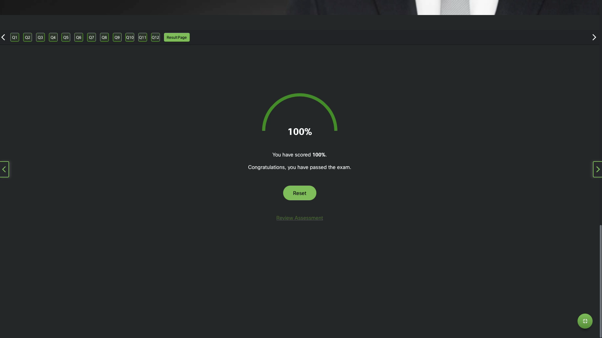
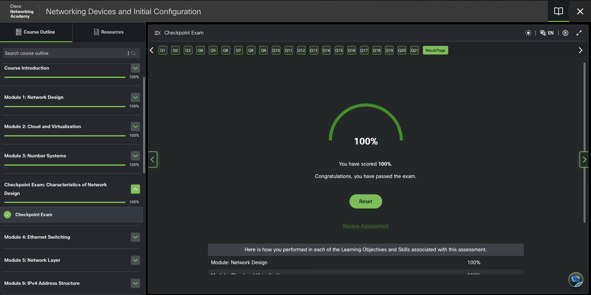

# Module 3: Number Systems

## Binary and IPv4 Addresses

IPv4 addresses begin as binary
Binary = numbering system digits 0 and 1 called bits.
decimal = 10 digits 0 - 9.

Each address consists of a string of 32 bits, divided into four sections called octets. Each octet contains 8 bits (or 1 byte) separated with a dot. For example, PC1 assigned IPv4 address 11000000.10101000.00001010.00001010.
Its default gateway address would be that of R1 Gigabit Ethernet interface 11000000.10101000.00001010.00000001.

For ease of use by people, IPv4 addresses are commonly expressed in dotted decimal notation. PC1 is assigned the IPv4 address 192.168.10.10, and its default gateway address is 192.168.10.1

### Decimal 10^

0 1 2 3 4 5 6 7 8 9

```text
0 1 2 3 4 5 6 7 8 9
```

### Binary 2^

```text
7   6   5   4   3  2  1  0
128 64  32  16  8  4  2  1
```

### Hexadecimal 16^

```text
3     2    1   0
4096  256  16  1
```

## IPv6

The hexadecimal numbering system is used in networking to represent IP Version 6 addresses and Ethernet MAC addresses. This base sixteen number system uses the digits 0 to 9 and the letters A to F. Binary and hexadecimal work well together because it is easier to express a value as a single hexadecimal digit than as four binary bits.

IPv6 addresses are 128 bits in length and every 4 bits is represented by a single hexadecimal digit; for a total of 32 hexadecimal values. IPv6 addresses are not case-sensitive and can be written in either lowercase or uppercase.

### Conversion Table

```text
DECIMAL	BINARY	HEX
1	    “0001”	 1
2	    “0010”	 2
3	    “0011”	 3
4	    “0100”	 4
5	    “0101”	 5
6	    “0110”	 6
7	    “0111”	 7
8	    “1000”	 8
9	    “1001”	 9
10	    “1010”	 a
11	    “1011”	 b
12	    “1100”	 c
13	    “1101”	 d
14	    “1110”	 e
15	    “1111”	 f
```

## Module 3 Pass



## Checkpoint Pass


