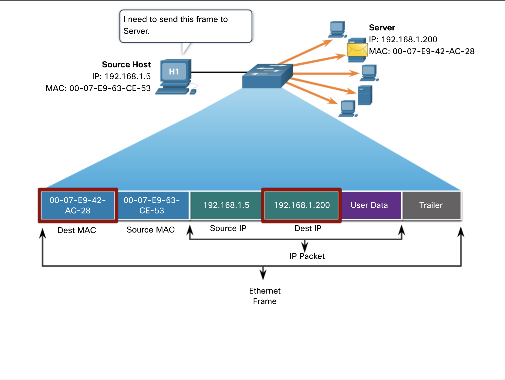
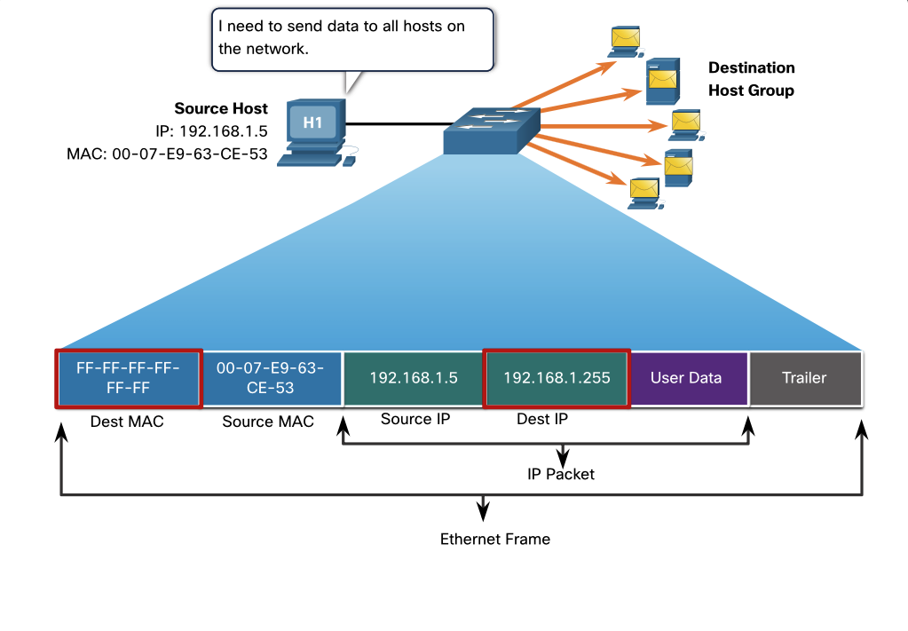
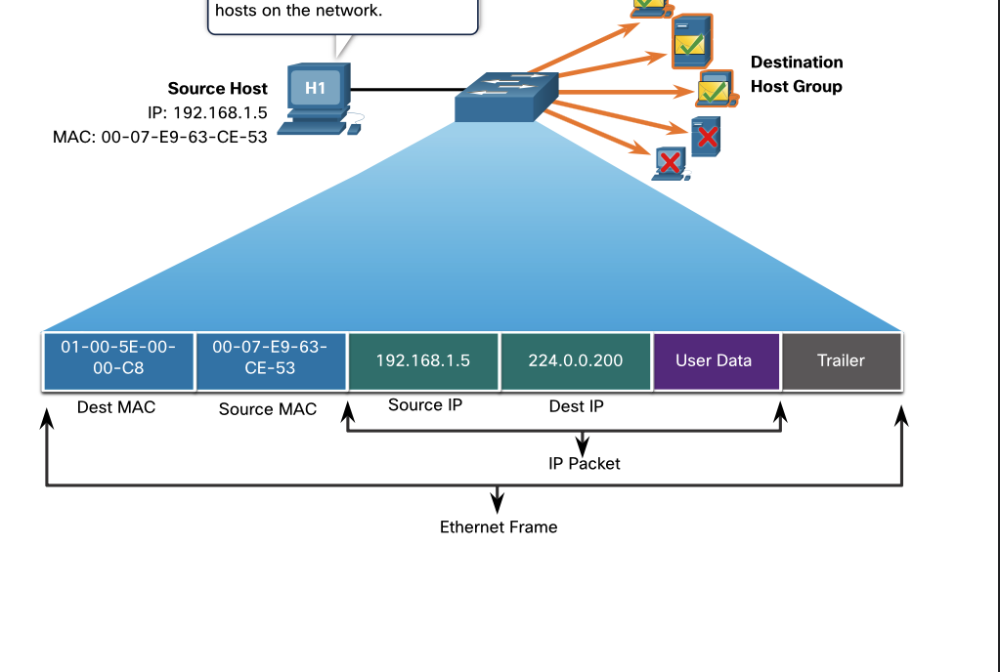

# 4 Ethernet Switching

Module Title: Ethernet Switching
Module Objective: Explain how Ethernet operates in a switched network.

## history

Equipment from one vendor might not communicate with equipment from another soas networks became more widespread, standards were developed that defined rules by which network equipment from different vendors operated.

Standards are beneficial to networking in many ways:

- Facilitate design
- Simplify product development
- Promote competition
- Provide consistent interconnections
- Facilitate training
- Provide more vendor choices for customers

There is no official local area networking standard protocol, but over time, one technology, Ethernet, has become more common than the others. Ethernet protocols define how data is formatted and how it is transmitted over the wired network. The Ethernet standards specify protocols that operate at Layer 1 and Layer 2 of the OSI model. Ethernet has become a de facto standard, which means that it is the technology used by almost all wired local area networks, as shown in the figure.

"The Institute of Electrical and Electronics Engineers, or IEEE ", maintains the networking standards, including Ethernet and wireless standards. IEEE committees are responsible for approving and maintaining the standards for connections, media requirements and communications protocols. Each technology standard is assigned a number that refers to the committee that is responsible for approving and maintaining the standard. The committee responsible for the Ethernet standards is 802.3.

Each version of Ethernet has an associated standard. For example, 802.3 100BASE-T represents the 100 Megabit Ethernet using twisted-pair cable standards.

```text
The standard notation translates as:
100 is the speed in Mbps
BASE stands for baseband transmission
T stands for the type of cable, in this case, twisted-pair.
```

## Ethernet and the OSI Model

two LAN technologies:
Ethernet
wireless LANs (WLANs).

Ethernet uses wired communications, including twisted pair, fiber-optic links, and coaxial cables.
Ethernet operates in the data link layer and the physical layer. It is a family of networking technologies defined in the IEEE 802.2 and 802.3 standards. Ethernet supports data bandwidths of the following:
10 Mbps
100 Mbps
1000 Mbps (1 Gbps)
10,000 Mbps (10 Gbps)
40,000 Mbps (40 Gbps)
100,000 Mbps (100 Gbps)

Ethernet and the OSI Model

Application
Presentation
Session
transport
Network
DataLink
LLC 802.2
MAC 802.3
Physical

## Data Link Sublayers

IEEE 802 LAN/MAN protocols, including Ethernet, use two separate sublayers of the data link layer to operate:

1. Logical Link Control (LLC)
2. Media Access Control (MAC)

LLC and MAC have the following roles in the data link layer:

1. LLC Sublayer IEEE 802.2 sublayer communicates between:
   networking software at the upper layers
   b. device hardware at the lower layers. It places information in the frame that identifies which network layer protocol is being used for the frame. This information allows multiple Layer 3 protocols, such as IPv4 and IPv6, to use the same network interface and media.

2. MAC Sublayer (IEEE 802.3, 802.11, or e.g. 802.15) implemented in hardware.

a. responsible for data encapsulation and media access control.

b. provides data link layer addressing

c. integrated with various physical layer technologies.


### MAC Sublayer

Incomplete  Ethernet Standards in the MAC Sublayer
Incomplete
Ethernet Standards in the MAC Sublayer
The MAC sublayer is responsible for data encapsulation and accessing the media.
Data Encapsulation
IEEE 802.3 data encapsulation includes the following:
Ethernet frame - This is the internal structure of the Ethernet frame.
Ethernet Addressing - The Ethernet frame includes both a source and destination MAC address to deliver the Ethernet frame from Ethernet NIC to Ethernet NIC on the same LAN.
Ethernet Error detection - The Ethernet frame includes a frame check sequence (FCS) trailer used for error detection.
Accessing the Media
As shown in the figure, the IEEE 802.3 MAC sublayer includes the specifications for different Ethernet communications standards over various types of media including copper and fibre.

### Ethernet Standards in the MAC Sublayer

legacy Ethernet using a bus topology or hubs, is a shared, half-duplex medium. Ethernet over a half-duplex medium uses a contention-based access method, carrier sense multiple access/collision detection (CSMA/CD) This ensures that only one device is transmitting at a time. CSMA/CD allows multiple devices to share the same half-duplex medium, detecting a collision when more than one device attempts to transmit simultaneously. It also provides a back-off algorithm for retransmission.
Ethernet LANs of today use switches that operate in full-duplex. Full-duplex communications with Ethernet switches do not require access control through CSMA/CD.

### Ethernet Frame Fields

The minimum Ethernet frame size is 64 bytes and the expected maximum is 1518 bytes. This includes all bytes from the destination MAC address field through the frame check sequence (FCS) field. The preamble field is not included when describing the size of the frame.
Note: The frame size may be larger if additional requirements are included, such as VLAN tagging.

Any frame less than 64 bytes in length is considered a “collision fragment” or “runt frame” and is automatically discarded by receiving stations. Frames with more than 1500 bytes of data are considered “jumbo” or “baby giant frames”.
If the size of a transmitted frame is less than the minimum, or greater than the maximum, the receiving device drops the frame. Dropped frames are likely to be the result of collisions or other unwanted signals. They are considered invalid. Jumbo frames are usually supported by most Fast Ethernet and Gigabit Ethernet switches and NICs.

1. Preamble and Start Frame Delimiter fields
   The Preamble (7 bytes) and Start Frame Delimiter (SFD), also called the Start of Frame (1 byte), fields are used for synchronization between the sending and receiving devices. These first eight bytes of the frame are used to get the attention of the receiving nodes. Essentially, the first few bytes tell the receivers to get ready to receive a new frame.

2. Destination MAC address field
   This 6-byte field is the identifier for the intended recipient. As you will recall, this address is used by Layer 2 to assist devices in determining if a frame is addressed to them. The address in the frame is compared to the MAC address in the device. If there is a match, the device accepts the frame. Can be a unicast, multicast or broadcast address.

3. Source MAC Address field
   This 6-byte field identifies the originating NIC or interface of the frame.

4. Type / Length
   This 2-byte field identifies the upper layer protocol encapsulated in the Ethernet frame. Common values are, in hexadecimal, 0x800 for IPv4, 0x86DD for IPv6 and 0x806 for ARP. : You may also see this field referred to as EtherType, Type, or Length.
5. Data Field
   This field (46 - 1500 bytes) contains the encapsulated data from a higher layer, which is a generic Layer 3 PDU, or more commonly, an IPv4 packet. All frames must be at least 64 bytes long. If a small packet is encapsulated, additional bits called a pad are used to increase the size of the frame to this minimum size.
6. Frame Check Sequence Field
   This field (46 - 1500 bytes) contains the encapsulated data from a higher layer, which is a generic Layer 3 PDU, or more commonly, an IPv4 packet. All frames must be at least 64 bytes long. If a small packet is encapsulated, additional bits called a pad are used to increase the size of the frame to this minimum size.

```text
            <———————              46 - 1518 bytes              ————————>
8 bytes     6 bytes       6 bytes      2 bytes     46-1500 bytes  4 bytes
Preamble    Destination   Source MAC   Type/Length Data           Frame Check
And SFD     MAC address   address                                 Sequence
```

NOTES:
MAC address of the PC NIC = SRC
default gateway MAC address = DST

## Lab - View Captured Traffic in Wireshark

### Topology

The topology displays the computer in a LAN is connected to the default gateway router. The router is connected to the internet.

### Objectives

#### Part 1: Download and Install Wireshark

#### Part 2: Capture and Analyze ARP Data in Wireshark

= Start and stop data capture of ping traffic to remote hosts.

= Locate the IPv4 and MAC address information in captured PDUs.

= Analyze the content of the ARP messages exchanged between devices on the LAN.

#### Part 3: View the ARP cache entries on the PC

= Access the Windows Command Prompt.

= Use the Windows arp command to view the local ARP table cache on the PC.

### Background / Scenario

Address Resolution Protocol (ARP) is used by TCP/IP to map a Layer 3 IPv4 address to a Layer 2 MAC address. When an Ethernet frame is transmitted on the network, it must have a destination MAC address. To dynamically discover the MAC address of a known destination, the source device broadcasts an ARP request on the local network. The device that is configured with the destination IPv4 address responds to the request with an ARP reply and the MAC address is recorded in the ARP cache.

Every device on the LAN maintains its own ARP cache. The ARP cache is a small area in RAM that holds the ARP responses. Viewing an ARP cache on a PC displays the IPv4 address and the MAC address of each device on the LAN with which the PC has exchanged ARP messages.

Wireshark is a software protocol analyzer, or "packet sniffer" application, used for network troubleshooting, analysis, software and protocol development, and education. As data streams travel back and forth over the network, the sniffer "captures" each protocol data unit (PDU) and can decode and analyze its content according to the appropriate protocol specifications.

Wireshark is a useful tool for anyone working with networks and can be used with most labs in the Cisco courses for data analysis and troubleshooting. This lab provides instructions for downloading and installing Wireshark, although it may already be installed. In this lab, you will use Wireshark to capture ARP exchanges on the local network.

### Required Resources

· 1 PC (Windows 10)

· internet access

· Additional PC(s) on a local-area network (LAN) will be used to reply to ping requests.

Step 4: Locate the ARP response frame that corresponds to the ARP request that you highlighted.

a. Using the Target IPv4 address in the ARP request, locate the ARP response frame in the upper section of the Wireshark capture screen.

Question:
What is the IPv4 address of the Target device in your ARP request?

Answer Area

Answers will vary but is 192.168.1.9 in our example.

b. Highlight the response frame in the upper section of the Wireshark output. You may have to scroll the window to find the response frame that matches the Target IPv4 address identified in the previous step. Expand the Ethernet II and Address Resolution Protocol (response) rows in the middle section of the screen.

Questions:
Is the ARP response frame a broadcast frame?

Answer Area

No.

What is the destination MAC address of the frame?

Answer Area

Answers will vary but the destination MAC address would be a4:4e:31:ad:78:4c in this example.

Is this the MAC address of your PC?

Answer Area

Yes.

What MAC address is the source of the frame?

Answer Area

Answers will vary but the source of the frame would be 90:4c:e5:be:15:63 in our example.

c. Verify with your team member that the MAC address matches the MAC address of their PC.

Part 3: Examine the ARP cache entries on the PC.

After the ARP reply is received by the PC, the MAC Address to IPv4 address association is stored in cache memory on the PC. These entries will stay in memory for a short period of time (from 15 to 45 seconds), then, if they are not used within that time, they will be removed from cache.

a. Open a command prompt window on the PC. At the prompt, enter arp –a and press enter.

C:\Users\Student> arp -a
Interface: 192.168.1.8 --- 0xb
Internet Address Physical Address Type
192.168.1.1 00-37-73-ea-b1-7a dynamic
192.168.1.9 90-4c-e5-be-15-63 dynamic
192.168.1.13 a4-4e-31-ad-78-4c dynamic
224.0.0.5 01-00-5e-00-00-05 static
224.0.0.6 01-00-5e-00-00-06 static
224.0.0.22 01-00-5e-00-00-16 static
224.0.0.252 01-00-5e-00-00-fc static
224.0.0.253 01-00-5e-00-00-fd static
239.255.255.250 01-00-5e-7f-ff-fa static
255.255.255.255 ff-ff-ff-ff-ff-ff static
The output of the arp –a command displays the entries that are in the cache on the PC. In the example, the PC has entries for the default gateway (192.168.1.1) and for two PCs that are located on the same LAN (192.168.1.9 and 192.168.1.13).

Question:
What is the result of executing the arp –a command on your PC?

Answer Area

Answers will vary but the command lists the known MAC to IPv4 address bindings

b. The arp command on the Windows PC has another functionality. Enter arp /? at the command prompt and press enter. The arp command options enable you to view, add and remove ARP table entriesif necessary.

Question:
Which option deletes an entry from the ARP cache?

Answer Area

arp -d

What would be the result of issuing the arp –d \* command?

Answer Area

It would delete the current address bindings in the ARP cache. This command requires administrative privileges in Windows 10.

Reflection

1.  What is a benefit of keeping ARP cache entries in memory on the source computer?

Answer Area

Your computer always checks its local cache before requesting information from other devices on the network. The ARP cache retains dynamically learned address bindings for a short period of time. When traffic is exchanged often between source and destination, the ARP cache prevents the host from needlessly broadcasting ARP requests.

2.  If the destination IPv4 address is not located on the same network as the source host, what MAC address will be used as the destination target MAC address in the frame?

Answer Area

The computer will use the MAC address of the default gateway.

## Lab part 2

### Objectives

- Part 1: Examine the Header Fields in an Ethernet II Frame

- Part 2: Use Wireshark to Capture and Analyze Ethernet Frames

### Background / Scenario

When upper layer protocols communicate with each other, data flows down the Open Systems Interconnection (OSI) layers and is encapsulated into a Layer 2 frame. The frame composition is dependent on the media access type. For example, if the upper layer protocols are TCP and IP and the media access is Ethernet, then the Layer 2 frame encapsulation will be Ethernet II. This is typical for a LAN environment.

When learning about Layer 2 concepts, it is helpful to analyze frame header information. In Part 1, you will review the fields contained in an Ethernet II frame. In Part 2, you will use Wireshark to capture and analyze Ethernet II frame header fields for local and remote traffic.

#### Required Resources

= 1 PC (Choice of operating system with Wireshark installed)

= Internet access

### Instructions

#### Part 1: Examine the Header Fields in an Ethernet II Frame

In this part, you will examine the header fields and content in an Ethernet II frame. A Wireshark capture will be used to examine the contents in those fields.

##### Step 1: Review the Ethernet II header field descriptions and lengths.

Table Widget

##### Step 2: Examine the network configuration of the PC.

In this example, this PC host IP address is 192.168.1.147 and the default gateway has an IP address of 192.168.1.1. (For Linux and MAC OS, use the command ifconfig in the terminal.)

```output
C:\> ipconfig /all
Ethernet adapter Ethernet:
Connection-specific DNS Suffix . :
Description . . . . . . . . . . . : Intel(R) 82579LM Gigabit Network Connection
Physical Address. . . . . . . . . : F0-1F-AF-50-FD-C8
DHCP Enabled. . . . . . . . . . . : Yes
Autoconfiguration Enabled . . . . : Yes
Link-local IPv6 Address . . . . . : fe80::58c5:45f2:7e5e:29c2%11(Preferred)
IPv4 Address. . . . . . . . . . . : 192.168.1.147(Preferred)
Subnet Mask . . . . . . . . . . . : 255.255.255.0
Lease Obtained. . . . . . . . . . : Friday, September 6, 2019 11:08:36 AM
Lease Expires . . . . . . . . . . : Saturday, September 7, 2019 11:08:36 AM
Default Gateway . . . . . . . . . : 192.168.1.1
DHCP Server . . . . . . . . . . . : 192.168.1.1
<output omitted>
```

##### Step 3: Examine Ethernet frames in a Wireshark capture.

The screenshots of the Wireshark capture below show the packets generated by a ping being issued from a PC host to its default gateway. A filter (arp or icmp) has been applied to Wireshark to view the ARP and ICMP protocols only. ARP stands for address resolution protocol. ARP is a communication protocol that is used for determining the MAC address that is associated with the IP address. The session begins with an ARP query and reply for the MAC address of the gateway router, followed by four ping requests and replies.

This screenshot highlights the frame details for an ARP request.
This screenshot highlights the frame details for an ARP request.
This screenshot highlights the frame details for an ARP reply.
This screenshot highlights the frame details for an ARP reply.

##### Step 4: Examine the Ethernet II header contents of an ARP request.

The following table takes the first frame in the Wireshark capture and displays the data in the Ethernet II header fields.
Table Widget

What is significant about the contents of the destination address field?

Answer: All hosts on the LAN will receive this broadcast frame. The host with the IP address of 192.168.1.1 (default gateway) will send a unicast reply to the source (PC host). This reply contains the MAC address of the NIC of the default gateway.

Why does the PC send out a broadcast ARP prior to sending the first ping request?

Answer: cant ping without the MAC address, so the PC needs to resolve the IP address of the default gateway to its MAC address. This is done by sending a broadcast ARP request. The PC then uses the obtained MAC address to build the frame header for that ping request. ARP broadcast is used to request the MAC address of the host with the IP address contained in the ARP.

What is the MAC address of the source in the first frame?

Answer: bc:f8:7e:38:a6:a8 or f0:1f:af:50:fd:c8

What is the Vendor ID (OUI) of the Source NIC in the ARP request?

Answer: TPlink

What portion of the MAC address is the OUI?

Answer: first 3 octets of the MAC address (i.e. bc:f8:7e or f0:1f:af)

What is the NIC serial number of the source?

Answer: above

##### Step 6: Examine the first Echo (ping) request in Wireshark.

a. In the packet list pane (top section), click the first frame listed. You should see Echo (ping) request under the Info heading.

b. Examine the first line in the packet details pane (middle section). This line displays the length of the frame.

c. The second line in the packet details pane shows that it is an Ethernet II frame. The source and destination MAC addresses are also displayed.

Questions:
What is the MAC address of the PC NIC?

Answer Area

MAC address of the PC.

What is the default gateway’s MAC address?

Answer Area

MAC address of the default gateway.

d. Click the greater than (>) sign at the beginning of the second line to obtain more information about the Ethernet II frame.

Question:
What type of frame is displayed?

Answer Area
SRC, DST, and Type fields are displayed. The Type field indicates that the frame is an IPv4 frame.

e. The last two lines displayed in the middle section provide information about the data field of the frame. Notice that the data contains the source and destination IPv4 address information.

Questions:
What is the source IP address?

Answer Area
SRC IP address of the PC.

What is the destination IP address?

Answer Area
DST IP address of the default gateway.

f. You can click any line in the middle section to highlight that part of the frame (hex and ASCII) in the Packet Bytes pane (bottom section). Click the Internet Control Message Protocol line in the middle section and examine what is highlighted in the Packet Bytes pane.

Question:
What do the last two highlighted octets spell?

Answer Area

hi

g. Click the next frame in the top section and examine an Echo reply frame. Notice that the source and destination MAC addresses have reversed, because this frame was sent from the default gateway router as a reply to the first ping.

Question:
What device and MAC address is displayed as the destination address?

Answer Area
destination MAC address for PC used

Step 7: Capture packets for a remote host.

a. Click the Start Capture icon to start a new Wireshark capture. You will receive a popup window asking if you would like to save the previous captured packets to a file before starting a new capture. Click Continue without Saving.

b. In a command prompt window, ping www.cisco.com.

c. Stop capturing packets.

d. Examine the new data in the packet list pane of Wireshark.

Questions:
In the first echo (ping) request frame, what are the source and destination MAC addresses?
Source:

Answer Area

the MAC address of the PC

Destination:

Answer Area

the MAC address of the Default Gateway

What are the source and destination IP addresses contained in the data field of the frame?
Source:

Answer Area

IP address of the PC.

Destination:

Answer Area
www.cisco.com i.e pinged address of the server.

Compare these addresses to the addresses you received in the previous step. The only address that changed is the destination IP address. Why has the destination IP address changed, while the destination MAC address remained the same?

Answer Area

LAYER 2 FRAMES NEVER LEAVE the LAN.
because when ping is issued to a remote host:

1. the source = default gateway MAC address for the frame destination.
2. default gateway receives the packet
3. strips the Layer 2 frame information from the packet
4. creates a new frame header with the MAC address of the next hop.
5. Rinse & Repeat - continues from router to router until the packet reaches destination IP address.

Reflection Question
Wireshark does not display the preamble field of a frame header. What does the preamble contain?

Answer Area
SEVEN OCTETS = 1010 (alternating sequence)
ONE OCTET = 10101011 ('11' signals beginning of frame)
i.e. 10101010 10101010 10101010 10101010 10101010 10101010 10101010 10101011

## MAC Address and Hexadecimal

### Decimal and Binary Equivalents of 0 to F Hexadecimal

In networking, IPv4 addresses are represented using the decimal base ten number system and the binary base 2 number system. IPv6 addresses and Ethernet addresses are represented using the hexadecimal base sixteen number system.

hexadecimal numbering system uses the numbers 0 to 9 and the letters A to F.

An Ethernet MAC address = 48-bit binary value. Hexadecimal is used to identify an Ethernet address because a single hexadecimal digit represents four binary bits.
so 48-bit Ethernet MAC address can be expressed using 12 hexadecimal values.

### Selected Decimal, Binary, and Hexadecimal Equivalents

Given that 8 bits (one byte) is a common binary grouping, binary 00000000 to 11111111 can be represented in hexadecimal as the range 00 to FF.


When using hexadecimal, leading zeroes are always displayed to complete the 8-bit representation.
e.g.

- binary value 0000 1010
- hexadecimal 0A.

Hexadecimal numbers will often be the value preceded by 0x (e.g., 0x73) to identify whether the value is decimal or hexadecimal in (e.g.) documentation.

Hexadecimal ALSO can be represented by:

- a subscript 16 (e.g., 73₁₆),
- the hex number followed by an H (e.g., 73H).

## Unicast MAC Address

In Ethernet, different MAC addresses are used for Layer 2 unicast, broadcast, and multicast communications.

A unicast MAC address is the unique address that is used when a frame is sent from a single transmitting device to a single destination device.



a host with IPv4 address 192.168.1.5 (source) requests a web page from the server at IPv4 unicast address 192.168.1.200. For a unicast packet to be sent and received, a destination IP address must be in the IP packet header. A corresponding destination MAC address must also be present in the Ethernet frame header. The IP address and MAC address combine to deliver data to one specific destination host.

The process that a source host uses to determine the destination MAC address associated with an IPv4 address is known as Address Resolution Protocol (ARP). The process that a source host uses to determine the destination MAC address associated with an IPv6 address is known as Neighbor Discovery (ND).

NB: The SOURCE MAC address must ALWAYS be a UNICAST.

## Broadcast MAC Address

An Ethernet broadcast frame is received and processed by every device on the Ethernet LAN. The features of an Ethernet broadcast are as follows:

It has a destination MAC address of FF-FF-FF-FF-FF-FF in hexadecimal (48 ones in binary).
It is flooded out all Ethernet switch ports except the incoming port.
It is not forwarded by a router.
If the encapsulated data is an IPv4 broadcast packet, this means the packet contains a destination IPv4 address that has all ones (1s) in the host portion. This numbering in the address means that all hosts on that local network (broadcast domain) will receive and process the packet.



the source host sends an IPv4 broadcast packet to all devices on its network. The IPv4 destination address is a broadcast address, 192.168.1.255. When the IPv4 broadcast packet is encapsulated in the Ethernet frame, the destination MAC address is the broadcast MAC address of FF-FF-FF-FF-FF-FF in hexadecimal (48 ones in binary).

DHCP for IPv4 is an example of a protocol that uses Ethernet and IPv4 broadcast addresses.

However, not all Ethernet broadcasts carry an IPv4 broadcast packet. For example:

- ARP Requests DONT USE IPv4
- but the ARP message IS SENT AS an Ethernet broadcast.

## Multicast MAC Address

An Ethernet multicast frame is received and processed by a group of devices on the Ethernet LAN that belong to the same multicast group.

### features of an Ethernet multicast

1. IPv4 multicast packet = destination MAC address 01-00-5E and IPv6 multicast packet = destination MAC address 33-33
2. It is flooded out all Ethernet switch ports except the incoming port, unless the switch is configured for multicast snooping.
3. It is not forwarded by a router, unless the router is configured to route multicast packets.
4. If the encapsulated data is an IP multicast packet, the devices that belong to a multicast group are assigned a multicast group IP address.

- Range of IPv4 multicast addresses: 224.0.0.0 to 239.255.255.255.
- Range of IPv6 multicast addresses begins with: ff00::/8.
- Because multicast addresses represent a group of addresses (sometimes called a host group), they can only be used as the destination of a packet.
- The source will always be a unicast address.

As with the unicast and broadcast addresses, the multicast IP address requires a corresponding multicast MAC address to deliver frames on a local network. The multicast MAC address is associated with, and uses addressing information from, the IPv4 or IPv6 multicast address.



Routing protocols and other network protocols use multicast addressing. Applications (e.g. video and imaging software) might use multicast addressing but less common.

reference examples of MAC addresses:
FF-FF-FF-FF-FF-FF is broadcast MAC address
01-00-5E-00-00-C8 is an IPv4 multicast MAC address
33-33-00-58-94-5C is an IPv6 multicast MAC address
00-07-E9-42-AC-28 is unicast MAC address

## Switch Fundamentals

A Layer 2 Ethernet switch uses Layer 2 MAC addresses to make forwarding decisions. It is completely unaware of the data (protocol) being carried in the data portion of the frame, such as an IPv4 packet, an ARP message, or an IPv6 ND packet. The switch makes its forwarding decisions based solely on the Layer 2 Ethernet MAC addresses.

An Ethernet switch examines its MAC address table to make a forwarding decision for each frame, unlike legacy Ethernet hubs that repeat bits out all ports except the incoming port.

N.B. MAC address table is sometimes referred to as a content addressable memory (CAM) table.

## Switch Learning and Forwarding

The switch dynamically builds the MAC address table by examining the source MAC address of the frames received on a port. The switch forwards frames by searching for a match between the destination MAC address in the frame and an entry in the MAC address table.

### Learn: Examining the Source MAC Address

Every frame that enters a switch is checked for new information. It does this by examining:

1. the source MAC address of the frame;
2. the port number where the frame entered the switch.

If the source MAC address DOES NOT exist? add to the table inc incoming port number.
If the source MAC address DOES exist? update the refresh timer for that entry in the table.

N.B.s

- By default, most Ethernet switches keep an entry in the table for 5 minutes.
- If the source MAC address does exist in the table but on a different port, the switch treats this as a new entry. The entry is replaced using the same MAC address but with the more current port number.

### Forward: Find the Destination MAC Address
a. If the destination MAC address is a unicast address, the switch will look for a match between the destination MAC address of the frame and an entry in its MAC address table.
b. If the destination MAC address is in the table, it will forward the frame out the specified port. If the destination MAC address is not in the table, the switch will forward the frame out all ports except the incoming port. This is called an unknown unicast.

N.B. If the destination MAC address is a broadcast or a multicast, the frame is also flooded out all ports except the incoming port.

## Filtering Frames

As a switch receives frames from different devices, it is able to populate its MAC address table by examining the source MAC address of every frame. When the MAC address table of the switch contains the destination MAC address, it is able to filter the frame and forward out a single port.

MAC Address Tables on Connected Switches
A switch can have multiple MAC addresses associated with a single port. This is common when the switch is connected to another switch. The switch will have a separate MAC address table entry for each frame received with a different source MAC address.

Send the Frame to the Default Gateway
When a device has an IP address that is on a remote network, the Ethernet frame cannot be sent directly to the destination device. Instead, the Ethernet frame is sent to the MAC address of the default gateway, the router.

## Learning Outcomes

### ethernet

There is no official local area networking standard protocol, but over time, one technology, Ethernet, has become more common than the others. Ethernet protocols define how data is formatted and how it is transmitted over the wired network. The Ethernet standards specify protocols that operate at Layer 1 and Layer 2 of the OSI model. Ethernet has become a de facto standard, which means that it is the technology used by almost all wired local area networks.
There is no official local area networking standard protocol, but over time, one technology, Ethernet, has become more common than the others. Ethernet protocols define how data is formatted and how it is transmitted over the wired network. The Ethernet standards specify protocols that operate at Layer 1 and Layer 2 of the OSI model. Ethernet has become a de facto standard, which means that it is the technology used by almost all wired local area networks.
Ethernet switches can send a frame out all ports (excluding the port it was received from). Each host that receives this frame examines the destination MAC address and compares it to their MAC address. It is the Ethernet NIC card that examines and compares the MAC address. If it does not match the host MAC address, the rest of the frame is ignored. When it is a match, that host receives the rest of the frame and the message it contains.

### ethernet frames

Ethernet is defined by data link layer 802.2 and 802.3 protocols. Ethernet supports data bandwidths from 10 Mbps up to 100 Gps. EEE 802 LAN/MAN protocols, including Ethernet, use two separate sublayers of the data link layer to operate: LLC and MAC.

LLC Sublayer - This IEEE 802.2 sublayer communicates between the networking software at the upper layers and the device hardware at the lower layers. It places information in the frame that identifies which network layer protocol is being used for the frame. This information allows multiple Layer 3 protocols, such as IPv4 and IPv6, to use the same network interface and media.

MAC Sublayer - This sublayer (IEEE 802.3, 802.11, or 802.15 for example) is implemented in hardware and is responsible for data encapsulation and media access control. It provides data link layer addressing and is integrated with various physical layer technologies. Data encapsulation includes the Ethernet frame, Ethernet Addressing, and Ethernet error detection.

Ethernet LANs of today use switches that operate in full-duplex. Full-duplex communications with Ethernet switches do not require access control through CSMA/CD. The minimum Ethernet frame size is 64 bytes and the expected maximum is 1518 bytes. The fields are Preamble and Start Frame Delimiter, Destination MAC address, Source MAC address, Type / Length, Data, and FCS. This includes all bytes from the destination MAC address field through the FCS field.

### ethernet MAC Adresses
An Ethernet MAC address consists of a 48-bit binary value. Hexadecimal is used to identify an Ethernet address because a single hexadecimal digit represents four binary bits. Therefore, a 48-bit Ethernet MAC address can be expressed using only 12 hexadecimal values.

A unicast MAC address is the unique address that is used when a frame is sent from a single transmitting device to a single destination device. The process that a source host uses to determine the destination MAC address associated with an IPv4 address is ARP. The process that a source host uses to determine the destination MAC address associated with an IPv6 address is ND.

The features of an Ethernet broadcast are:
It is flooded out all Ethernet switch ports except the incoming port.
It is not forwarded by a router.

The features of an Ethernet multicast are:
There is a destination MAC address of 01-00-5E when the encapsulated data is an IPv4 multicast packet and a destination MAC address of 33-33 when the encapsulated data is an IPv6 multicast packet.
There are other reserved multicast destination MAC addresses for when the encapsulated data is not IP, such as STP and LLDP.
It is flooded out all Ethernet switch ports except the incoming port, unless the switch is configured for multicast snooping.
It is not forwarded by a router, unless the router is configured to route multicast packets.

### MAC Address table

A Layer 2 Ethernet switch uses Layer 2 MAC addresses to make forwarding decisions. It is completely unaware of the data (protocol) being carried in the data portion of the frame. An Ethernet switch examines its MAC address table to make a forwarding decision for each frame. The MAC address table is sometimes referred to as a CAM table.

The switch dynamically builds the MAC address table by examining the source MAC address of the frames received on a port. The switch forwards frames by searching for a match between the destination MAC address in the frame and an entry in the MAC address table. If the destination MAC address is a unicast address, the switch will look for a match between the destination MAC address of the frame and an entry in its MAC address table. If the destination MAC address is in the table, it will forward the frame out the specified port. If the destination MAC address is not in the table, the switch will forward the frame out all ports except the incoming port. This is called an unknown unicast.

As a switch receives frames from different devices, it is able to populate its MAC address table by examining the source MAC address of every frame. When the MAC address table of the switch contains the destination MAC address, it is able to filter the frame and forward out a single port. A switch can have multiple MAC addresses associated with a single port. This is common when the switch is connected to another switch. The switch will have a separate MAC address table entry for each frame received with a different source MAC address. When a device has an IP address that is on a remote network, the Ethernet frame cannot be sent directly to the destination device. Instead, the Ethernet frame is sent to the MAC address of the default gateway, the router.


