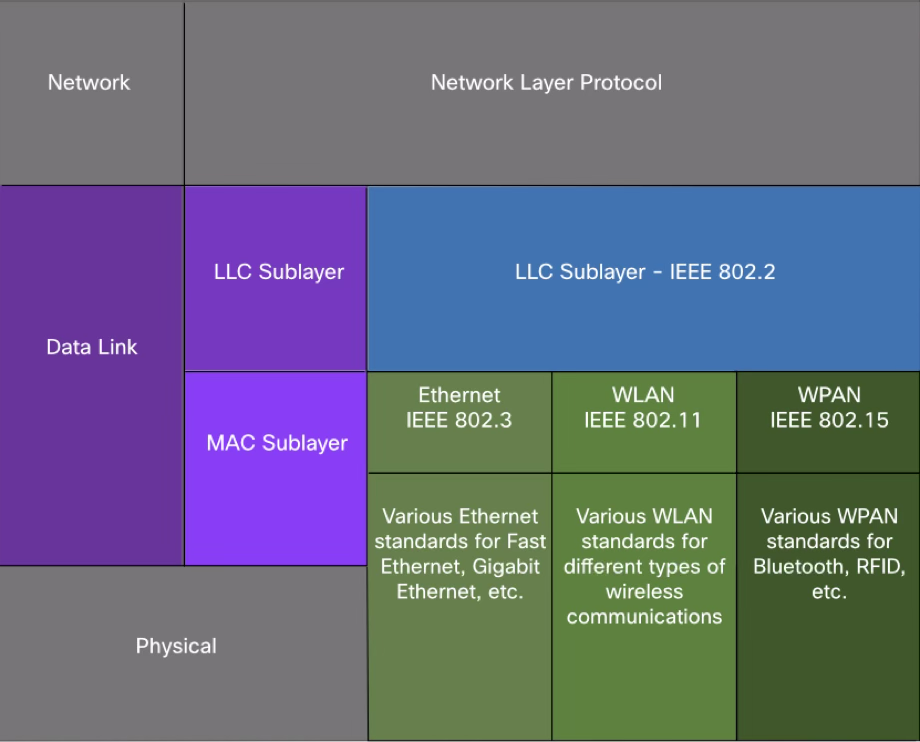

# 4 Ethernet Switching

Module Title: Ethernet Switching
Module Objective: Explain how Ethernet operates in a switched network.

## history

Equipment from one vendor might not communicate with equipment from another soas networks became more widespread, standards were developed that defined rules by which network equipment from different vendors operated.

Standards are beneficial to networking in many ways:

- Facilitate design
- Simplify product development
- Promote competition
- Provide consistent interconnections
- Facilitate training
- Provide more vendor choices for customers

There is no official local area networking standard protocol, but over time, one technology, Ethernet, has become more common than the others. Ethernet protocols define how data is formatted and how it is transmitted over the wired network. The Ethernet standards specify protocols that operate at Layer 1 and Layer 2 of the OSI model. Ethernet has become a de facto standard, which means that it is the technology used by almost all wired local area networks, as shown in the figure.

"The Institute of Electrical and Electronics Engineers, or IEEE ", maintains the networking standards, including Ethernet and wireless standards. IEEE committees are responsible for approving and maintaining the standards for connections, media requirements and communications protocols. Each technology standard is assigned a number that refers to the committee that is responsible for approving and maintaining the standard. The committee responsible for the Ethernet standards is 802.3.

Each version of Ethernet has an associated standard. For example, 802.3 100BASE-T represents the 100 Megabit Ethernet using twisted-pair cable standards.

```text
The standard notation translates as:
100 is the speed in Mbps
BASE stands for baseband transmission
T stands for the type of cable, in this case, twisted-pair.
```

## Ethernet and the OSI Model

two LAN technologies:
Ethernet
wireless LANs (WLANs).

Ethernet uses wired communications, including twisted pair, fiber-optic links, and coaxial cables.
Ethernet operates in the data link layer and the physical layer. It is a family of networking technologies defined in the IEEE 802.2 and 802.3 standards. Ethernet supports data bandwidths of the following:
10 Mbps
100 Mbps
1000 Mbps (1 Gbps)
10,000 Mbps (10 Gbps)
40,000 Mbps (40 Gbps)
100,000 Mbps (100 Gbps)

Ethernet and the OSI Model

Application
Presentation
Session
transport
Network
DataLink
LLC 802.2
MAC 802.3
Physical

## Data Link Sublayers

IEEE 802 LAN/MAN protocols, including Ethernet, use two separate sublayers of the data link layer to operate:

1. Logical Link Control (LLC)
2. Media Access Control (MAC)

LLC and MAC have the following roles in the data link layer:

1. LLC Sublayer IEEE 802.2 sublayer communicates between:
   networking software at the upper layers
   b. device hardware at the lower layers. It places information in the frame that identifies which network layer protocol is being used for the frame. This information allows multiple Layer 3 protocols, such as IPv4 and IPv6, to use the same network interface and media.

2. MAC Sublayer (IEEE 802.3, 802.11, or e.g. 802.15) implemented in hardware.

a. responsible for data encapsulation and media access control.

b. provides data link layer addressing

c. integrated with various physical layer technologies.



### MAC Sublayer

Incomplete  Ethernet Standards in the MAC Sublayer
Incomplete
Ethernet Standards in the MAC Sublayer
The MAC sublayer is responsible for data encapsulation and accessing the media.
Data Encapsulation
IEEE 802.3 data encapsulation includes the following:
Ethernet frame - This is the internal structure of the Ethernet frame.
Ethernet Addressing - The Ethernet frame includes both a source and destination MAC address to deliver the Ethernet frame from Ethernet NIC to Ethernet NIC on the same LAN.
Ethernet Error detection - The Ethernet frame includes a frame check sequence (FCS) trailer used for error detection.
Accessing the Media
As shown in the figure, the IEEE 802.3 MAC sublayer includes the specifications for different Ethernet communications standards over various types of media including copper and fibre.

### Ethernet Standards in the MAC Sublayer

legacy Ethernet using a bus topology or hubs, is a shared, half-duplex medium. Ethernet over a half-duplex medium uses a contention-based access method, carrier sense multiple access/collision detection (CSMA/CD) This ensures that only one device is transmitting at a time. CSMA/CD allows multiple devices to share the same half-duplex medium, detecting a collision when more than one device attempts to transmit simultaneously. It also provides a back-off algorithm for retransmission.
Ethernet LANs of today use switches that operate in full-duplex. Full-duplex communications with Ethernet switches do not require access control through CSMA/CD.

### Ethernet Frame Fields

The minimum Ethernet frame size is 64 bytes and the expected maximum is 1518 bytes. This includes all bytes from the destination MAC address field through the frame check sequence (FCS) field. The preamble field is not included when describing the size of the frame.
Note: The frame size may be larger if additional requirements are included, such as VLAN tagging.

Any frame less than 64 bytes in length is considered a “collision fragment” or “runt frame” and is automatically discarded by receiving stations. Frames with more than 1500 bytes of data are considered “jumbo” or “baby giant frames”.
If the size of a transmitted frame is less than the minimum, or greater than the maximum, the receiving device drops the frame. Dropped frames are likely to be the result of collisions or other unwanted signals. They are considered invalid. Jumbo frames are usually supported by most Fast Ethernet and Gigabit Ethernet switches and NICs.

1. Preamble and Start Frame Delimiter fields
   The Preamble (7 bytes) and Start Frame Delimiter (SFD), also called the Start of Frame (1 byte), fields are used for synchronization between the sending and receiving devices. These first eight bytes of the frame are used to get the attention of the receiving nodes. Essentially, the first few bytes tell the receivers to get ready to receive a new frame.

2. Destination MAC address field
   This 6-byte field is the identifier for the intended recipient. As you will recall, this address is used by Layer 2 to assist devices in determining if a frame is addressed to them. The address in the frame is compared to the MAC address in the device. If there is a match, the device accepts the frame. Can be a unicast, multicast or broadcast address.

3. Source MAC Address field
   This 6-byte field identifies the originating NIC or interface of the frame.

4. Type / Length
   This 2-byte field identifies the upper layer protocol encapsulated in the Ethernet frame. Common values are, in hexadecimal, 0x800 for IPv4, 0x86DD for IPv6 and 0x806 for ARP. : You may also see this field referred to as EtherType, Type, or Length.
5. Data Field
   This field (46 - 1500 bytes) contains the encapsulated data from a higher layer, which is a generic Layer 3 PDU, or more commonly, an IPv4 packet. All frames must be at least 64 bytes long. If a small packet is encapsulated, additional bits called a pad are used to increase the size of the frame to this minimum size.
6. Frame Check Sequence Field
   This field (46 - 1500 bytes) contains the encapsulated data from a higher layer, which is a generic Layer 3 PDU, or more commonly, an IPv4 packet. All frames must be at least 64 bytes long. If a small packet is encapsulated, additional bits called a pad are used to increase the size of the frame to this minimum size.

```text
            <———————               64 - 1518 bytes              ————————>
8 bytes     6 bytes       6 bytes      2 bytes     46-1500 bytes  4 bytes
Preamble    Destination   Source MAC   Type/Length Data           Frame Check
And SFD     MAC address   address                                 Sequence
```
