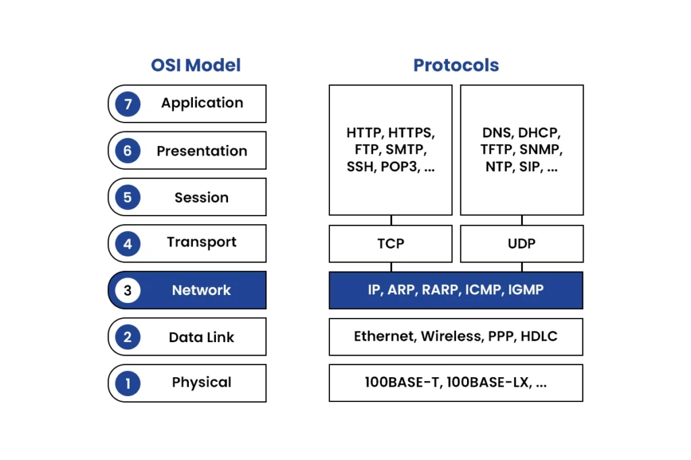
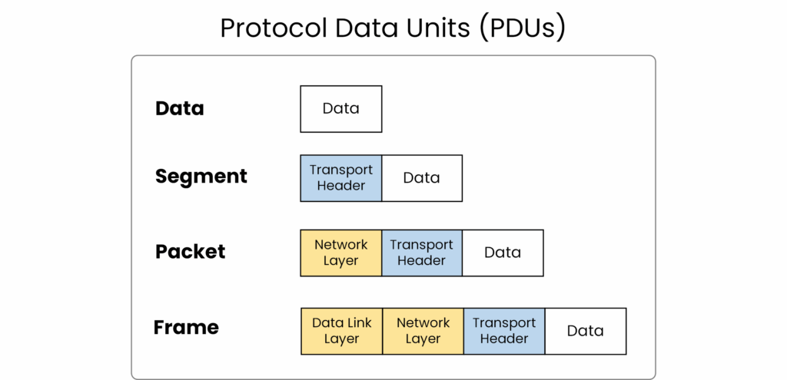
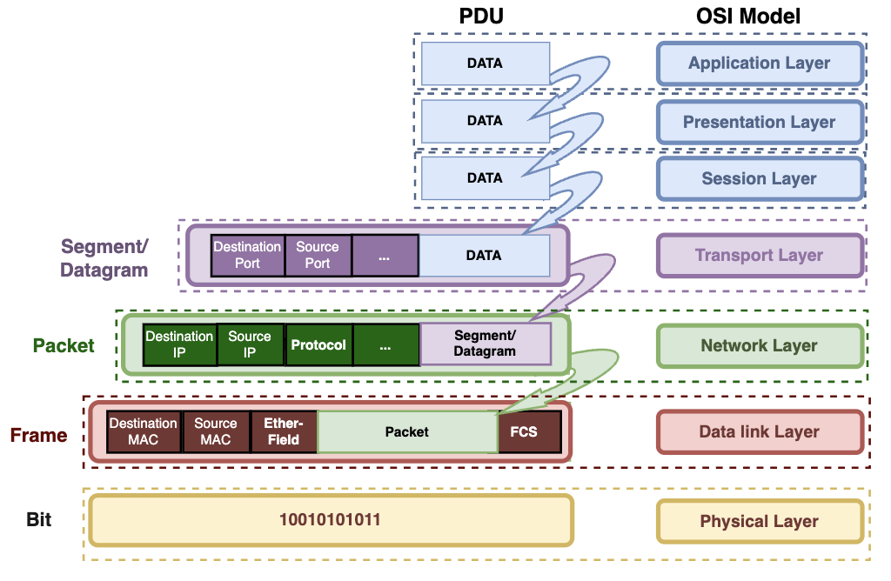
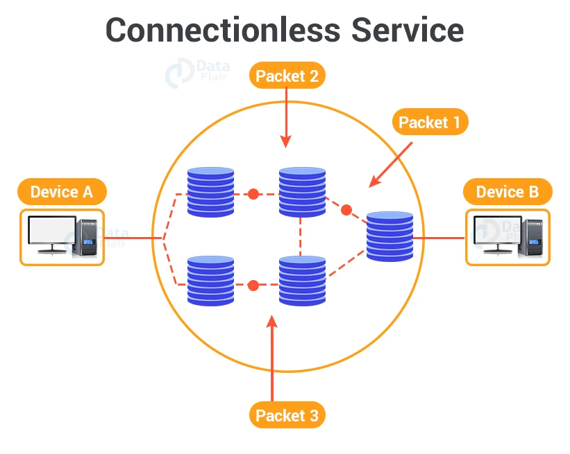
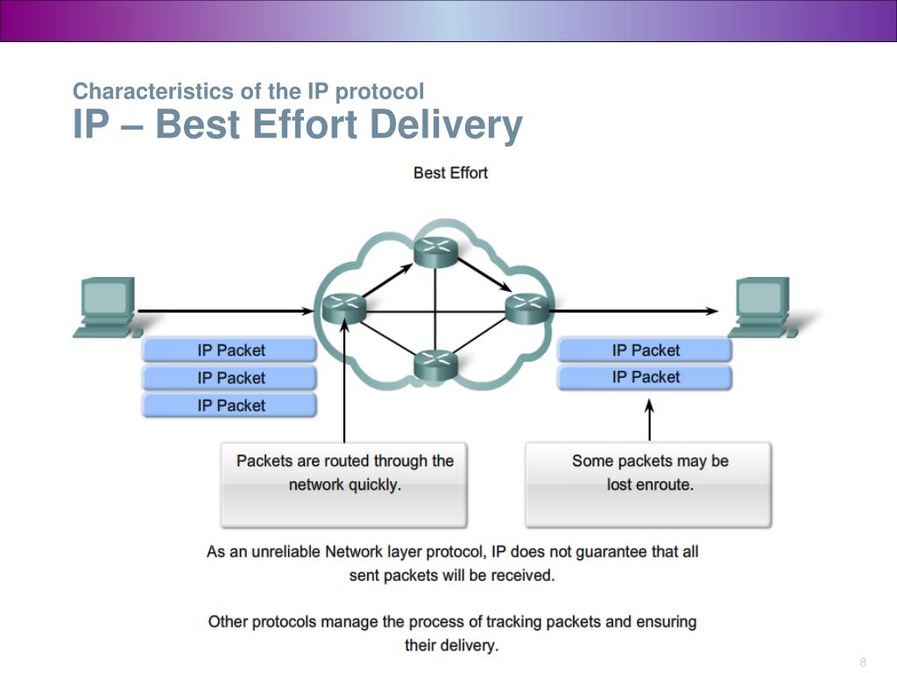
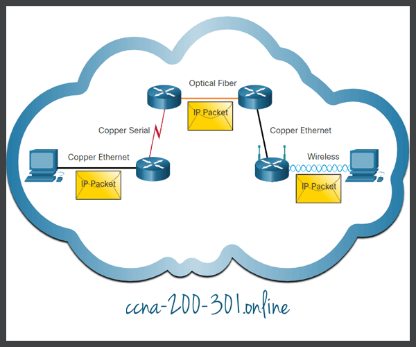
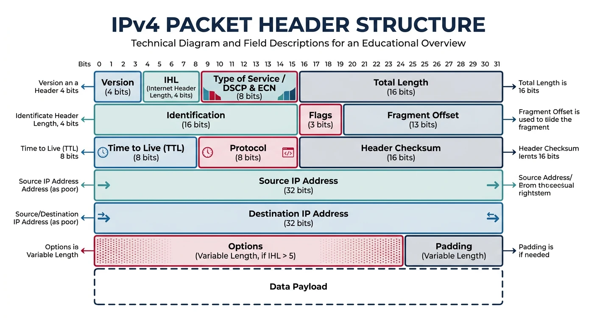
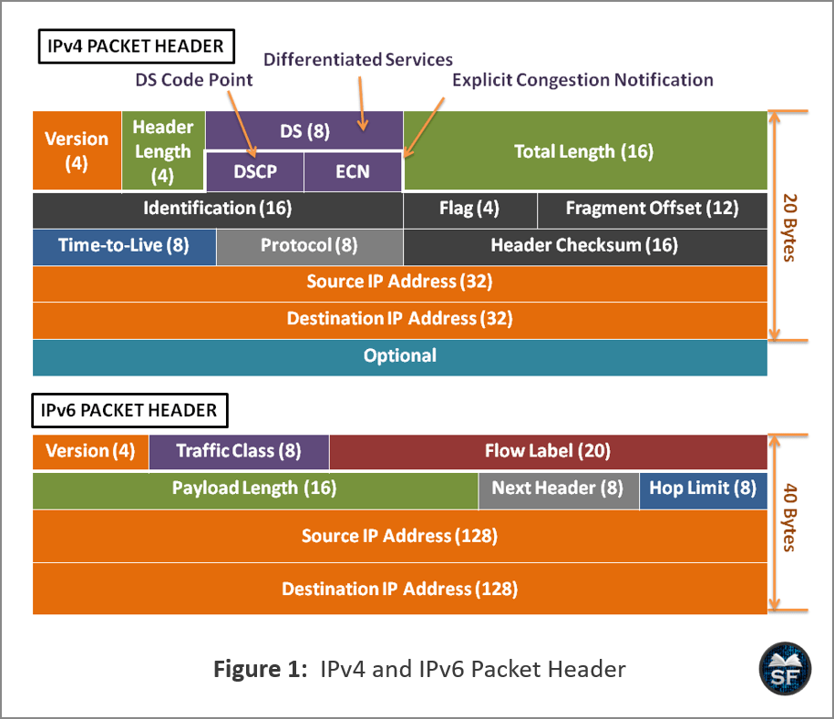
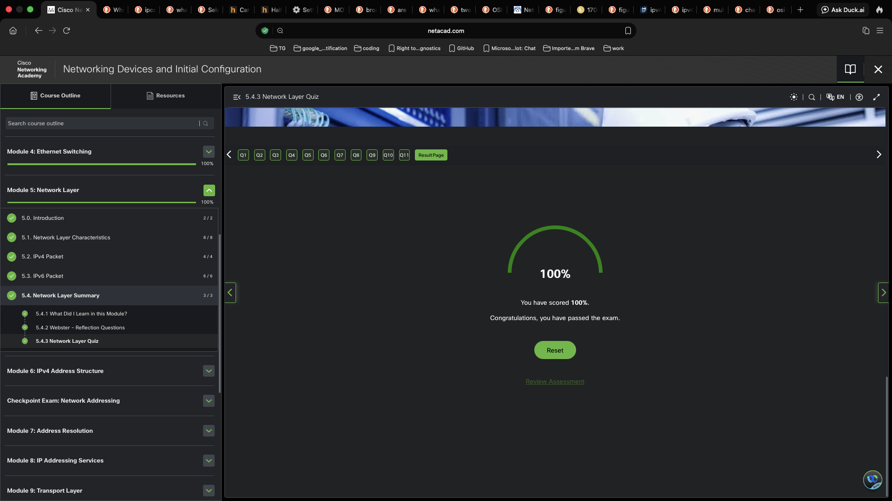

# Network Layer

Module Objective: Explain how routers use network layer protocols and services to enable end-to-end connectivity.

```table
topic | Learning objectives |
Network Layer Characteristics | Explain how the network layer uses IP protocols to communicate reliably
IPv4 Packets | Explain the role of the major header fields in IPv4 packets
IPv6 Packets | Explain the role of the major header fields in IPv6 packets
```

## Data Encapsulation


## The Network Layer


### Network Layer Protocols

The network layer, aka OSI Layer 3, provides services to allow end devices to exchange data across networks.

IP version 4 (IPv4) and IP version 6 (IPv6) are the principle network layer communication protocols.

Other network layer protocols include:

- routing protocols e.g. Open Shortest Path First (OSPF);
- messaging protocols e.g. Internet Control Message Protocol (ICMP).



To accomplish end-to-end communications across network boundaries, network layer protocols perform four basic operations. REMEMBER: AERD / AddrEn RoutDeEn / adder routed dean

#### Addressing end devices

End devices must be configured with a unique IP address for identification on the network.

#### Encapsulation

The network layer encapsulates the protocol data unit (PDU) from the transport layer into a packet. The encapsulation process adds IP header information, such as the IP address of the source (sending) and destination (receiving) hosts. The encapsulation process is performed by the source of the IP packet.

#### Routing

The network layer provides services to direct the packets to a destination host on another network. To travel to other networks, the packet must be processed by a router. The role of the router is to select the best path and direct packets toward the destination host in a process known as routing. A packet may cross many routers before reaching the destination host. Each router a packet crosses to reach the destination host is called a hop.

#### De-encapsulation

When the packet arrives at the network layer of the destination host, the host checks the IP header of the packet. If the destination IP address within the header matches its own IP address, the IP header is removed from the packet. After the packet is de-encapsulated by the network layer, the resulting Layer 4 PDU is passed up to the appropriate service at the transport layer. The de-encapsulation process is performed by the destination host of the IP packet.

Unlike the transport layer (OSI Layer 4), which manages the data transport between the processes running on each host, network layer communication protocols (i.e., IPv4 and IPv6) specify the packet structure and processing used to carry the data from one host to another host. Operating without regard to the data carried in each packet allows the network layer to carry packets for multiple types of communications between multiple hosts.

### IP Encapsulation

IP encapsulates the transport layer (the layer just above the network layer) segment or other data by adding an IP header. The IP header is used to deliver the packet to the destination host.

Protocol Data Units (PDUs)

REMEMBER: DatSeg PakFrm or DSPF bits

The process of encapsulating data layer by layer enables the services at the different layers to develop and scale without affecting the other layers. This means the transport layer segments can be readily packaged by IPv4 or IPv6 or by any new protocol that might be developed in the future.

The IP header is examined by Layer 3 devices (i.e., routers and Layer 3 switches) as it travels across a network to its destination. It is important to note, that the IP addressing information remains the same from the time the packet leaves the source host until it arrives at the destination host, except when translated by the device performing Network Address Translation (NAT) for IPv4.


Routers implement routing protocols to route packets between networks. The routing performed by these intermediary devices examines the network layer addressing in the packet header. In all cases, the data portion of the packet, that is, the encapsulated transport layer PDU or other data, remains unchanged during the network layer processes.

### Characteristics of IP

IP was designed as a protocol with low overhead. It provides ONLY the functions that are NECESSARY to deliver a packet from a source to a destination over an interconnected system of networks. The protocol was NOT designed to track and manage the flow of packets. These functions, if required, are performed by other protocols at other layers, primarily TCP at Layer 4.

#### basic characteristics of IP

- Connectionless: There is no connection with the destination established before sending data packets.
- Best Effort: IP is inherently unreliable because packet delivery is not guaranteed.
- Media Independent: Operation is independent of the medium (i.e. copper, fibre, wireless) carrying the data.

### Connectionless

Connectionless - Analogy: letter in a mailbox.
IP is connectionless, meaning that no dedicated end-to-end connection is created by IP before data is sent. Connectionless communication is conceptually similar to sending a letter to someone without notifying the recipient in advance. The figure summarizes this key point.

Connectionless - Network
Connectionless data communications work on the same principle. As shown in the figure, IP requires no initial exchange of control information to establish an end-to-end connection before packets are forwarded.



### Best Effort

IP also does not require additional fields in the header to maintain an established connection. This process greatly reduces the overhead of IP. However, with no pre-established end-to-end connection, senders are unaware whether destination devices are present and functional when sending packets, nor are they aware if the destination receives the packet, or if the destination device is able to access and read the packet.

The IP protocol does not guarantee that all packets delivered are received.



### Media Independent

Unreliable means that IP does not have the capability to manage and recover from undelivered or corrupt packets. This is because while IP packets are sent with information about the location of delivery, they do not contain information that can be processed to inform the sender whether delivery was successful. Packets may arrive at the destination corrupted, out of sequence, or not at all. IP provides no capability for packet retransmissions if errors occur.

If out-of-order packets are delivered, or packets are missing, then applications using the data, or upper layer services, must resolve these issues. This allows IP to function very efficiently. In the TCP/IP protocol suite, reliability is the role of the TCP protocol at the transport layer.

IP operates independently of the media that carry the data at lower layers of the protocol stack. IP packets can be communicated as electronic signals over copper cable, as optical signals over fiber, or wirelessly as radio signals.



The OSI data link layer is responsible for taking an IP packet and preparing it for transmission over the communications medium.

N.B. This means that the delivery of IP packets is NOT limited to any particular medium.

#### MTU - Maximum Transmission Unit

One major characteristic of the media that the network layer must consider

- maximum size of the PDU that each medium can transport.

This characteristic is referred to as the maximum transmission unit (MTU). Part of the control communication between the data link layer and the network layer is the establishment of a maximum size for the packet.

1. data link layer - passes the MTU value up to the network layer.
2. network layer - then determines how large packets can be.

#### Fragmenting the packet

In some cases, an intermediate device, e.g. a router, splits up an IPv4 packet when forwarding it from one medium to another medium with a smaller MTU. This process is called fragmenting the packet, or fragmentation. Fragmentation causes latency. IPv6 packets cannot be fragmented by the router.

## IPv4 Packets

### IPv4 Packet Header

IPv4 is one of the primary network layer communication protocols. The IPv4 packet header is used to ensure that this packet is delivered to its next stop on the way to its destination end device.

An IPv4 packet header consists of fields containing important information about the packet. These fields contain binary numbers which are examined by the Layer 3 process.

### IPv4 Packet Header Fields

The binary values of each field identify various settings of the IP packet. Protocol header diagrams, which are read left to right, and top down, provide a visual to refer to when discussing protocol fields. The IP protocol header diagram in the figure identifies the fields of an IPv4 packet.

#### Fields in the IPv4 Packet Header



#### Significant fields in the IPv4 header

- Version - Contains a 4-bit binary value set to 0100 that identifies this as an IPv4 packet.
- Differentiated Services or DiffServ (DS) - , the DS field is an 8-bit field used to determine the priority of each packet. The six most significant bits of the DiffServ field are the differentiated services code point (DSCP) bits and the last two bits are the explicit congestion notification (ECN) bits. Formerly type of service (ToS) field.
- Time to Live (TTL) – TTL contains an 8-bit binary value that is used to limit packet lifetime. The source device of the IPv4 packet sets the initial TTL value. It is decreased by one each time the packet is processed by a router. If the TTL field decrements to zero, the router discards the packet and sends an Internet Control Message Protocol (ICMP) Time Exceeded message to the source IP address. Because the router decrements the TTL of each packet, the router must also recalculate the Header Checksum.
- Protocol – This field is used to identify the next level protocol. This 8-bit binary value indicates the data payload type that the packet is carrying, which enables the network layer to pass the data to the appropriate upper-layer protocol. Common values include ICMP (1), TCP (6), and UDP (17).
- Header Checksum – This is used to detect corruption in the IPv4 header.
- Source IPv4 Address – This contains a 32-bit binary value that represents the source IPv4 address of the packet. The source IPv4 address is always a unicast address.
- Destination IPv4 Address – This contains a 32-bit binary value that represents the destination IPv4 address of the packet. The destination IPv4 address is a unicast, multicast, or broadcast address.
  The two most commonly referenced fields are the source and destination IP addresses. These fields identify where the packet is coming from and where it is going. Typically, these addresses do not change while travelling from the source to the destination.

The Internet Header Length (IHL), Total Length, and Header Checksum fields are used to identify and validate the packet.

Other fields are used to reorder a fragmented packet.

Specifically, the IPv4 packet uses Identification, Flags, and Fragment Offset fields to keep track of the fragments. A router may have to fragment an IPv4 packet when forwarding it from one medium to another with a smaller MTU.

### Limitations of IPv4

despite development of additional protocols and processes developed to address new challenges, IPv4 has three major issues:

#### IPv4 address depletion

IPv4 has a limited number of unique public addresses available. Although there are approximately 4 billion IPv4 addresses, the increasing number of new IP-enabled devices, always-on connections, and the potential growth of less-developed regions have increased the need for more addresses.

#### Lack of end-to-end connectivity

Network Address Translation (NAT) is a technology commonly implemented within IPv4 networks. NAT provides a way for multiple devices to share a single public IPv4 address. However, because the public IPv4 address is shared, the IPv4 address of an internal network host is hidden. This can be problematic for technologies that require end-to-end connectivity.

#### Increased network complexity

While NAT has extended the lifespan of IPv4 it was only meant as a transition mechanism to IPv6. NAT in its various implementation creates additional complexity in the network, creating latency and making troubleshooting more difficult.

## IPv6 Packets

### IPv6 Overview

early 1990s: the Internet Engineering Task Force (IETF) grow concerned about the issues with IPv4 and begin to look for a replacement.

now: This activity led to the development of IP version 6 (IPv6). IPv6 overcomes the limitations of IPv4 and is a powerful enhancement with features that better suit current and foreseeable network demands.

Improvements provided by IPv6:

- Increased address space - IPv6 addresses are based on 128-bit hierarchical addressing as opposed to IPv4 with 32 bits.
- Improved packet handling - The IPv6 header has been simplified with fewer fields.
- Enhanced security - IPv6 includes built-in security features, such as IPsec, which are not available in IPv4.
- Eliminates NAT dependency - With such a large number of public IPv6 addresses, NAT between a private IPv4 address and a public IPv4 is not needed. This avoids some of the NAT-induced problems experienced by applications that require end-to-end connectivity.

The 32-bit IPv4 address space provides approximately 4,294,967,296 unique addresses.

The 128-bit IPv6 address space provides 340,282,366,920,938,463,463,374,607,431,768,211,456, or 340 undecillion addresses.

### IPv4 Packet Header Fields in the IPv6 Packet Header
One of the major design improvements of IPv6 over IPv4 is the simplified IPv6 header.

For example, the IPv4 header consists of a variable length header of 20 octets (up to 60 bytes if the Options field is used) and 12 basic header fields, not including the Options field and Padding field.

For IPv6, some fields have remained the same, some fields have changed names and positions, and some IPv4 fields are no longer required.

IPv6 has a fixed length header of 40 octets (40 bytes) and 8 basic header fields.



#### Fields in the IPv6 Packet Header

- Version - This field contains a 4-bit binary value set to 0110 that identifies this as an IP version 6 packet.
- Traffic Class - This 8-bit field is equivalent to the IPv4 Differentiated Services (DS) field.
  Flow Label - This 20-bit field suggests that all packets with the same flow label receive the same type of handling by routers.
- Payload Length - This 16-bit field indicates the length of the data portion or payload of the IPv6 packet. This does not include the length of the IPv6 header, which is a fixed 40-byte header.
- Next Header - This 8-bit field is equivalent to the IPv4 Protocol field. It indicates the data payload type that the packet is carrying, enabling the network layer to pass the data to the appropriate upper-layer protocol.
- Hop Limit - This 8-bit field replaces the IPv4 TTL field. This value is decremented by a value of 1 by each router that forwards the packet. When the counter reaches 0, the packet is discarded, and an ICMPv6 Time Exceeded message is forwarded to the sending host,. This indicates that the packet did not reach its destination because the hop limit was exceeded. Unlike IPv4, IPv6 does not include an IPv6 Header Checksum, because this function is performed at both the lower and upper layers. This means the checksum does not need to be recalculated by each router when it decrements the Hop Limit field, which also improves network performance.
- Source IPv6 Address - This 128-bit field identifies the IPv6 address of the sending host.
- Destination IPv6 Address - This 128-bit field identifies the IPv6 address of the receiving host.

An IPv6 packet may also contain extension headers (EH) providing additional network layer information. Extension headers are optional andplaced BETWEEN IPv6 header and payload.

EHs are used for (e.g.) fragmentation, security and support mobility.

N.B. routers do NOT fragment routed IPv6 packets!

## Learning Outcomes

### Network Layer characterstics

The network layer, or OSI Layer 3, provides services to allow end devices to exchange data across networks. IPv4 and IPv6 are the principal network layer communication protocols. Other network layer protocols include routing protocols such as OSPF and messaging protocols such as ICMP.
Network layer protocols perform four operations: addressing end devices, encapsulation, routing, and de-encapsulation. IPv4 and IPv6 specify the packet structure and processing used to carry the data from one host to another host. Operating without regard to the data carried in each packet allows the network layer to carry packets for multiple types of communications between multiple hosts.
IP encapsulates the transport layer segment or other data by adding an IP header. The IP header is used to deliver the packet to the destination host. The IP header is examined by routers and Layer 3 switches as it travels across a network to its destination. IP addressing information remains the same from the time the packet leaves the source host until it arrives at the destination host, except when translated by the device performing NAT for IPv4.
The basic characteristics of IP are that it is: connectionless, best effort, and media independent. IP is connectionless, meaning that no dedicated end-to-end connection is created by IP before data is sent. IP does not require additional fields in the header to maintain an established connection. This reduces the overhead of IP. Senders are unaware whether destination devices are present and functional when sending packets, nor are they aware if the destination receives the packet, or if the destination device is able to access and read the packet. IP operates independently of the media that carry the data at lower layers of the protocol stack. IP packets can be communicated as electronic signals over copper cable, as optical signals over fiber, or wirelessly as radio signals. One characteristic of the media that the network layer considers is the maximum size of the PDU that each medium can transport, or the MTU.

### IPv4

The IPv4 packet header is used to ensure that a packet is delivered to its next stop on the way to its destination end device. An IPv4 packet header consists of fields containing binary numbers which are examined by the Layer 3 process. Significant fields in the IPv4 header include: version, DS, TTL, protocol, header checksum, source IPv4 address, and destination IPv4 address.
The IHL, Total Length, and Header Checksum fields are used to identify and validate the packet. The IPv4 packet uses Identification, Flags, and Fragment Offset fields to keep track of the fragments. A router may have to fragment an IPv4 packet when forwarding it from one medium to another with a smaller MTU.

### IPv6

IPv4 has limitations, including: IPv4 address depletion, lack of end-to-end connectivity, and increased network complexity. IPv6 overcomes the limitations of IPv4. Improvements that IPv6 provides include the following: increased address space, improved packet handling, and it eliminates the need for NAT.

The 32-bit IPv4 address space provides approximately 4,294,967,296 unique addresses. IPv6 address space provides 340,282,366,920,938,463,463,374,607,431,768,211,456, or 340 undecillion addresses. This is roughly equivalent to every grain of sand on Earth.

IPv6 simplified header fields include: version, traffic class, flow label, payload length, next header, hop limit, source IP address, and destination IP address.

An IPv6 packet may also contain EH, which provide optional network layer information. Extension headers are optional and are placed between the IPv6 header and the payload. EHs are used for fragmentation, security, to support mobility and more. Unlike IPv4, routers do not fragment routed IPv6 packets.

## Module Pass


