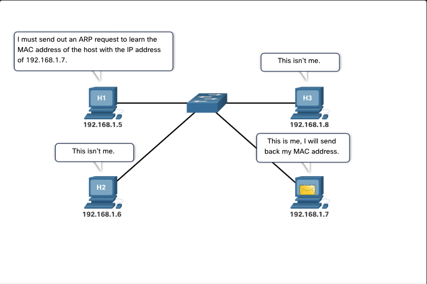
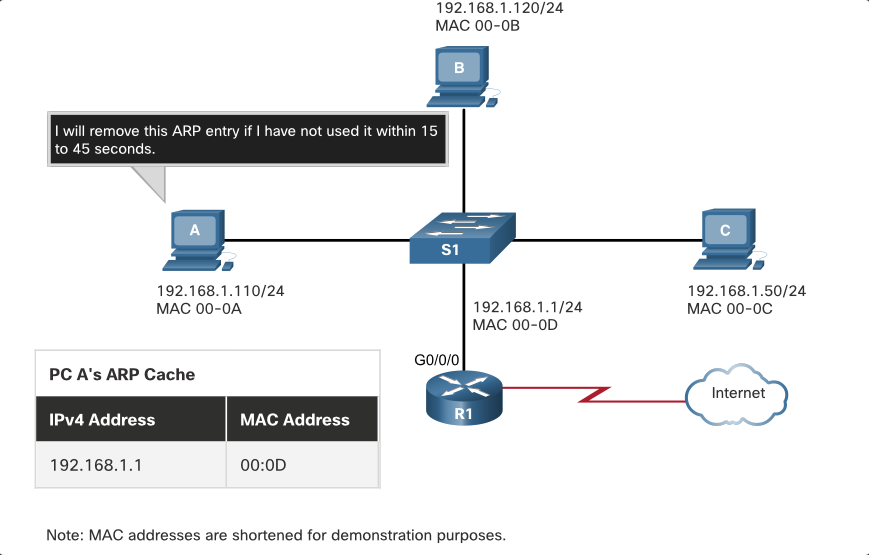
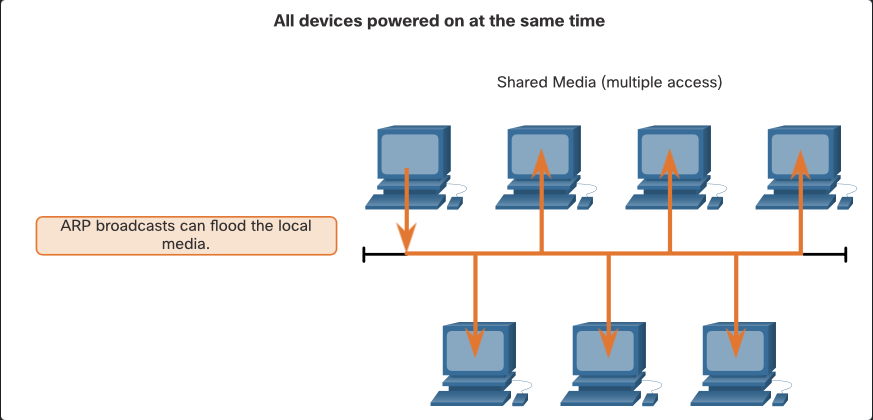
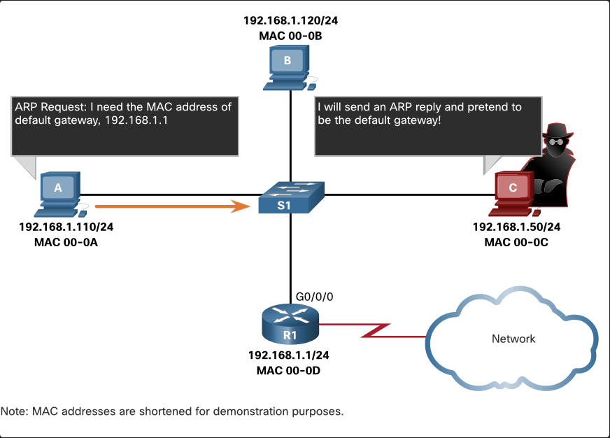

# Address Resolution

- Module Objective: Explain how ARP enables local area network communication.

## ARP

networks using the IPv4 communications protocol, need the Address Resolution Protocol, or ARP, to map IPv4 addresses to MAC addresses.

Every IP device on an Ethernet network has a unique Ethernet MAC address. When a device sends an Ethernet Layer 2 frame, it contains these two addresses:

- Destination MAC address - The Ethernet MAC address of the destination device on the same local network segment. If the destination host is on another network, then the destination address in the frame would be that of the default gateway (i.e., router).
- Source MAC address - The MAC address of the Ethernet NIC on the source host.

o send a packet to another host on the same local IPv4 network, a host must know the IPv4 address and the MAC address of the destination device. Device destination IPv4 addresses are either known or resolved by device name. However, MAC addresses must be discovered.

A device uses Address Resolution Protocol (ARP) to determine the destination MAC address of a local device when it knows its IPv4 address.

ARP provides two basic functions:

- Resolving IPv4 addresses to MAC addresses
- Maintaining a table of IPv4 to MAC address mappings

## ARP functs

When a packet is sent to the data link layer to be encapsulated into an Ethernet frame, the device refers to a table in its memory to find the MAC address that is mapped to the IPv4 address. This table is stored temporarily in RAM memory and called the ARP table or the ARP cache.

The sending device will search its ARP table for a destination IPv4 address and a corresponding MAC address.

- If the packet’s destination IPv4 address is on the same network as the source IPv4 address, the device will search the ARP table for the destination IPv4 address.
- If the destination IPv4 address is on a different network than the source IPv4 address, the device will search the ARP table for the IPv4 address of the default gateway.

In both cases, the search is for an IPv4 address and a corresponding MAC address for the device.

Each entry, or row, of the ARP table binds an IPv4 address with a MAC address. We call the relationship between the two values a map. This simply means that you can locate an IPv4 address in the table and discover the corresponding MAC address. The ARP table temporarily saves (caches) the mapping for the devices on the LAN.

If the device locates the IPv4 address, its corresponding MAC address is used as the destination MAC address in the frame. If there is no entry is found, then the device sends an ARP request.



## ARP Operation - ARP Request

An ARP request is sent when a device needs to determine the MAC address that is associated with an IPv4 address, and it does not have an entry for the IPv4 address in its ARP table.

ARP messages are encapsulated directly within an Ethernet frame. There is no IPv4 header. The ARP request is encapsulated in an Ethernet frame using the following header information:

Destination MAC address – This is a broadcast address FF-FF-FF-FF-FF-FF requiring all Ethernet NICs on the LAN to accept and process the ARP request.
Source MAC address – This is MAC address of the sender of the ARP request.
Type - ARP messages have a type field of 0x806. This informs the receiving NIC that the data portion of the frame needs to be passed to the ARP process.
Because ARP requests are broadcasts, they are flooded out all ports by the switch, except the receiving port. All Ethernet NICs on the LAN process broadcasts and must deliver the ARP request to its operating system for processing. Every device must process the ARP request to see if the target IPv4 address matches its own. A router will not forward broadcasts out other interfaces.

Only one device on the LAN will have an IPv4 address that matches the target IPv4 address in the ARP request. All other devices will not reply.

## ARP Operation - ARP Reply

Only the device with the target IPv4 address associated with the ARP request will respond with an ARP reply. The ARP reply is encapsulated in an Ethernet frame using the following header information:

- Destination MAC address – the MAC address of the sender of the ARP request.
- Source MAC address – the MAC address of the sender of the ARP reply.

- Type - ARP messages type field = 0x806. This informs the receiving NIC that the data portion of the frame needs to be passed to the ARP process.

Only the device that originally sent the ARP request will receive the unicast ARP reply. After the ARP reply is received, the device will add the IPv4 address and the corresponding MAC address to its ARP table. Packets destined for that IPv4 address can now be encapsulated in frames using its corresponding MAC address.

If no device responds to the ARP request? the packet is dropped (becvause frame cannot be created).

Entries in the ARP table are time stamped. If a device does not receive a frame from a particular device before the timestamp expires, the entry for this device is removed from the ARP table.

Additionally, static map entries can be entered in an ARP table, but this is rarely done. Static ARP table entries do not expire over time and must be manually removed.

Note: IPv6 uses a similar process to ARP for IPv4, known as ICMPv6 Neighbor Discovery (ND). IPv6 uses neighbor solicitation and neighbor advertisement messages, similar to IPv4 ARP requests and ARP replies.

## ARP Role in Remote Communications

When the destination IPv4 address is not on the same network as the source IPv4 address, the source device needs to send the frame to its default gateway. This is the interface of the local router. Whenever a source device has a packet with an IPv4 address on another network, it will encapsulate that packet in a frame using the destination MAC address of the router.

The IPv4 address of the default gateway is stored in the IPv4 configuration of the hosts. When a host creates a packet for a destination, it compares the destination IPv4 address and its own IPv4 address to determine if the two IPv4 addresses are located on the same Layer 3 network. If the destination host is not on its same network, the source checks its ARP table for an entry with the IPv4 address of the default gateway. If there is not an entry, it uses the ARP process to determine a MAC address of the default gateway.

## Removing Entries from an ARP Table

For each device, an ARP cache timer removes ARP entries that have not been used for a specified period of time. The times differ depending on the operating system of the device. For example, newer Windows operating systems store ARP table entries between 15 and 45 seconds

Commands may also be used to manually remove some or all of the entries in the ARP table. After an entry has been removed, the process for sending an ARP request and receiving an ARP reply must occur again to enter the map in the ARP table.



## ARP Tables on Devices

On a Cisco router, the show ip arp command is used to display the ARP table.

```bash
R1# show ip arp
Protocol Address Age (min) Hardware Addr Type Interface
Internet 192.168.10.1 - a0e0.af0d.e140 ARPA GigabitEthernet0/0/0
Internet 209.165.200.225 - a0e0.af0d.e141 ARPA GigabitEthernet0/0/1
Internet 209.165.200.226 1 a03d.6fe1.9d91 ARPA GigabitEthernet0/0/1
R1#
```

On a Windows 10 PC, the arp –a command is used to display the ARP table.

```bash
C:∖Users∖PC> arp -a
Interface: 192.168.1.124 --- 0x10
Internet Address Physical Address Type
192.168.1.1 c8-d7-19-cc-a0-86 dynamic
192.168.1.101 08-3e-0c-f5-f7-77 dynamic
192.168.1.110 08-3e-0c-f5-f7-56 dynamic
192.168.1.112 ac-b3-13-4a-bd-d0 dynamic
192.168.1.117 08-3e-0c-f5-f7-5c dynamic
192.168.1.126 24-77-03-45-5d-c4 dynamic
192.168.1.146 94-57-a5-0c-5b-02 dynamic
192.168.1.255 ff-ff-ff-ff-ff-ff static
224.0.0.22 01-00-5e-00-00-16 static
224.0.0.251 01-00-5e-00-00-fb static
239.255.255.250 01-00-5e-7f-ff-fa static
255.255.255.255 ff-ff-ff-ff-ff-ff static
C:∖Users∖PC>
```

## ARP Issues - ARP Broadcasts and ARP Spoofing

### ARP Broadcast



As a broadcast frame, an ARP request is received and processed by every device on the local network. On a typical business network, these broadcasts would probably have minimal impact on network performance. However, if a large number of devices were to be powered up and all start accessing network services at the same time, there could be some reduction in performance for a short period of time, as shown in the figure. After the devices send out the initial ARP broadcasts and have learned the necessary MAC addresses, any impact on the network will be minimized.

### ARP Spoofing

In some cases, the use of ARP can lead to a potential security risk. A threat actor can use ARP spoofing to perform an ARP poisoning attack. This is a technique used by a threat actor to reply to an ARP request for an IPv4 address that belongs to another device, such as the default gateway.

#### steps

1. The threat actor sends an ARP reply with its own MAC address.
2. The receiver of the ARP reply will add the wrong MAC address to its ARP table.
3. The threat actor can then intercept and manipulate the traffic between the devices.
   
   Enterprise level switches include mitigation techniques known as dynamic ARP inspection (DAI).

## Packet Tracer - Examining the ARP Table

### Objectives

Part 1: Examine an ARP Request

Part 2: Examine a Switch MAC Address Table

Part 3: Examine the ARP Process in Remote Communications

### Background

Gather PDU information in simulation mode and answer a series of questions about the data.

## Part 1: Examining an ARP Request

Step 1: Generate ARP requests by pinging 172.16.31.3 from 172.16.31.2.

### Questions & Answers

Is this address listed in the table above?

Answer: no

e. Click Capture/Forward to move the PDU to the next device.

Question:
How many copies of the PDU did Switch1 make?

Answer: 3

What is the IP address of the device that accepted the PDU?

Answer: 172.16.31.3

f. Open the PDU and examine Layer 2.

Question:
What happened to the source and destination MAC addresses?

Answer: src MAC became dest MAC address (i.e. ffff:ffff:ffff to 172.16.31.3) broadcast to unicast

g. Click Capture/Forward until the PDU returns to 172.16.31.2.

Question:
How many copies of the PDU did the switch make during the ARP reply?

Answer: 1

#### Step 2: Examine the ARP table.

a. Note that the ICMP packet reappears. Open the PDU and examine the MAC addresses.

Question:
Do the MAC addresses of the source and destination align with their IP addresses?

Answer: yes

b. Switch back to Realtime and the ping completes.

c. Click 172.16.31.2 and enter the arp –a command.

Question:
To what IP address does the MAC address entry correspond?

Answer: 172.16.31.3

Question:
In general, when does an end device issue an ARP request?

Answer: when receiver MAC address = unknown

#### Part 2: Examine a Switch MAC Address Table

Step 1: Generate additional traffic to populate the switch MAC address table.

a. From 172.16.31.2, enter the ping 172.16.31.4 command.

b. Click 10.10.10.2 and open the Command Prompt.

c. Enter the ping 10.10.10.3 command.

Question:
How many replies were sent and received?

Answer: 4/4

Step 2: Examine the MAC address table on the switches.

a. Click Switch1and then the CLI tab. Enter the show mac-address-table command.

Question:
Do the entries correspond to those in the table above?

Answer: yes

b. Click Switch0, then the CLI tab. Enter the show mac-address-table command.

Questions:
Do the entries correspond to those in the table above?

Answer: yes

Why are two MAC addresses associated with one port?

Answer: both devices connect via single access point

### Part 3: Examine the ARP Process in Remote Communications

Step 1: Generate traffic to produce ARP traffic.

a. Click 172.16.31.2 and open the Command Prompt.

b. Enter the ping 10.10.10.1 command.

c. Type arp –a.

Question:
What is the IP address of the new ARP table entry?

Answer: 172.16.31.1

d. Enter arp -d to clear the ARP table and switch to Simulation mode.

e. Repeat the ping to 10.10.10.1.

Question:
How many PDUs appear?

Answer: 2

f. Click Capture/Forward. Click the PDU that is now at Switch1.

Question:
What is the target destination IP destination address of the ARP request?

Answer: 172.16.31.1

g. The destination IP address is not 10.10.10.1.

Question:
Why?

Answer: if receiving host is not on the same network communication will be between network gateways. the source uses the ARP process to determine a MAC address for the router interface serving as the gateway.

the ARP request is being sent to the default gateway (172.16.31.1) to resolve the MAC address of the destination IP (10.10.10.1).

Step 2: Examine the ARP table on Router1.

a. Switch to Realtime mode. Click Router1 and then the CLI tab.

b. Enter privileged EXEC mode and then the show mac-address-table command.

Question:
How many MAC addresses are in the table? Why?

Answer: 0

c. Enter the show arp command.

Questions:
Is there an entry for 172.16.31.2?

Answer: Yes

What happens to the first ping in a situation where the router responds to the ARP request?

Answer: timeout, because the router does not have the MAC address for the destination IP address.
