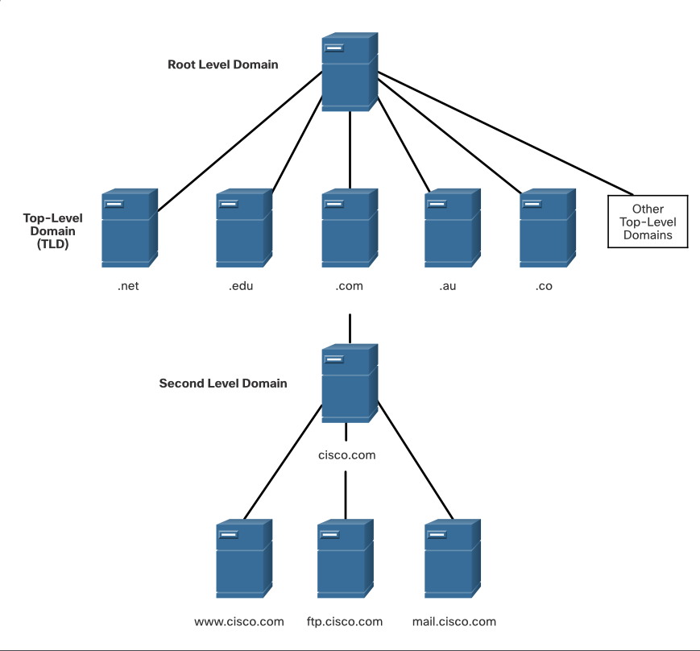
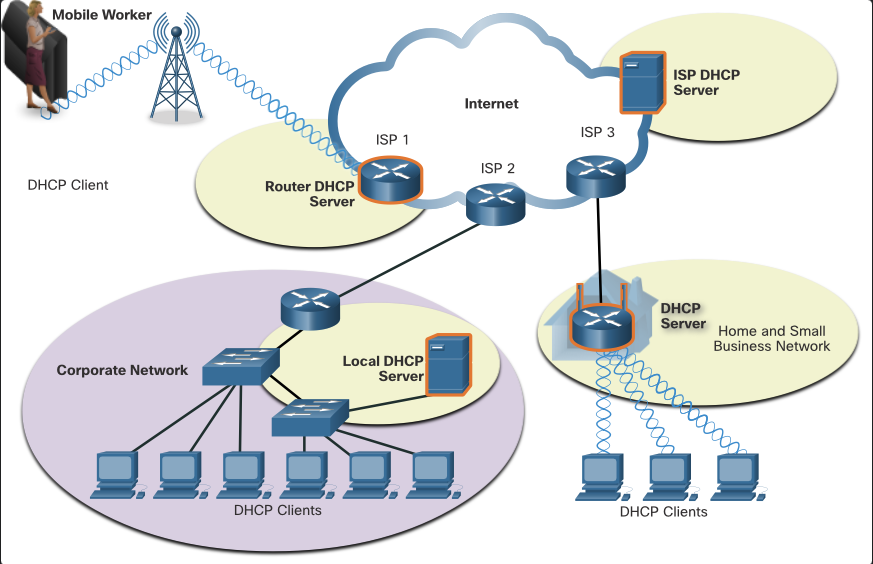
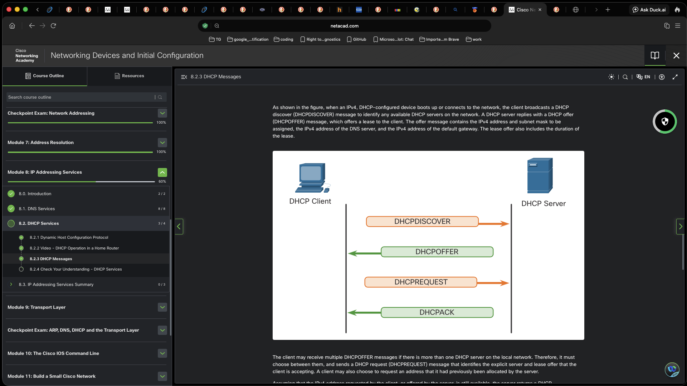

# IP Addressing Services

## DNS

There are other application layer-specific protocols designed to make it easier to obtain addresses for network devices. These services are essential because it would be very time consuming to remember IP addresses instead of URLs or manually configure all of the devices in a medium to large network.

In data networks, devices are labeled with numeric IP addresses to send and receive data over networks. Domain names were created to convert the numeric address into a simple, recognizable name.

### FQDN

fully-qualified domain names (FQDNs), e.g. http://www.cisco.com, are much easier to remember than 198.133.219.25 (i.e. the actual numeric address for this server). If Cisco decides to change the numeric address of www.cisco.com, it is transparent to the user because the domain name remains the same. The new address is simply linked to the existing domain name and connectivity is maintained.

The DNS protocol defines an automated service that matches resource names with the required numeric network address. It includes the format for queries, responses, and data.

The DNS protocol communications use a single format called a message. This message format is used for all types of client queries and server responses, error messages, and the transfer of resource record information between servers.

Step 1: User types FQDN into browser application address field (i.e. normal web search)
Step 2: DNS query is sent to designated DNS server for the client computer
Step 3: DNS server matches the FQDN to the IP address
Step 4:DNS query response is returned to client computer with tthe IP address for the FQDN requested
Step 5: client computer can now use the IP address to call requests fromn the server hosting the FQDN requested

### DNS Message Format
The DNS server stores different types of resource records that are used to resolve names. These records contain the name, address, and type of record. Some of these record types include:

- A - An end device IPv4 address
- NS - An authoritative name server
- AAAA - An end device IPv6 address (pronounced quad-A)
- MX - A mail exchange record

When a client makes a query, the server DNS process first looks at its own records to resolve the name.

If it is unable to resolve the name by using its stored records, it contacts other servers to resolve the name.

After a match is found and returned to the original requesting server, the server temporarily stores the numbered address in the event that the same name is requested again.

The DNS client service on Windows PCs also stores previously resolved names in memory.

N.B. ipconfig /displaydns - displays all cached DNS entries.

DNS uses the same message format between servers, consisting of a question, answer, authority, and additional information for all types of client queries and server responses, error messages, and transfer of resource record information.

e.g.

```table
question   | question for name server
answer     | resource records answering question
authority  | resource records pointing toward an authority
additional | resource records holding additional information
```

### DNS Hierarchy
The DNS protocol uses a hierarchical system to create a database to provide name resolution. DNS uses domain names to form the hierarchy.



The naming structure is broken down into small, manageable zones. Each DNS server maintains a specific database file and is only responsible for managing name-to-IP mappings for that small portion of the entire DNS structure.

N.B. When a DNS server receives a request for a name translation that is not within its DNS zone, the DNS server forwards the request to another DNS server within the proper zone for translation.

N.B. DNS is scalable because hostname resolution is spread across multiple servers.

The different top-level domains represent either the type of organization or the country of origin. Examples of top-level domains:

- .com - business or industry
- .org - non-profit organization
- .gov - government organization
- .uk - United Kingdom
- .jp - Japan

### nslookup Command

When configuring a network device, one or more DNS server addresses are provided that the DNS client can use for name resolution. Usually, the ISP provides the addresses to use for the DNS servers. When a user application requests to connect to a remote device by name, the requesting DNS client queries the name server to resolve the name to a numeric address.

Computer operating systems also have a utility called nslookup that allows the user to manually query the name servers to resolve a given host name. This utility can also be used to troubleshoot name resolution issues and to verify the current status of the name servers.

In this figure, when the nslookup command is issued, the default DNS server configured for your host is displayed. The name of a host or domain can be entered at the nslookup prompt. The nslookup utility has many options available for extensive testing and verification of the DNS process.

```bash
C:\Users> nslookup
Default Server:  dns-sj.cisco.com
Address:  171.70.168.183
> www.cisco.com
Server:  dns-sj.cisco.com
Address:  171.70.168.183
Name:    origin-www.cisco.com
Addresses:  2001:420:1101:1::a
          173.37.145.84
Aliases:  www.cisco.com
> cisco.netacad.net
Server:  dns-sj.cisco.com
Address:  171.70.168.183
Name:  cisco.netacad.net
Address:  72.163.6.223
>
```

N.B.

- NS records resolve authoritative name servers.
- DNS A records resolve IPv4 addresses.
- AAAA records resolve IPv6 addresses
- MX records resolve mail exchange servers.

### nslookup Command Options

The nslookup command has many options available for extensive testing and verification of the DNS process. Some of the most common options include:
nslookup (get into mode)
www.cisco.com (get the IP address of the FQDN)
exit (exit nslookup mode)
nslookup www.google.com (get the IP address of the FQDN)
nslookup -type=mx domain.com (get the mail exchange records for the domain)
nslookup -type=ns domain.com (get the name servers for the domain)
nslookup -type=a domain.com (get the A records for the domain)
nslookup -type=aaaa domain.com (get the AAAA records for the domain)
nslookup -type=ptr ipaddress (get the PTR record for the IP address)

## Lab - Observe DNS Resolution

### Objectives

Part 1: Observe the DNS Conversion of a URL to an IP Address

Part 2: Observe DNS Lookup Using the nslookup Command on a Web Site

Part 3: Observe DNS Lookup Using the nslookup Command on Mail Servers

### Background / Scenario

The Domain Name System (DNS) is invoked when you type a Uniform Resource Locator (URL), such as http://www.cisco.com, into a web browser. The first part of the URL describes which protocol is used. Common protocols are Hypertext Transfer Protocol (HTTP), Hypertext Transfer Protocol over Secure Socket Layer (HTTPS), and File Transfer Protocol (FTP).

DNS uses the second part of the URL, which in this example is www.cisco.com. DNS translates the domain name (www.cisco.com) to an IP address to allow the source host to reach the destination server. In this lab, you will observe DNS in action and use the nslookup (name server lookup) command to obtain additional DNS information.

### Questions / Answers

```bash
C:> ping www.icann.org
Pinging www.vip.icann.org [2620:0:2d0:200::7] with 32 bytes of data:
Reply from 2620:0:2d0:200::7: time=43ms
Reply from 2620:0:2d0:200::7: time=41ms
Reply from 2620:0:2d0:200::7: time=44ms
Reply from 2620:0:2d0:200::7: time=39ms
Ping statistics for 2620:0:2d0:200::7:
    Packets: Sent = 4, Received = 4, Lost = 0 (0% loss),
Approximate round trip times in milli-seconds:
    Minimum = 39ms, Maximum = 44ms, Average = 41ms
C:> ping -4 www.icann.org
Pinging www.vip.icann.org [192.0.32.7] with 32 bytes of data:
Reply from 192.0.32.7: bytes=32 time=41ms TTL=241
Reply from 192.0.32.7: bytes=32 time=42ms TTL=241
Reply from 192.0.32.7: bytes=32 time=42ms TTL=241
Reply from 192.0.32.7: bytes=32 time=43ms TTL=241
Ping statistics for 192.0.32.7:
    Packets: Sent = 4, Received = 4, Lost = 0 (0% loss),
Approximate round trip times in milli-seconds:
    Minimum = 41ms, Maximum = 43ms, Average = 42ms
```

Record the IP addresses for www.icann.org.

Answer: 104.18.2.93

c. Type the IPv4 addresses from step b into a web browser, instead of the URL. Enter https://192.0.32.7 in the web browser. If your computer has an IPv6 address you can enter the IPv6 address. https://[2620:0:2d0:200::7] in the web browser.

d. Notice that the ICANN home web page is displayed without using DNS.
Most humans find it easier to remember words, rather than numbers. If you tell someone to go to www.icann.org, they can probably remember that. If you told them to go to 192.0.32.7, they would have a difficult time remembering an IP address. Computers process in numbers. DNS is the process of translating words into numbers. Additionally, there is a second translation that takes place. Humans think in Base 10 numbers. Computers process in Base 2 numbers. The Base 10 IP address 192.0.32.7 in Base 2 numbers is 11000000.00000000.00100000.00000111. What happens if you cut and paste these Base 2 numbers into a browser?

Answer: nothing. page cannot dislpay or silent fail, returns search results related to bin conversion

e. ping www.cisco.com.

Note: If the domain name is resolved to an IPv6 address, use the command ping -4 www.cisco.com to translate into an IPv4 address if desired.

```bash
C:> ping www.cisco.com
Pinging origin-www.cisco.com [2600:1408:7:1:9300::90] with 32 bytes of data:
Reply from 2600:1408:7:1:9300::90: time=70ms
Reply from 2600:1408:7:1:9300::90: time=74ms
Reply from 2600:1408:7:1:9300::90: time=72ms
Reply from 2600:1408:7:1:9300::90: time=71ms
Ping statistics for 2600:1408:7:1:9300::90:
    Packets: Sent = 4, Received = 4, Lost = 0 (0% loss),
Approximate round trip times in milli-seconds:
    Minimum = 70ms, Maximum = 74ms, Average = 71ms
C:> ping -4 www.cisco.com
Pinging e2867.dsca.akamaiedge.net [172.230.155.162] with 32 bytes of data:
Reply from 172.230.155.162: bytes=32 time=7ms TTL=54
Reply from 172.230.155.162: bytes=32 time=6ms TTL=54
Reply from 172.230.155.162: bytes=32 time=7ms TTL=54
Reply from 172.230.155.162: bytes=32 time=6ms TTL=54
Ping statistics for 172.230.155.162:
    Packets: Sent = 4, Received = 4, Lost = 0 (0% loss),
Approximate round trip times in milli-seconds:
    Minimum = 6ms, Maximum = 7ms, Average = 6ms
```

When you ping www.cisco.com, do you get the same IP address as the example? Explain.

Answer: no. regional server provisioning and load balancing

Type the IP address that you obtained when you pinged www.cisco.com into a browser. Does the web site display? Explain.

Answer: 23.214.208.112, does not work. 1. Some web servers are configured to accept IP addresses sent from a browser and some are not. 2. firewall rule in the Cisco security system that prohibits an IP address from being sent via a browser. Depending on the Web Browser you can also get a message saying the connection is not secure or there is a certificate error.

Part 2: Observe DNS Lookup Using the nslookup Command on a Web Site

a. At the command prompt, type the nslookup command.

C:> nslookup
What is the default DNS server used?

Answer: loc dep

a. Notice how the command prompt changed to a greater than (>) symbol. This is the nslookup prompt. From this prompt, you can enter commands related to DNS.

At the prompt, type ? to see a list of all the available commands that you can use in nslookup mode.

b. At the nslookup prompt, type www.cisco.com.

```bash
> www.cisco.com
Default Server:  one.one.one.one
Address:  1.1.1.1
Non-authoritative answer:
Name:    e2867.dsca.akamaiedge.net
Addresses:  2600:1404:a:395::b33
          2600:1404:a:38e:::b33
          172.230.155.162
Aliases:  www.cisco.com
          www.cisco.com.akadns.net
          wwwds.cisco.com.edgekey.net
          wwwds.cisco.com.edgekey.net.globalredir.akadns.net
```

Questions:
What is the translated IPv4 address?

Answer: 23.214.208.112

Note: IP addresses will differ because Cisco use mirrored servers in various locations around the world.

Is it the same as the IP address shown with the ping command?

Answer: yes

Under addresses, in addition to the 172.230.155.162 IP address, there are the following numbers: 2600:1404:a:395::b33 and 2600:1404:a:38e:::b33. What are these?

Answer: IPv6 Addresses

c. At the nslookup prompt, type the IP address of the Cisco web server that you just found. You can use nslookup to get the domain name of an IP address if you do not know the URL.

```bash
> 172.230.155.162
Default Server:  one.one.one.one
Address:  1.1.1.1
Name:    a172-230-155-162.deploy.static.akamaitechnologies.com
Address:  172.230.155.162
```

You can use the nslookup tool to translate domain names into IP addresses. You can also use it to translate IP addresses into domain names.
Using the nslookup tool, record the IP addresses associated with www.google.com.

Answer: 142.251.155.119
fe80::bef8:7eff:fe38:a6a8%11

```bash
> www.google.com
Server:  one.one.one.one
Address:  1.1.1.1

Non-authoritative answer:
Name:    www.google.com
Addresses:  2607:f8b0:4000:80f::2004
172.217.9.132
```

Part 3: Observe DNS Lookup Using the nslookup Command on Mail Servers

a. At the nslookup prompt, type set type=mx to use nslookup to identify mail servers.

```bash
> set type=mx
b.  At the nslookup prompt, type cisco.com.

> cisco.com
Server:  one.one.one.one
Address:  1.1.1.1
Non-authoritative answer:
cisco.com       MX preference = 20, mail exchanger = rcdn-mx-01.cisco.com
cisco.com       MX preference = 30, mail exchanger = aer-mx-01.cisco.com
cisco.com       MX preference = 10, mail exchanger = alln-mx-01.cisco.com
```

A fundamental principle of network design is redundancy (more than one mail server is configured). In this way, if one of the mail servers is unreachable, then the computer making the query tries the second mail server. Email administrators determine which mail server is contacted first by using MX preference. The mail server with the lowest MX preference is contacted first.

Question:
Based upon the output above, which mail server will be contacted first when the email is sent to cisco.com?

Answer: cisco.com mail exchanger = 20 rcdn-mx-01.cisco.com.

c. At the nslookup prompt, type exit to return to the regular PC command prompt.

d. At the PC command prompt, type ipconfig /all.
Write the IP addresses of all the DNS servers that your school uses.

Answer: confirmed, local DNS server addresses are used, but the actual addresses will depend on the specific network configuration.

Reflection Question
What is the fundamental purpose of DNS?

Answer: human name to computer number translation. IPv4 or IPv6.

## Dynamic Host Configuration Protocol



The Dynamic Host Configuration Protocol (DHCP) for IPv4 service automates the assignment of IPv4 addresses, subnet masks, gateways, and other IPv4 networking parameters. This is referred to as dynamic addressing. The alternative to dynamic addressing is static addressing. When using static addressing, the network administrator manually enters IP address information on hosts.

When a host connects to the network, the DHCP server is contacted, and an address is requested. The DHCP server chooses an address from a configured range of addresses called a pool and assigns (leases) it to the host.

On larger networks, or where the user population changes frequently, DHCP is preferred for address assignment. New users may arrive and need connections; others may have new computers that must be connected. Rather than use static addressing for each connection, it is more efficient to have IPv4 addresses assigned automatically using DHCP.

DHCP can allocate IP addresses for a configurable period of time, called a lease period. The lease period is an important DHCP setting, When the lease period expires or the DHCP server gets a DHCPRELEASE message the address is returned to the DHCP pool for reuse. Users can freely move from location to location and easily re-establish network connections through DHCP.

Various types of devices can be DHCP servers. The DHCP server in most medium-to-large networks is usually a local, dedicated PC-based server.

With home networks, the DHCP server is usually located on the local router that connects the home network to the ISP.

Many networks use both DHCP and static addressing. DHCP is used for general purpose hosts, such as end user devices. Static addressing is used for network devices, such as gateway routers, switches, servers, and printers.

DHCP for IPv6 (DHCPv6) provides similar services for IPv6 clients. One important difference is that DHCPv6 does not provide a default gateway address. This can only be obtained dynamically from the Router Advertisement message of the router.

### DHCP Operation in a Home Router


### DHCP Messages

4 parts aka DORA:

1. DISCOVER - client broadcasts to find available DHCP servers
2. OFFER - server responds with an offer of an IP address and other configuration
3. REQUEST - client requests the offered IP address from the server
4. ACK - server acknowledges the request and finalizes the lease


when an IPv4, DHCP-configured device boots up or connects to the network, the client broadcasts a DHCP discover (DHCPDISCOVER) message to identify any available DHCP servers on the network. A DHCP server replies with a DHCP offer (DHCPOFFER) message, which offers a lease to the client. The offer message contains the IPv4 address and subnet mask to be assigned, the IPv4 address of the DNS server, and the IPv4 address of the default gateway. The lease offer also includes the duration of the lease.

The client may receive multiple DHCPOFFER messages if there is more than one DHCP server on the local network. it has to choose between them, and sends a DHCP request (DHCPREQUEST) message to identify the explicit server and lease offer that the client is accepting. A client may also choose to request an address that it had previously been allocated by the server.

Assuming that the IPv4 address requested by the client, or offered by the server, is available, the server returns a DHCP acknowledgment (DHCPACK) message that acknowledges to the client that the lease has been finalized.

If the offer is no longer valid, then the selected server responds with a DHCP negative acknowledgment (DHCPNAK) message. If a DHCPNAK message is returned, then the selection process must begin again with a new DHCPDISCOVER message being transmitted. After the client has the lease, it must be renewed prior to the lease expiration through another DHCPREQUEST message.

The DHCP server ensures that all IP addresses are unique (the same IP address cannot be assigned to two different network devices simultaneously). Most ISPs use DHCP to allocate addresses to their customers.

DHCPv6 has a set of messages that is similar to those for DHCPv4. The DHCPv6 messages are SOLICIT, ADVERTISE, INFORMATION REQUEST, and REPLY.

## Learning Outcomes

### IP Addressing Services

In data networks, devices are labeled with numeric IP addresses to send and receive data over networks. Domain names were created to convert the numeric address into a simple, recognizable name. The DNS protocol defines an automated service that matches resource names with the required numeric network address. The DNS protocol communications use a single format called a message. This message format is used for all types of client queries and server responses, error messages, and the transfer of resource record information between servers.

The DNS server stores different types of resource records that are used to resolve names. These records contain the name, address, and type of record. DNS uses the same message format between servers, consisting of a question, answer, authority, and additional information for all types of client queries and server responses, error messages, and transfer of resource record information.

DNS uses domain names to form the hierarchy. The naming structure is broken down into zones. Each DNS server maintains a specific database file and is only responsible for managing name-to-IP mappings for that small portion of the entire DNS structure. When a DNS server receives a request for a name translation that is not within its DNS zone, the DNS server forwards the request to another DNS server within the proper zone for translation. DNS is scalable because hostname resolution is spread across multiple servers.

Computer operating systems have a utility called Nslookup that allows the user to manually query the name servers to resolve a given host name. This utility can also be used to troubleshoot name resolution issues and to verify the current status of the name servers. When the `nslookup` command is issued, the default DNS server configured for your host is displayed. The name of a host or domain can be entered at the nslookup prompt.

On larger networks, DHCP is preferred for address assignment. Rather than use static addressing for each connection, it is more efficient to have IPv4 addresses assigned automatically using DHCP. DHCP can allocate IP addresses for a configurable period of time, called a lease period. When the lease period expires or the DHCP server gets a DHCPRELEASE message, the address is returned to the DHCP pool for reuse. Users can freely move from location to location and easily re-establish network connections through DHCP.

DHCPv6 provides similar services for IPv6 clients. One important difference is that DHCPv6 does not provide a default gateway address. This can only be obtained dynamically from the Router Advertisement message of the router.

When an IPv4, DHCP-configured device boots up or connects to the network, the client broadcasts a DHCPDISCOVER message to identify any available DHCP servers on the network.

A DHCP server replies with a DHCPOFFER message, which offers a lease to the client. The client sends a DHCPREQUEST message that identifies the explicit server and lease offer that the client is accepting.

Assuming that the IPv4 address requested by the client, or offered by the server, is still available, the server returns a DHCPACK message that acknowledges to the client that the lease has been finalized. If the offer is no longer valid, then the selected server responds with a DHCPNAK message. If a DHCPNAK message is returned, then the selection process must begin again with a new DHCPDISCOVER message being transmitted.

DHCPv6 has a set of messages that is similar to those for DHCPv4. The DHCPv6 messages are SOLICIT, ADVERTISE, INFORMATION REQUEST, and REPLY.

DHCP automates the assignment of IP addresses, subnet masks, gateways, and other IPv4 networking parameters. ARP automates the process for discovering the MAC address of the destination. DNS automates the process for discovering the IP address for a domain name. NAT automates the translation of private and public IP addresses.

DORA - correct order of messages for DHCP operation is DHCPDISCOVER, DHCPOFFER, DHCPREQUEST, DHCPNAK
