# Transport Layer

## Role of the Transport Layer

Application layer programs generate data that must be exchanged between source and destination hosts. The transport layer is responsible for logical communications between applications running on different hosts. This may include services such as establishing a temporary session between two hosts and the reliable transmission of information for an application.

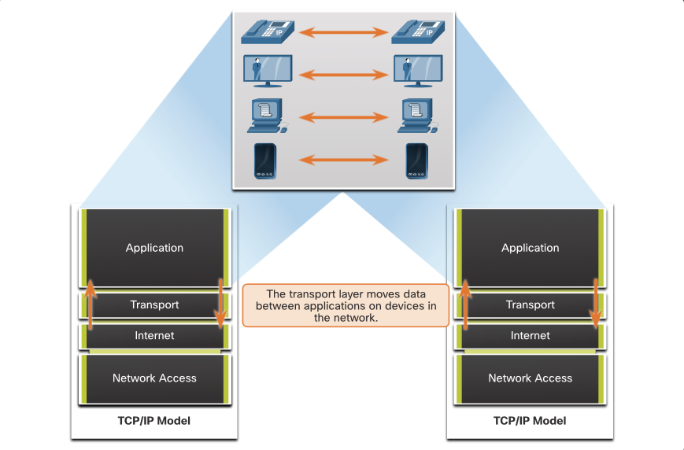

The transport layer is the link between the application layer and the lower layers that are responsible for network transmission.

N.B. The transport layer DOES NOT KNOW:

- destination host type,
- type of media over which the data must travel,
- path taken by the data,
- congestion on a link,
- size of the network.

The transport layer includes two protocols:

Transmission Control Protocol (TCP)
User Datagram Protocol (UDP)

### Transport Layer Responsibilities

#### Tracking individual conversations
At the transport layer, each set of data flowing between a source application and a destination application is known as a conversation and is tracked separately. It is the responsibility of the transport layer to maintain and track these multiple conversations.
A host may have multiple applications that are communicating across the network simultaneously.
Most networks have a limitation on the amount of data that can be included in a single packet. Therefore, data must be divided into manageable pieces.

#### Segmenting Data Reassembling Data

It is the transport layer responsibility to divide the application data into appropriately sized blocks. Depending on the transport layer protocol used, the transport layer blocks are called either segments or datagrams. The figure illustrates the transport layer using different blocks for each conversation.

The transport layer divides the data into smaller blocks (i.e., segments or datagrams) that are easier to manage and transport.

#### Add Header Information

The transport layer protocol also adds header information containing binary data organized into several fields to each block of data. It is the values in these fields that enable various transport layer protocols to perform different functions in managing data communication.

For instance, the header information is used by the receiving host to reassemble the blocks of data into a complete data stream for the receiving application layer program.

The transport layer ensures that even with multiple application running on a device, all applications receive the correct data.

#### Identifying Applications

The transport layer must be able to separate and manage multiple communications with different transport requirement needs. To pass data streams to the proper applications, the transport layer identifies the target application using an identifier called a port number. As illustrated in the figure, each software process that needs to access the network is assigned a port number unique to that host.

#### Conversation Multiplexing

Sending some types of data (e.g., a streaming video) across a network, as one complete communication stream, can consume all the available bandwidth. This would prevent other communication conversations from occurring at the same time. It would also make error recovery and retransmission of damaged data difficult.

the transport layer uses segmentation and multiplexing to enable different communication conversations to be interleaved on the same network.

Error checking can be performed on the data in the segment, to determine if the segment was altered during transmission.

### Transport Layer Protocols

IP is concerned only with the structure, addressing, and routing of packets. IP does not specify how the delivery or transportation of the packets takes place.

Transport layer protocols specify how to transfer messages between hosts, and are responsible for managing reliability requirements of a conversation. The transport layer includes the TCP and UDP protocols.

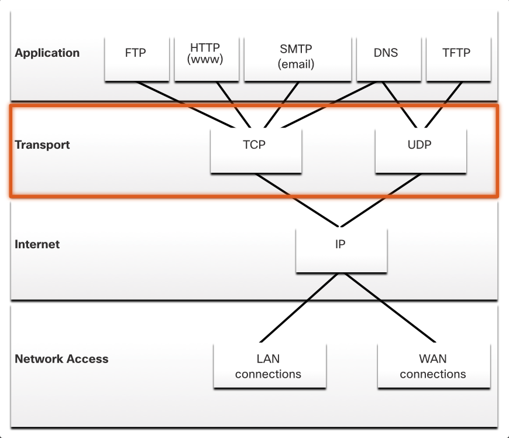

Different applications have different transport reliability requirements, so TCP/IP provides two transport layer protocols.

### Transmission Control Protocol (TCP)

IP is concerned only with the structure, addressing, and routing of packets, from original sender to final destination. IP is not responsible for guaranteeing delivery or determining whether a connection between the sender and receiver needs to be established.

TCP is considered a reliable, full-featured transport layer protocol, which ensures that all of the data arrives at the destination. TCP includes fields which ensure the delivery of the application data. These fields require additional processing by the sending and receiving hosts.

N.B. TCP divides data into segments.

TCP transport is analogous to sending packages that are tracked from source to destination. If a shipping order is broken up into several packages, a customer can check online to see the order of the delivery.

TCP provides reliability and flow control using

- Number and track data segments transmitted to a specific host from a specific application
- Acknowledge received data
- Retransmit any unacknowledged data after a certain amount of time
- Sequence data that might arrive in wrong order
- Send data at an efficient rate that is acceptable by the receiver

To maintain conversation state and information tracking, TCP must first establish a connection between the sender and the receiver. This is why TCP is known as a connection-oriented protocol.

### User Datagram Protocol (UDP)

UDP is a simpler transport layer protocol than TCP. It does not provide reliability and flow control, which means it requires fewer header fields. Because the sender and the receiver UDP processes do not have to manage reliability and flow control, this means UDP datagrams can be processed faster than TCP segments. UDP provides the basic functions for delivering datagrams between the appropriate applications, with very little overhead and data checking.

N.B. UDP divides data into datagrams that are also referred to as segments.

UDP is a connectionless protocol. Because UDP does not provide reliability or flow control, it does not require an established connection. Because UDP does not track information sent or received between the client and server, UDP is also known as a stateless protocol.

UDP is also known as a best-effort delivery protocol because there is no acknowledgment that the data is received at the destination. With UDP, there are no transport layer processes that inform the sender of a successful delivery.

UDP is like placing a regular, nonregistered, letter in the mail. The sender of the letter is not aware of the availability of the receiver to receive the letter. Nor is the post office responsible for tracking the letter or informing the sender if the letter does not arrive at the final destination.

### The Right Transport Layer Protocol for the Right Application

```table
UDP | TCP
--- | ---
VoIP, DNS (DNS Resolution) | SMTP/IMAP, HTTP/HTTPS, FTP, Telnet
Connectionless | Connection-oriented
No reliability | Reliable
No flow control | Flow control
Fast | Slower
No Required Acknowledgment | Acknowledgment Required
Does not resend lost data | Resends lost data
Data delivery as it arrives | Data delivery in sequenced order
Low overhead | High(er) overhead
```

Some applications can tolerate some data loss during transmission over the network, but delays in transmission are unacceptable. For these applications, UDP is the better choice because it requires less network overhead. UDP is preferable for applications such as Voice over IP (VoIP). Acknowledgments and retransmission would slow down delivery and make the voice conversation unacceptable.

UDP is also used by request-and-reply applications where the data is minimal, and retransmission can be done quickly. For example, Domain Name System (DNS) uses UDP for this type of transaction. The client requests IPv4 and IPv6 addresses for a known domain name from a DNS server. If the client does not receive a response in a predetermined amount of time, it simply sends the request again.

For example, if one or two segments of a live video stream fail to arrive, it creates a momentary disruption in the stream. This may appear as distortion in the image or sound, but may not be noticeable to the user. If the destination device had to account for lost data, the stream could be delayed while waiting for retransmissions, therefore causing the image or sound to be greatly degraded. In this case, it is better to render the best media possible with the segments received, and forego reliability.

For other applications it is important that all the data arrives and that it can be processed in its proper sequence. For these types of applications, TCP is used as the transport protocol. For example, applications such as databases, web browsers, and email clients, require that all data that is sent arrives at the destination in its original condition. Any missing data could corrupt a communication, making it either incomplete or unreadable. For example, it is important when accessing banking information over the web to make sure all the information is sent and received correctly.

Application developers must choose which transport protocol type is appropriate based on the requirements of the applications. Video may be sent over TCP or UDP. Applications that stream stored audio and video typically use TCP. The application uses TCP to perform buffering, bandwidth probing, and congestion control, in order to better control the user experience.

Real-time video and voice usually use UDP, but may also use TCP, or both UDP and TCP. A video conferencing application may use UDP by default, but because many firewalls block UDP, the application can also be sent over TCP.

Applications that stream stored audio and video use TCP. For example, if your network suddenly cannot support the bandwidth needed to watch an on-demand movie, the application pauses the playback. During the pause, you might see a “buffering...” message while TCP works to re-establish the stream. When all the segments are in order and a minimum level of bandwidth is restored, your TCP session resumes, and the movie resumes playing.

## TCP Features

To understand the differences between TCP and UDP, it is important to understand how each protocol implements specific reliability features and how each protocol tracks conversations.

In addition to supporting the basic functions of data segmentation and reassembly, TCP also provides the following services:

- Establishes a Session - TCP is a connection-oriented protocol that negotiates and establishes a permanent connection (or session) between source and destination devices prior to forwarding any traffic. Through session establishment, the devices negotiate the amount of traffic that can be forwarded at a given time, and the communication data between the two can be closely managed.
- Ensures Reliable Delivery - For many reasons, it is possible for a segment to become corrupted or lost completely, as it is transmitted over the network. TCP ensures that each segment that is sent by the source arrives at the destination.
- Provides Same-Order Delivery - Because networks may provide multiple routes that can have different transmission rates, data can arrive in the wrong order. By numbering and sequencing the segments, TCP ensures segments are reassembled into the proper order.
- Supports Flow Control - Network hosts have limited resources (i.e., memory and processing power). When TCP is aware that these resources are overtaxed, it can request that the sending application reduce the rate of data flow. This is done by TCP regulating the amount of data the source transmits. Flow control can prevent the need for retransmission of the data when the resources of the receiving host are overwhelmed.

N.B. more information on TCP: search the internet for the RFC 793.

### TCP Header

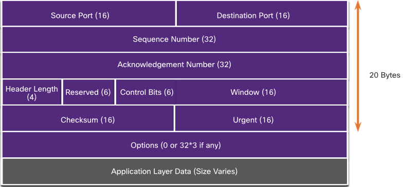

TCP is a stateful protocol which means it keeps track of the state of the communication session. To track the state of a session, TCP records which information it has sent and which information has been acknowledged. The stateful session begins with the session establishment and ends with the session termination.

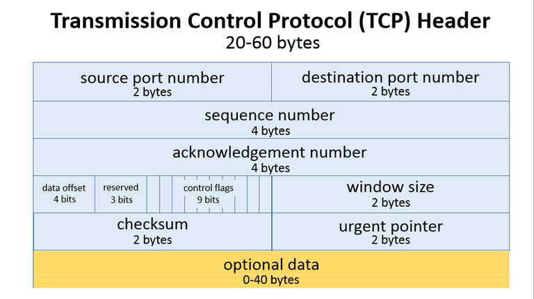

A TCP segment adds 20 bytes (i.e. 160 bits) of overhead when encapsulating the application layer data.

### TCP Header Fields

```table
Field | Description
--- | ---
Source Port | 16 bits. Identifies the sending application on the source host.
Destination Port | 16 bits. Identifies the receiving application on the destination host.
Sequence Number | 32 bits. Used to identify the order of the segments sent from the source to the destination. The sequence number is used by the receiving host to reassemble the segments in the correct order.
Acknowledgment Number | 32 bits. Used to acknowledge the receipt of segments sent from the source to the destination. The acknowledgment number is used by the receiving host to inform the sending host that it has received a segment.
Header Length | 4 bits. Indicates the length of the TCP header in 32-bit words. The minimum value is 5 (20 bytes) and the maximum value is 15 (60 bytes).
Reserved | 6 bits. Reserved for future use and should be set to zero.
Control Bits | 6 bits. Used to control the flow of data between the source and destination hosts. The control bits include SYN, ACK, FIN, RST, PSH, and URG.
Window Size | 16 bits. Used to indicate the amount of data that the receiving host is willing to accept. The window size is used for flow control.
Checksum | 16 bits. Used to verify the integrity of the TCP segment. The checksum is calculated by the sending host and verified by the receiving host.
Urgent Pointer | 16 bits. Used to indicate the end of urgent data in the segment. The urgent pointer is used when the URG control bit is set.
```

### Applications that use TCP

TCP is a good example of how the different layers of the TCP/IP protocol suite have specific roles.

TCP handles all tasks associated with dividing the data stream into segments, providing reliability, controlling data flow, and reordering segments.

TCP frees the application from having to manage any of these tasks.

Applications send the data stream to the transport layer and use the services of TCP.

```diagram

IP <---> TCP <----> HTTP, FTP, SMTP, SSH, Telnet, etc.
```

## UDP features

UDP is a best-effort transport protocol. UDP is a lightweight transport protocol that offers the same data segmentation and reassembly as TCP, but without TCP reliability and flow control.

UDP is such a simple protocol that it is usually described in terms of what it does not do compared to TCP.

UDP features

- Data is reconstructed in the order that it is received.
- Any segments that are lost are not resent.
- There is no session establishment.
- The sending is not informed about resource availability.

For more information on UDP: search for the RFC.

### UDP Header

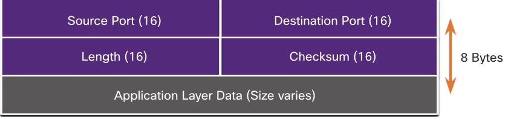

8 bytes (i.e., 64 bits).
UDP is a stateless protocol, meaning neither the client, nor the server, tracks the state of the communication session. If reliability is required when using UDP as the transport protocol, it must be handled by the application.

One of the most important requirements for delivering live video and voice over the network is that the data continues to flow quickly. Live video and voice applications can tolerate some data loss with minimal or no noticeable effect, and are perfectly suited to UDP.

The blocks of communication in UDP are called datagrams, or segments. These datagrams are sent as best effort by the transport layer protocol.

The UDP header is MUCH simpler than the TCP header because it only has four fields and requires 8 bytes (i.e., 64 bits).

### UDP Header Fields

```table
Field | Description
--- | ---
Source Port | 16 bits. Identifies the sending application on the source host.
Destination Port | 16 bits. Identifies the receiving application on the destination host.
Length | 16 bits. Indicates the length of the UDP header and data in bytes.
Checksum | 16 bits. Used to verify the integrity of the UDP datagram. The checksum is calculated by the sending host and verified by the receiving host.
```

### Applications that use UDP

Three types of applications best suited for UDP

- Live video and multimedia applications - These applications can tolerate some data loss, but require little or no delay. Examples include VoIP and live streaming video.
- Simple request and reply applications - Applications with simple transactions where a host sends a request and may or may not receive a reply. Examples include DNS and DHCP.
- Applications that handle reliability themselves - Unidirectional communications where flow control, error detection, acknowledgments, and error recovery is not required, or can be handled by the application. Examples include SNMP and TFTP.

```diagram
IP <---> UDP <----> VoIP, DNS, DHCP, SNMP, TFTP, Video conferencing, etc.
```

DNS and SNMP use UDP by default, both can also use TCP. DNS will use TCP if the DNS request or DNS response is more than 512 bytes, such as when a DNS response includes many name resolutions. Similarly, under some situations the network administrator may want to configure SNMP to use TCP.

## Port Numbers

### Multiple Separate Communications

There are some situations where TCP is the right protocol for the job, and other situations in which UDP should be used. TCP and UDP both use port numbers.

The TCP and UDP transport layer protocols use port numbers to manage multiple, simultaneous conversations. The TCP and UDP header fields identify a source and destination application port number.

```text
Source Port (16) | Destination Port (16)
```

The source port number is associated with the originating application on the local host whereas the destination port number is associated with the destination application on the remote host.

For instance, assume a host is initiating a web page request from a web server. When the host initiates the web page request, the source port number is dynamically generated by the host to uniquely identify the conversation. Each request generated by a host will use a different dynamically created source port number. This process allows multiple conversations to occur simultaneously.

In the request, the destination port number is what identifies the type of service being requested of the destination web server. For example, when a client specifies port 80 in the destination port, the server that receives the message knows that web services are being requested.

A server can offer more than one service simultaneously such as web services on port 80 while it offers File Transfer Protocol (FTP) connection establishment on port 21.

### Socket Pairs

The source and destination ports are placed within the segment. The segments are then encapsulated within an IP packet. The IP packet contains the IP address of the source and destination. The combination of the source IP address and source port number, or the destination IP address and destination port number is known as a socket.

A PC can simultaneously request FTP and web services from the destination server.

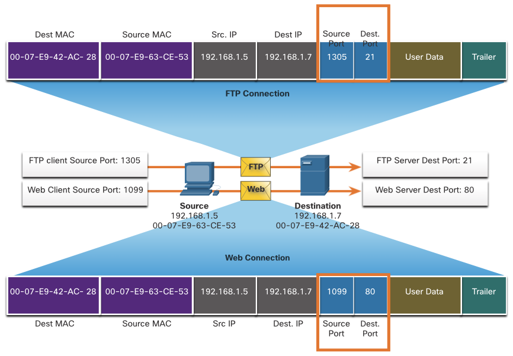

In the example above, the FTP request generated by the PC includes the Layer 2 MAC addresses and the Layer 3 IP addresses. The request also identifies the source port number 1305 (i.e., dynamically generated by the host) and destination port, identifying the FTP services on port 21. The host also has requested a web page from the server using the same Layer 2 and Layer 3 addresses. However, it is using the source port number 1099 (i.e., dynamically generated by the host) and destination port identifying the web service on port 80.

The socket is used to identify the server and service being requested by the client. A client socket might look like this, with 1099 representing the source port number: 192.168.1.5:1099

The socket on a web server might be 192.168.1.7:80

Together, these two sockets combine to form a socket pair: 192.168.1.5:1099, 192.168.1.7:80

Sockets enable multiple processes, running on a client, to distinguish themselves from each other, and multiple connections to a server process to be distinguished from each other.

The source port number acts as a return address for the requesting application. The transport layer keeps track of this port and the application that initiated the request so that when a response is returned, it can be forwarded to the correct application.

### Port Number Groups

The Internet Assigned Numbers Authority (IANA) is the standards organization responsible for assigning various addressing standards, including the 16-bit port numbers. The 16 bits used to identify the source and destination port numbers provides a range of ports from 0 through 65535.

The IANA has divided the range of numbers into the following three port groups.

```table
Port Group | Number Range | Description
Well-known | 0 - 1023 | These are the ports that are reserved for well-known services.
Registered | 1024 - 49151 | These are the ports that are registered for specific services.
Private/Dynamic | 49152 - 65535 | aka Ephemeral Ports. These are the ports that are used for private or dynamic purposes.
```

N.B. Some client operating systems may use registered port numbers instead of dynamic port numbers for assigning source ports.

#### common well-known port numbers and their associated applications

```table
Port Number | Protocol | Application
--- | --- | ---
20 | TCP | FTP (Data)
21 | TCP | FTP (Control)
22 | TCP | SSH
23 | TCP | Telnet
25 | TCP | SMTP
53 | TCP/UDP | DNS
67 | UDP | DHCP (Server)
68 | UDP | DHCP (Client)
80 | TCP | HTTP
110 | TCP | POP3
143 | TCP | IMAP
161 | UDP | SNMP
162 | UDP | SNMP Trap
443 | TCP | HTTPS
```

Some applications may use both TCP and UDP e.g. DNS uses UDP when clients send requests to a DNS server.
communication between two DNS servers always uses TCP.

Search the IANA website for: port registry to view the full list of port numbers and associated applications.

### Netstat Command

Unexplained TCP connections can pose a major security threat. They can indicate that something or someone is connected to the local host. Sometimes it is necessary to know which active TCP connections are open and running on a networked host. Netstat is an important network utility that can be used to verify those connections. As shown below, enter the command netstat to list the protocols in use, the local address and port numbers, the foreign address and port numbers, and the connection state.

```bash
C:∖> netstat

Active Connections

  Proto    Local Address          Foreign Address           State
  TCP      192.168.1.124:3126     192.168.0.2:netbios-ssn   ESTABLISHED
  TCP      192.168.1.124:3158     207.138.126.152:http      ESTABLISHED
  TCP      192.168.1.124:3159     207.138.126.169:http      ESTABLISHED
  TCP      192.168.1.124:3160     207.138.126.169:http      ESTABLISHED
  TCP      192.168.1.124:3161     sc.msn.com:http           ESTABLISHED
  TCP      192.168.1.124:3166     www.cisco.com:http        ESTABLISHED
(output omitted)
C:∖>
```

By default, the netstat command will attempt to resolve IP addresses to domain names and port numbers to well-known applications. The -n option can be used to display IP addresses and port numbers in their numerical form.

#### netstat option list

```bash
Option | Description
--- | ---
-a | Displays all connections and listening ports.
-b | Displays the executable involved in creating each connection or listening port. In some cases, well-known executables host multiple independent components, and in these cases the sequence of components involved in creating the connection or listening port is displayed. In this case, the executable name is in [] at the bottom, on top is the component it called, and so forth until TCP/IP was reached. Note that some Microsoft Windows NT executables may not be identified by name.
-e | Displays Ethernet statistics, such as the number of bytes and packets sent and received. This can be combined with the -s option
-f | Displays the fully qualified domain name (FQDN) for foreign addresses.
-n | Displays addresses and port numbers in numerical form.
-o | Displays the owning process ID associated with each connection. (The process ID is used to identify the application that is using the connection.)
-p proto | Shows connections for the protocol specified by proto; proto may be any of the following: TCP, UDP, TCPv6, or UDPv6. If used with the -s option to display per-protocol statistics, proto may be any of the following: IP, IPv6, ICMP, ICMPv6, TCP, TCPv6, UDP, or UDPv6.
-r | Displays the routing table.
-s | Displays per-protocol statistics. By default, statistics are shown for IP, IPv6, ICMP, ICMPv6, TCP, TCPv6, UDP, and UDPv6. The -p option can be used to specify a subset of the default.
-t | Displays the current connection offload state.
```

## TCP Server Processes

TCP three-way handshake and session termination processes.

Each application process running on a server is configured to use a port number. The port number is either automatically assigned or configured manually by a system administrator.

An individual server cannot have two services assigned to the same port number within the same transport layer services. For example, a host running a web server application and a file transfer application cannot have both configured to use the same port, such as TCP port 80.

An active server application assigned to a specific port is considered open, which means that the transport layer accepts, and processes segments addressed to that port. Any incoming client request addressed to the correct socket is accepted, and the data is passed to the server application. There can be many ports open simultaneously on a server, one for each active server application.

### Client Sending TCP requests to a Server

Client 1 is requesting web services and Client 2 is requesting email service of the same sever.
Server
HTTP: Port 80
SMTP: Port 25

HTTP Request:
Source Port: 49152
Destination Port: 80
SMTP Request:
Source Port: 51152
Destination Port: 25

### Request Destination Ports

Client 1 is requesting web services using well-known destination port 80 (HTTP) and Client 2 is requesting email service using well-known port 25 (SMTP).

N.B. Use well known port numbers as the destination port.

Server HTTP: Port 80
SMTP: Port 25

Client 1 HTTP Request:

- Source Port: 49152
- Destination Port: 80

Client 2 SMTP Request:

- Source Port: 51152
- Destination Port: 25

### Request Source Ports

Client requests dynamically generate a source port number. In this case:

- Client 1 is using source port 49152
- Client 2 is using source port 51152.

N.B. Use dynamic port numbers as the source port.

#### Server

HTTP: Port 80
SMTP: Port 25

Client 1
HTTP Request:

- Source Port: 49152
- Destination Port: 80

Client 2 SMTP Request:

- Source Port: 51152
- Destination Port: 25

### Response Destination Ports

When the server responds to the client requests, it reverses the destination and source ports of the initial request.

Server response to the web request now has destination port 49152 and the email response now has destination port 51152.

N.B. Server response to TCP client uses the source port from the request packet as the destination port.

#### Client requests to TCP server

Client 1
HTTP Request:

- Source Port: 49152
- Destination Port: 80

Client 2
SMTP Request:

- Source Port: 51152
- Destination Port: 25

HTTP response:

- Source Port 80
- Destination Port 49152

SMTP Response:

- Source Port 25
- Destination Port 51152

Server

- HTTP: Port 80
- SMTP: Port 25

### Response Source Ports

The source port in the server response is the original destination port in the initial requests.

N.B. Server response to TCP client uses the destination port from the request packet as the source port.

#### Client requests to TCP server

Server

- Client 1 HTTP: Port 80
- Client 2 SMTP: Port 25

HTTP Request:

- Source Port: 49152
- Destination Port: 80

SMTP Request:

- Source Port: 51152
- Destination Port: 25

HTTP response:

- Source Port: 80
- Destination Port: 49152

SMTP Response:

- Source Port: 25
- Destination Port: 51152

### TCP Connection Establishment

In TCP connections, the host client establishes the connection with the server using the three-way handshake process.

SYN -> ACK SYN -> ACK

Step 1. SYN
The initiating client requests a client-to-server communication session with the server.

Step 2. ACK and SYN
The server acknowledges the client-to-server communication session and requests a server-to-client communication session.

Step 3. ACK
The initiating client acknowledges the server-to-client communication session.

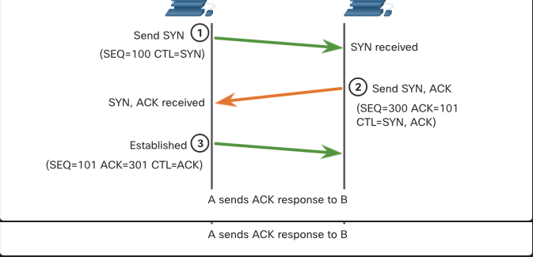

The three-way handshake validates that the destination host is available to communicate. In this example, host A has validated that host B is available.

### Session Termination

To close a connection, the Finish (FIN) control flag must be set in the segment header. REMEMBER: FAFA

To end each one-way TCP session, a two-way handshake, consisting of a FIN segment and an Acknowledgment (ACK) segment, is used.
To terminate a single conversation supported by TCP, four exchanges are needed to end both sessions.

N.B. Either the client or the server can initiate the termination.

N.B. Any two hosts that have an open session can initiate the termination process.

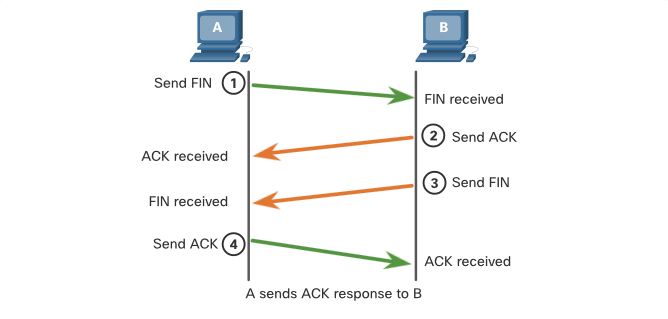

Step 1. FIN

When the client has no more data to send in the stream, it sends a segment with the FIN flag set.

Step 2. ACK

The server sends an ACK to acknowledge the receipt of the FIN to terminate the session from client to server.

Step 3. FIN

The server sends a FIN to the client to terminate the server-to-client session.

Step 4. ACK

The client responds with an ACK to acknowledge the FIN from the server.

the session is closed when all segments have been acknowledged.

REMEMBER: FAFA

### TCP Three-way Handshake Analysis

Hosts maintain state, track each data segment within a session, and exchange information about what data is received using the information in the TCP header.

TCP is a full-duplex protocol, where each connection represents two one-way communication sessions.

To establish the connection, the hosts perform a three-way handshake. Control bits in the TCP header indicate the progress and status of the connection.

#### Three-way handshake functions

N.B. THREE way handshake consists of FOUR exchanges.

- establishes that the destination device is present on the network.
- verifies that the destination device has an active service and is accepting requests on the destination port number that the initiating client intends to use.
- informs the destination device that the source client intends to establish a communication session on that port number.

After the communication is completed the sessions are closed and connection terminated.

N.B. The connection and session mechanisms enable TCP reliability function.

#### Control Bits Field

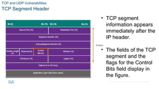

##### 6 control bits flags

- URG - Urgent pointer field significant
- ACK - Acknowledgment flag used in connection establishment and session termination
- PSH - Push function
- RST - Reset the connection when an error or timeout occurs
- SYN - Synchronize sequence numbers used in connection establishment
- FIN - No more data from sender and used in session termination

N.B. Learn more online: PSH and URG flags.

## Reliability and Flow Control

### TCP Reliability - Guaranteed and Ordered Delivery

TCP is the better protocol for some applications because (unlike UDP) it resends dropped packets and number of packets to indicate their proper order before delivery.

TCP can also help maintain the flow of packets so that devices do not become overloaded.

Sometimes TCP segments do not arrive at their destination. Other times segments might arrive out of order.

For the original message to be understood by the recipient, all the data must be received and the data in these segments must be reassembled into the original order.

Sequence numbers are assigned in the header of each packet to achieve this goal.

The sequence number represents the first data byte of the TCP segment.

During session setup, an initial sequence number (ISN) is set. This ISN represents the starting value of the bytes that are transmitted to the receiving application. As data is transmitted during the session, the sequence number is incremented by the number of bytes that have been transmitted. This data byte tracking enables each segment to be uniquely identified and acknowledged. Missing segments can then be identified.

N.B. The ISN does not begin at one, but is effectively a random number.

This is to prevent certain types of malicious attacks.

Segment sequence numbers indicate how to reassemble and reorder received segments.

### TCP reordering at the receiving host

The receiving TCP process places the data from a segment into a receiving buffer. Segments are then placed in the proper sequence order and passed to the application layer when reassembled. Any segments that arrive with sequence numbers that are out of order are held for later processing. Then, when the segments with the missing bytes arrive, these segments are processed in order.

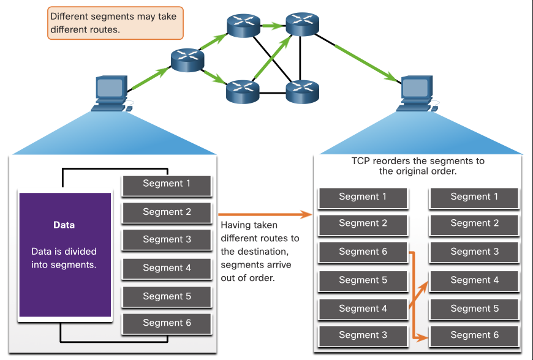

### TCP Reliability - Data Loss and Retransmission

No matter how well designed a network is, data loss occasionally occurs. TCP provides methods of managing these segment losses. Among these is a mechanism to retransmit segments for unacknowledged data.

The sequence (SEQ) number and acknowledgement (ACK) number are used together to confirm receipt of the bytes of data contained in the transmitted segments. The SEQ number identifies the first byte of data in the segment being transmitted. TCP uses the ACK number sent back to the source to indicate the next byte that the receiver expects to receive. This is called expectational acknowledgement.

Prior to later enhancements, TCP could only acknowledge the next byte expected. For example, in the figure, using segment numbers for simplicity, host A sends segments 1 through 10 to host B. If all the segments arrive except for segments 3 and 4, host B would reply with acknowledgment specifying that the next segment expected is segment 3. Host A has no idea if any other segments arrived or not. Host A would, therefore, resend segments 3 through 10. If all the resent segments arrived successfully, segments 5 through 10 would be duplicates. This can lead to delays, congestion, and inefficiencies.
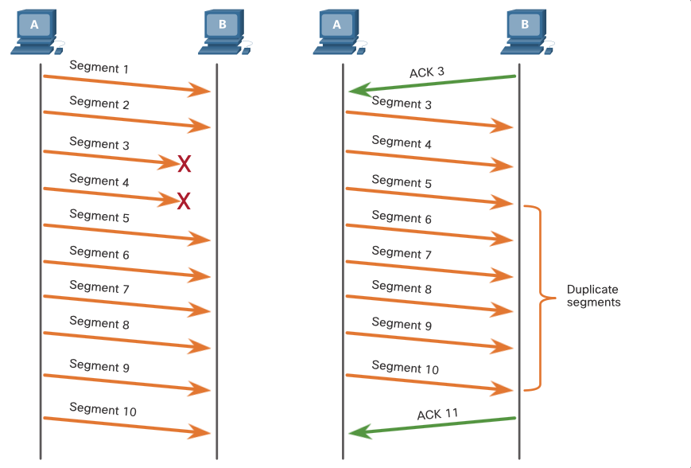

Host operating systems today typically employ an optional TCP feature called selective acknowledgment (SACK), negotiated during the three-way handshake. If both hosts support SACK, the receiver can explicitly acknowledge which segments (bytes) were received including any discontinuous segments. The sending host would therefore only need to retransmit the missing data. For example, in the next figure, again using segment numbers for simplicity, host A sends segments 1 through 10 to host B. If all the segments arrive except for segments 3 and 4, host B can acknowledge that it has received segments 1 and 2 (ACK 3), and selectively acknowledge segments 5 through 10 (SACK 5-10). Host A would only need to resend segments 3 and 4.
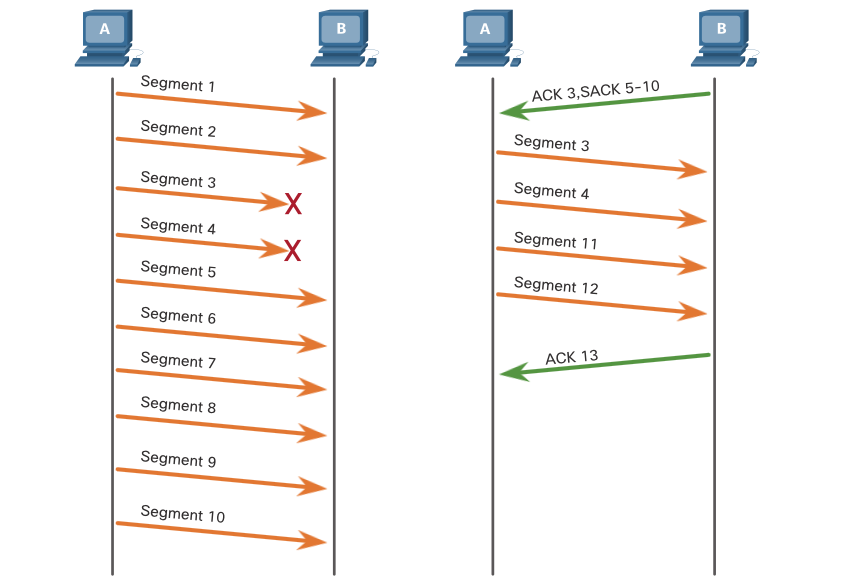

N.B. TCP typically sends ACKs for every OTHER packet, but other factors (e.g. network conditions, buffer sizes) may alter this behavior.

TCP uses timers to know how long to wait before resending a segment.

### TCP Flow Control - Window Size and Acknowledgments

TCP also provides mechanisms for flow control.

N.B. DEF: Flow control: the amount of data that the destination can receive and process reliably.

Flow control helps maintain the reliability of TCP transmission by adjusting the rate of data flow between source and destination for a given session.

TCP header includes a 16-bit field called the window size for this purpose.

The window size determines the number of bytes that can be sent before expecting an acknowledgment. The acknowledgment number is the number of the next expected byte.

The window size is the number of bytes that the destination device of a TCP session can accept and process at one time.

e.g. PC B initial window size for the TCP session is 10,000 bytes. Starting with the first byte, byte number 1, the last byte PC A can send without receiving an acknowledgment is byte 10,000.

This is known as the send window of PC A.

The window size is included in every TCP segment so the destination can modify the window size at any time depending on buffer availability.

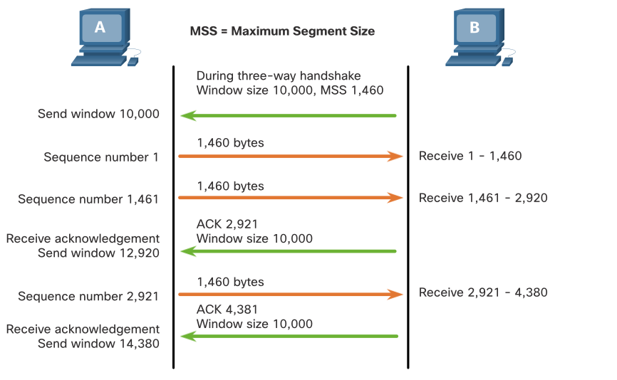

The initial window size is agreed upon when the TCP session is established during the three-way handshake. The source device must limit the number of bytes sent to the destination device based on the window size of the destination. Only after the source device receives an acknowledgment that the bytes have been received, can it continue sending more data for the session. Typically, the destination will not wait for all the bytes for its window size to be received before replying with an acknowledgment. As the bytes are received and processed, the destination will send acknowledgments to inform the source that it can continue to send additional bytes.

For example, typically, PC B would not wait until all 10,000 bytes have been received before sending an acknowledgment.

This means PC A can adjust its send window as it receives acknowledgments from PC B.

when PC A receives an acknowledgment with the acknowledgment number 2,921, (i.e. the next expected byte). The PC A send window will increment 2,920 bytes.

This changes the send window from 10,000 bytes to 12,920.

PC A can now continue to send up to another 10,000 bytes to PC B as long as it does not send more than its new send window at 12,920.

A destination sending acknowledgments as it processes bytes received, and the continual adjustment of the source send window, is known as sliding windows. In the previous example, the send window of PC A increments or slides over another 2,921 bytes from 10,000 to 12,920.

If the availability of the destination’s buffer space decreases, it may reduce its window size to inform the source to reduce the number of bytes it should send without receiving an acknowledgment.

N.B. Devices today use the SLIDING WINDOW PROTOCOL:

- The receiver typically sends an acknowledgment after every two segments it receives
- The number of segments received before being acknowledged may vary
- sliding windows advantage - continuous segment transmission from the sender so long as the receiver acknowledges previous segments.

TODO?: research sliding windows

### TCP Flow Control - Maximum Segment Size (MSS)
In the figure, the source is transmitting 1,460 bytes of data within each TCP segment. This is typically the Maximum Segment Size (MSS) that the destination device can receive. The MSS is part of the options field in the TCP header that specifies the largest amount of data, in bytes, that a device can receive in a single TCP segment. The MSS size does not include the TCP header. The MSS is typically included during the three-way handshake.


A common MSS is 1,460 bytes when using IPv4. A host determines the value of its MSS field by subtracting the IP and TCP headers from the Ethernet maximum transmission unit (MTU). On an Ethernet interface, the default MTU is 1500 bytes. Subtracting the IPv4 header of 20 bytes and the TCP header of 20 bytes, the default MSS size will be 1460 bytes


### TCP Flow Control - Congestion Avoidance

network congestion results in packets being discarded by the overloaded router. packets containing TCP segments that do not reach their destination are left unacknowledged.

Determining the rate at which TCP segments are sent but not acknowledged, lets the source assume the level of network congestion.

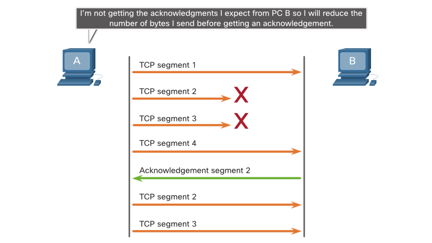

Whenever there is congestion, retransmission of lost TCP segments from the source will occur. If the retransmission is not properly controlled, the additional retransmission of the TCP segments can exhasterbate congestion. New packets with TCP segments introduced into the network and the feedback effect of retransmitted TCP segments previously lost will add to congestion.

N.B. To avoid and control congestion, TCP employs several congestion handling mechanisms, timers, and algorithms.

If the source determines that the TCP segments are either not being acknowledged or not acknowledged in a timely manner, then it can reduce the number of bytes it sends before receiving an acknowledgment. As illustrated in the figure, PC A senses there is congestion and therefore, reduces the number of bytes it sends before receiving an acknowledgment from PC B.

Acknowledgment numbers are for the next expected byte and not for a segment. The segment numbers used are simplified for illustration purposes.

Notice that it is the source that is reducing the number of unacknowledged bytes it sends and not the window size determined by the destination.

TODO?: for explanations of actual congestion handling mechanisms, timers, algorithms - search the internet for TCP congestion control.

## UDP communication

### UDP Low Overhead versus Reliability

UDP is perfect for communications that need to be fast, like VoIP. This topic explains in detail why UDP is perfect for some types of transmissions. As shown in the figure, UDP does not establish a connection. UDP provides low overhead data transport because it has a small datagram header and no network management traffic.

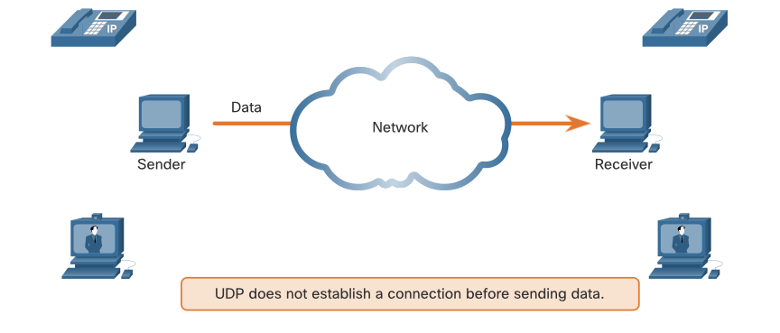

### UDP Datagram Reassembly

Like segments with TCP, when UDP datagrams are sent to a destination, they often take different paths and arrive in the wrong order. UDP does not track sequence numbers the way TCP does. UDP has no way to reorder the datagrams into their transmission order, as shown in the figure.

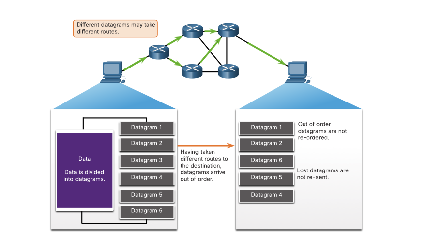

Therefore, UDP simply reassembles the data in the order that it was received and forwards it to the application. If the data sequence is important to the application, the application must identify the proper sequence and determine how the data should be processed.

UDP: Connectionless and Unreliable

### UDP Server Processes and Requests

Like TCP-based applications, UDP-based server applications are assigned well-known or registered port numbers, as shown in the figure. When these applications or processes are running on a server, they accept the data matched with the assigned port number. When UDP receives a datagram destined for one of these ports, it forwards the application data to the appropriate application based on its port number.
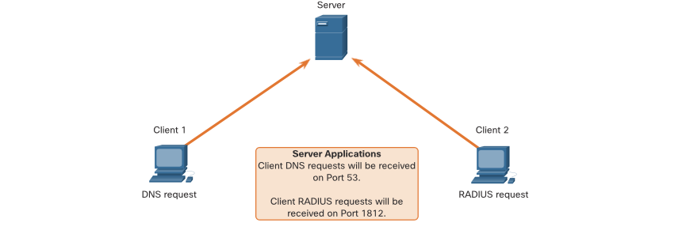

### UDP Client Processes

As with TCP, client-server communication is initiated by a client application that requests data from a server process. The UDP client process dynamically selects a port number from the range of port numbers and uses this as the source port for the conversation. The destination port is usually the well-known or registered port number assigned to the server process.

After a client has selected the source and destination ports, the same pair of ports are used in the header of all datagrams in the transaction. For the data returning to the client from the server, the source and destination port numbers in the datagram header are reversed.

1. Clients Sending UDP Requests
   Client 1 is sending a DNS request while Client 2 is requesting RADIUS authentication services of the same server.
   Server
   DNS: Port 53
   RADIUS: Port 1812

Client 1 DNS Request:
Source Port 49152
Destination Port 53

Client 2 RADIUS User Authentication Request:
Source Port 51152
Destination Port 1812

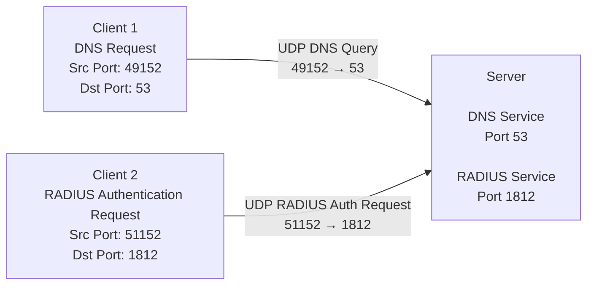

2. UDP Request Destination Ports
   Client 1 is sending a DNS request using the well-known destination port 53 while Client 2 is requesting RADIUS authentication services using the registered destination port 1812.

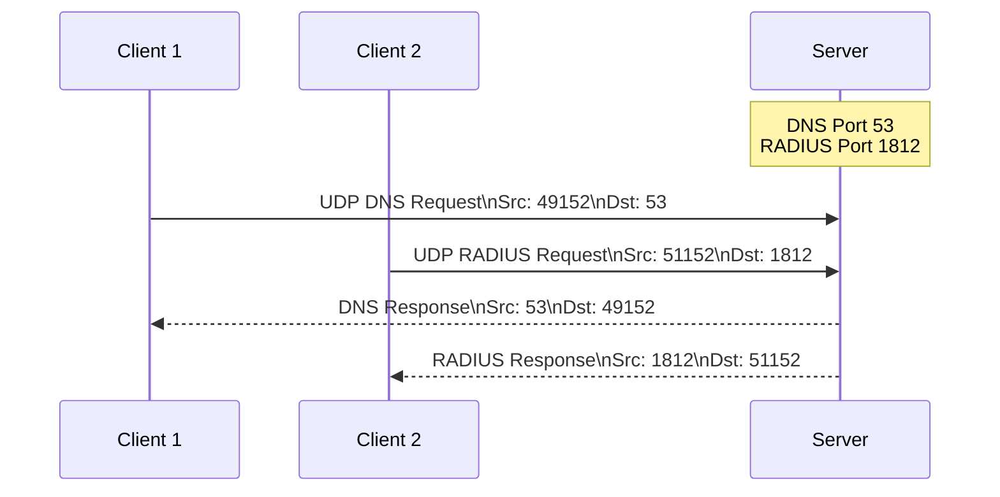

3. UDP Request Source Ports
   The requests of the clients dynamically generate source port numbers. In this case, Client 1 is using source port 49152 and Client 2 is using source port 51152.

4. UDP Response Destination
   When the server responds to the client requests, it reverses the destination and source ports of the initial request. In the Server response to the DNS request is now destination port 49152 and the RADIUS authentication response is now destination port 51152.

5. UDP Response Source Ports
   The source ports in the server response are the original destination ports in the initial requests.

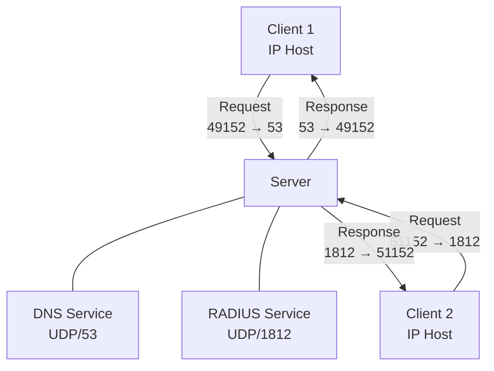

## Packet Tracer - TCP and UDP Communications

### Objectives

- Part 1: Generate Network Traffic in Simulation Mode

- Part 2: Examine the Functionality of the TCP and UDP Protocols

### Background

This simulation activity is intended to provide a foundation for understanding TCP and UDP in detail. Simulation mode provides the ability to view the state of different PDUs as they travel through the network.

The steps outlined below lead through the process of requesting network services using various applications that are available on a client PC. Including functionality of TCP and UDP protocols, multiplexing, and the function of port numbers in determining which local application requested the data or is sending the data.

### Q/A

b. Click Capture/Forward six times and watch the PDUs from the different hosts as they travel on the network. Note that only one PDU can cross a wire in each direction at any given time.

Questions:
What is this called?

Answer: conversation multiplexing

A variety of PDUs appears in the event list in the Simulation Panel. What is the meaning of the different colors?

Answer: colours are protocol differentiators

Part 2: Examine Functionality of the TCP and UDP Protocols

Step 1: Examine HTTP traffic as the clients communicate with the server.

a. Click Reset Simulation.

b. Filter the traffic that is currently displayed to only HTTP and TCP PDUs. To filter the traffic that is currently displayed:

1.  Click Edit Filters and toggle the Show All/None button.

2.  Select HTTP and TCP. Click the red “x” in the upper right-hand corner of the Edit Filters box to close it. Visible Events should now display only HTTP and TCP PDUs.

c. Open the browser on HTTP Client and enter 192.168.1.254 in the URL field. Click Go to connect to the server over HTTP. Minimize the HTTP Client window.

d. Click Capture/Forward until you see a PDU appear for HTTP. Note that the color of the envelope in the topology window matches the color code for the HTTP PDU in the Simulation Panel.

Question:
Why did it take so long for the HTTP PDU to appear?

Answer: 1st: TCP establishes reliable connection via 3-way shake
2nd: HTTP PDU is sent after TCP connection established

e. Click the PDU envelope to show the PDU details. Click the Outbound PDU Details tab and scroll down to the second to the last section.

Questions:
What is the section labeled?

Answer: TCP

Are these communications considered to be reliable?

Answer: yes

Record the SRC PORT, DEST PORT, SEQUENCE NUM, and ACK NUM values.

Answer:
1028
80
1
1

f. Look at the value in the Flags field, which is located next to the Window field. The values to the right of the “b” represent the TCP flags that are set for this stage of the data conversation. Each of the six places corresponds to a flag. The presence of a “1” in any place indicates that the flag is set. More than one flag can be set at a time. The values for the flags are shown below.

```Table Widget
Flag Place | Value
----------- -------
6          | URG
5          | ACK
4          | PSH
3          | RST
2          | SYN
1          | FIN
```

Question:
Which TCP flags are set in this PDU?

Answer: ACK, PSH

g. Close the PDU and click Capture/Forward until a PDU with a checkmark returns to the HTTP Client.

h. Click the PDU envelope and select Inbound PDU Details.

Question:
How are the port and sequence numbers different than before?

Answer:
SRC, DST are opposite.
ACK number now === 1
flags = SYN+ACK

i. Click the HTTP PDU which HTTP Client has prepared to send to MultiServer. This is the beginning of the HTTP communication. Click this second PDU envelope and select Outbound PDU Details.

Question:
What information is now listed in the TCP section? How are the port and sequence numbers different from the previous two PDUs?

Answer:
SRC, DST reversed again
SRC, DST seq number(s) === 1
flags === SYN, ACK
ACK number 103

j. Reset the simulation.

Step 2: Examine FTP traffic as the clients communicate with the server.

a. Open the command prompt on the FTP Client desktop. Initiate an FTP connection by entering ftp 192.168.1.254.

b. In the Simulation Panel, change Edit Filters to display only FTP and TCP.

c. Click Capture/Forward. Click the second PDU envelope to open it.

Click the Outbound PDU Details tab and scroll down to the TCP section.

Question:
Are these communications considered to be reliable?

Answer: yes

d. Record the SRC PORT, DEST PORT, SEQUENCE NUM, and ACK NUM values.

Question:
What is the value in the flagfield?

Answer:
1026
21
0
0

e. Close the PDU and click Capture/Forward until a PDU returns to the FTP Client with a checkmark.

f. Click the PDU envelope and select Inbound PDU Details.

Question:
How are the port and sequence numbers different than before?

Answer:
SRC, DST reversed
1026
SYN+ACK
0
1

g. Click the OutboundPDU Details tab.

Question:
How are the port and sequence numbers different from the previous results?

Answer:
ports reversed
1026
21
SYN 1
ACK 1

h. Close the PDU and click Capture/Forward until a second PDU returns to the FTP Client. The PDU is a different color.

i. Open the PDU and select Inbound PDU Details. Scroll down past the TCP section.

Question:
What is the message from the server?

Answer: welcome

j. Click Reset Simulation.

Step 3: Examine DNS traffic as the clients communicate with the server.

a. Repeat the steps in Part 1 to create DNS traffic.

b. In the Simulation Panel, change Edit Filters to display only DNS and UDP.

c. Click the PDU envelope to open it.

d. Look at the OSI Model details for the outbound PDU.

Question:
What is the Layer 4 protocol?

Answer: UDP

Are these communications considered to be reliable?

Answer: no

e. Open the Outbound PDU Details tab and find the UDP section of the PDU formats. Record the SRC PORT and DEST PORT values.

Question:
Why are there no sequence and acknowledgement numbers?

Answer: Because UDP is a best attempt connectionless protocol and does not require the overhead of sequence and acknowledgement numbers.

f. Close the PDU and click Capture/Forward until a PDU with a check mark returns to the DNS Client.

g. Click the PDU envelope and select Inbound PDU Details.

Question:
How are the port and sequence numbers different than before?

Answer: ports reversed, no sequence numbers

What is the last section of the PDU called? What is the IP address for the name multiserver.pt.ptu?

Answer: DNS ANSWER 192.168.1.254

h. Click Reset Simulation.

Step 4: Examine email traffic as the clients communicate with the server.

a. Repeat the steps in Part 1 to send an email to user@multiserver.pt.ptu.

b. In the Simulation Panel, change Edit Filters to display only POP3, SMTP and TCP.

c. Click the first PDU envelope to open it.

d. Click the Outbound PDU Details tab and scroll down to the last section.

Questions:
What transport layer protocol does email traffic use?

Answer: TCP

Are these communications considered to be reliable?

Answer: yes

e. Record the SRC PORT, DEST PORT, SEQUENCE NUM, and ACK NUM values. What is the flag field value?

Answer:
1026
26
0
0
SYN

f. Close the PDU and click Capture/Forward until a PDU returns to the E-Mail Client with a checkmark.

g. Click the TCP PDU envelope and select Inbound PDU Details.

Question:
How are the port and sequence numbers different than before?

Answer:
ports reversed
25
1026
0
1
SYN+ACK

h. Click the OutboundPDU Details tab.

Question:
How are the port and sequence numbers different from the previous two results?

Answer:
ports reversed
1026
25
0
1
SYN+ACK

i. There is a second PDU of a different color that E-Mail Client has prepared to send to MultiServer. This is the beginning of the email communication. Click this second PDU envelope and select Outbound PDU Details.

Questions:
How are the port and sequence numbers different from the previous two PDUs?

Answer:
ports reversed
1026
25
1
1
PSH+ACK

What email protocol is associated with TCP port 25? What protocol is associated with TCP port 110?

Answer:
25 SMTP
110 POP3

## Transport Layer Summary

## Module Pass

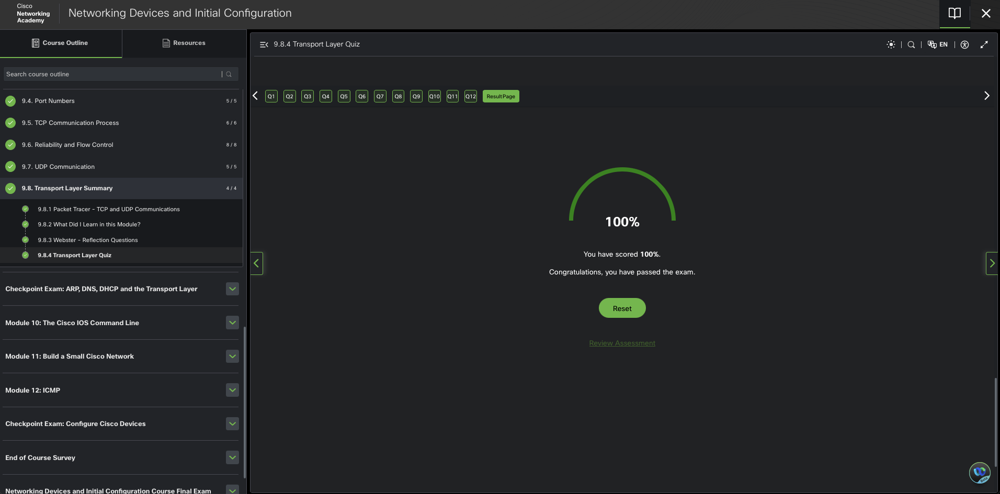

### module notes

The transport layer is responsible for establishing a temporary communication session between the source and destination host applications.

The transport layer is responsible for conversation multiplexing, segmenting data and reassembling segments, and tracking individual conversations.

The TCP header consists of 10 fields in a 20-byte header.
UDP header consists of four fields in an 8-byte header.

socket pair for a host with IP address 10.1.1.10 requesting web services from a server at 10.1.1.254 would be 10.1.1.10:1099, 10.1.1.254:80.

FTP, HTTP, and TFTP applications port numbers are defined in the well-known port numbers group.

The netstat Windows command would display protocols in use, the local address and port numbers, the foreign address and port numbers, and the connection state.

The destination port is the well-known port for Simple Mail Transport Protocol, which is 25. This is the port that the mail server will be listening on. The source port is dynamically selected by the requesting client and can be 49152.

The three-way handshake consists of a three message exchanges with the following control bit flags: SYN, SYN ACK, and ACK.

There are four exchanges to end both sessions between two hosts. (1) Host A sends a FIN. (2) Host B sends an ACK. (3) Host B sends a FIN. (4) Host A sends an ACK.

The sequence number field is used by the destination host to reassemble segments into the original order.
The Window Size field is used to provide flow control.
