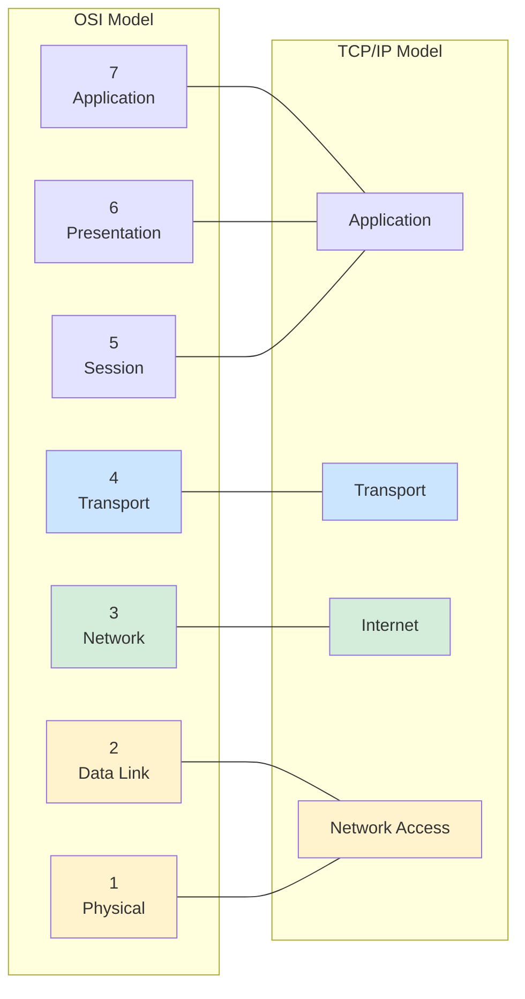
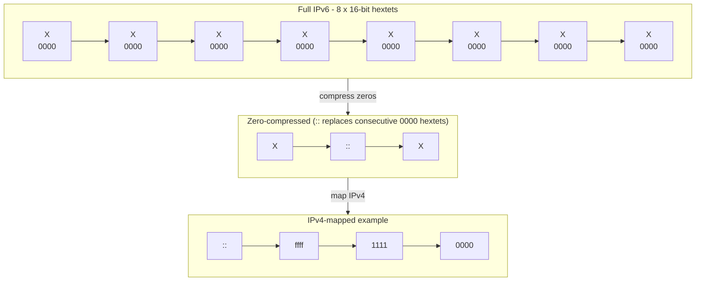
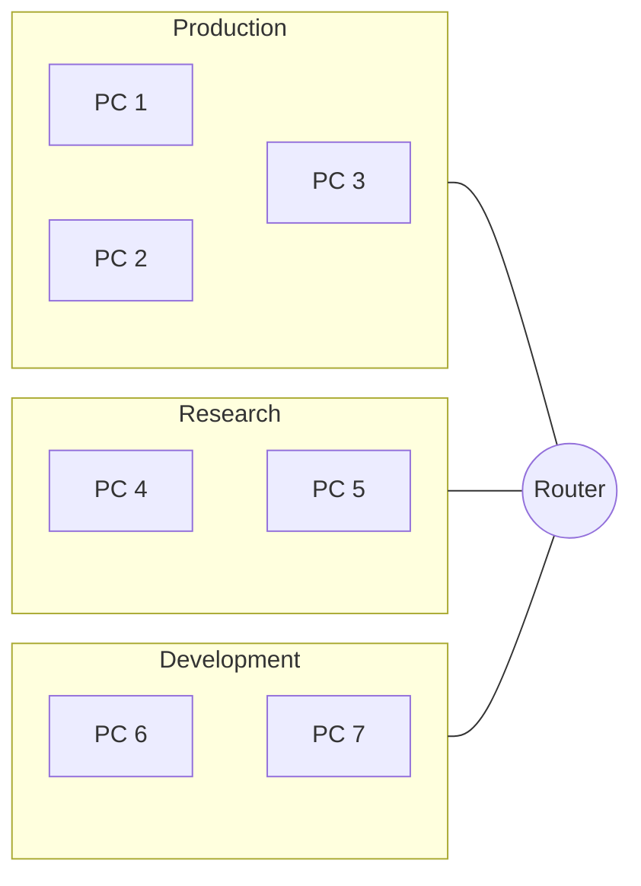
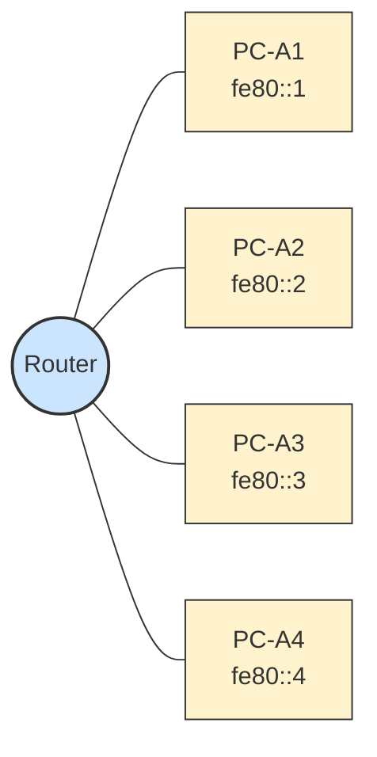
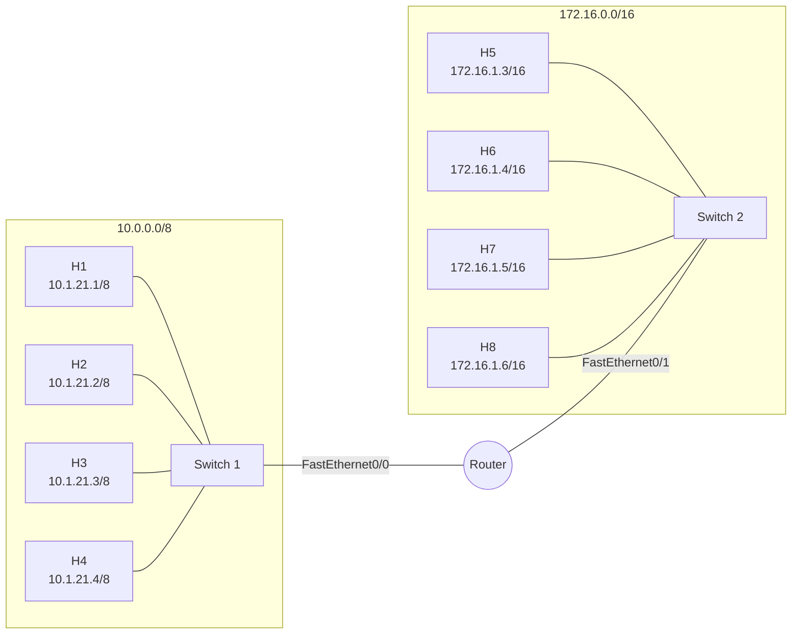
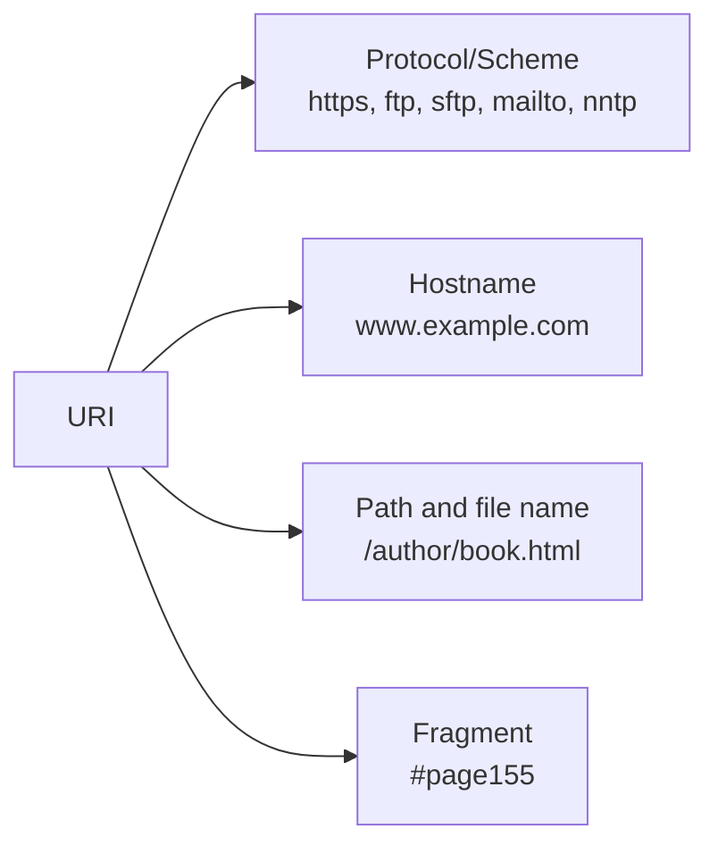

# Networking Basics

## Module 1

### Learning Outcomes

**Network Types**  
The internet is not owned by any individual or group. The internet is a worldwide collection of interconnected networks (internetwork or internet for short), cooperating with each other to exchange information using common standards. Through telephone wires, fiber-optic cables, wireless transmissions, and satellite links, internet users can exchange information in a variety of forms.  
Small home networks connect a few computers to each other and to the internet. The SOHO network allows computers in a home office or a remote office to connect to a corporate network, or access centralized, shared resources. Medium to large networks (for example, those used by corporations and schools) can have many locations with hundreds or thousands of interconnected hosts. The internet is a network of networks that connects hundreds of millions of computers worldwide.  
Devices you use daily can be connected to the internet. These include mobile devices (smartphones, tablets, smartwatches, and smart glasses). Things in your home can be connected to the internet (security system, appliances, smart TV, and gaming console). Outside your home there are smart cars, RFID tags, sensors and actuators, and even medical devices.

**Data Transmission**  
The following categories are used to classify types of personal data:

- **Volunteered data** - Created and explicitly shared by individuals (for example, social network profiles). This type of data might include video files, pictures, text, or audio files.
- **Observed data** - Captured by recording the actions of individuals (for example, location data when using cell phones).
- **Inferred data** - Data such as a credit score, which is based on analysis of volunteered or observed data.

The term bit is an abbreviation of "binary digit" and represents the smallest piece of data. Each bit can only have one of two possible values, 0 or 1.

**Signal transmission methods**

- **Electrical signals** - Data is represented as electrical pulses on copper wire.
- **Optical signals** - Electrical signals are converted into light pulses.
- **Wireless signals** - Data is transmitted using infrared, microwave, or radio waves through the air.

**Bandwidth and Throughput**  
Bandwidth is the capacity of a medium to carry data. Digital bandwidth measures the amount of data that can flow from one place to another in a given amount of time. Bandwidth is typically measured in the number of bits that (theoretically) can be sent across the media in a second.

**Common bandwidth measurements**

- Thousands of bits per second (Kbps)
- Millions of bits per second (Mbps)
- Billions of bits per second (Gbps)

Throughput does not usually match the specified bandwidth. Many factors influence throughput, including:

- The amount of data being sent and received over the connection
- The latency created by the number of network devices encountered between source and destination

Latency refers to the amount of time, including delays, for data to travel from one given point to another.

## Module 2: Network Components, Types, Connections

**Module Objective** - Explain network types, components, and connections.

**Topic Title - Topic Objective**

- **Clients and Servers** - Explain the roles of clients and servers in a network.
- **Network Components** - Explain the roles of network infrastructure devices.
- **ISP Connectivity Options** - Describe ISP connectivity options.

**P2P (Peer-to-Peer) Applications**  
A P2P application allows a device to act as both a client and a server within the same communication, as shown in the figure. In this model, every client is a server and every server is a client. P2P applications require that each end device provide a user interface and run a background service.

Some P2P applications use a hybrid system where resource sharing is decentralized, but the indexes that point to resource locations are stored in a centralized directory. In a hybrid system, each peer accesses an index server to get the location of a resource stored on another peer.

**Network infrastructure components**

- **End devices** - phones, laptops, printers.
- **Intermediate devices** - switches, routers, firewall appliances.
- **Network media** - WAN used by ISPs, etc.

An end device (or host) is either the source or destination of a message transmitted over the network. In order to uniquely identify hosts, addresses are used. When a host initiates communication, it uses the address of the destination host to specify where the message should be sent.

**ISP Services**  
An ISP can be the local cable provider, a landline telephone service provider, the cellular network that provides your smartphone service, or an independent provider who leases bandwidth on the physical network infrastructure of another company.

Many ISPs also offer additional services to their contract subscribers. These services can include email accounts, network storage, website hosting, automated backup, and security services.

ISPs are critical to communications across the global internet. Each ISP connects to other ISPs to form a network of links that interconnect users all over the world. ISPs are connected in a hierarchical manner that ensures that internet traffic generally takes the shortest path from the source to the destination.

The internet backbone is like an information super highway that provides high-speed data links to connect the various service provider networks in major metropolitan areas around the world. The primary medium that connects the internet backbone is fiber-optic cable.

**Other connectivity options**

- **Cellular** - Cellular internet access uses a cell phone network. Wherever you can get a cellular signal, you can get cellular internet access. Performance is limited by the phone and cell tower capabilities. The downside is bandwidth is typically metered.
- **Satellite service** - Good for homes or offices without DSL or cable. Satellite dishes require a clear line of sight. Speeds vary by contract. Equipment and installation costs can be high, with a moderate monthly fee thereafter.
- **Dial-up** - An inexpensive option that uses any phone line and a modem. The low bandwidth is usually not sufficient for large data transfer, but it is useful for mobile access while traveling.

### Learning Outcomes

**Clients and Servers**  
All computers connected to a network that participate directly in network communication are classified as hosts. Hosts can send and receive messages on the network. In modern networks, computer hosts can act as a client, a server, or both. The software installed on the computer determines which role the computer plays.  
Client and server software usually run on separate computers, but it is also possible for one computer to run both client and server software at the same time. In small businesses and homes, many computers function as the servers and clients on the network. This type of network is called a P2P network. In larger businesses, because of the potential for high amounts of network traffic, it is often necessary to have dedicated servers to support the number of service requests. P2P networks are easy to set up, less complex, lower in cost, and can be used for simple tasks (for example, transferring files and sharing printers). However, there is no centralized administration. They have less security, are not scalable, and can perform slower.

**Network Components**  
The network infrastructure is the platform that supports the network. It provides the stable and reliable channel over which communications can occur. The network infrastructure contains three categories of hardware components: end devices, intermediate devices, and network media.  
End devices form the interface between users and the underlying communication network. Examples include:

- **Computers** - workstations, laptops, file servers, web servers
- **Network printers**
- **Telephones and teleconferencing equipment**
- **Security cameras**
- **Mobile devices** - smartphones, tablets, PDAs, wireless debit or credit card readers, barcode scanners

**ISP Connectivity Options**  
An ISP provides the link between the home network and the internet. Each ISP connects to other ISPs to form a network of links that interconnect users worldwide. ISPs are connected in a hierarchical manner that ensures that internet traffic generally takes the shortest path from source to destination.  
For a home user, connecting to the ISP is uncomplicated. The most common connection option is a wireless integrated router to connect to the ISP. The router includes a switch for wired hosts and a wireless AP for wireless hosts. The router also provides client IP addressing and security for inside hosts. The two most common methods are cable and DSL. Other options include cellular, satellite, and dial-up.

## Module 3: Wireless and Mobile Networks

**Module Objective** - Wireless networks and mobile device connectivity.

### Learning Outcomes

**Wireless Networks**  
Mobile phones use radio waves to transmit voice signals to antennas mounted on towers located in specific geographic areas. When a call is made, the voice signal is relayed from one tower to another until it reaches its destination. This network is used for calls to mobile or wired phones, and for text messages. The most common cellular network is GSM. The abbreviations 3G, 4G, 4G-LTE, and 5G describe enhanced networks optimized for fast data transmission.

**Smartphone connectivity methods**

- **Wi-Fi** - Enables the phone to connect to local networks and the internet. Wi-Fi networks are usually privately owned but often provide guest or public access hotspots.
- **Bluetooth** - Wireless technology that allows devices to communicate over short distances. Multiple devices can connect at the same time.
- **NFC** - Wireless communication technology that enables data exchange at very close proximity, usually less than a few centimeters.

**Mobile Device Connectivity**  
Precautions to protect Wi-Fi communications on mobile devices:

- Never send login or password information using unencrypted text (plaintext).
- Use a VPN connection when possible if you are sending sensitive data.
- Enable security on home networks.
- Use WPA2 or higher encryption for security.

Two of the most popular operating systems for mobile devices are Android and Apple iOS. Mobile devices are preprogrammed to use a Wi-Fi network for the internet if one is available. If no Wi-Fi network is available, the device uses cellular data if it is configured.

Bluetooth technology provides a simple way for mobile devices to connect to each other and to wireless accessories. Bluetooth is wireless, automatic, and uses very little power, which helps conserve battery life.

Bluetooth pairing occurs when two Bluetooth devices establish a connection to share resources. For pairing, Bluetooth radios are turned on, one device searches, and the other is set to discoverable mode (visible). When discoverable, a device transmits:

- Name
- Bluetooth class
- Services the device can use
- Technical information (for example, supported features or specification)

A PIN may be requested to authenticate the pairing process.

## Module 4: Build a Home Network

**Module Objective** - Configure integrated wireless router and wireless client for home network connectivity.

**Wired Network Technology**

- **Ethernet patch cable** - Usually unshielded twisted pair. These cables can be purchased with RJ-45 connectors already installed.
- **Category 5e** - Most common wiring used in a LAN. The cable is made up of 4 pairs of wires twisted to reduce electrical interference.
- **Coaxial cable** - Inner wire surrounded by insulating layer, then a conducting shield, and an outer insulating jacket.
- **Fiber-optic cables** - Glass or plastic with diameter about the same as a human hair. Carries digital information at very high speeds over long distances and provides very high bandwidth.

**Wi-Fi Networks (4.3.1)**  
Standards have been developed to allow wireless device communication. They specify the RF spectrum used, data rates, and how information is transmitted. The Institute of Electrical and Electronics Engineers (IEEE) creates wireless technical standards. IEEE 802.11 governs the WLAN environment. Wireless standards for LANs use the 2.4 GHz and 5 GHz frequency bands and are referred to as Wi-Fi.

The Wi-Fi Alliance is responsible for testing wireless LAN devices from different manufacturers. The Wi-Fi logo means equipment meets standards and should operate with other devices that use the same standard.

**Wireless router settings**

- **Network mode** - Determines the type of technology supported (for example, 802.11b, 802.11g, 802.11n, or Mixed Mode).
- **Network Name (SSID)** - Identifies the WLAN. All devices must have the same SSID.
- **Standard Channel** - Channel over which communication occurs. Default is Auto so the AP can determine the optimum channel.
- **SSID Broadcast** - Whether the SSID is broadcast to all devices within range. Default is Enabled.

_Note:_ SSID stands for Service Set Identifier.

**Network Mode**  
If all wireless devices connect with the same 802.11 standard, maximum speeds can be obtained. If the AP is configured to accept only one standard, devices that do not use that standard cannot connect.

A mixed mode wireless network environment can include devices that use any existing Wi-Fi standards. This provides easy access for older devices that do not support the latest standards.

The SSID is a case-sensitive alphanumeric string up to 32 characters. It is sent in the header of all frames transmitted over the WLAN. The SSID tells wireless stations (STAs) which WLAN they belong to.

Disabling SSID broadcasting makes it more difficult for legitimate clients to find the network, but it does not prevent unauthorized clients from connecting. Use the strongest available encryption to restrict unauthorized access.

**Router setup**  
A cable modem connection uses a coaxial terminal to accept a BNC-type connector. A DSL connection uses a telephone-type cable, usually an RJ-11 connector.  
After confirming the computer is connected and the NIC link lights indicate a working connection, the computer needs an IP address. Most network routers are set up so the computer receives an IP address automatically from a local DHCP server on the wireless router. If the computer does not have an IP address, check the router documentation and configure the PC or tablet with a unique IP address, subnet mask, default gateway, and DNS information.

**Design Considerations**

- **What should my network be called?** If SSID broadcasting is on, the SSID name is seen by all wireless clients within range. It is not good practice to include the device model or brand name as part of the SSID.
- **What types of devices will attach to my network?** If a device only supports 802.11b/g, it will not connect if the router is set to only 802.11n or 802.11ac. If all devices support the same standard, the network works at optimum speed. If not, enable legacy or mixed mode.

### Learning Outcomes


## Module 5: Communication Principles

**Communication Protocols** - Method, Language, Confirmation  
**Communication Standards** - Standards organizations and RFCs  
**Network Communication Models** - Compare OSI and TCP/IP models

**Test questions**  
**Question 2**  
Rory is studying the fields inside an Ethernet frame and notices that the destination MAC address is listed before the source MAC address. Which protocol characteristic is Rory investigating?

- message timing
- message pattern
- encapsulation - SELECTED
- encoding
- timing

**Question 3**  
Rory discovers that a frame can be 64 to 1518 bytes of information that is converted into a series of bits before being sent. Which two protocol characteristics did Rory learn about for Ethernet?

- message pattern
- message size - SELECTED
- encapsulation
- encoding - SELECTED
- timing

**5.2 Network Standards Organizations**  
When a new standard is proposed, each stage of the development and approval process is recorded in a numbered Request for Comments (RFC) document so the evolution of the standard is tracked. RFCs for internet standards are published and managed by the Internet Engineering Task Force (IETF).  
Organizations include: IEEE, IANA, ICAAN, IETF, ITU, TIA.

**Network protocols**

- **ETHERNET** - Used for NIC to NIC communications in the same network.
- **IP** - IPv4 or IPv6, ensuring messages get from source to destination, within a network or across multiple networks. Supports addressing, routing, fragmentation, reassembly, and best-effort delivery.
- **TCP** - Reordering, reliability, flow control, congestion control.
- **HTTP** - Exchange and transfer of HTML. Web page requests and responses.

**TCP/IP model layers**

- **Application** - HTTP, FTP, SMTP, DNS
- **Transport** - TCP, UDP
- **Internet** - IP
- **Network Access** - Ethernet, Wi-Fi, DSL, Cable

**5.3.4 The OSI Reference Model**  
**Protocol Model** - A set of rules that govern how data is transmitted between two points in a network.  
**Reference Model** - A conceptual model that defines the functions of a communication system in terms of layers.

The OSI model is a theoretical model that characterizes and standardizes communication functions without regard to internal structure or technology. The OSI model partitions a communication system into seven abstraction layers (from top 7 to bottom 1):

- **Application** - process-to-process communication (for example, HTTP, FTP, SMTP, DNS)
- **Presentation** - common representation of data transferred between layer services (for example, encryption, compression, translation)
- **Session** - organizes and synchronizes communication between applications (session establishment, maintenance, termination)
- **Transport** - segments, transfers, and reassembles data (for example, TCP, UDP)
- **Network** - exchanges data between identified devices (for example, IP, routing, fragmentation, reassembly, best-effort delivery)
- **Data Link** - exchanges data frames over a common media (for example, Ethernet, Wi-Fi, DSL, Cable)
- **Physical** - mechanical, electrical, functional, and procedural means to activate, maintain, and deactivate physical connections (for example, Ethernet, Wi-Fi, DSL, Cable)

**TCP/IP vs OSI**



The key similarities are in the transport and network layers:

- **OSI Layer 3** maps to the TCP/IP Internet layer (addressing and routing).
- **OSI Layer 4** maps to the TCP/IP Transport layer (ordered and reliable delivery).
- **TCP/IP Application layer** includes several protocols that provide specific functionality. OSI Layers 5, 6, and 7 are used as references for application developers.
- **Lower layers** - OSI separates Data Link and Physical layers and is commonly used for these lower layers.

**Learning outcomes: Communication Protocols**

- **Message format** - The structure of data being transmitted, including headers and payload.
- **Message timing** - Timing of when messages are sent and received, including delays or timeouts.
- **Message pattern** - The sequence of messages exchanged, including acknowledgments or responses.
- **Encapsulation** - Adding headers and trailers to data as it moves through layers.
- **Encoding** - Converting data into a specific format for transmission (for example, binary or compression).
- **Confirmation** - Acknowledging receipt of a message or data.
- **Message size** - Amount of data being transmitted in a message.

**Communication Standards**  
Network communication standards are developed by various organizations to ensure devices from different manufacturers can communicate effectively:

- **IEEE** - Standards for wired and wireless networking (Ethernet, Wi-Fi).
- **IANA** - Allocation of IP addresses and internet protocol resources.
- **ICANN** - Domain name system and other internet-related resources.
- **IETF** - Internet standards and protocols.
- **ITU** - Telecommunications and information communication standards.
- **TIA** - Telecommunications standards, including cabling and infrastructure.

**OSI Model Layer Descriptions**


## Module 6: Network Media

**Objective** - Network media types.

**Media types**

- **UTP** - unshielded twisted pair.
- **Coaxial cable** - inner wire surrounded by insulating layer and conducting shield, with an outer insulating jacket.
- **Fiber-optic cables** - glass or plastic that carry digital information at very high speeds over long distances. High bandwidth.

**Three media cables**

- **Metal wires within cables** - Data is encoded into electrical impulses.
- **Glass or plastic fibers (fiber-optic cable)** - Data is encoded into pulses of light.
- **Wireless transmission** - Data is encoded by modulation of specific frequencies of electromagnetic waves.

**DEASC criteria**

- **D, Distance** - Maximum distance the media can carry a signal.
- **E, Environment** - Environment in which the media will be installed.
- **AS, Amount of Data** - Amount of data and speed required.
- **C, Cost** - Cost of media and installation.


## Module 7: Access Layer

**Learning Objectives**

- **Encapsulation and the Ethernet frame**
- **Access layer**

**Ethernet Frame**

- **Preamble** - 7 bytes used for synchronization.
- **Start Frame Delimiter (SFD)** - 1 byte indicating the start of the frame.
- **Destination MAC Address** - 6 bytes identifying the destination host.
- **Source MAC Address** - 6 bytes identifying the source host.
- **Length Type** - 2 bytes indicating the protocol in the payload or type of data (IPv4, IPv6).
- **Data Payload** - 46 to 1500 bytes of data.
- **Frame Check Sequence (FCS)** - 4 bytes for error checking.

**Switches**  
Like to learn, but only for about 5 mins.

**Ethernet Switches**  
802.3 Ethernet frames are used for communication between devices on the same network. The Ethernet frame contains a destination MAC address and a source MAC address, which are used to identify the devices that are communicating. When a switch receives an Ethernet frame, it reads the destination MAC address and forwards the frame only to the port that is connected to the device with that MAC address. This process is called switching and helps reduce congestion by ensuring frames are only sent to devices that need them.

**Learning outcomes**

- **Encapsulation and the Ethernet Frame** - Encapsulation adds headers and trailers as data moves through layers. The Ethernet frame includes preamble, SFD, destination MAC, source MAC, length or type, payload, and FCS.
- **Access layer** - Provides connectivity to end devices (computers, printers, mobile devices). Includes switches and wireless access points. Can provide authentication, authorization, and accounting (AAA).

**MAC Filtering**  
MAC filtering permits or denies access based on a device's 48-bit MAC address. It is an access control mechanism, not encryption.

**Key characteristics**

- **Access Control Method** - Security feature on routers and access points to allow only authorized devices.
- **Whitelist or Blacklist** - Allow or block specific devices.
- **Hardware Identifier Based** - Uses the MAC address of the NIC.
- **Limited Security** - MAC addresses can be spoofed or cloned.
- **Maintenance Intensive** - Constant updates required for large networks.
- **No Encryption** - Only controls access.

**Limitations**

- **Spoofing** - Attackers can bypass filters by impersonating a MAC address.
- **Complexity** - Does not scale well in large environments.
- **Randomization Conflict** - MAC randomization can cause connectivity issues.

**Switch MAC table maintenance**

- **Source MAC Address** - Used to learn which device sent the data.
- **Incoming Port** - Recorded as the interface where the frame arrived.
- **Association** - Source MAC is paired with the port in the MAC table.
- **Aging** - Entries are removed after a period of inactivity.


## Checkpoint 2


## Module 8: Internet Protocol

**Learning objective** - IP address features.

**IPv4 address purpose** - Logical network address used for routing and addressing.  
**IPv4 address structure** - Addresses and subnets used together.

**Learning outcomes**

- **IPv4 Address Purpose** - IPv4 is a logical network address used for routing and addressing. It identifies source and destination of data packets as they traverse networks.
- **IPv4 Address Structure** - 32-bit binary number represented in dotted decimal notation (for example, 192.168.1.1). Structured into network and host portions, with subnetting used for efficient use of addresses.


## Module 9: IPv4 and Network Segmentation

**Topics**

- IPv4 Unicast, Broadcast, Multicast
- Types of IPv4 Addresses - public, private, APIPA
- Network Segmentation - subnetting

**Unicast** - 1 to 1. A unicast address is a unique identifier assigned to a single device on a network. It is used for one-to-one communication.

**Broadcast** - 1 to all. A broadcast packet has a destination IP address with all ones in the host portion (32 one bits).  
_Note:_ IPv4 uses broadcast packets. There are no broadcast packets with IPv6.

A broadcast packet must be processed by all devices in the same broadcast domain. A broadcast may be directed or limited. A directed broadcast is sent to all hosts on a specific network. A limited broadcast is sent to 255.255.255.255. By default, routers do not forward broadcasts.

Broadcast packets use resources on the network and make every receiving host process the packet. Broadcast traffic should be limited because it can degrade network performance.

**Multicast** - 1 to many. Multicast addresses range from 224.0.0.0 to 239.255.255.255.  
Hosts that receive particular multicast packets are called multicast clients and subscribe to multicast groups. Each multicast group is represented by a single IPv4 multicast destination address.  
Routing protocols such as OSPF use multicast. For example, routers enabled with OSPF communicate using multicast address 224.0.0.5.

**Network Addresses and Prefixes**  
Public IPv4 addresses are globally unique and can be routed on the internet. Private IPv4 addresses are reserved for private networks and are not routable. Private ranges:

- 10.0.0.0 to 10.255.255.255
- 172.16.0.0 to 172.31.255.255
- 192.168.0.0 to 192.168.255.255

_Note:_ Private addresses are defined in RFC 1918.

**Private IPv4 Addresses and NAT**  
Private addresses are not globally routable. Packets with private source addresses must be filtered or translated before being forwarded to an ISP. NAT translates private IPv4 to public IPv4 addresses, typically on the router connecting the internal network to the ISP.

**Special Use IPv4 Addresses**

**Loopback addresses**  
127.0.0.0/8 (commonly 127.0.0.1) are used by a host to direct traffic to itself.

_Note:_ You will learn more about the ping command later in this course.

**Pinging the Loopback Interface**

```code
C:\Users\NetAcad> ping 127.0.0.1
Pinging 127.0.0.1 with 32 bytes of data:
Reply from 127.0.0.1: bytes=32 time<1ms TTL=128
Reply from 127.0.0.1: bytes=32 time<1ms TTL=128
Reply from 127.0.0.1: bytes=32 time<1ms TTL=128
Reply from 127.0.0.1: bytes=32 time<1ms TTL=128
Ping statistics for 127.0.0.1:
    Packets: Sent = 4, Received = 4, Lost = 0 (0% loss),
Approximate round trip times in milli-seconds:
    Minimum = 0ms, Maximum = 0ms, Average = 0ms
C:\Users\NetAcad> ping 127.1.1.1
Pinging 127.1.1.1 with 32 bytes of data:
Reply from 127.1.1.1: bytes=32 time<1ms TTL=128
Reply from 127.1.1.1: bytes=32 time<1ms TTL=128
Reply from 127.1.1.1: bytes=32 time<1ms TTL=128
Reply from 127.1.1.1: bytes=32 time<1ms TTL=128
Ping statistics for 127.1.1.1:
    Packets: Sent = 4, Received = 4, Lost = 0 (0% loss),
Approximate round trip times in milli-seconds:
    Minimum = 0ms, Maximum = 0ms, Average = 0ms
C:\Users\NetAcad>
```

**Link-local addresses**  
169.254.0.0/16 are also known as APIPA or self-assigned addresses.

**Legacy Classful Addressing**

**IPv4 Address Classes**

- **Class A** - 0.0.0.0 to 127.255.255.255 (Large networks)
- **Class B** - 128.0.0.0 to 191.255.255.255 (Medium and large networks)
- **Class C** - 192.0.0.0 to 223.255.255.255 (Small networks)
- **Class D** - 224.0.0.0 to 239.255.255.255 (Multicast)
- **Class E** - 240.0.0.0 to 255.255.255.255 (Experimental)

**Reserved Private IPv4 Ranges**

- 10.0.0.0 to 10.255.255.255 (10.0.0.0/8)
- 172.16.0.0 to 172.31.255.255 (172.16.0.0/12)
- 192.168.0.0 to 192.168.255.255 (192.168.0.0/16)

**Special IPv4 Address Ranges**

- **Loopback or Localhost** - 127.0.0.0/8
- **APIPA (Link-Local)** - 169.254.0.0/16
- **Broadcast** - 255.255.255.255

**Key Concepts**

- **Public vs. Private** - Public IPs are reachable on the internet; private IPs are used within local networks.
- **CIDR** - Classless Inter-Domain Routing, which allocates IP addresses efficiently using slash notation (for example, /24).

In 1981, IPv4 addresses were assigned using classful addressing as defined in RFC 790. Customers were allocated a network address based on classes A, B, or C:

- **Class A** (0.0.0.0/8 to 127.0.0.0/8) - Extremely large networks, more than 16 million host addresses.
- **Class B** (128.0.0.0/16 to 191.255.0.0/16) - Moderate to large networks, about 65,000 host addresses.
- **Class C** (192.0.0.0/24 to 223.255.255.0/24) - Small networks, maximum 254 hosts.
- **Class D** multicast block (224.0.0.0 to 239.0.0.0)
- **Class E** experimental block (240.0.0.0 to 255.0.0.0)

Class A networks accounted for 50 percent of IPv4 networks, which caused most available IPv4 addresses to go unused.

The diagram is a pie chart showing the percentage of Class A, B, C, D, and E IPv4 addressing with the total number of networks and hosts per class:

- **Class A** - 50 percent, 128 networks, 16,777,214 hosts per network
- **Class B** - 25 percent, 16,384 networks, 65,534 hosts per network
- **Class C** - 12.5 percent, 2,097,152 networks, 254 hosts per network
- **Class D and E** - 12.5 percent

Classful addressing was deprecated in the mid-1990s and replaced with classless addressing.

**Regional Internet Registries (RIRs)**  
Public IPv4 addresses are globally routed and must be unique. IANA allocates blocks of IP addresses to the five RIRs:

- **AfriNIC** - Africa Region
- **APNIC** - Asia and Pacific Region
- **ARIN** - North America Region
- **LACNIC** - Latin America and some Caribbean Islands
- **RIPE NCC** - Europe, the Middle East, and Central Asia (Reseaux IP Europeens Network Coordination Centre)

RFC 790: https://datatracker.ietf.org/doc/html/rfc790


## Module 10: IPv6 Address Formats and Rules

**Learning objectives**

- **IPv4 Issues**
- **IPv6 Addressing**

**IPv4 and IPv6 Coexistence**  
There is no specific date to move to IPv6. Both IPv4 and IPv6 will coexist for years. The IETF created tools to help migrate to IPv6. Migration techniques include:

- **Dual stack** - IPv4 and IPv6 coexist on the same network segment.
- **Tunneling** - IPv6 packets are encapsulated inside IPv4 packets.
- **Translation** - NAT64 translates IPv6 to IPv4 and IPv4 to IPv6.

The physical network topology shows an IPv6-only network communicating with an IPv4-only network through a NAT64 router.

_Note:_ Tunneling and translation are for transitioning to native IPv6 and should only be used where needed. The goal should be native IPv6 communications from source to destination.

**IPv6 Addressing**  
IPv6 addresses are represented using hexadecimal numbers (0 to 9 and A to F). IPv6 addresses are 128 bits in length and written as a string of hexadecimal values. Every four bits is represented by a single hexadecimal digit, for a total of 32 hexadecimal values.

**Hextets (16-bit segments)**



**Examples of IPv6 addresses**

- 2001 : 0db8 : 0000 : 1111 : 0000 : 0000 : 0000 : 0200
- 2001 : 0db8 : 0000 : 00a3 : abcd : 0000 : 0000 : 1234
- 2001 : 0db8 : 000a : 0001 : c012 : 9aff : fe9a : 19ac
- 2001 : 0db8 : aaaa : 0001 : 0000 : 0000 : 0000 : 0000
- fe80 : 0000 : 0000 : 0000 : 0123 : 4567 : 89ab : cdef
- fe80 : 0000 : 0000 : 0000 : 0000 : 0000 : 0000 : 0001
- fe80 : 0000 : 0000 : 0000 : c012 : 9aff : fe9a : 19ac
- 0000 : 0000 : 0000 : 0000 : 0000 : 0000 : 0000 : 0001

**Rules for compression**

1. **Omit leading zeros** - 0db8 can be written as db8, and 0001 can be written as 1.
2. **Use a double colon (::)** to replace consecutive hextets of zeros, but only once in an address.

**Learning outcomes**

- **IPv4 Issues** - Limited address space and less efficient headers. ICMPv6 provides address resolution and neighbor discovery functions previously handled by ARP. IPv6 includes built-in support for IPsec.
- **Migration to IPv6** - Dual stack, tunneling, and translation (NAT64).
- **IPv6 addressing** - 128-bit hexadecimal addresses, divided into eight 16-bit hextets. Compression uses omitted leading zeros and a single double colon for consecutive zero hextets.


## Module 11: Dynamic Addressing and DHCP

**Module objective** - Configure a DHCP server.

**Topics**

- Static and dynamic addressing
- DHCP IPv4 configuration

**Static IPv4 Address Assignment**  
IPv4 addresses can be assigned either statically or dynamically. With a static assignment, the network administrator manually configures:

- **IP address** - Identifies the host on the network.
- **Subnet mask** - Identifies the network.
- **Default gateway** - Identifies the gateway used to access other networks.

Static addresses are useful for printers, servers, and devices that need consistent access. However, static assignment can be time-consuming and is prone to entry errors.

**Dynamic IPv4 Address Assignment**  
Dynamic assignment uses Dynamic Host Configuration Protocol (DHCP) to automatically assign:

- IP address
- Subnet mask
- Default gateway
- DNS server
- Other configuration information

DHCP is preferred on large networks because it reduces support burden and minimizes errors. DHCP leases are temporary, so unused addresses return to the pool.

**DHCP Servers**  
Many devices can be DHCP servers. In home networks, the wireless router often acts as both a DHCP client (to the ISP) and a DHCP server (to internal hosts). The router receives a public IPv4 address and distributes private addresses internally.

**DORA process**

1. **Discover** - Client broadcasts a DHCP Discover message.
2. **Offer** - Server responds with a DHCP Offer.
3. **Request** - Client selects an offer and sends a DHCP Request.
4. **Acknowledgment** - Server confirms with a DHCP Acknowledgment.

**Learning outcomes**

- **Static IPv4 Address Assignment** - Manual configuration provides control but is time-consuming and error-prone.
- **Dynamic IPv4 Address Assignment** - DHCP automates assignment and improves efficiency.
- **DHCP Servers** - DHCP Discover uses broadcast destination IP 255.255.255.255 and destination MAC FF:FF:FF:FF:FF:FF.

Defaults for home and small business networks: internal router interface is usually 192.168.0.1 with subnet mask 255.255.255.0.


A subnet mask acts in conjunction with an IP address to divide it into a network address and a host address. It tells network devices which part of the address defines the network (for example, zip code) and which identifies the specific device (for example, house number), enabling efficient routing and dividing large networks into smaller, manageable subnets.

**Key purposes of subnet masks**

- **Defining Network Boundaries** - Specifies which bits are reserved for the network and which are for hosts.
- **Determining Local vs. Remote Traffic** - Determines if an IP address is local or requires a router.
- **Subnetting and Organization** - Breaks down large networks into smaller subnets.
- **Routing Optimization** - Helps routers determine efficient paths.

Example using IP address $192.168.1.10$ and subnet mask $255.255.255.0$:

- The $255$s mask the first three octets (192.168.1.) as the Network ID.
- The $0$ indicates the final part (.10) is the Host ID.

Normally, DHCP servers and BOOTP relay agents attempt to deliver DHCPOFFER, DHCPACK, and DHCPNAK messages directly to the client using unicast delivery. But in Cisco, it is broadcast to the client with a destination IPv4 address of

## Checkpoint 3


## Module 12: Gateways to Other Networks

**Learning objectives**

- Network boundaries
- NAT (Network Address Translation)

**Routers as Gateways**  
The router provides a gateway through which hosts on one network can communicate with hosts on different networks. Each interface on a router is connected to a separate network. The IPv4 address assigned to the interface identifies which local network is connected directly to it.

Every host on a network must use the router as a gateway to other networks. Each host must know the IPv4 address of the router interface connected to the network where the host is attached. This address is the default gateway address, configured statically or by DHCP.

When a wireless router is configured as a DHCP server, it provides its own internal IPv4 address as the default gateway to DHCP clients. It also provides their IPv4 address and subnet mask.

**Routers as Boundaries Between Networks**  
The wireless router acts as a DHCP server for local hosts attached to it. These local hosts are in an internal (inside) network. Most DHCP servers assign private addresses to internal hosts, so the internal network is not directly accessible from the internet.

The default IPv4 address configured on the local wireless router interface is usually the first host address on that network. Internal hosts must be assigned addresses within the same network, either statically or through DHCP.

ISPs provide IPv4 addresses to the internet side of the wireless router. The internet side is the external (outside) network. When a wireless router connects to the ISP, it acts as a DHCP client to receive the correct external network IPv4 address.

The wireless router serves as the boundary between the local internal network and the external internet.

**Learning outcomes**

- **Network Boundaries** - The router provides a gateway between networks. Each router interface connects to a separate network and provides the default gateway address.
- **NAT Operation** - The router receives a public IPv4 address from the ISP and assigns private IPv4 addresses to internal hosts. It translates many private addresses to a single public address, allowing multiple devices to access the internet while maintaining security and efficient use of address space.


### Module 13: ARP Address Resolution Protocol

**Learning objectives**

- MAC and IP - compare and contrast
- Broadcast containment - importance of containing broadcasts within a local network

**Destination on the same network**  
There are two primary addresses assigned to a device on an Ethernet LAN:

- **Physical address (MAC address)** - Used for NIC-to-NIC communications on the same Ethernet network.
- **Logical address (IP address)** - Used to send the packet from the source to the destination device.

If the destination IP address is on the same network, the destination MAC address is that of the destination device. If the destination IP address is on a different network, the destination MAC address is that of the default gateway (the router interface).

**Destination on a remote network**  
When the destination IP address is on a remote network, the destination MAC address will be the address of the default gateway (router interface). The router forwards the packet to the next hop toward the destination.

**Address resolution**

- **IPv4** uses Address Resolution Protocol (ARP).
- **IPv6** uses ICMPv6 Neighbor Discovery (ND).

**Broadcast Domains**  
When a host receives a message addressed to the broadcast address, it processes it. Switches forward broadcast messages to every connected host within the same local network. A local area network with one or more Ethernet switches is a broadcast domain.

If too many hosts are connected to the same broadcast domain, broadcast traffic can become excessive. Routers divide the network into multiple broadcast domains. Each router interface creates a new broadcast domain, so broadcasts are contained within each local network.



**Access Layer Communication**  
On a local Ethernet network, a NIC only accepts a frame if the destination address is the broadcast MAC address or matches its own MAC address.  
IPv4 uses ARP to discover the MAC address of a host on the same local network. IPv6 uses Neighbor Discovery.



**ARP process**

1. The sending host creates and sends a frame addressed to a broadcast MAC address. The frame contains the IPv4 address of the intended destination.
2. Each host receives the broadcast frame and compares the IPv4 address to its own. The matching host sends its MAC address back.
3. The sender stores the MAC and IPv4 address in an ARP table. Future frames can be sent directly to the destination.

**Learning outcomes**

- **MAC and IP** - MAC addresses are used for NIC-to-NIC communications on the same Ethernet network. IP addresses are used to send packets across networks.
- **Broadcast containment** - Broadcast messages are sent to all devices within the same local network. Routers divide networks into multiple broadcast domains and contain broadcast traffic.

A host will send an ARP reply if the IP address in the ARP request matches its own IP address.

- **Layer 2** - MAC address
- **Layer 3** - IP address


## Module 14: Routing Between Networks

**Learning objectives**

- Need for routing
- Routing table
- LAN creation

**Need for routing**  
A router is a networking device connecting multiple Layer 3 IP networks. At the distribution layer, routers direct traffic and perform functions critical to efficient network operation. Routers decode and read messages sent to them.

Switches make forwarding decisions based on Layer 2 MAC addresses. Routers make forwarding decisions based on Layer 3 IP addresses.

If the network portion of the IP addresses of source and destination hosts do not match, a router must be used to forward the message.  
Example: A host on network 1.1.1.0 sends a message to a host on network 5.5.5.0. The host forwards the message to the router. The router decapsulates the Ethernet frame, reads the destination IP address, determines where to forward it, then re-encapsulates into a new frame.

**Routing Table Entries**  
Routers use routing tables to store information about local and remote networks. The routing table contains network addresses and the best path to reach them. Entries can be created:

1. Dynamically, from other routers
2. Manually, by a network administrator

If the router cannot determine where to forward a message, it will drop it. Administrators configure a static default route so packets are not dropped due to missing routes.



**The Default Gateway**  
When a host needs to send a message to another host on the same network, it forwards the message directly. The host uses ARP to discover the MAC address of the destination host.  
When a host needs to send a message to a remote network, it must use the router. The host still includes the destination IP in the packet, but it uses the MAC address of the router as the frame destination. The router accepts the frame based on its MAC address and forwards the packet.

**Source host router MAC address**  
A host is given the IPv4 address of the router through the default gateway address configured in its TCP/IP settings. The default gateway address is the address of the router interface connected to the same local network as the source host. All hosts on the local network use the default gateway address to send messages to the router.

**Important** - The correct default gateway must be configured on each host. If no default gateway is configured, or the wrong one is specified, messages addressed to remote networks cannot be delivered.


**Local Area Networks**  
A local area network (LAN) refers to a local network, or a group of interconnected local networks under the same administrative control. Originally, LANs were small networks in a single physical location. Today, LANs can be a single local network in a home or small office, or interconnected local networks with many hundreds of hosts installed in multiple buildings.

_Note:_ All the local networks within a LAN are under one administrative control.

Common LAN characteristics: use Ethernet or wireless protocols and support high data rates.

**Intranet** - A private LAN belonging to an organization, accessible only to organization members, employees, or authorized users.


**Local and Remote Network Segments**  
**Local Segmentation** - Placing all hosts on a single local network allows them to be seen by all other hosts. There is one broadcast domain and hosts use ARP to find each other.

Use case: simple network design. As networks grow, increased traffic can decrease performance. At that point, move hosts onto a remote network.

**Advantages of a single local segment**

- Appropriate for simpler networks
- Less complexity, lower cost
- Allows devices to be seen by other devices
- Faster data transfer
- Ease of device access

**Disadvantages**

- All hosts are in one broadcast domain, increasing traffic
- Harder to implement QoS
- Harder to implement security

**Remote Segmentation** - Placing additional hosts on a remote network decreases the impact of traffic demands, but hosts on one network cannot communicate with hosts on another without routing. Routers increase complexity and can introduce latency.

Use case: larger, more complex network design.

**Advantages**

- Splits broadcast domains and decreases traffic
- Improves performance on each segment
- Machines are invisible to other segments
- Can increase security and improve organization

**Disadvantages**

- Requires routing (distribution layer)
- Router can slow traffic between segments
- More complexity, cost, and hardware

**Commands**

- **arp -a** - Displays the ARP table.
- **arp -d** - Deletes an entry from the ARP table.
- **arp -s** - Adds a static entry to the ARP table.

**Learning outcomes**

- **Need for routing** - Routers limit broadcasts, improve security, and interconnect networks across physical locations or logical groups. Routers forward based on Layer 3 IP addresses.
- **Routing table** - Contains network addresses and the best path to reach them. Entries are dynamic or static. A default route prevents drops for unknown networks.
- **LANs** - Under one administrative control, use Ethernet or wireless protocols, and support high data rates.


## Checkpoint 4


## Module 15: TCP and UDP

**Learning objectives**

- **TCP** - acknowledgments, sequence numbers, connection-oriented, reliable delivery, flow control, congestion control.
- **UDP** - no acknowledgments, no sequence numbers, connectionless, best-effort delivery.

**Port numbers**  
Services like DNS, web, email, FTP, IM, and VoIP use client/server systems. A port is a numeric identifier in each segment that tracks conversations between a client and server. Every message includes a source and destination port.


When a message is received by a server, the server determines which service is being requested. Clients are preconfigured to use destination ports that are registered for each service. For example, web browser clients send requests to web servers using port 80, the well-known port for HTTP.

Ports are assigned and managed by the Internet Corporation for Assigned Names and Numbers (ICANN). Ports are broken into three categories and range from 1 to 65,535:

- **Well-Known Ports** - 1 to 1023. Destination ports associated with common network services.
- **Registered Ports** - 1024 to 49151. Can be used as source or destination ports and registered by organizations for specific applications.
- **Private Ports** - 49152 to 65535. Often used as source ports.

**Common well-known ports**

| Port Number | Transport | Application Protocol                                |
| ----------- | --------- | --------------------------------------------------- |
| 20          | TCP       | File Transfer Protocol (FTP) - Data                 |
| 21          | TCP       | FTP - Control                                       |
| 22          | TCP       | Secure Shell (SSH)                                  |
| 23          | TCP       | Telnet                                              |
| 25          | TCP       | Simple Mail Transfer Protocol (SMTP)                |
| 53          | UDP, TCP  | Domain Name Service (DNS)                           |
| 67          | UDP       | Dynamic Host Configuration Protocol (DHCP) - Server |
| 68          | UDP       | DHCP - Client                                       |
| 69          | UDP       | Trivial File Transfer Protocol (TFTP)               |
| 80          | TCP       | Hypertext Transfer Protocol (HTTP)                  |
| 110         | TCP       | Post Office Protocol version 3 (POP3)               |
| 143         | TCP       | Internet Message Access Protocol (IMAP)             |
| 161         | UDP       | Simple Network Management Protocol (SNMP)           |
| 443         | TCP       | Hypertext Transfer Protocol Secure (HTTPS)          |

**Notes**

- DNS uses UDP for most client queries. If responses exceed 512 bytes or the client requests it, DNS can use TCP.
- Communication between two DNS servers always uses TCP for reliable zone transfers.
- See the IANA website for a full port registry.

**Socket Pairs**  
The source and destination ports are placed within the segment, then encapsulated within an IP packet. The IP packet contains the source and destination IP addresses. The combination of an IP address and port number is a socket.


**Example**  
The FTP request generated by the PC includes Layer 2 MAC addresses and Layer 3 IP addresses. The request identifies the source port number 1305 and destination port 21. The host also requests a web page from the server using source port 1099 and destination port 80.

A socket identifies the server and service being requested:

- **Client socket** - 192.168.1.5:1099
- **Server socket** - 192.168.1.7:80
- **Socket pair** - 192.168.1.5:1099, 192.168.1.7:80

Sockets let multiple processes running on a client distinguish themselves from each other, and allow multiple connections to a server process to be uniquely distinguishable.

The source port number acts as a return address. The transport layer tracks this port and the application so that responses are forwarded to the correct application.

**netstat command**  
Unexplained TCP connections can pose a security threat. Use netstat to list active TCP connections. The -n option displays IP addresses and port numbers in numeric form.

```bash
C:\> netstat

Active Connections

  Proto Local Address           Foreign Address             State
  TCP   192.168.1.124:3126      192.168.0.2:netbios-ssn     ESTABLISHED
  TCP   192.168.1.124:3158      207.138.126.152:http        ESTABLISHED
  TCP   192.168.1.124:3159      207.138.126.169:http        ESTABLISHED
  TCP   192.168.1.124:3161      sc.msn.com:http             ESTABLISHED
  TCP   192.168.1.124:3166      www.cisco.com:http          ESTABLISHED
(output omitted)
C:\> netstat
```

**Learning outcomes**

- **TCP and UDP** - TCP provides ordered, reliable delivery with acknowledgments and sequence numbers. UDP provides best-effort delivery without acknowledgments.
- **Port numbers** - Identify protocols and services. Clients use registered destination ports for services; source ports are dynamically generated to track conversations.
- **netstat** - Lists protocols in use, local and foreign addresses, ports, and connection states.


## Module 16: Application Layer Services

**Learning objectives**

- Client Server Relationship
- NAS: common network applications
- Domain Name System: DNS
- Web Clients and Servers: HTTP, HTML
- FTP clients and Servers: FTP
- Virtual Terminals: Telnet, SSH
- Email and Messaging: email protocols

**Client and Server Interaction**  
Most commonly used internet applications rely on interactions between servers and clients. A server is a host running software that provides information or services to other hosts on the network. A web server is a well-known example. There are millions of servers connected to the internet, providing services such as websites, email, financial transactions, and music downloads. These interactions function because they all use agreed-upon standards and protocols.

An example of client software is a web browser, like Chrome or Firefox. A single computer can also run multiple types of client software. For example, a user can check email and view a web page while instant messaging and listening to an audio stream. The table lists three common types of server software.

| Type  | Description                                                                                                                                                          |
| ----- | -------------------------------------------------------------------------------------------------------------------------------------------------------------------- |
| Email | The email server runs email server software. Clients use mail client software, such as Microsoft Outlook, to access email on the server.                             |
| Web   | The web server runs web server software. Clients use browser software, such as Chrome or Firefox, to access web pages on the server.                                 |
| File  | The file server stores corporate and user files in a central location. The client devices access these files with client software such as the Windows File Explorer. |

**URI, URN, and URL**
Components of a URI
Web resources and web services such as RESTful APIs are identified using a Uniform Resource Identifier (URI). A URI is a string of characters that identifies a specific network resource. As shown in the figure, a URI has two specializations:

Uniform Resource Name (URN) - This identifies only the namespace of the resource (web page, document, image, etc.) without reference to the protocol.

Uniform Resource Locator (URL) - This defines the network location of a specific resource on the network. HTTP or HTTPS URLs are typically used with web browsers. Other protocols such as FTP, SFTP, SSH, and others can be used as a URL. A URL using SFTP might look like: sftp://sftp.example.com.

These are the parts of a URI, as shown in the figure:




Protocol/scheme - HTTPS or other protocols such as FTP, SFTP, mailto, and NNTP
Hostname - w​ww.example.com
Path and file name - /author/book.html
Fragment - #page155

**Common Network Application Services**
services such as internet searches, social media sites, video and audio streaming, on-line shopping sites, email and messaging. Each of these services relies on protocols from the TCP/IP protocol suite to reliably communicate the information between the clients and the servers.


| Protocol                                       | Description                                                                                                                                 |
| ---------------------------------------------- | ------------------------------------------------------------------------------------------------------------------------------------------- |
| **Domain Name System (DNS)**                   | Resolves internet names to IP addresses.                                                                                                    |
| **Secure Shell (SSH)**                         | Used to provide remote access to servers and networking devices.                                                                            |
| **Simple Mail Transfer Protocol (SMTP)**       | Sends email messages and attachments from clients to servers and from servers to other email servers.                                       |
| **Post Office Protocol (POP)**                 | Used by email clients to retrieve email and attachments from a remote server.                                                               |
| **Internet Message Access Protocol (IMAP)**    | Used by email clients to retrieve email and attachments from a remote server.                                                               |
| **Dynamic Host Configuration Protocol (DHCP)** | Used to automatically configure devices with IP addressing and other necessary information to enable them to communicate over the internet. |
| **Hypertext Transfer Protocol (HTTP)**         | Used by web browsers to request web pages and web servers to transfer the files that make up web pages of the World Wide Web.               |
| **File Transfer Protocol (FTP)**               | Used for interactive file transfer between systems.                                                                                         |

**Syntax Checker - The nslookup Command**
When you manually configure a device for network connectivity, recall that you also include a DNS server address. For home networks, this configuration is typically handled by DHCP running on the home router. Your ISP provides the DNS server address to your home router, and then your home router uses DHCP to send the configuration to all the devices connected to its network. When you type the name for a website, e.g. www.cisco.com, the DNS client running on your device first asks the DNS server for the IP address, e.g. 172.230.155.162, before sending out your HTTP request.

```code
C:\>nslookup

Default Server: Unknown
Address: 10.10.10.1
# The output lists the name and IP address of the DNS server configured in the client. Note that the DNS server address can be manually configured, or dynamically learned, through DHCP. You are now in nslookup mode. Enter the domain name www.cisco[]().com.

>www.cisco.com
Server:  UnKnown
Address:  10.10.10.1
Non-authoritative answer:
Name:    e2867.dsca.akamaiedge.net
Addresses:  2600:1404:a:395::b33
          2600:1404:a:38e::b33
          172.230.155.162
Aliases:  www.cisco.com
          www.cisco.com.akadns.net
          wwwds.cisco.com.edgekey.net
          wwwds.cisco.com.edgekey.net.globalredir.akadns.net
# The output lists IP addresses related to www.cisco[]().com that the server 'e2867' currently has in its database. Notice that IPv6 addresses are also listed. In addition, various aliases are shown that will resolve to www.cisco[]().com.

# Enter the exit command to leave nslookup mode and return to the Windows command line.
>exit
# You can directly query the DNS servers by simply adding the domain name to the nslookup command.

# Enter nslookup www.google[]().com.

C:\>nslookup www.google.com
Server:  UnKnown
Address:  10.10.10.1
Non-authoritative answer:
Name:    www.google.com
Addresses:  2607:f8b0:4000:80f::2004
          172.217.12.36


=========================================
# You are now working from Linux command prompt. The nslookup command is the same.

# Enter the nslookup command to begin a manual query of the name servers.
# Enter www.cisco[]().com at the \> prompt.
# Enter the exit command to leave nslookup mode and return to the Linux command line.
user@cisconetacad$nslookup
Server: 127.0.1.1
Address: 127.0.1.1#53
>www.cisco.com
Non-authoritative answer:
www.cisco.com canonical name = www.cisco.com.akadns.net.
www.cisco.com.akadns.net canonical name = wwwds.cisco.com.edgekey.net.
wwwds.cisco.com.edgekey.net canonical name = wwwds.cisco.com.edgekey.net.globalredir.akadns.net.
wwwds.cisco.com.edgekey.net.globalredir.akadns.net canonical name = e144.dscb.akamaiedge.net.
Name: e144.dscb.akamaiedge.net
Address: 23.60.112.170
>exit

# As in Windows, you can directly query the DNS servers by simply adding the domain name to the nslookup command. Enter nslookup www.google[]().com.

user@cisconetacad$nslookup www.google.com
Server: 127.0.0.53
Address: 127.0.0.53#53

Non-authoritative answer:
Name: www.google.com
Address: 172.217.6.164
Name: www.google.com
Address: 2607:f8b0:4000:812::2004
# You successfully used the nslookup command to verify the status of domain names.

```

**HTTP and HTML**
When a web client receives the IP address of a web server, the client browser uses that IP address and port 80 to request web services. This request is sent to the server using the Hypertext Transfer Protocol (HTTP).

When the server receives a port 80 request, the server responds to the client request and sends the web page to the client. The information content of a web page is encoded using specialized 'mark-up' languages. The HyperText Markup Language (HTML) coding tells the browser how to format the web page and what graphics and fonts to use. HTML is the most commonly used language.

The HTTP protocol is not a secure protocol; information could easily be intercepted by other users as data is sent over the network. In order to provide security for the data, HTTP can be used with secure transport protocols. Requests for secure HTTP are sent to port 443. These requests use https in the site address in the browser, rather than http.

There are many different web servers and web clients available. The HTTP protocol and HTML standards make it possible for these servers and clients from many different manufacturers to work together seamlessly.

**File Transfer Protocol**
In addition to web services, another common service used across the internet is one that allows users to transfer files.

File Transfer Protocol (FTP) provides an easy method to transfer files from one computer to another. A host running FTP client software can access an FTP server to perform various file management functions including file uploads and downloads.

The FTP server enables a client to exchange files between devices. It also enables clients to manage files remotely by sending file management commands such as delete or rename. To accomplish this, the FTP service uses two different ports to communicate between client and server.

The example in the figure illustrates how FTP operates. To begin an FTP session, control connection requests are sent to the server using destination TCP port 21. When the session is opened, the server uses TCP port 20 to transfer the data files.


FTP client software is built into computer operating systems and into most web browsers. Stand-alone FTP clients offer many options in an easy-to-use GUI-based interface.

**Telnet**
Telnet dates back to the early 1970s and is among the oldest of the application layer protocols and services in the TCP/IP suite. Telnet provides a standard method of emulating text-based terminal devices over the data network. Both the protocol itself and the client software that implements the protocol are commonly referred to as Telnet. Telnet servers listen for client requests on TCP port 23.

a connection using Telnet is called a virtual terminal (vty) session, or connection. Rather than using a physical device to connect to the server, Telnet uses software to create a virtual device that provides the same features of a terminal session with access to the server’s command line interface (CLI).

Note: Telnet is not considered to be a secure protocol. SSH should be used in most environments instead of Telnet.

**Security Issues with Telnet**
After a Telnet connection is established, users can perform any authorized function on the server, just as if they were using a command line session on the server itself. If authorized, they can start and stop processes, configure the device, and even shut down the system.

Although the Telnet protocol can require a user to login, it does not support transporting encrypted data. All data exchanged during Telnet sessions is transported as plaintext across the network. This means that the data can be easily intercepted and understood.

The Secure Shell (SSH) protocol offers an alternate and secure method for server access. SSH provides the structure for secure remote login and other secure network services. It also provides stronger authentication than Telnet and supports transporting session data using encryption. As a best practice, network professionals should always use SSH in place of Telnet, whenever possible.


**Email Clients and Servers**
Email is one of the most popular client/server applications on the internet. Email servers run server software that enables them to interact with clients and with other email servers over the network.

Each mail server receives and stores mail for users who have mailboxes configured on the mail server. Each user with a mailbox must then use an email client to access the mail server and read these messages. Many internet messaging systems use a web-based client to access email. Examples of this type of client include Microsoft 365, Yahoo, and Gmail.

Mailboxes are identified by the format: user@c​ompany.domain

Various application protocols used in processing email include SMTP, POP3, and IMAP4.

**Email Protocols**

Simple Mail Transfer Protocol (SMTP) port 25

- SMTP is used by an email client to send messages to its local email server. The local server then decides if the message is destined for a local mailbox or if the message is addressed to a mailbox on another server.

- If the server has to send the message to a different server, SMTP is used between those two servers as well. SMTP requests are sent to port 25.

Post Office Protocol (POP3) port 110

- A server that supports POP clients receives and stores messages addressed to its users. When the client connects to the email server, the messages are downloaded to the client. By default, messages are not kept on the server after they have been accessed by the client. Clients contact POP3 servers on port 110.

Internet Message Access Protocol (IMAP4) port 143

- A server that supports IMAP clients also receives and stores messages addressed to its users. However, unlike POP, IMAP keeps the messages in the mailboxes on the server, unless they are deleted by the user. instead it downloads a copy of any message to the client. The most current version of IMAP is IMAP4 which listens for client requests on port 143.

Many different email servers exist for the various network operating system platforms.

**Text Messaging**
Text messaging, shown in the figure, is one of the most popular communication tools in use today. In addition, text messaging software is built into many online applications, smartphone apps, and social media sites.


Text messages may also be called instant messages, direct messages, private messages, and chat messages. Text messaging enables users to communicate or chat over the internet in real-time. Text messaging services on a computer are usually accessed through a web-based client that is integrated into a social media or information sharing site. These clients usually only connect to other users of the same site.

There are also a number of standalone text message clients such as Cisco Webex Teams, Microsoft Teams, WhatsApp, Facebook Messenger, and many others. These applications are available for a wide variety of operating systems and devices. A mobile version is typically offered. In addition to text messages, these clients support the transfer of documents, video, music, and audio files.

**Internet Phone Calls**
Making telephone calls over the internet is becoming increasingly popular. An internet telephony client uses peer-to-peer technology similar to that used by instant messaging, as shown in the figure. IP telephony makes use of Voice over IP (VoIP) technology, which converts analog voice signals into digital data. The voice data is encapsulated into IP packets which carry the phone call through the network.

When the IP phone software has been installed, the user selects a unique name. This is so that calls can be received from other users. Speakers and a microphone, built-in or separate, are required. A headset is frequently plugged into the computer to serve as a phone.

Calls are made to other users of the same service on the internet, by selecting the username from a list. A call to a regular telephone (landline or cell phone) requires using a gateway to access the Public Switched Telephone Network (PSTN). Depending on the service, there may be charges associated with this type of call. The protocols and destination ports used by internet telephony applications can vary based on the software.

**Learning outcomes**  
Client Server Relationship

- A server is a host running software that provides information or services to other hosts on the network. A client is a host running software that accesses services provided by servers.
  a URI is a string of characters that identifies a specific network resource. . AURI has 2 specializations: Uniform Resource Name (URN) and Uniform Resource Locator (URL). other protocols that can be used as a URL include FTP, SFTP, SSH, and others. A URL using SFTP might look like: sftp://sftp.example.com.

Network Application Services

- Common network applications include DNS, SSH, SMTP, POP, IMAP, DHCP, HTTP, and FTP.

Domain Name System (DNS)

- Resolves internet names to IP addresses. The nslookup command can be used to query DNS servers. common high-level domains include .com, .org, .net, .edu, and .gov. when the DNS server recieves a query, it checks its database for the name. If it has the name, it returns the IP address. If it does not have the name, it forwards the query to another DNS server.

Web Clients and Servers

- port 80. HTTP is not secure; HTTPS uses port 443 and provides encryption.

FTP Clients and Servers

- port 21 for control, port 20 for data. FTP provides interactive file transfer between systems.

Virtual Terminals

- Telnet (port 23) and SSH (port 22) provide remote access to servers and networking devices.Telnet is not secure; SSH provides encryption and stronger authentication.

Email and Messaging

- SMTP (port 25) is used to send email messages and attachments from clients to servers and from servers to other email servers.
- POP (port 110) is used by email clients to retrieve email and attachments from a remote server.
- IMAP (port 143) is used by email clients to retrieve email and attachments from a remote server, but keeps the messages in the mailboxes on the server, unless they are deleted by the user.


**Module 17: Network Testing Utilities**
**Learning objectives**
Troubleshooting Commands: network utilities.

commands

- ipconfig - Displays IP configuration information.
- ping - Tests connections to other IP hosts.
- netstat - Displays network connections.
- tracert - Displays the route taken to the destination.
- nslookup - Directly queries the name server for information on a destination domain.

ipconfig /release and /renew

- If IP addressing information is assigned dynamically, the command ipconfig /release will release the current DHCP bindings. ipconfig /renew will request fresh configuration information from the DHCP server. A host may contain faulty or outdated IP configuration information and a simple renewal of this information is all that is required to regain connectivity.

- If, after releasing the IP configuration, the host is unable to obtain fresh information from the DHCP server, it could be that there is no network connectivity. Verify that the NIC has an illuminated link light, indicating that it has a physical connection to the network. If this does not solve the problem, it may be an issue with the DHCP server or network connections to the DCHP server.

**Ping Command**
Probably the most commonly used network utility is ping. Most IP enabled devices support some form of the ping command in order to test whether or not network devices are reachable through the IP network.

If the IP configuration appears to be correctly configured on the local host, next, test network connectivity by using ping. The ping command can be followed by either an IP address or the name of a destination host. In the example, the user pings the default gateway at 10.10.10.1 and then pings ww​w.cisco.com.

When a ping is sent to an IP address, a packet known as an echo request is sent across the network to the IP address specified. If the destination host receives the echo request, it responds with a packet known as an echo reply. If the source receives the echo reply, connectivity is verified by the reply from the specific IP address. The ping is not successful if a message such as request timed out or general failure appears.

If a ping command is sent to a name, such as ww​w.cisco.com, a packet is first sent to a DNS server to resolve the name to an IP address. After the IP address is obtained, the echo request is forwarded to the IP address and the process proceeds. TROUBLESHOOTING: If a ping to the IP address succeeds, but a ping to the name does not, there is most likely a problem with DNS.

**Ping Results**
If ping commands to both the name and IP address are successful, but the user is still unable to access the application, then the problem most likely resides in the application on the destination host. For example, it may be that the requested service is not running.

If neither ping is successful, then network connectivity along the path to the destination is most likely the problem. If this occurs, it is common practice to ping the default gateway. If the ping to the default gateway is successful, the problem is not local. If the ping to the default gateway fails, the problem resides on the local network.

In some cases, the ping may fail but network connectivity is not the problem. A ping may fail due to the firewall on the sending or receiving device, or a router along the path that is blocking the pings.

The basic ping command usually issues four echoes and waits for the replies to each one. It can, however, be modified to increase its usefulness. The options listed in the figure display additional features available.

```script
C:\> ping

Usage: ping [-t] [-a] [-n count] [-l size] [-f] [-i TTL] [-v TOS]
            [-r count] [-s count] [[-j host-list] | [-k host-list]]
            [-w timeout] [-R] [-S srcaddr] [-c compartment] [-p]
            [-4] [-6] target_name

Options:
    -t             Ping the specified host until stopped.
                   To see statistics and continue - type Control-Break;
                   To stop - type Control-C.
    -a             Resolve addresses to hostnames.
    -n count       Number of echo requests to send.
    -l size        Send buffer size.
    -f             Set Don't Fragment flag in       packet (IPv4-only).
    -i TTL         Time To Live.
    -v TOS         Type Of Service (IPv4-only. This setting has been deprecated
                   and has no effect on the type of service field in the IP
                   Header).
    -r count       Record route for count hops (IPv4-only).
    -s count       Timestamp for count hops (IPv4-only).
    -j host-list   Loose source route along host-list (IPv4-only).
    -k host-list   Strict source route along host-list (IPv4-only).
    -w timeout     Timeout in milliseconds to wait for each reply.
    -R             Use routing header to test reverse route also (IPv6-only).
                   Per RFC 5095 the use of this routing header has been
                   deprecated. Some systems may drop echo requests if
                   deprecated. Some systems may drop echo requests if
    -S srcaddr     Source address to use.
    -c compartment Routing compartment identifier.
    -p             Ping a Hyper-V Network Virtualization provider address.
    -4             Force using IPv4.
    -6             Force using IPv6.


C:\>
```


**Checkpoint 5**


## Course Completion Certificate


## Glossary

- **ARP** - Address Resolution Protocol, used to map an IP address to a MAC address on a local network.
- **DORA** - Discover, Offer, Request, Acknowledge, the four-step process used by DHCP to assign an IP address to a client.
- **DNS** - Domain Name System, a hierarchical and decentralized naming system for computers, services, or other resources.
- **DHCP** - Dynamic Host Configuration Protocol, a protocol used to automate IP configuration.
- **ICMP** - Internet Control Message Protocol, used to diagnose network issues and report errors.
- **IP** - Internet Protocol, rules governing the format of packets sent over networks.
- **LAN** - Local Area Network, connects devices within a limited area.
- **MAC Address** - Media Access Control Address, a unique identifier assigned to network interfaces.
- **NAT** - Network Address Translation, translates private IP addresses to public IP addresses and vice versa. -**PSTN** - Public Switched Telephone Network, the traditional telephone network.
- **TCP** - Transmission Control Protocol, provides reliable, ordered delivery of data.
- **UDP** - User Datagram Protocol, connectionless protocol with best-effort delivery.
- **Socket** - Combination of an IP address and port number (for example, 192.168.1.1:80).
- **IPv4** - Internet Protocol version 4, 32-bit addresses.
- **IPv6** - Internet Protocol version 6, 128-bit addresses.
- **Routing Table** - A data table stored in a router or networked computer that lists routes to destinations.

## Command Line Utilities

- **arp -a** - Displays the ARP table.
- **arp -d** - Deletes an entry from the ARP table.
- **ipconfig /all** - Displays all TCP/IP configuration values and refreshes DHCP and DNS settings.
- **ipconfig /release** - Releases the current DHCP configuration.
- **ipconfig /renew** - Renews the DHCP configuration.
- **ipconfig /flushdns** - Flushes the DNS resolver cache.
- **ipconfig /displaydns** - Displays the DNS resolver cache.
- **ipconfig /registerdns** - Refreshes DHCP leases and re-registers DNS names.
- **nslookup** - Queries DNS to obtain domain name or IP address mapping information.
- **netstat -n** - Displays active TCP connections and ports in numerical form.
- **ping** - Tests reachability of a host and measures round-trip time.
- **tracert** - Traces the path an IP packet takes from source to destination.
