# Cisco Learning Dump

## Why

just somewhere to put the stuff I learn about Cisco and networking plus badges, etc... for later reference.

## Packet Tracer


### 1.Intro to

Skills Learned: Cisco Packet Tracer to visualize and simulate a network using everyday examples.

### 2.Exploring Networking

Skills Learned: connect, configure network devices, wireless devices, verify connectivity.

### 3.IoT

Skills Learned: IoT, Network Simulation, Environmental Controls, Programming, JavaScript, Python, Visual Blocky.

#### Module 1: Create Your Own Smart Home Network

In simple terms, the IoT is a collection of networked sensors, actuators, and smart devices that gather and share data. To connect the devices to your network, you need a home gateway or registration server. To control the devices, you have two options: you can interact directly with a device, or you can connect remotely over the network using a remote PC, tablet, or smart phone. You can connect and control smart devices using either a Home Gateway device or a remote registration server. The Home Gateway device acts as a local connection to your IoT smart devices. The Home Gateway device provides an IoT registration service that is always turned on, and an auto discovery service for Things in the local Ethernet and wireless network. When a home gateway device has been added to the logical workspace and you click the device, you will see the following:

- Physical tab – The device has an internet port, four LAN ports, and multiple antennae.
  Config tab – This shows the interfaces and network settings that are configurable.
  GUI tab – This shows the registration server inside the device that allows for interaction with IoT devices. It is on by default but can be turned off.
  Attributes tab – This is blank by default but can show features and values e.g. MTBF, cost, power source, and wattage. IoT devices can also be registered to a dedicated Registration Server for remote monitoring, control, or programming. The dedicated registration server has the additional benefit of being able to provide many other services to your network, e.g. Web, DHCP, DNS, email, and FTP.

#### Module 2: Environmental Controls and IoT Things in Packet Tracer

In the Physical Workspace there are containers. Containers include the intercity, city, buildings, and wiring closets. They all have their own set of environmental values. If there are no devices configured to affect the environment, their values are looped on a 24-hour cycle. Different containers may have different levels of insulation and thus different transference values. The transference values determine the rate that the child container converges with the parent container, and it works the same way for all environment types. To be able to provide true IoT solutions, it is critical to have programming knowledge. Packet Tracer provides supports JavaScript, Python, and Visual Blocky. Important terms and concepts:

- Current time – Time inside a container that increments by 30 minute increments. Every 1 second in real time equates to 30 minutes in “Container” time. The timer goes from 0 (midnight) to 11:59.
  KeyFrame – Represents a single moment in time.
  KeyFrame graph – A graph that shows the value of environmental elements at any given point in time throughout the day.
  Transference - Values that determine the rate that the child container converges with the parent container and works the same way for all environment types.
  You can use programming language to modify environmental elements within a container. You can even create a new IoT “Thing” in Packet Tracer. First, decide what the Thing will do, how it will connect to the network, and how it will work. You also need to identify an existing Thing that functions in a similar manner as the new Thing. The existing script can then be modified to create the new script. Clicking any IoT device that is in the workspace will reveal the specifications about that device. The specifications include:

- Features – How the device works or what it does. Devices can generate high and low values based on a button being pushed or toggled on and off or they can detect certain environmental values (eg. smoke or sunlight).
  Usage – Things may connect to other IoT devices in order to receive LOW or HIGH inputs or it may read the variable set in the Environment object.
  Direct Control – Shows you what keystrokes will allow you to physically interact with the Thing.
  Local and Remote Control – Shows how to control the Thing locally or remotely (if applicable).
  Data Specifications – How the values are produced or the port/slot used to connect to the sensor.
  Example – Describes an example of how it works.

## Networking Basics

### Module 1

#### Learning outcomes

Network Types

The internet is not owned by any individual or group. The internet is a worldwide collection of interconnected networks (internetwork or internet for short), cooperating with each other to exchange information using common standards. Through telephone wires, fiber-optic cables, wireless transmissions, and satellite links, internet users can exchange information in a variety of forms.
Small home networks connect a few computers to each other and to the internet. The SOHO network allows computers in a home office or a remote office to connect to a corporate network, or access centralized, shared resources. Medium to large networks, e.g. those used by corporations and schools, can have many locations with hundreds or thousands of interconnected hosts. The internet is a network of networks that connects hundreds of millions of computers world-wide.
There are devices all around that you may interact with on a daily basis that are also connected to the internet. These include mobile devices e.g. smartphones, tablets, smartwatches, and smart glasses. Things in your home can be connected to the internet e.g. a security system, appliances, your smart TV, and your gaming console. Outside your home there are smart cars, RFID tags, sensors and actuators, and even medical devices which can be connected.

Data Transmission

The following categories are used to classify types of personal data:
Volunteered data - This is created and explicitly shared by individuals, e.g. social network profiles. This type of data might include video files, pictures, text, or audio files.
Observed data - This is captured by recording the actions of individuals, e.g. location data when using cell phones.
Inferred data -This is data e.g. a credit score, which is based on analysis of volunteered or observed data.

The term bit is an abbreviation of “binary digit” and represents the smallest piece of data. Each bit can only have one of two possible values, 0 or 1.

There are three common methods of signal transmission used in networks:
Electrical signals - Transmission is achieved by representing data as electrical pulses on copper wire.
Optical signals - Transmission is achieved by converting the electrical signals into light pulses.
Wireless signals - Transmission is achieved by using infrared, microwave, or radio waves through the air.

Bandwidth and Throughput

Bandwidth is the capacity of a medium to carry data. Digital bandwidth measures the amount of data that can flow from one place to another in a given amount of time. Bandwidth is typically measured in the number of bits that (theoretically) can be sent across the media in a second. Common bandwidth measurements are as follows:
Thousands of bits per second (Kbps)
Millions of bits per second (Mbps)
Billions of bits per second (Gbps)
Throughput does not usually match the specified bandwidth. Many factors influence throughput including:
The amount of data being sent and received over the connection
The latency created by the number of network devices encountered between source and destination
Latency refers to the amount of time, including delays, for data to travel from one given point to another.

### Module 2: Network Components, Types, Connections

Module Objective:
Explain network types, components, and connections.

Topic Title - Topic Objective
Clients and Servers - Explain the roles of clients and servers in a network
Network Components - Explain the roles of network infrastructure devices
ISP Connectivity Options - Describe ISP connectivity options

P2P
Peer-to-Peer Applications
A P2P application allows a device to act as both a client and a server within the same communication, as shown in the figure. In this model, every client is a server and every server is a client. P2P applications require that each end device provide a user interface and run a background service.

Some P2P applications use a hybrid system where resource sharing is decentralized, but the indexes that point to resource locations are stored in a centralized directory. In a hybrid system, each peer accesses an index server to get the location of a resource stored on another peer.

The network infrastructure contains three categories of hardware components, as shown in the figure:

End devices - phones, laptops, printers
An end device (or host) is either the source or destination of a message transmitted over the network, as shown in the animation. In order to uniquely identify hosts, addresses are used. When a host initiates communication, it uses the address of the destination host to specify where the message should be sent.

Intermediate devices - switches, routers, firewall appliances

Network media - WAN - used by ISPs, etc...
ISP Services
An ISP can be the local cable provider, a landline telephone service provider, the cellular network that provides your smartphone service, or an independent provider who leases bandwidth on the physical network infrastructure of another company.

Many ISPs also offer additional services to their contract subscribers, as shown in the figure. These services can include email accounts, network storage, and website hosting and automated backup or security services.

ISPs are critical to communications across the global internet. Each ISP connects to other ISPs to form a network of links that interconnect users all over the world. ISPs are connected in a hierarchical manner that ensures that internet traffic generally takes the shortest path from the source to the destination.

The internet backbone is like an information super highway that provides high-speed data links to connect the various service provider networks in major metropolitan areas around the world. The primary medium that connects the internet backbone is fiber-optic cable.

other connectivity options include:
Cellular
Cellular internet access uses a cell phone network to connect. Wherever you can get a cellular signal, you can get cellular internet access. Performance will be limited by the capabilities of the phone and the cell tower to which it is connected. The availability of cellular internet access is a real benefit for people in areas that would otherwise have no internet connectivity at all, or for people who are constantly on the move. The downside of cellular connectivity is that the carrier usually meters the bandwidth usage of the connection and may charge extra for bandwidth that exceeds the contract data plan.

Sat service
Satellite service is a good option for homes or offices that do not have access to DSL or cable. Satellite dishes (see figure) require a clear line of sight to the satellite and so might be difficult in heavily wooded areas or places with other overhead obstructions. Speeds will vary depending on the contract, though they are generally good. Equipment and installation costs can be high (although check the provider for special deals), with a moderate monthly fee thereafter. Like cellular access, the availability of satellite internet access is a real benefit in areas that would otherwise have no internet connectivity at all.

dialup
An inexpensive option that uses any phone line and a modem. To connect to the ISP, a user calls the ISP access phone number. The low bandwidth provided by a dial-up modem connection is usually not sufficient for large data transfer, although it is useful for mobile access while traveling. A modem dial-up connection should only be considered when higher speed connection options are not available.

#### Learning outcomes

Clients and Servers:
All computers connected to a network that participate directly in network communication are classified as hosts. Hosts can send and receive messages on the network. In modern networks, computer hosts can act as a client, a server, or both. The software installed on the computer determines which role the computer plays.
Client and server software usually run on separate computers, but it is also possible for one computer to run both client and server software at the same time. In small businesses and homes, many computers function as the servers and clients on the network. This type of network is called a P2P network. In larger businesses, because of the potential for high amounts of network traffic, it is often necessary to have dedicated servers to support the number of service requests. P2P networks are easy to set up, less complex, lower in cost, and can be used for simple tasks e.g. transferring files and sharing printers. However, there is no centralized administration. They have less security, are not scalable, and can perform slower.

Network Components:
There are symbols that represent various types of networking equipment. The network infrastructure is the platform that supports the network. It provides the stable and reliable channel over which our communications can occur. The network infrastructure contains three categories of hardware components: end devices, intermediate devices, and network media. Hardware is often the visible components of the network platform e.g. a laptop, PC, switch, router, wireless access point, or the cabling used to connect the devices. Components that are not visible include wireless media.
End devices, or hosts, form the interface between users and the underlying communication network. Some examples of end devices include:
Computers (workstations, laptops, file servers, web servers)
Network printers
Telephones and teleconferencing equipment
Security cameras
Mobile devices (e.g. smartphones, tablets, PDAs, and wireless debit/credit card readers and barcode scanners)

ISP Connectivity Options:
An ISP provides the link between the home network and the internet. An ISP can be the local cable provider, a landline telephone service provider, the cellular network that provides your smartphone service, or an independent provider who leases bandwidth on the physical network infrastructure of another company. Each ISP connects to other ISPs to form a network of links that interconnect users all over the world. ISPs are connected in a hierarchical manner that ensures that internet traffic generally takes the shortest path from the source to the destination.
The interconnection of ISPs that forms the backbone of the internet is a complex web of fiber-optic cables with expensive networking switches and routers that direct the flow of information between source and destination hosts.
For a home user, connecting to the ISP is a fairly uncomplicated process. This is the most common connection option. It consists of using a wireless integrated router to connect to the ISP. The router includes a switch to connect wired hosts and a wireless AP to connect wireless hosts. The router also provides client IP addressing information and security for inside hosts. The two most common methods are cable and DSL. Other options include cellular, satellite, and dial-up telephone.

### Module 3: Wireless and Mobile Networks

Module Objective:
wireless networks - different network types used by cell, mobile devices
Mobile device Connectivity - configuring mobile devices for wireless connectivity

#### Learning Outcomes

Wireless Networks:
Mobile phones use radio waves to transmit voice signals to antennas mounted on towers located in specific geographic areas. When a telephone call is made, the voice signal is relayed from one tower to another tower until it is delivered to its destination. This type of network is used when you make a phone call to another mobile phone or to a wired telephone. It is also used to send text messages directly from the phone. The most common type of cellular telephone network is called a GSM network. The abbreviations 3G, 4G, 4G-LTE, and 5G are used to describe enhanced cell phone networks that are optimized for the fast transmission of data. Currently, 4G still dominates as the current mobile network used by most phones.
In addition to the GSM and 4G/5G transmitters and receivers, smartphones make connections in a variety of ways.
Wi-Fi transmitters and receivers located within the smartphone enable the phone to connect to local networks and the internet. Wi-Fi networks are usually privately owned but often provide guest or public access hotspots. A hotspot is an area where Wi-Fi signals are available.
Bluetooth is wireless technology that allows devices to communicate over short distances. Multiple devices can be connected at the same time with Bluetooth.
NFC is a wireless communication technology that enables data to be exchanged by devices that are in very close proximity to each other, usually less than a few centimeters.

Mobile Device Connectivity
Almost all mobile devices are capable of connecting to Wi-Fi networks. These precautions should be taken to protect Wi-Fi communications on mobile devices:
Never send login or password information using unencrypted text (plaintext).
Use a VPN connection when possible if you are sending sensitive data.
Enable security on home networks.
Use WPA2 or higher encryption for security.
Two of the most popular operating systems for mobile devices are Android and Apple iOS. Mobile devices are preprogrammed to use a Wi-Fi network for the internet if one is available, and the device can connect to the access point and receive an IP address. If no Wi-Fi network is available, the device uses the cellular data capability if it is configured.
Bluetooth technology provides a simple way for mobile devices to connect to each other and to wireless accessories. Bluetooth is wireless, automatic, and uses very little power, which helps conserve battery life. Some examples of devices that use Bluetooth include hands-free headsets, keyboards, a mouse, stereo controls, car speakerphones, and mobile speakers.
Bluetooth pairing occurs when two Bluetooth devices establish a connection to share resources. In order for the devices to pair, the Bluetooth radios are turned on, and one device begins searching for other devices. Other devices must be set to discoverable mode, also called visible, so that they can be detected.
When a Bluetooth device is in discoverable mode, it transmits the following information when another Bluetooth device requests it:
Name
Bluetooth class
Services that the device can use
Technical information, e.g. the features or the Bluetooth specification that it supports
During the pairing process, a PIN may be requested to authenticate the pairing process.

### Module 4: Build a Home Network

Module Objective: Configure integrated wireless router and wireless Client for home network connectivity

Wired Network Technology
Ethernet patch cable, usually unshielded twisted pair. These cables can be purchased with the RJ-45 connectors already installed
Category 5e is the most common wiring used in a LAN. The cable is made up of 4 pairs of wires that are twisted to reduce electrical interference
Coaxial cable has an inner wire surrounded by a tubular insulating layer, that is then surrounded by a tubular conducting shield. Most coax cables also have an external insulating sheath or jacket.
Fiber-optic cables can be either glass or plastic with a diameter about the same as a human hair and it can carry digital information at very high speeds over long distances. Fiber-optic cables have a very high bandwidth, which enables them to carry very large amounts of data.

4.3.1 Wi-Fi Networks
standards have been developed to allow wireless device communication. They specify (inc) the RF spectrum used, data rates, how the information is transmitted...
The main organization responsible for the creation of wireless technical standards is the Institute of Electrical and Electronics Engineers (IEEE).
IEEE 802.11 standard governs the WLAN environment. There are amendments to the IEEE 802.11 standard that describe characteristics for different standards of wireless communications. Wireless standards for LANs use the 2.4 GHz and 5 GHz frequency bands. Collectively these technologies are referred to as Wi-Fi.

Another organization, known as the Wi-Fi Alliance, is responsible for testing wireless LAN devices from different manufacturers. The Wi-Fi logo on a device means that this equipment meets standards and should operate with other devices that use the same standard.

Wireless routers using the 802.11 standards have multiple settings that have to be configured. These settings include the following:

N.B. SSID stands for Service Set Identifier.

Network mode
Determines the type of technology that must be supported. For example,802.11b,802.11g,802.11n or Mixed Mode.

Network Name (SSID)
Used to identify the WLAN. All devices that wish to participate in the WLAN must have the same SSID.

Standard Channel
Specifies the channel over which communication will occur. By default, this is set to Auto to allow the access point (AP) to determine the optimum channel to use.

SSID Broadcast
Determines if the SSID will be broadcast to all devices within range. By default, set to Enabled.

Network Mode

The 802.11 protocol can provide increased throughput based on the wireless network environment. If all wireless devices connect with the same 802.11 standard, maximum speeds can be obtained for that standard. If the access point is configured to accept only one 802.11 standard, devices that do not use that standard cannot connect to the access point.

A mixed mode wireless network environment can include devices that use any of the existing Wi-Fi standards. This environment provides easy access for older devices that need a wireless connection but do not support the latest standards.

When building a wireless network, it is important that the wireless components connect to the appropriate WLAN. This is done using the SSID.

The SSID is a case-sensitive, alphanumeric string that contains up to 32 characters. It is sent in the header of all frames transmitted over the WLAN. The SSID is used to tell wireless devices, called wireless stations (STAs), which WLAN they belong to and with which other devices they can communicate.

We use the SSID to identify a specific wireless network. It is essentially the name of the network. Wireless routers usually broadcast their configured SSIDs by default. The SSID broadcast allows other devices and wireless clients to automatically discover the name of the wireless network. When the SSID broadcast is disabled, you must manually enter the SSID on wireless devices.

Disabling SSID broadcasting can make it more difficult for legitimate clients to find the wireless network. However, simply turning off the SSID broadcast is not sufficient to prevent unauthorized clients from connecting to the wireless network. All wireless networks should use the strongest available encryption to restrict unauthorized access.

Router setup
A cable modem connection will have a coaxial terminal to accept a BNC-type connector. A DSL connection will have a port for a telephone-type cable, usually an RJ-11 connector.
After confirming that the computer is connected to the network router and the link lights on the NIC indicate a working connection, the computer needs an IP address. Most network routers are set up so that the computer receives an IP address automatically from a local DHCP server automatically configured on the wireless router. If the computer does not have an IP address, check the router documentation and configure the PC or tablet with a unique IP address, subnet mask, default gateway, and DNS information.

Design Considerations
What should my network be called?
If SSID broadcasting is on, the SSID name will be seen by all wireless clients within your signal range. Many times the SSID gives away too much information about the network to unknown client devices. It is not a good practice to include the device model or brand name as part of the SSID. Wireless devices have default settings that are easy to find on the internet, as well as known security weaknesses.

What types of devices will attach to my network?
Wireless devices contain radio transmitter/receivers that function within a specific frequency range. If a device only has the necessary radio for 802.11 b/g, it will not connect if the wireless router or access point is configured to only accept 802.11n or 802.11ac standards. If all devices support the same standard, the network will work at its optimum speed. If you have devices that do not support the n or ac standards, then you will have to enable legacy mode. A legacy mode wireless network environment varies between router models but can include a combination of 802.11a, 802.11b, 802.11g, 802.11n, and 802.11ac. This environment provides easy access for legacy devices that need a wireless connection.

#### Learning Outcomes

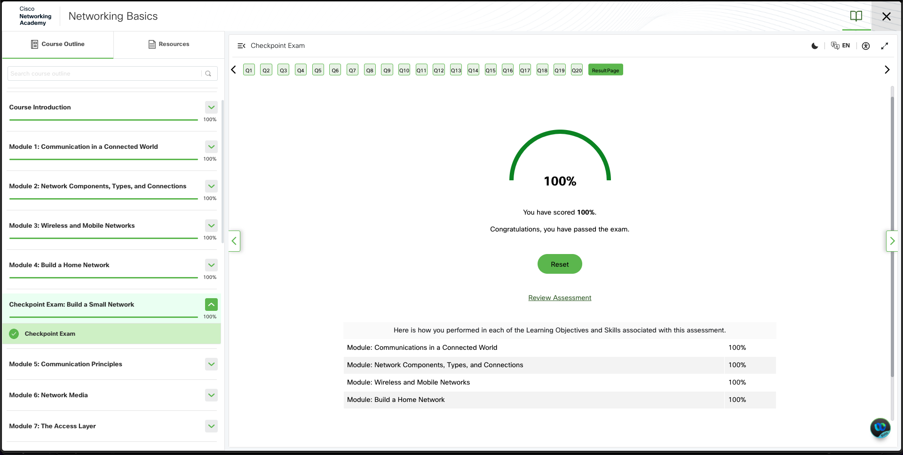

### Module 5: Communication Principles

Communication Protocols - Method, Language, Confirmation
Communication Standards -
Network Communication Models - compare OSI and TCP/IP models

TEST questions
TODO: learn protocolsbetter
Question 2
Rory is studying the fields inside an Ethernet frame for an upcoming test and notices that the destination Media Access Control (MAC) address is listed first before the source MAC address. Which of the following protocol characteristics is Rory investigating?

message timing
message pattern
encapsulation - SELECTED
encoding
timing

Question 3
As Rory continues to study Ethernet, he discovers that a frame can typically be 64 to 1518 bytes of information that is converted into a series of bits before being sent out on the network. Which two protocol characteristics did Rory learn about for Ethernet?

message pattern
message size - SELECTED
encapsulation
encoding - SELECTED
timing

5.2 Network Standards Organizations
when a new standard is proposed, each stage of the development and approval process is recorded in a numbered Request for Comments (RFC) document so that the evolution of the standard is tracked. RFCs for internet standards are published and managed by the Internet Engineering Task Force (IETF). orgs: IEEE, IANA, ICAAN, IETF, ITU, TIA.

network protocols
ETHERNET | IP | TCP | HTTP
ETHERNET - The Ethernet protocol is used for NIC card, network interface card to network interface card communications in the same network.
IP - can be IP version 4 or IP version 6. This makes sure that the message gets from the original source to the final destination. Whether or not that message is within the same network or has to go across multiple networks.addressing, routing, fragmentation, reassembly, best effort delivery
TCP - reordering, reliability, flow control, congestion control
HTTP - exchange/transfer of HTML. web page requests and responses

TCP/IP model Layers
Application - HTTP, FTP, SMTP, DNS
Transport - TCP, UDP
Internet - IP
Network Access - Ethernet, Wi-Fi, DSL, Cable

5.3.4 The OSI Reference Model
Protocol Model - a set of rules that govern how data is transmitted between two points in a network. A protocol model is a framework for understanding how protocols work together to enable communication between devices on a network.

Reference Model - a conceptual model that defines the functions of a communication system in terms of layers. A reference model is a theoretical framework that provides a common language and structure for understanding how different protocols and technologies work together to enable communication between devices on a network.

The OSI model is a theoretical model that characterizes and standardizes the communication functions of a telecommunication or computing system without regard to its underlying internal structure and technology. The OSI model partitions a communication system into seven abstraction layers. The layers are (from top 7 to bottom 1):
Application - process-to-process communication, e.g. HTTP, FTP, SMTP, DNS
Presentation - common representation of data transfrered between layer services. e.g. encryption, compression, translation
Session - provides services to Presentation Layer to organize and synchronize communication between applications. e.g. session establishment, maintenance, and termination
Transport - defines Services to segement, transfer, and reassemble the data for individual communications between end devices. e.g. TCP, UDP
Network - services to exchange individual pieces of data over the network between identified end devices. e.g. IP, routing, fragmentation, reassembly, best effort delivery
Data Link - methods for exchanging data frames between devices over a common media. e.g. Ethernet, Wi-Fi, DSL, Cable
Physical - mechanical, electical, functional, and procedural means to activate, maintain, and deactivate physical connections for bit transmission to/from end devices. e.g. Ethernet, Wi-Fi, DSL, Cable

TCP/IP vs OSI

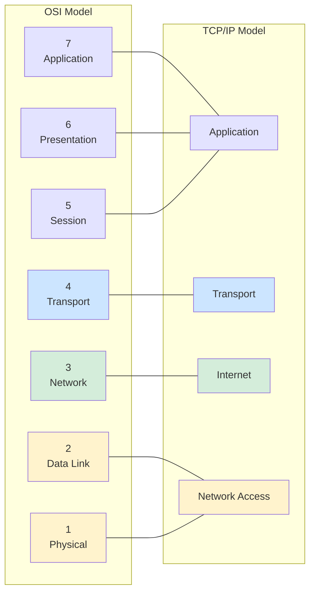

The key similarities are in the transport and network layers; however, the two models differ in how they relate to the layers above and below each layer:

OSI Layer 3, the network layer, maps directly to the TCP/IP internet layer. This layer is used to describe protocols that address and route messages through an internetwork.
OSI Layer 4, the transport layer, maps directly to the TCP/IP transport layer. This layer describes general services and functions that provide ordered and reliable delivery of data between source and destination hosts.
The TCP/IP application layer includes several protocols that provide specific functionality to a variety of end user applications. The OSI model Layers 5, 6, and 7 are used as references for application software developers and vendors to produce applications that operate on networks.
Both the TCP/IP and OSI models are commonly used when referring to protocols at various layers. Because the OSI model separates the data link layer from the physical layer, it is commonly used when referring to these lower layers.

learning outcomes:
Communication Protocols: A protocol is a set of rules that govern how data is transmitted between two points in a network. Protocols are necessary to ensure that devices on a network can communicate with each other effectively. these include:
message format - the structure of the data being transmitted, including the headers and payload.
message timing - the timing of when messages are sent and received, including any delays or timeouts that may occur.
message pattern - the sequence of messages that are exchanged between devices, including any acknowledgments or responses that may be required.
encapsulation - the process of adding headers and trailers to data as it moves through the layers of a network protocol stack. This allows data to be transmitted across different types of networks and ensures that it is properly formatted for the receiving device.
encoding - the process of converting data into a specific format for transmission, e.g. converting text into binary code or compressing data to reduce its size for faster transmission.
Confirmation - the process of acknowledging the receipt of a message or data, which can help ensure that messages are delivered successfully and that any errors or issues can be identified and resolved.
message pattern - the sequence of messages that are exchanged between devices, including any acknowledgments or responses that may be required. This can include the order in which messages are sent and received, as well as any specific patterns or protocols that must be followed for successful communication.
message size - the amount of data that is being transmitted in a message, which can affect the speed and efficiency of communication. Protocols may have specific limits on message size, and larger messages may require additional processing or fragmentation to be transmitted successfully.
encapsulation - the process of adding headers and trailers to data as it moves through the layers of a network protocol stack. This allows data to be transmitted across different types of networks and ensures that it is properly formatted for the receiving device. Encapsulation can also provide additional functionality, e.g. error checking or encryption, to help ensure the integrity and security of the data being transmitted.
encoding - the process of converting data into a specific format for transmission, e.g. converting text into binary code or compressing data to reduce its size for faster transmission. Encoding can also involve adding error correction codes or other information to help ensure that the data is transmitted accurately and can be properly decoded by the receiving device.
timing - the timing of when messages are sent and received, including any delays or timeouts that may occur.

Communication Standards

Network communication standards are developed by various organizations to ensure that devices from different manufacturers can communicate with each other effectively. These standards define the protocols, formats, and procedures for communication between devices on a network. Some of the key organizations responsible for developing network communication standards include:
IEEE (Institute of Electrical and Electronics Engineers) - develops standards for wired and wireless networking technologies, including Ethernet and Wi-Fi.
IANA (Internet Assigned Numbers Authority) - manages the allocation of IP addresses and other internet protocol resources.
ICANN (Internet Corporation for Assigned Names and Numbers) - manages the domain name system (DNS) and other internet-related resources.
IETF (Internet Engineering Task Force) - develops and promotes internet standards, including protocols for communication between devices on a network.
ITU (International Telecommunication Union) - develops standards for telecommunications and information communication technologies.
TIA (Telecommunications Industry Association) - develops standards for telecommunications and information communication technologies, including standards for cabling and network infrastructure.

OSI Model Layer Descriptions

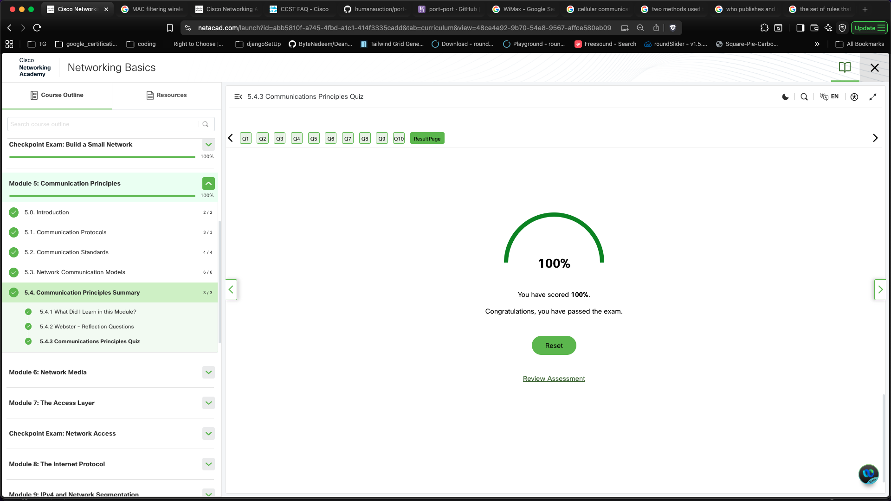

### Module 6: Network Media

objective: Network Media types

UTP - unshielded twisted pair
Coaxial cable - an inner wire surrounded by a tubular insulating layer, that is then surrounded by a tubular conducting shield. Most coax cables also have an external insulating sheath or jacket.
fiber-optic cables - can be either glass or plastic with a diameter about the same as a human hair and it can carry digital information at very high speeds over long distances. Fiber-optic cables have a very high bandwidth, which enables them to carry very large amounts of data.

3 media cables:
Modern networks primarily use three types of media to interconnect devices, as shown in the figure:

Metal wires within cables - Data is encoded into electrical impulses.
Glass or plastic fibers within cables (fiber-optic cable) - Data is encoded into pulses of light.
Wireless transmission - Data is encoded via modulation of specific frequencies of electromagnetic waves.

The four main criteria for choosing network media are DEASC:

D, Distance: What is the maximum distance that the media can successfully carry a signal?
E, Environment: What is the environment in which the media will be installed?
AS, Amount of Data: What is the amount of data and at what speed must it be transmitted?
C, Cost: What is the cost of the media and installation?

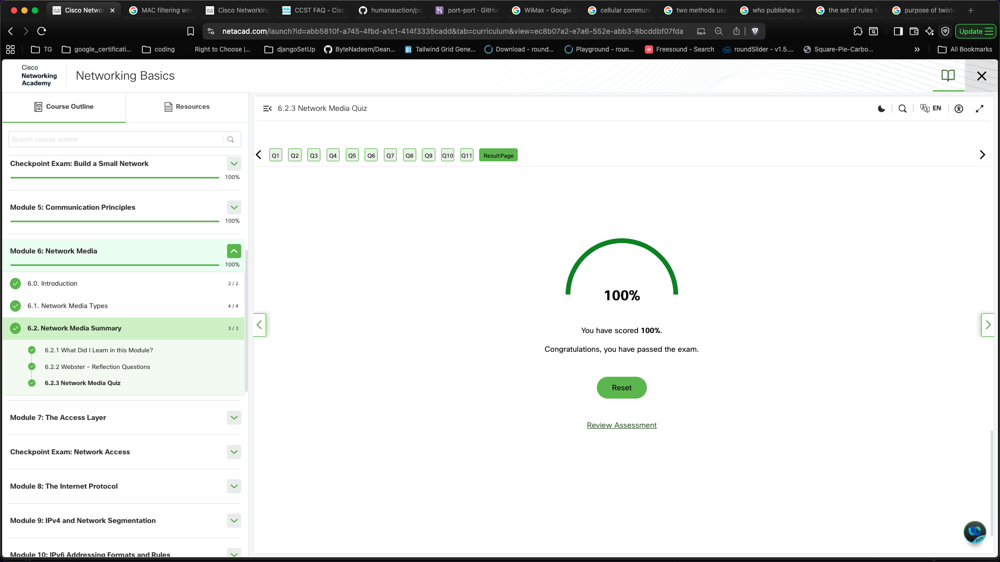

### Module 7: Access layer

Learning objectives:
Encapsualtion and the Ethernet frame
Access Layer

Ethernet Frame:
Preamble - 7 bytes used for synchronization
Start Frame Delimiter (SFD) - 1 byte used to indicate the start of the frame
Destination MAC Address - 6 bytes used to identify the destination host
Source MAC Address - 6 bytes used to identify the source host
Length Type - 2 bytes used to indicate the protocol being encapsulated in the payload OR type of data IPv4, IPv6...
Data Payload - 46 to 1500 bytes of data being transmitted
Frame Check Sequence (FCS) - 4 bytes used for error checking

Switches:
like to learn. but only for about 5 mins.
Ethernet Switches:
802.3 Ethernet frame is used for communication between devices on the same network. The Ethernet frame contains a destination MAC address and a source MAC address, which are used to identify the devices that are communicating. When a switch receives an Ethernet frame, it reads the destination MAC address and forwards the frame only to the port that is connected to the device with that MAC address. This process is called switching, and it helps to reduce network congestion and improve performance by ensuring that frames are only sent to the devices that need them.
MAC address tables:

learning outcomes:
Encapsulation and the Ethernet Frame: Encapsulation is the process of adding headers and trailers to data as it moves through the layers of a network protocol stack. This allows data to be transmitted across different types of networks and ensures that it is properly formatted for the receiving device. The Ethernet frame is a specific type of data packet used in Ethernet networks. It consists of several fields, including a preamble, start frame delimiter, destination MAC address, source MAC address, length/type field, data payload, and frame check sequence. Each of these fields serves a specific purpose in the encapsulation process, allowing data to be transmitted effectively and efficiently across an Ethernet network.

Access layer: The access layer is the layer of a network that provides connectivity to end devices, e.g. computers, printers, and mobile devices. It is responsible for providing access to the network and ensuring that data is transmitted securely and efficiently between end devices and the rest of the network. The access layer typically includes switches, wireless access points, and other networking devices that connect end devices to the network infrastructure. The access layer also provides features e.g. authentication, authorization, and accounting (AAA) to ensure that only authorized users can access the network and that their activities are monitored and logged for security purposes.

MAC Filtering:
MAC filtering in wireless networks acts as a security access control mechanism that permits or denies access to a network based on a device's unique 48-bit hardware address (MAC address). It functions as a gatekeeper, creating white or blacklists to allow or block specific devices, but it does not provide traffic encryption.
Key Characteristics of MAC Filtering:
Access Control Method: It is a security feature, often found on routers and access points, to allow only authorized devices to connect to a Wi-Fi network.Whitelist/Blacklist Functionality: Administrators can create a list of authorized devices (whitelist) to permit access or a list of disallowed devices (blacklist) to block access.
Hardware Identifier Based: It uses the unique MAC address of a device’s network interface card (NIC) to identify it, regardless of its IP address.
Limited Security (Weakness): It is considered a weak security measure because MAC addresses can be easily spoofed or cloned by attackers.Maintenance Intensive: Managing MAC address lists is cumbersome in larger networks, requiring constant manual updates.No Encryption: MAC filtering does not encrypt traffic or protect against eavesdropping; it only controls access.
Limitations:
Spoofing: Attackers can bypass MAC filters by "spoofing" (impersonating) the MAC address of an authorized device.Complexity: It does not scale well to large environments with many devices, leading to increased management overhead.Randomization Conflict: Modern devices often use randomized MAC addresses for privacy, which can cause connectivity issues when MAC filtering is enabled.It is generally recommended to use MAC filtering as an extra layer in combination with strong encryption protocols like WPA2 or WPA3, rather than as a standalone security measure.

switches:
A switch keeps its MAC address table current by using the source MAC address and the incoming port of incoming data frames. By examining these two pieces of information, the switch learns which device is connected to which port and updates the table's timestamp to keep entries active.

Key details on how switches maintain this information:
Source MAC Address: When a frame arrives, the switch examines the source MAC address to identify which device sent the data.
Incoming Port: The switch records the specific interface (port) on which the frame arrived.
Association/Learning: The switch pairs the source MAC address with the incoming port in its table, allowing it to know where to send future traffic.
Aging Mechanism: If a device stops sending frames, the switch will remove that device's MAC address from the table after a certain period (aging time) to keep the table accurate.

While the switch uses the destination MAC address to decide where to send a frame, it specifically uses the source MAC address and incoming port to update and maintain the table.

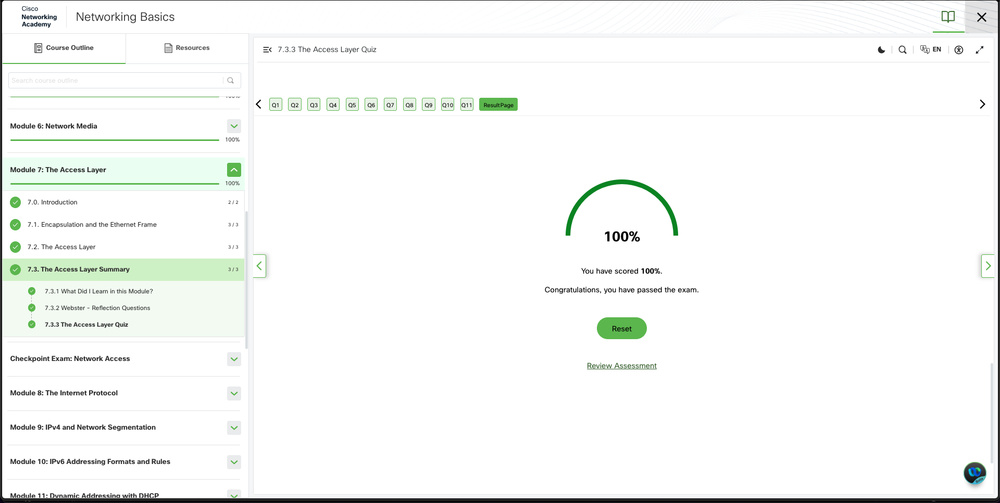

### Checkpoint 2

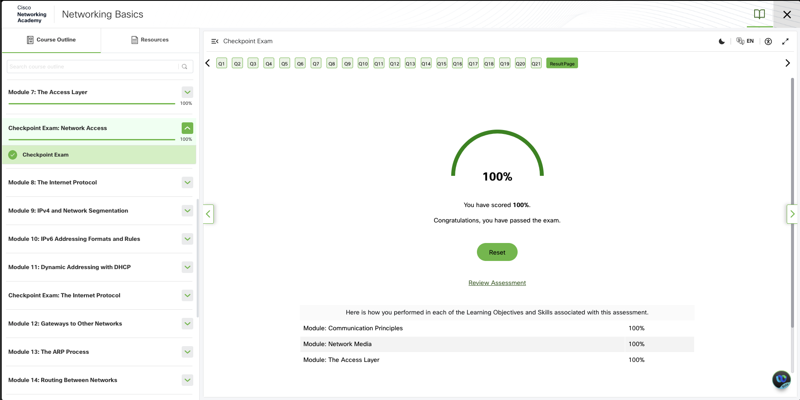

### Module 8: Internet Protocol

learning objective: IP address features

IPv4 address purpose - logical network address used for routing and addressing,

IPv4 address structure - addresses and subnets used together

learning outcomes:
IPv4 Address Purpose: An IPv4 address is a logical network address used for routing and addressing in an IP network. It serves as a unique identifier for devices on a network, allowing them to communicate with each other and with devices on other networks. IPv4 addresses are used to identify both the source and destination of data packets as they traverse the internet or other IP-based networks. They are essential for the proper functioning of the internet and enable devices to send and receive data across networks.

IPv4 Address Structure: An IPv4 address is a 32-bit binary number that is typically represented in dotted decimal notation, consisting of four octets separated by periods (e.g., 192.168.1.1). Each octet can range from 0 to 255, allowing for a total of approximately 4.3 billion unique addresses. IPv4 addresses are structured into two main parts: the network portion and the host portion. The network portion identifies the specific network to which the device belongs, while the host portion identifies the individual device within that network. Subnetting is often used to divide larger networks into smaller, more manageable subnets, allowing for more efficient use of IP addresses and improved network performance.

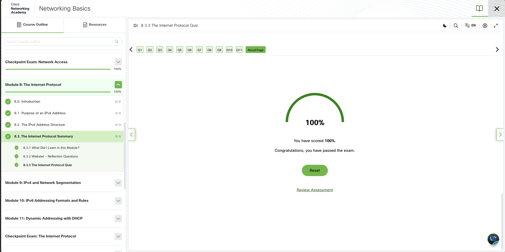

### Module 9: IPv4 and Network Segmentation

IPv4 Unicast, Broadcast, Multicast
Types of IPv4 Addresses - public, private, APIPA
Network Segmentation - subnetting

Unicast: 1 to 1. ßA unicast address is a unique identifier assigned to a single device on a network. It is used for one-to-one communication, where data is sent from one source to one specific destination. Unicast addresses are typically used for communication between individual devices, such as a computer communicating with a printer or a server communicating with a client.

Broadcast: 1 to all. Broadcast transmission refers to a device sending a message to all the devices on a network in one-to-all communications.

A broadcast packet has a destination IP address with all ones (1s) in the host portion, or 32 one (1) bits.

Note: IPv4 uses broadcast packets. However, there are no broadcast packets with IPv6.

A broadcast packet must be processed by all devices in the same broadcast domain. A broadcast domain identifies all hosts on the same network segment. A broadcast may be directed or limited. A directed broadcast is sent to all hosts on a specific network. For example, a host on the 172.16.4.0/24 network sends a packet to 172.16.4.255. A limited broadcast is sent to 255.255.255.255. By default, routers do not forward broadcasts.

Broadcast packets use resources on the network and make every receiving host on the network process the packet. Therefore, broadcast traffic should be limited so that it does not adversely affect the performance of the network or devices. Because routers separate broadcast domains, subdividing networks can improve network performance by eliminating excessive broadcast traffic.

Multicast: 1 to many 224.0.0.0 to 239.255.255.255
Multicast transmission reduces traffic by allowing a host to send a single packet to a selected set of hosts that subscribe to a multicast group.

A multicast packet is a packet with a destination IP address that is a multicast address. IPv4 has reserved the 224.0.0.0 to 239.255.255.255 addresses as a multicast range.

Hosts that receive particular multicast packets are called multicast clients. The multicast clients use services requested by a client program to subscribe to the multicast group.

Each multicast group is represented by a single IPv4 multicast destination address. When an IPv4 host subscribes to a multicast group, the host processes packets addressed to this multicast address, and packets addressed to its uniquely allocated unicast address.

Routing protocols such as OSPF use multicast transmissions. For example, routers enabled with OSPF communicate with each other using the reserved OSPF multicast address 224.0.0.5. Only devices enabled with OSPF will process these packets with 224.0.0.5 as the destination IPv4 address. All other devices will ignore these packets.

Network Addresses and prefixes:
Public IPv4 addresses are globally unique and can be routed on the internet. They are assigned by Internet Service Providers (ISPs) and are used for devices that need to be accessible from outside the local network, such as web servers or email servers. Public IPv4 addresses are necessary for communication over the internet, as they allow devices to be identified and located globally. Private IPv4 addresses are reserved for use within private networks and are not routable on the internet. They are used for devices that do not need to be accessible from outside the local network, such as computers, printers, and other devices within a home or office network. Private IPv4 addresses are defined in the following ranges: 10.0.0.0 to 10.255.255.255, 172.16.0.0 to 172.31.255.255, and 192.168.0.0 to 192.168.255.255.

Note: Private addresses are defined in RFC 1918 and sometimes referred to as RFC 1918 address space.

Private IPv4 Addresses and Network Address Translation (NAT)
Most internal networks, from large enterprises to home networks, use private IPv4 addresses for addressing all internal devices (intranet) including hosts and routers. However, private addresses are not globally routable.

In the figure, customer networks 1, 2, and 3 are sending packets outside their internal networks. These packets have a source IPv4 address that is a private address and a destination IPv4 address that is public (globally routable). Packets with a private address must be filtered (discarded) or translated to a public address before forwarding the packet to an ISP.

Before the ISP can forward this packet, it must translate the source IPv4 address, which is a private address, to a public IPv4 address using Network Address Translation (NAT). NAT is used to translate between private IPv4 and public IPv4 addresses. This is usually done on the router that connects the internal network to the ISP network. Private IPv4 addresses in the organization’s intranet will be translated to public IPv4 addresses before routing to the internet.

Special Use IPv4 Addresses
There are certain addresses, such as the network address and broadcast address, that cannot be assigned to hosts. There are also special addresses that can be assigned to hosts, but with restrictions on how those hosts can interact within the network.

Loopback addresses

Loopback addresses (127.0.0.0 /8 or 127.0.0.1 to 127.255.255.254) are more commonly identified as only 127.0.0.1. These are special addresses used by a host to direct traffic to itself. For example, the ping command is commonly used to test connections to other hosts. But you can also use the ping command to test if the IP configuration on your own device, as shown in the figure.

Note: You will learn more about the ping command later in this course.
Pinging the Loopback Interface

```bash
C:∖Users∖NetAcad> ping 127.0.0.1
Pinging 127.0.0.1 with 32 bytes of data:
Reply from 127.0.0.1: bytes=32 time<1ms TTL=128
Reply from 127.0.0.1: bytes=32 time<1ms TTL=128
Reply from 127.0.0.1: bytes=32 time<1ms TTL=128
Reply from 127.0.0.1: bytes=32 time<1ms TTL=128
Ping statistics for 127.0.0.1:
    Packets: Sent = 4, Received = 4, Lost = 0 (0% loss),
Approximate round trip times in milli-seconds:
    Minimum = 0ms, Maximum = 0ms, Average = 0ms
C:∖Users∖NetAcad> ping 127.1.1.1
Pinging 127.1.1.1 with 32 bytes of data:
Reply from 127.1.1.1: bytes=32 time<1ms TTL=128
Reply from 127.1.1.1: bytes=32 time<1ms TTL=128
Reply from 127.1.1.1: bytes=32 time<1ms TTL=128
Reply from 127.1.1.1: bytes=32 time<1ms TTL=128
Ping statistics for 127.1.1.1:
    Packets: Sent = 4, Received = 4, Lost = 0 (0% loss),
Approximate round trip times in milli-seconds:
    Minimum = 0ms, Maximum = 0ms, Average = 0ms
C:∖Users∖NetAcad>
```

Link-Local addresses

Link-local addresses (169.254.0.0 /16 or 169.254.0.1 to 169.254.255.254) are more commonly known as the Automatic Private IP Addressing (APIPA) addresses or self-assigned addresses. They are used by a Windows client to self-configure in the event that the client cannot obtain an IP addressing through other methods. Link-local addresses can be used in a peer-to-peer connection but are not commonly used for this purpose.

Legacy Classful Addressing

IPv4 Address Classes
Class A: 0.0.0.0 – 127.255.255.255 (Large networks)
Class B: 128.0.0.0 – 191.255.255.255 (Medium/large networks)
Class C: 192.0.0.0 – 223.255.255.255 (Small networks)
Class D: 224.0.0.0 – 239.255.255.255 (Multicast)
Class E: 240.0.0.0 – 255.255.255.255 (Experimental)
Reserved Private IPv4 Ranges (Not routable on the Internet)
10.0.0.0 – 10.255.255.255 (10.0.0.0/8)
172.16.0.0 – 172.31.255.255 (172.16.0.0/12)
192.168.0.0 – 192.168.255.255 (192.168.0.0/16)
Special IPv4 Address Ranges
Loopback/Localhost: 127.0.0.0/8 (127.0.0.0 – 127.255.255.255)
APIPA (Link-Local): 169.254.0.0/16 (169.254.0.0 – 169.254.255.255)
Broadcast: 255.255.255.255

Key Concepts
Public vs. Private: Public IPs are reachable on the internet;
Private IPs are used within local networks.CIDR (Classless Inter-Domain Routing): Replaces the class system to allocate IP addresses more efficiently using a slash notation (e.g., /24).

In 1981, IPv4 addresses were assigned using classful addressing as defined in RFC 790 (https://tools.ietf.org/html/rfc790), Assigned Numbers. Customers were allocated a network address based on one of three classes, A, B, or C. The RFC divided the unicast ranges into specific classes as follows:

Class A (0.0.0.0/8 to 127.0.0.0/8) - Designed to support extremely large networks with more than 16 million host addresses. Class A used a fixed /8 prefix with the first octet to indicate the network address and the remaining three octets for host addresses (more than 16 million host addresses per network).
Class B (128.0.0.0 /16 - 191.255.0.0 /16) - Designed to support the needs of moderate to large size networks with up to approximately 65,000 host addresses. Class B used a fixed /16 prefix with the two high-order octets to indicate the network address and the remaining two octets for host addresses (more than 65,000 host addresses per network).
Class C (192.0.0.0 /24 - 223.255.255.0 /24) - Designed to support small networks with a maximum of 254 hosts. Class C used a fixed /24 prefix with the first three octets to indicate the network and the remaining octet for the host addresses (only 254 host addresses per network).
Class D multicast block consisting of 224.0.0.0 to 239.0.0.0
Class E experimental address block consisting of 240.0.0.0 - 255.0.0.0.

At the time, with a limited number of computers using the internet, classful addressing was an effective means to allocate addresses. As shown in the figure, Class A and B networks have a very large number of host addresses and Class C has very few. Class A networks accounted for 50% of the IPv4 networks. This caused most of the available IPv4 addresses to go unused.

The diagram is a pie chart showing the percentage of Class A, B, C, D, & E IPv4 addressing with the total number of networks and hosts per class A, B, and C networks. Percentages are: class A = 50%, class B = 25%, class C = 12.5%, and class D and E = 12.5%. For the total number of networks and total number of hosts per network: class A = 128 networks with 16,777,214 total hosts per network; class B = 16,384 networks with 65,534 total hosts per network; and class C = 2,097,152 networks with 254 total hosts per network.
Class D & E 12.5%
Class A 50%
Class C 12.5%
Class B 25%
Class A Total Networks: 128
Total Hosts/Net: 16,777,214
Class BTotal Networks: 16,384
Total Hosts/Net: 65,534
Class C
Total Networks: 2,097,152
Total Hosts/Net: 254
In the mid-1990s, with the introduction of the World Wide Web (WWW), classful addressing was deprecated to more efficiently allocate the limited IPv4 address space. Classful address allocation was replaced with classless addressing, which is used today. Classless addressing ignores the rules of classes (A, B, C). Public IPv4 network addresses (network addresses and subnet masks) are allocated based on the number of addresses that can be justified.

Regional Internet Registries
Public IPv4 addresses are addresses which are globally routed over the internet. Public IPv4 addresses must be unique.

Both IPv4 and IPv6 addresses are managed by the Internet Assigned Numbers Authority (IANA). The IANA manages and allocates blocks of IP addresses to the Regional Internet Registries (RIRs). The five RIRs are shown in the figure.

RIRs are responsible for allocating IP addresses to ISPs who provide IPv4 address blocks to organizations and smaller ISPs. Organizations can also get their addresses directly from an RIR (subject to the policies of that RIR).

Regional Internet Registries
This figure shows the geographic locations of the Reginal Internet Registries (RIR). The regions governed by each RIR are as follows: AfriNIC (African Network Information Center) - serving the Africa Region, APNIC (Asia Pacific Network Information Centre) - serving the Asia/Pacific Region, ARIN (American Registry for Internet Numbers) - serving the North America Region, LACNIC (Regional Latin-American and Caribbean IP Address Registy) - serving Latin America and some Caribbean Islands, and RIPE NCC (Reseaux IP Europeens Network Coordination Centre) - serving Europe, the Middle East, and Central Asia.

<strong>AfriNIC</strong> (African Network Information Centre) - Africa Region
<strong>APNIC</strong> (Asia Pacific Network Information Centre) - Asia/Pacific Region
<strong>ARIN</strong> (American Registry for Internet Numbers) - North America Region
<strong>LACNIC</strong> (Regional Latin-American and Caribbean IP Address Registry) - Latin America and some Caribbean Islands
<strong>RIPE NCC</strong> (Réseaux IP Européens Network Coordination Centre) - Europe, the Middle East, and Central Asia

https://datatracker.ietf.org/doc/html/rfc790

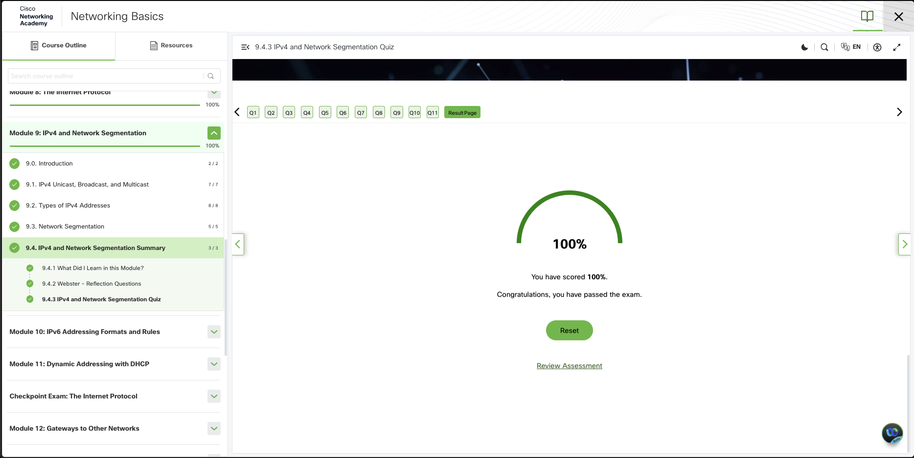

### Module 10: IPv6 Address formats and rules

learning objectives:
IP4 Issues
IPv6 Addressing

IPv4 and IPv6 Coexistence
There is no specific date to move to IPv6. Both IPv4 and IPv6 will coexist in the near future and the transition will take several years. The IETF has created various protocols and tools to help network administrators migrate their networks to IPv6. The migration techniques can be divided into three categories:

Dual stack
Dual stack allows IPv4 and IPv6 to coexist on the same network segment. Dual stack devices run both IPv4 and IPv6 protocol stacks simultaneously. Known as native IPv6, this means the customer network has an IPv6 connection to their ISP and is able to access content found on the internet over IPv6.

Tunneling
Tunneling is a method of transporting an IPv6 packet over an IPv4 network. The IPv6 packet is encapsulated inside an IPv4 packet, similar to other types of data. Tunneling is used when a customer network has an IPv4 connection to their ISP and needs to access content found on the internet over IPv6.

Translation
Network Address Translation 64 (NAT64) allows IPv6-enabled devices to communicate with IPv4-enabled devices using a translation technique similar to NAT for IPv4. An IPv6 packet is translated to an IPv4 packet and an IPv4 packet is translated to an IPv6 packet.

The physcial network topology shows on IPv6-only network on the left communication with an IPv4-only network on the right through a NAT64 router.
PC1
PC2
IPv6-only NetworkIPv4-only NetworkNAT64 Router

N.B. Tunneling and translation are for transitioning to native IPv6 and should only be used where needed. The goal should be native IPv6 communications from source to destination.

IPv6 Addressing
IPv6 addresses are represented using hexadecimal numbers. This base sixteen number system uses the digits 0 to 9 and the letters A to F:

0 1 2 3 4 5 6 7 8 9 A B C D E F

In IPv6 addresses, these 16 digits are represented as hextets. IPv6 addresses are 128 bits in length and written as a string of hexadecimal values. Every four bits is represented by a single hexadecimal digit; for a total of 32 hexadecimal values, as shown in the figure. IPv6 addresses are not case-sensitive and can be written in either lowercase or uppercase.

Hextets (16-BIT SEGMENTS)

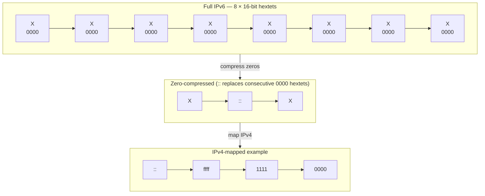

examples of IPv6 addresses in the preferred format.

2001 : 0db8 : 0000 : 1111 : 0000 : 0000 : 0000: 0200
2001 : 0db8 : 0000 : 00a3 : abcd : 0000 : 0000: 1234
2001 : 0db8 : 000a : 0001 : c012 : 9aff : fe9a: 19ac
2001 : 0db8 : aaaa : 0001 : 0000 : 0000 : 0000: 0000
fe80 : 0000 : 0000 : 0000 : 0123 : 4567 : 89ab: cdef
fe80 : 0000 : 0000 : 0000 : 0000 : 0000 : 0000: 0001
fe80 : 0000 : 0000 : 0000 : c012 : 9aff : fe9a: 19ac
fe80 : 0000 : 0000 : 0000 : 0123 : 4567 : 89ab: cdef
0000 : 0000 : 0000 : 0000 : 0000 : 0000 : 0000: 0001
0000 : 0000 : 0000 : 0000 : 0000 : 0000 : 0000: 0001

2 rules for compression of IPv6 addresses:
1 omit leading zeros. e.g. 0db8 can be written as db8, and 0001 can be written as 1. Leading zeros in a hextet can be omitted to simplify the address representation. For example, the hextet 0db8 can be compressed to db8, and the hextet 0001 can be compressed to 1. However, if a hextet is entirely zeros, it can be represented as a single zero (0) or omitted entirely if it is part of a sequence of zeros.
2 double colon (::) can be used to replace consecutive hextets of zeros, but only once in an address. The double colon can replace one or more consecutive hextets of zeros, but it can only be used once in an address to avoid ambiguity. For example, the address 2001:0db8:0000:0000:0000:0000:0000:0001 can be compressed to 2001:0db8::1, where the double colon replaces the six consecutive hextets of zeros. However, if there were multiple groups of zeros, only one group could be replaced with a double colon (the longer string), and the other group would need to be represented with its full hextet values.

learning outcomes:
IPv4 Issues: IPv4 has several limitations, including a limited address space (approximately 4.3 billion addresses), which has led to the exhaustion of available IPv4 addresses. Additionally, IPv4 does not have built-in security features, and its header structure is less efficient compared to IPv6. These issues have prompted the development of IPv6 to address the growing needs of the internet and provide improved functionality. e.g.ICMPv6 provides address resolution and neighbor discovery functions that were previously handled by separate protocols in IPv4 (e.g., ARP). IPv6 also includes built-in support for IPsec, which provides enhanced security features compared to IPv4.

migration to IPv6:
methods include dual stack(both), tunneling(encapsulate 6 in 4) and translation(NAT64).

- Dual stack allows both IPv4 and IPv6 to coexist on the same network segment, enabling devices to communicate using either protocol.
- Tunneling encapsulates IPv6 packets within IPv4 packets to allow communication over an IPv4 network.
- Translation, such as NAT64 (network address translation 6 to 4), enables communication between IPv6-enabled devices and IPv4-enabled devices by translating between the two protocols. The goal of these methods is to facilitate a smooth transition to native IPv6 communications while maintaining compatibility with existing IPv4 infrastructure.

IPv6 addressing:
128-bit addresses represented in hexadecimal format, divided into eight 16-bit hextets. IPv6 addresses can be compressed by omitting leading zeros and using a double colon (::) to replace consecutive hextets of zeros, but the double colon can only be used once in an address to avoid ambiguity. This allows for a more efficient and compact representation of IPv6 addresses while maintaining their uniqueness and functionality. e.g. the IPv6 address 2001:0db8:0000:0000:0000:0000:0000:0001 can be compressed to 2001:0db8::1, where the double colon replaces the six consecutive hextets of zeros.
if multiple occurunces of zeros, only the longer string can be replaced with a double colon, and the other group would need to be represented with its full hextet values. e.g. the address fe80:0000:0000:0000:0123:4567:89ab:cdef can be compressed to fe80::123:4567:89ab:cdef, where the double colon replaces the three consecutive hextets of zeros. However, if there were multiple groups of zeros, only one group could be replaced with a double colon (the longer string), and the other group would need to be represented with its full hextet values. e.g. the address 2001:0db8:0000:0001:c012:9aff:fe9a:19ac because there are two groups of zeros (0000 and 0000) and only one can be replaced with a double colon, the address would need to be represented as 2001:0db8:0:1:c012:9aff:fe9a:19ac to avoid ambiguity.

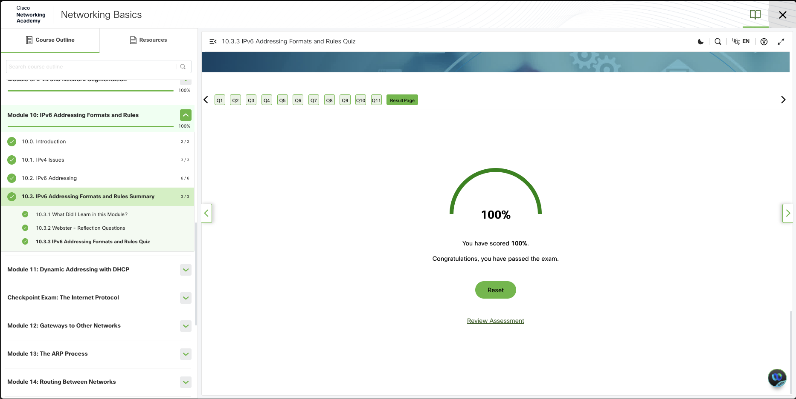

#### module 11: Dynamic Addressing and DHCP

module objective: configure a DHCP server

static and dynamic addressing
DHCPv4 configuration

Static IPv4 Address Assignment
IPv4 addresses can be assigned either statically or dynamically.

With a static assignment, the network administrator must manually configure the network information for a host. At a minimum, this includes the following:

IP address - This identifies the host on the network.
Subnet mask - This is used to identify the network on which the host is connected.
Default gateway - This identifies the networking device that the host uses to access the internet or another remote network.
Static addresses have some advantages. For instance, they are useful for printers, servers, and other networking devices that need to be accessible to clients on the network. If hosts normally access a server at a particular IPv4 address, it would not be good if that address changed.

Static assignment of addressing information can provide increased control of network resources, but it can be time consuming to enter the information on each host. When IPv4 addresses are entered statically, the host only performs basic error checks on the IPv4 address. Therefore, errors are more likely to occur.

When using static IPv4 addressing, it is important to maintain an accurate list of which IPv4 addresses are assigned to which devices. Additionally, these are permanent addresses and are not normally reused.

Dynamic IPv4 Address Assignment
On local networks it is often the case that the user population changes frequently. New users arrive with laptops and need a connection. Others have new workstations that need to be connected. Rather than have the network administrator assign IPv4 addresses for each workstation, it is easier to have IPv4 addresses assigned automatically. This is done using a protocol known as Dynamic Host Configuration Protocol (DHCP).

DHCP automatically assigns addressing information such as IPv4 address, subnet mask, default gateway, DNS server, and other configuration information.

DHCP is generally the preferred method of assigning IPv4 addresses to hosts on large networks because it reduces the burden on network support staff and virtually eliminates entry errors.

Another benefit of DHCP is that an address is not permanently assigned to a host but is only leased for a period of time. If the host is powered down or taken off the network, the address is returned to the pool for reuse. This is especially helpful with mobile users that come and go on a network.

DHCP Servers:
with a wireless hotspot, DHCP makes it possible for you to access the internet. As you enter the area, your laptop DHCP client contacts the local DHCP server via a wireless connection. The DHCP server assigns an IPv4 address to your laptop.

Various types of devices can be DHCP servers as long as they are running DHCP service software. With most medium to large networks, the DHCP server is usually a local dedicated PC-based server.

With home networks, the DHCP server may be located at the ISP and a host on the home network receives its IPv4 configuration directly from the ISP.
Many home networks and small businesses use a wireless router and modem. In this case, the wireless router is both a DHCP client and a server. The wireless router acts as a client to receive its IPv4 configuration from the ISP and then acts as a DHCP server for internal hosts on the local network. The router receives the public IPv4 address from the ISP, and in its role as a DHCP server, it distributes private addresses to internal hosts.

In addition to PC-based servers and wireless routers, other types of networking devices such as dedicated routers can provide DHCP services to clients, although this is not as common.

DHCP discover, offer, request, and acknowledgment (DORA) process:
When a DHCP client connects to the network, it goes through a process to obtain an IP address and other configuration information from the DHCP server. DORA, - Discover, Offer, Request, and Acknowledgment.
discover - The client sends a DHCP Discover message to the network to find available DHCP servers. This message is broadcasted to all devices on the local network.
offer - When a DHCP server receives the Discover message, it responds with a DHCP Offer message. This message contains an available IP address and other configuration information that the server is offering to the client.
request - The client receives the Offer messages from one or more DHCP servers and selects one of the offers. It then sends a DHCP Request message to the selected server, indicating that it accepts the offered IP address and configuration.
acknowledgment - The DHCP server receives the Request message and responds with a DHCP Acknowledgment message. This message confirms that the IP address has been assigned to the client and includes any additional configuration information, such as the subnet mask, default gateway, and DNS server addresses. Once the client receives the Acknowledgment message, it can begin using the assigned IP address and configuration to communicate on the network.

remember, DORA.

learning outcomes:
Static IPv4 Address Assignment: Static IPv4 address assignment involves manually configuring the network information for a host, including the IP address, subnet mask, and default gateway. This method provides increased control over network resources and is useful for devices that need to be consistently accessible, such as printers and servers. However, it can be time-consuming and prone to errors, as the network administrator must enter the information for each host individually. Additionally, static addresses are permanent and are not typically reused, which can lead to inefficient use of IP address space if not managed properly.
Dynamic IPv4 Address Assignment: Dynamic IPv4 address assignment uses the Dynamic Host Configuration Protocol (DHCP) to automatically assign IP addresses and other configuration information to hosts on a network. This method reduces the burden on network support staff and minimizes entry errors, as the DHCP server handles the assignment process. DHCP also allows for efficient use of IP address space, as addresses are leased to hosts for a specific period of time and returned to the pool for reuse when no longer needed. This is particularly beneficial for mobile users who frequently connect and disconnect from the network.
DHCP Servers: configured on range or pool. client IPv4 need will send DHCP Discover message to find available DHCP servers.
broadcast with a destination IPv4 address of 255.255.255.255 (32*1)
Destination MAC address of FF:FF:FF:FF:FF:FF (48*1).

All hosts on the local network will receive the DHCP Discover message, but only DHCP servers will respond with a DHCP Offer message. The client will then select one of the offers and send a DHCP Request message to the selected server, which will respond with a DHCP Acknowledgment message to confirm the assignment of the IP address and configuration information. This process allows for efficient and automated management of IP addresses on a network.

for home and small business networks defaults on internal router interface are 192.168.0.1 and subnet mask 255.255.255.0.

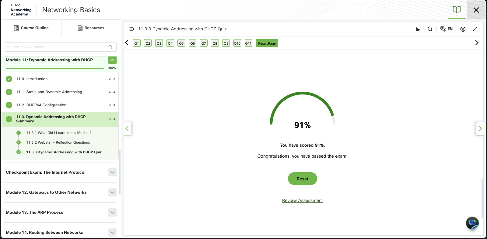
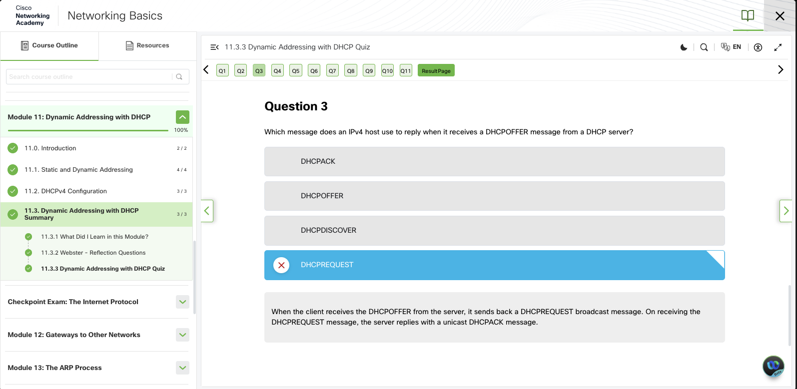

A subnet mask acts in conjunction with an IP address to divide it into a network address and a host address. It tells network devices which part of the address defines the network (e.g., zip code) and which identifies the specific device (e.g., house number), enabling efficient routing and dividing large networks into smaller, manageable subnets.Key Purposes of Subnet Masks:Defining Network Boundaries: It specifies which bits in an IP address are reserved for the network and which are for individual devices (hosts).Determining Local vs. Remote Traffic: It allows a device to determine if another IP address is on the same local network or requires a router to reach a remote network.Subnetting and Organization: It breaks down large networks into smaller, more secure, and manageable subnets to reduce traffic congestion.Routing Optimization: Routers use masks to determine the most efficient path for data packets, ensuring they reach the correct destination network.Example:Using an IP address of \(192.168.1.10\) and a subnet mask of \(255.255.255.0\):The \(255\)s mask the first three octets (\(192.168.1.\)) as the Network ID.The \(0\) indicates the final part (\(.10\)) is the Host ID.A subnet mask ensures proper identification of both the network and the individual device within that network

Normally, DHCP servers and BOOTP relay agents attempt to deliver DHCPOFFER, DHCPACK and DHCPNAK messages directly to the client using uicast delivery. but noit Cisco, Cisco its BROADCAST to the client with a destination IPv4 address of

## Checkpoint 3

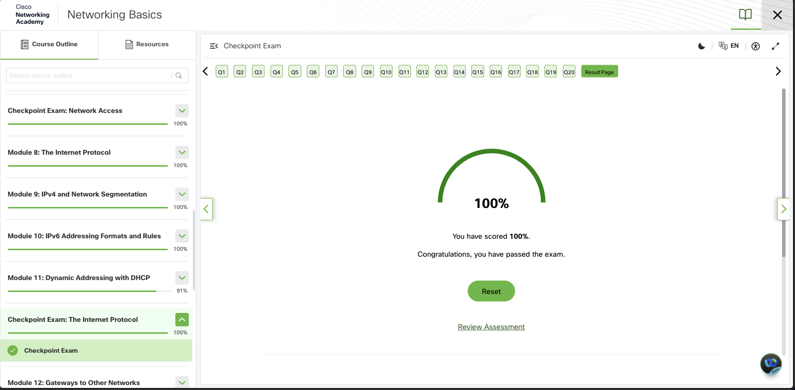

### Module 12: Gateways to other networks

learning objectives:
Network Boundries
NAT Network Address Translation

Routers as Gateways
The router provides a gateway through which hosts on one network can communicate with hosts on different networks. Each interface on a router is connected to a separate network.

The IPv4 address assigned to the interface identifies which local network is connected directly to it.

Every host on a network must use the router as a gateway to other networks. Therefore, each host must know the IPv4 address of the router interface connected to the network where the host is attached. This address is known as the default gateway address. It can be either statically configured on the host or received dynamically by DHCP.

When a wireless router is configured to be a DHCP server for the local network, it automatically sends the correct interface IPv4 address to the hosts as the default gateway address. In this manner, all hosts on the network can use that IPv4 address to forward messages to hosts located at the ISP and get access to hosts on the internet. Wireless routers are usually set to be DHCP servers by default.

The IPv4 address of that local router interface becomes the default gateway address for the host configuration. The default gateway is provided, either statically or by DHCP.

When a wireless router is configured as a DHCP server, it provides its own internal IPv4 address as the default gateway to DHCP clients. It also provides them with their respective IPv4 address and subnet mask

Routers as Boundaries Between Networks
The wireless router acts as a DHCP server for all local hosts attached to it, either by Ethernet cable or wirelessly. These local hosts are referred to as being located on an internal, or inside, network. Most DHCP servers are configured to assign private addresses to the hosts on the internal network, rather than internet routable public addresses. This ensures that, by default, the internal network is not directly accessible from the internet.

The default IPv4 address configured on the local wireless router interface is usually the first host address on that network. Internal hosts must be assigned addresses within the same network as the wireless router, either statically configured, or through DHCP. When configured as a DHCP server, the wireless router provides addresses in this range. It also provides the subnet mask information and its own interface IPv4 address as the default gateway, as shown in the figure.

Many ISPs also use DHCP servers to provide IPv4 addresses to the internet side of the wireless router installed at their customer sites. The network assigned to the internet side of the wireless router is referred to as the external, or outside, network.

When a wireless router is connected to the ISP, it acts like a DHCP client to receive the correct external network IPv4 address for the internet interface. ISPs usually provide an internet-routable address, which enables hosts connected to the wireless router to have access to the internet.

The wireless router serves as the boundary between the local internal network and the external internet.

learning outcomes:
Network Boundries: wireless router serves as the boundary between the local internal network and the external internet. The router provides a gateway through which hosts on one network can communicate with hosts on different networks. Each interface on a router is connected to a separate network, and the IPv4 address assigned to the interface identifies which local network is connected directly to it. Every host on a network must use the router as a gateway to other networks, and therefore, each host must know the IPv4 address of the router interface connected to the network where the host is attached, known as the default gateway address.

NAT Operation: wireless router recieves a public IPv4 address from the ISP on its internet interface and assigns private IPv4 addresses to hosts on the internal network. The wireless router can translate many private addresses to a single public address, allowing multiple devices on the internal network to access the internet using one public IP address, while still maintaining security and efficient use of IP address space. NAT (Network Address Translation) is a technique used by routers to allow multiple devices on a local network to access the internet using a single public IP address. The router translates the private IP addresses of the devices on the local network to the public IP address assigned to the router by the ISP. This allows for efficient use of IP address space and provides a layer of security by hiding the internal network structure from external entities on the internet. When a device on the local network sends a request to access the internet, the router modifies the source IP address in the outgoing packets to its own public IP address and keeps track of which internal device made the request. When a response is received from the internet, the router uses this tracking information to forward the response back to the correct internal device. This process allows multiple devices on the local network to share a single public IP address while still being able to access the internet and receive responses correctly.

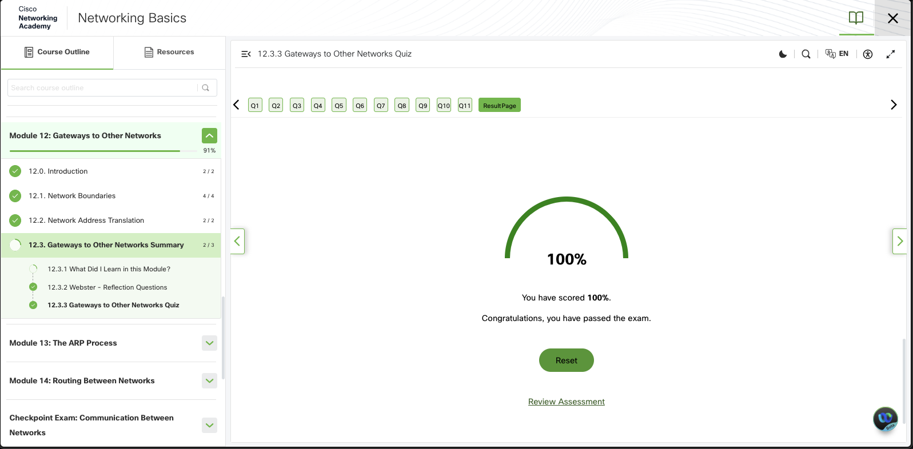

### Module 13: ARP Address Resolution Protocol

learning objectives:

MAC and IP - compare and contrast
Broadcast containment - importance of containing broadcasts within a local network

Destination on same network: There are two primary addresses assigned to a device on an Ethernet LAN:

Physical address (MAC address) – Used for NIC-to-NIC communications on the same Ethernet network.

Logical address (IP address) – Used to send the packet from the source device to the destination device.

The destination IP address may be on the same IP network as the source, or it may be on a remote network.
Layer 2 physical addresses (i.e., Ethernet MAC addresses) are used to deliver the data link frame with the encapsulated IP packet from one NIC to another NIC that is on the same network. If the destination IP address is on the same network, the destination MAC address will be that of the destination device. If the destination IP address is on a different network, the destination MAC address will be that of the default gateway (the router interface connected to the local network). The router will then forward the packet to the next hop toward the destination.

When a host needs to send a packet to another device on the same network, it must first determine the MAC address associated with the destination IP address. This is done using the Address Resolution Protocol (ARP). ARP allows a device to map an IP address to its corresponding MAC address. When a host wants to communicate with another device on the same network, it sends an ARP request broadcast message asking "Who has this IP address?" The device with that IP address responds with an ARP reply containing its MAC address. The sender can then use this MAC address to encapsulate the data link frame and send it directly to the destination device.

Destination on Remote Network
When the destination IP address (IPv4 or IPv6) is on a remote network, the destination MAC address will be the address of the host default gateway (i.e., the router interface). The router will then forward the packet to the next hop toward the destination. This is because devices on a local network can only communicate directly with other devices on the same network using their MAC addresses. To communicate with devices on different networks, the packet must be sent to the default gateway, which will handle the routing of the packet to its final destination.

How are the IP addresses of the IP packets in a data flow associated with the MAC addresses on each link along the path to the destination?
IPv4 packets, this is done through a process called Address Resolution Protocol (ARP).
IPv6 packets, the process is ICMPv6 Neighbor Discovery (ND).

Broadcast Domains
When a host receives a message addressed to the broadcast address, it accepts and processes the message as though the message was addressed directly to it. When a host sends a broadcast message, switches forward the message to every connected host within the same local network. For this reason, a local area network, a network with one or more Ethernet switches, is also referred to as a broadcast domain.

If too many hosts are connected to the same broadcast domain, broadcast traffic can become excessive. The number of hosts and the amount of network traffic that can be supported on the local network is limited by the capabilities of the switches used to connect them. As the network grows and more hosts are added, network traffic, including broadcast traffic, increases. To improve performance, it is often necessary to divide one local network into multiple networks, or broadcast domains, as shown in the figure. Routers are used to divide the network into multiple broadcast domains. Each router interface creates a new broadcast domain. This means that broadcast messages sent by hosts on one side of the router will not be forwarded to hosts on the other side of the router, effectively containing the broadcast traffic within each local network.

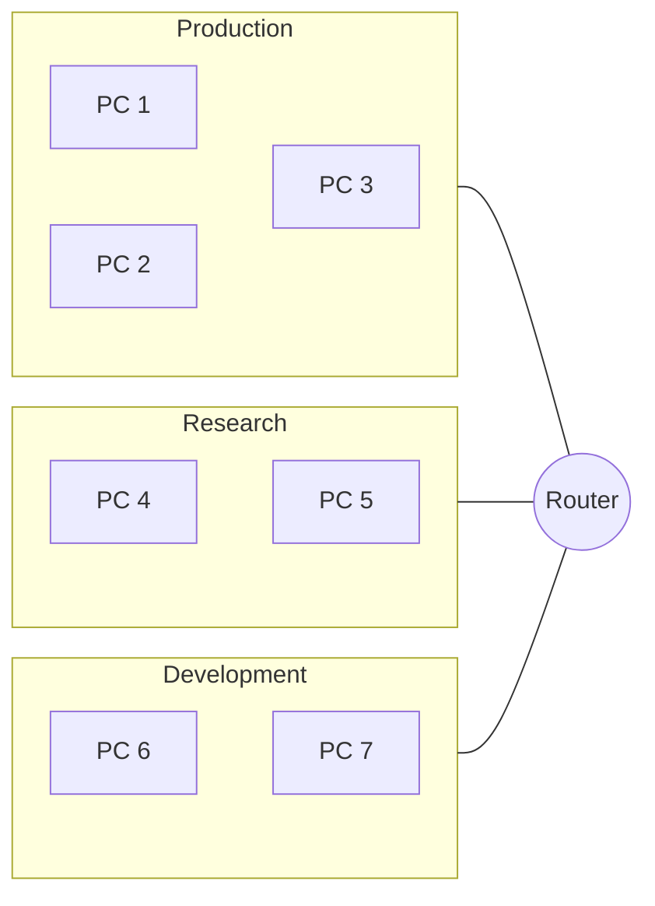

Access Layer Communication
On a local Ethernet network, a NIC only accepts a frame if the destination address is either the broadcast MAC address, or else corresponds to the MAC address of the NIC.

Most network applications, however, rely on the logical destination IP address to identify the location of the servers and clients. The figure illustrates the problem that arises if a sending host only has the logical IP address of the destination host. How does the sending host determine what destination MAC address to place within the frame?

The sending host can use an IPv4 protocol called address resolution protocol (ARP) to discover the MAC address of any host on the same local network. IPv6 uses a similar method known as Neighbor Discovery.

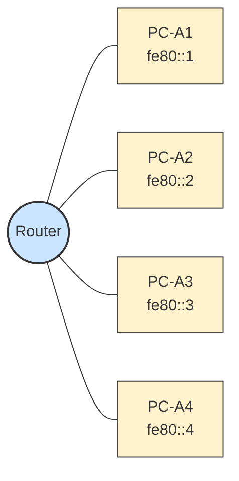

ARP
ARP uses a three step process to discover and store the MAC address of a host on the local network when only the IPv4 address of the host is known:

1. The sending host creates and sends a frame addressed to a broadcast MAC address. Contained in the frame is a message with the IPv4 address of the intended destination host.
2. Each host on the network receives the broadcast frame and compares the IPv4 address inside the message with its configured IPv4 address. The host with the matching IPv4 address sends its MAC address back to the original sending host.
3. The sending host receives the message and stores the MAC address and IPv4 address information in a table called an ARP table.
   When the sending host has the MAC address of the destination host in its ARP table, it can send frames directly to the destination without doing an ARP request. Because ARP messages rely on broadcast frames to deliver the requests, all hosts in the local IPv4 network must be in the same broadcast domain.

learning outcomes:

MAC and IP: MAC addresses are used for NIC-to-NIC communications on the same Ethernet network, while IP addresses are used to send packets from the source device to the destination device across different networks. When a host needs to communicate with another device on the same network, it uses ARP to map the destination IP address to its corresponding MAC address. If the destination IP address is on a remote network, the host sends the packet to the default gateway (router), which then forwards it to the next hop toward the destination.

Broadcast containment: Broadcast messages are sent to all devices within the same local network (broadcast domain). If too many hosts are connected to the same broadcast domain, broadcast traffic can become excessive and degrade network performance. To improve performance, networks can be divided into multiple broadcast domains using routers, which contain the broadcast traffic within each local network and prevent it from affecting other networks. hex notation is FF:FF:FF:FF:FF:FF:FF for MAC and 0.0.0.0 for IP.
uses NIC-to-NIC communication on the same Ethernet network, while IP addresses are used to send packets from the source device to the destination device across different networks. When a host needs to communicate with another device on the same network, it uses ARP to map the destination IP address to its corresponding MAC address. If the destination IP address is on a remote network, the host sends the packet to the default gateway (router), which then forwards it to the next hop toward the destination.
ND for IPv6 performs similar functions to ARP for IPv4, allowing devices to discover the MAC address associated with an IPv6 address on the same local network. Both ARP and ND rely on broadcast messages to request address information, and they help ensure that devices can communicate effectively within their local networks by resolving IP addresses to MAC addresses.

A host will send an ARP reply if the IP address in the ARP request matches its own IP address.

Layer 2 - MAC address
Layer 3 - IP address

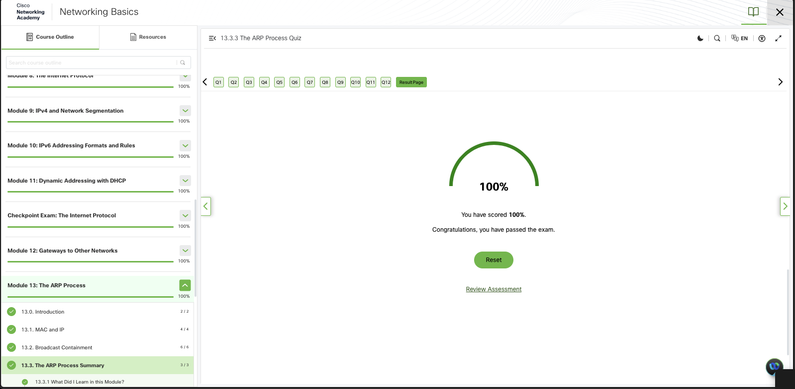

### Module 14: Routing between networks

learning objectives:
need for routing
routing table
LAN creation

need for routing:
A router is a networking device connecting multiple Layer 3, IP networks.
Distribution layer of the network - routers direct traffic and perform other functions critical to efficient network operation.

Routers, like switches, are able to decode and read the messages sent to them.

switches make forwarding decision based on Layer 2 MAC address
routers make forwarding decision based on the Layer 3 IP address.

The packet format contains the IP addresses of the destination and source hosts, as well as the message data being sent between them. The router reads the network portion of the destination IP address and uses it to find which one of the attached networks is the best way to forward the message to the destination.

If network portion of IP addresses of source and destination hosts do not match, a router must be used to forward the message.
e.g. If a host located on network 1.1.1.0 needs to send a message to a host on network 5.5.5.0
the host will forward the message to the router.
The router receives the message, de-encapsulates the Ethernet frame, and then reads the destination IP address in the IP packet.
router determines where to forward message.
router re-encapsulates the packet into a NEW frame, and forwards the frame to final destination.

Routing Table Entries
Routers move information between local and remote networks using routing tables to store information.
Routers use the routing tables to determine which interface to use to forward a message to its intended destination.
Routing tables dont care about the addresses of individual hosts.
Routing tables contain the addresses of networks, and the best path to reach those networks.
Routing table entries can be made in 2 WAYS: 1. dynamically updated by information received from other routers in the network; 2. manually entered by a network administrator.

If the router cannot determine where to forward a message, it will drop it. Network administrators configure a static default route that is placed into the routing table so that a packet will not be dropped due to the destination network not being in the routing table.

A default route is the interface through which the router forwards a packet containing an unknown destination IP network address. This default route usually connects to another router that can forward the packet towards its final destination network.

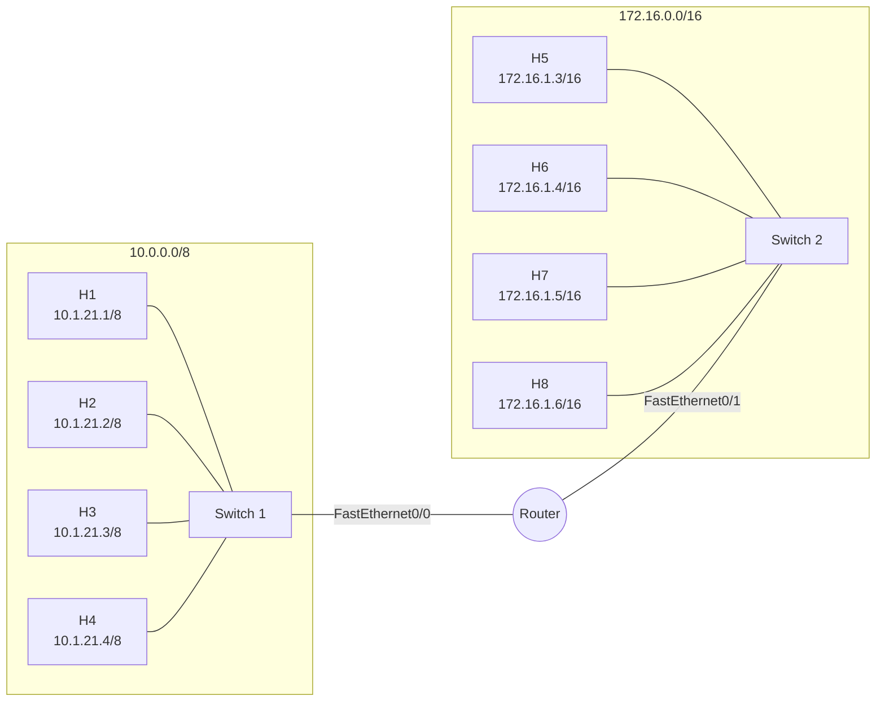

The Default Gateway
The method a host uses to send messages to a destination on a remote network is different to a host sending messages on the same local network. When a host needs to send a message to another host located on the same network, it will forward the message directly. A host will use ARP to discover the MAC address of the destination host. The IPv4 packet contains the destination IPv4 address and encapsulates the packet into a frame containing the MAC address of the destination and forwards it out.

When a host needs to send a message to a remote network, it must use the router. The host still includes the IP address of the destination host within the packet. but when it encapsulates the packet into a frame, it uses the MAC address of the router as the frame destination. the router will receive and accept the frame based on the MAC address.

Source host router MAC address:
A host is given the IPv4 address of the router through the default gateway address configured in its TCP/IP settings. The default gateway address is the address of the router interface connected to the same local network as the source host.

All hosts on the local network use the default gateway address to send messages to the router.

When the host knows the default gateway IPv4 address, it can use ARP to determine the MAC address. The MAC address of the router is then placed in the frame, destined for another network.

VERY IMPORTANT: the correct default gateway must be configured on each host on the local network. If no default gateway is configured in the host TCP/IP settings, or if the wrong default gateway is specified, messages addressed to hosts on remote networks cannot be delivered.

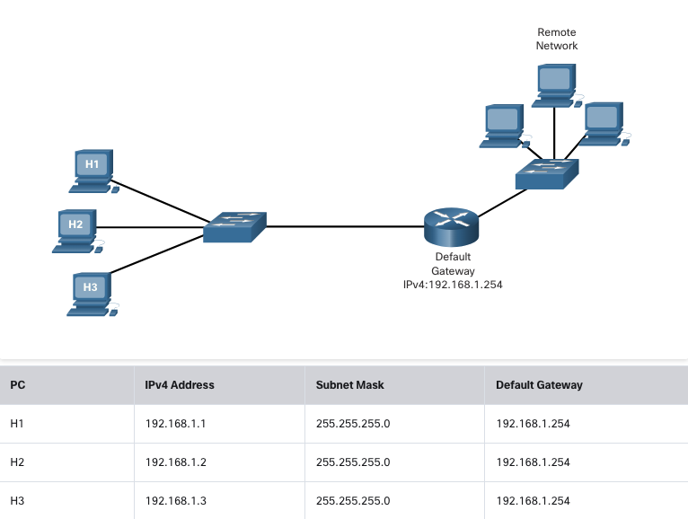

Local Area Networks
local area network (LAN) refers to a local network, or a group of interconnected local networks under the same administrative control. originally, LANs were defined as small networks existing in a single physical location. now, LANs CAN be a single local network installed in a home or small office, BUT the definition of LAN has EVOLVED to include interconnected local networks, consisting of many hundreds of hosts, installed in multiple buildings and locations.

N.B. all the local networks within a LAN are UNDER 1 ADMIN CONTROL. Common characteristics of LANs: typically use Ethernet or wireless protocols; support high data rates.

Intranet: a private LAN belonging to an organization only accesible toorganization members, employees, or others with authorization.

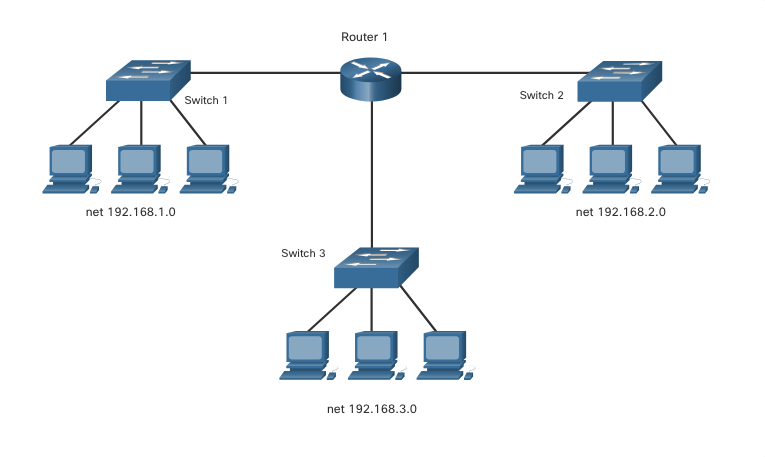

Local and Remote Network Segments
Local Segmentation - Placing all hosts on a single local network allows them to be seen by all other hosts. This is because there is one broadcast domain and hosts use ARP to find each other.

use case: simple network design. As networks grow in size, increased traffic will decrease network performance and speed. thats when you move some hosts onto a remote network.

Advantages of a single local segment:
Appropriate for simpler networks
Less complexity, lower network cost
Allows devices to be "seen" by other devices
Faster data transfer / more direct communication
Ease of device access

Disadvantages:
All hosts are in one broadcast domain which causes more traffic on the segment and may slow network performance
Harder to implement QoS
Harder to implement security

Remote Segmentation - Placing additional hosts on a remote network will decrease the impact of traffic demands, but hosts on one network will not be able to communicate with hosts on the other network without routing. Routers increase complexity of network configuration and can introduce latency (time delay) on packets sent from one local network to the other.

use case: larger, more complex network design.

Advantages:
larger, more complex networks
Splits up broadcast domains, decreases traffic
Can improve performance on each segment
Machines invisible to those on other local network segments
Can provide increased security
Can improve network organization

Disadvantages:
Requires routing (distribution layer)
Router can slow traffic between segments
More complexity, cost, hardware (i.e. requires a router)

commands:
arp -a - displays the ARP table, which contains the mappings of IP addresses to MAC addresses that the host has learned through ARP requests and replies.
arp -d - deletes an entry from the ARP table, which can be useful for troubleshooting or clearing out stale entries.
arp -s - allows you to manually add a static entry to the ARP table, specifying the IP address and corresponding MAC address. This can be useful for testing or when you want to ensure that a specific IP address always resolves to a particular MAC address.

learning outcomes:
need for routing: As networks grow, it is often necessary to divide one access layer network into multiple access layer networks. There are many ways to divide networks based on different criteria:
Broadcast containment - Routers in the distribution layer can limit broadcasts to the local network where they need to be heard.
Security requirements - Routers in the distribution layer can separate and protect certain groups of computers where confidential information resides.
Physical locations - Routers in the distribution layer can be used to interconnect local networks at various locations of an organization that are geographically separated.
Logical grouping - Routers in the distribution layer can be used to logically group users, such as departments within a company, who have common needs or for access to resources.
The distribution layer connects these independent local networks and controls the traffic flowing between them. It is responsible for ensuring that traffic between hosts on the local network stays local.
A router is a networking device that connects multiple Layer 3, IP networks. At the distribution layer of the network, routers direct traffic and perform other functions critical to efficient network operation. Routers, like switches, are able to decode and read the messages that are sent to them. Unlike switches, which make their forwarding decision based on the Layer 2 MAC address, routers make their forwarding decision based on the Layer 3 IP address.  
Anytime the network portion of the IP addresses of the source and destination hosts do not match, a router must be used to forward the message.

Routing Table: Each port, or interface, on a router connects to a different local network. Every router contains a table of all locally connected networks and the interfaces that connect to them.
When a router receives a frame, it decodes the frame to get to the packet containing the destination IP address. It matches the network portion of the destination IP address to the networks that are listed in the routing table. If the destination network address is in the table, the router encapsulates the packet in a new frame in order to send it out. if it is not in the table, the router will drop the packet. To prevent this from happening, network administrators configure a static default route that is placed into the routing table so that a packet will not be dropped due to the destination network not being in the routing table. A default route is the interface through which the router forwards a packet containing an unknown destination IP network address. This default route usually connects to another router that can forward the packet towards its final destination network.
It forwards the new frame out of the interface associated with the path, to the destination network. The process of forwarding the packets toward their destination network is called routing.
A router forwards a packet to one of two places: a directly connected network containing the actual destination host, or to another router on the path to reach the destination host. When a router encapsulates the frame to forward it out a routed interface, it must include a destination MAC address. If the router must forward the packet to another router through a routed interface, it will use the MAC address of the connected router. Routers obtain these MAC addresses from ARP tables.
A host is given the IPv4 address of the router through the default gateway address configured in its TCP/IP settings. The default gateway address is the address of the router interface connected to the same local network as the source host. All hosts on the local network use the default gateway address to send messages to the router.
Routing tables contain the addresses of networks, and the best path to reach those networks. Entries can be made to the routing table in two ways: dynamically updated by information received from other routers in the network, or manually entered by a network administrator.

LANs
LAN refers to a local network, or a group of interconnected local networks that are under the same administrative control. All the local networks within a LAN are under one administrative control. Other common characteristics of LANs are that they typically use Ethernet or wireless protocols, and they support high data rates.
Within a LAN, it is possible to place all hosts on a single local network or divide them up between multiple networks connected by a distribution layer device.
Placing all hosts on a single local network allows them to be seen by all other hosts. This is because there is one broadcast domain and hosts use ARP to find each other.
Placing additional hosts on a remote network will decrease the impact of traffic demands. However, hosts on one network will not be able to communicate with hosts on the other network without the use of routing. Routers increase the complexity of the network configuration and can introduce latency, or time delay, on packets sent from one local network to the other.

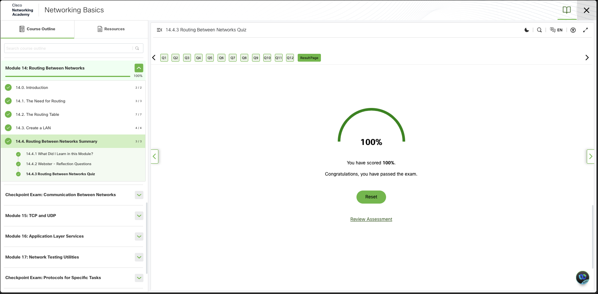

## Checkpoint 4

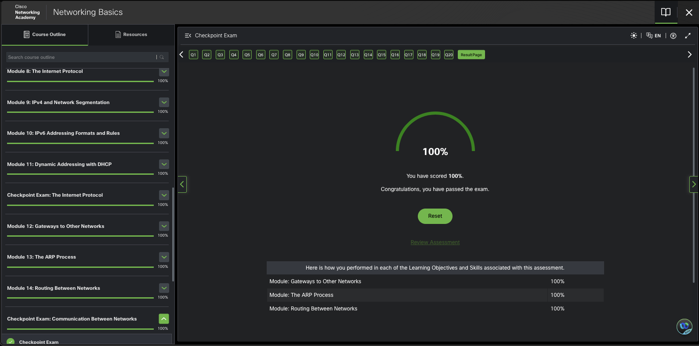
