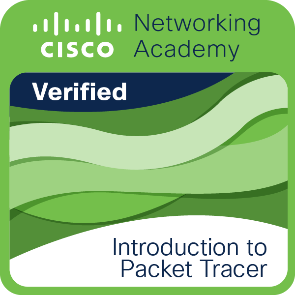

# Cisco Learning Dump

## Why

just somewhere to put the stuff I learn about Cisco and networking plus badges, etc... for later reference.

## Packet Tracer

### 1.Intro to

Skills Learned: Cisco Packet Tracer to visualize and simulate a network using everyday examples.

### 2.Exploring Networking

Skills Learned: connect, configure network devices, wireless devices, verify connectivity.

### 3.IoT

Skills Learned: IoT, Network Simulation, Environmental Controls, Programming, JavaScript, Python, Visual Blocky.

#### Module 1: Create Your Own Smart Home Network

In simple terms, the IoT is a collection of networked sensors, actuators, and smart devices that gather and share data. To connect the devices to your network, you need a home gateway or registration server. To control the devices, you have two options: you can interact directly with a device, or you can connect remotely over the network using a remote PC, tablet, or smart phone. You can connect and control smart devices using either a Home Gateway device or a remote registration server. The Home Gateway device acts as a local connection to your IoT smart devices. The Home Gateway device provides an IoT registration service that is always turned on, and an auto discovery service for Things in the local Ethernet and wireless network. When a home gateway device has been added to the logical workspace and you click the device, you will see the following:

- Physical tab – The device has an internet port, four LAN ports, and multiple antennae.
  Config tab – This shows the interfaces and network settings that are configurable.
  GUI tab – This shows the registration server inside the device that allows for interaction with IoT devices. It is on by default but can be turned off.
  Attributes tab – This is blank by default but can show features and values such as MTBF, cost, power source, and wattage. IoT devices can also be registered to a dedicated Registration Server for remote monitoring, control, or programming. The dedicated registration server has the additional benefit of being able to provide many other services to your network, such as Web, DHCP, DNS, email, and FTP.

#### Module 2: Environmental Controls and IoT Things in Packet Tracer

In the Physical Workspace there are containers. Containers include the intercity, city, buildings, and wiring closets. They all have their own set of environmental values. If there are no devices configured to affect the environment, their values are looped on a 24-hour cycle. Different containers may have different levels of insulation and thus different transference values. The transference values determine the rate that the child container converges with the parent container, and it works the same way for all environment types. To be able to provide true IoT solutions, it is critical to have programming knowledge. Packet Tracer provides supports JavaScript, Python, and Visual Blocky. Important terms and concepts:

- Current time – Time inside a container that increments by 30 minute increments. Every 1 second in real time equates to 30 minutes in “Container” time. The timer goes from 0 (midnight) to 11:59.
  KeyFrame – Represents a single moment in time.
  KeyFrame graph – A graph that shows the value of environmental elements at any given point in time throughout the day.
  Transference - Values that determine the rate that the child container converges with the parent container and works the same way for all environment types.
  You can use programming language to modify environmental elements within a container. You can even create a new IoT “Thing” in Packet Tracer. First, decide what the Thing will do, how it will connect to the network, and how it will work. You also need to identify an existing Thing that functions in a similar manner as the new Thing. The existing script can then be modified to create the new script. Clicking any IoT device that is in the workspace will reveal the specifications about that device. The specifications include:

- Features – How the device works or what it does. Devices can generate high and low values based on a button being pushed or toggled on and off or they can detect certain environmental values (eg. smoke or sunlight).
  Usage – Things may connect to other IoT devices in order to receive LOW or HIGH inputs or it may read the variable set in the Environment object.
  Direct Control – Shows you what keystrokes will allow you to physically interact with the Thing.
  Local and Remote Control – Shows how to control the Thing locally or remotely (if applicable).
  Data Specifications – How the values are produced or the port/slot used to connect to the sensor.
  Example – Describes an example of how it works.

## Networking Basics

### Module 1

#### Learning outcomes

Network Types

The internet is not owned by any individual or group. The internet is a worldwide collection of interconnected networks (internetwork or internet for short), cooperating with each other to exchange information using common standards. Through telephone wires, fiber-optic cables, wireless transmissions, and satellite links, internet users can exchange information in a variety of forms.
Small home networks connect a few computers to each other and to the internet. The SOHO network allows computers in a home office or a remote office to connect to a corporate network, or access centralized, shared resources. Medium to large networks, such as those used by corporations and schools, can have many locations with hundreds or thousands of interconnected hosts. The internet is a network of networks that connects hundreds of millions of computers world-wide.
There are devices all around that you may interact with on a daily basis that are also connected to the internet. These include mobile devices such as smartphones, tablets, smartwatches, and smart glasses. Things in your home can be connected to the internet such as a security system, appliances, your smart TV, and your gaming console. Outside your home there are smart cars, RFID tags, sensors and actuators, and even medical devices which can be connected.

Data Transmission

The following categories are used to classify types of personal data:
Volunteered data - This is created and explicitly shared by individuals, such as social network profiles. This type of data might include video files, pictures, text, or audio files.
Observed data - This is captured by recording the actions of individuals, such as location data when using cell phones.
Inferred data -This is data such as a credit score, which is based on analysis of volunteered or observed data.

The term bit is an abbreviation of “binary digit” and represents the smallest piece of data. Each bit can only have one of two possible values, 0 or 1.

There are three common methods of signal transmission used in networks:
Electrical signals - Transmission is achieved by representing data as electrical pulses on copper wire.
Optical signals - Transmission is achieved by converting the electrical signals into light pulses.
Wireless signals - Transmission is achieved by using infrared, microwave, or radio waves through the air.

Bandwidth and Throughput

Bandwidth is the capacity of a medium to carry data. Digital bandwidth measures the amount of data that can flow from one place to another in a given amount of time. Bandwidth is typically measured in the number of bits that (theoretically) can be sent across the media in a second. Common bandwidth measurements are as follows:
Thousands of bits per second (Kbps)
Millions of bits per second (Mbps)
Billions of bits per second (Gbps)
Throughput does not usually match the specified bandwidth. Many factors influence throughput including:
The amount of data being sent and received over the connection
The latency created by the number of network devices encountered between source and destination
Latency refers to the amount of time, including delays, for data to travel from one given point to another.

### Module 2: Network Components, Types, Connections

Module Objective:
Explain network types, components, and connections.

Topic Title - Topic Objective
Clients and Servers - Explain the roles of clients and servers in a network
Network Components - Explain the roles of network infrastructure devices
ISP Connectivity Options - Describe ISP connectivity options

P2P
Peer-to-Peer Applications
A P2P application allows a device to act as both a client and a server within the same communication, as shown in the figure. In this model, every client is a server and every server is a client. P2P applications require that each end device provide a user interface and run a background service.

Some P2P applications use a hybrid system where resource sharing is decentralized, but the indexes that point to resource locations are stored in a centralized directory. In a hybrid system, each peer accesses an index server to get the location of a resource stored on another peer.

The network infrastructure contains three categories of hardware components, as shown in the figure:

End devices - phones, laptops, printers
An end device (or host) is either the source or destination of a message transmitted over the network, as shown in the animation. In order to uniquely identify hosts, addresses are used. When a host initiates communication, it uses the address of the destination host to specify where the message should be sent.

Intermediate devices - switches, routers, firewall appliances

Network media - WAN - used by ISPs, etc...
ISP Services
An ISP can be the local cable provider, a landline telephone service provider, the cellular network that provides your smartphone service, or an independent provider who leases bandwidth on the physical network infrastructure of another company.

Many ISPs also offer additional services to their contract subscribers, as shown in the figure. These services can include email accounts, network storage, and website hosting and automated backup or security services.

ISPs are critical to communications across the global internet. Each ISP connects to other ISPs to form a network of links that interconnect users all over the world. ISPs are connected in a hierarchical manner that ensures that internet traffic generally takes the shortest path from the source to the destination.

The internet backbone is like an information super highway that provides high-speed data links to connect the various service provider networks in major metropolitan areas around the world. The primary medium that connects the internet backbone is fiber-optic cable.

other connectivity options include:
Cellular
Cellular internet access uses a cell phone network to connect. Wherever you can get a cellular signal, you can get cellular internet access. Performance will be limited by the capabilities of the phone and the cell tower to which it is connected. The availability of cellular internet access is a real benefit for people in areas that would otherwise have no internet connectivity at all, or for people who are constantly on the move. The downside of cellular connectivity is that the carrier usually meters the bandwidth usage of the connection and may charge extra for bandwidth that exceeds the contract data plan.

Sat service
Satellite service is a good option for homes or offices that do not have access to DSL or cable. Satellite dishes (see figure) require a clear line of sight to the satellite and so might be difficult in heavily wooded areas or places with other overhead obstructions. Speeds will vary depending on the contract, though they are generally good. Equipment and installation costs can be high (although check the provider for special deals), with a moderate monthly fee thereafter. Like cellular access, the availability of satellite internet access is a real benefit in areas that would otherwise have no internet connectivity at all.

dialup
An inexpensive option that uses any phone line and a modem. To connect to the ISP, a user calls the ISP access phone number. The low bandwidth provided by a dial-up modem connection is usually not sufficient for large data transfer, although it is useful for mobile access while traveling. A modem dial-up connection should only be considered when higher speed connection options are not available.

#### Learning outcomes

Clients and Servers:
All computers connected to a network that participate directly in network communication are classified as hosts. Hosts can send and receive messages on the network. In modern networks, computer hosts can act as a client, a server, or both. The software installed on the computer determines which role the computer plays.
Client and server software usually run on separate computers, but it is also possible for one computer to run both client and server software at the same time. In small businesses and homes, many computers function as the servers and clients on the network. This type of network is called a P2P network. In larger businesses, because of the potential for high amounts of network traffic, it is often necessary to have dedicated servers to support the number of service requests. P2P networks are easy to set up, less complex, lower in cost, and can be used for simple tasks such as transferring files and sharing printers. However, there is no centralized administration. They have less security, are not scalable, and can perform slower.

Network Components:
There are symbols that represent various types of networking equipment. The network infrastructure is the platform that supports the network. It provides the stable and reliable channel over which our communications can occur. The network infrastructure contains three categories of hardware components: end devices, intermediate devices, and network media. Hardware is often the visible components of the network platform such as a laptop, PC, switch, router, wireless access point, or the cabling used to connect the devices. Components that are not visible include wireless media.
End devices, or hosts, form the interface between users and the underlying communication network. Some examples of end devices include:
Computers (workstations, laptops, file servers, web servers)
Network printers
Telephones and teleconferencing equipment
Security cameras
Mobile devices (such as smartphones, tablets, PDAs, and wireless debit/credit card readers and barcode scanners)

ISP Connectivity Options:
An ISP provides the link between the home network and the internet. An ISP can be the local cable provider, a landline telephone service provider, the cellular network that provides your smartphone service, or an independent provider who leases bandwidth on the physical network infrastructure of another company. Each ISP connects to other ISPs to form a network of links that interconnect users all over the world. ISPs are connected in a hierarchical manner that ensures that internet traffic generally takes the shortest path from the source to the destination.
The interconnection of ISPs that forms the backbone of the internet is a complex web of fiber-optic cables with expensive networking switches and routers that direct the flow of information between source and destination hosts.
For a home user, connecting to the ISP is a fairly uncomplicated process. This is the most common connection option. It consists of using a wireless integrated router to connect to the ISP. The router includes a switch to connect wired hosts and a wireless AP to connect wireless hosts. The router also provides client IP addressing information and security for inside hosts. The two most common methods are cable and DSL. Other options include cellular, satellite, and dial-up telephone.

### Module 3: Wireless and Mobile Networks

Module Objective:
wireless networks - different network types used by cell, mobile devices
Mobile device Connectivity - configuring mobile devices for wireless connectivity

#### Learning Outcomes

Wireless Networks:
Mobile phones use radio waves to transmit voice signals to antennas mounted on towers located in specific geographic areas. When a telephone call is made, the voice signal is relayed from one tower to another tower until it is delivered to its destination. This type of network is used when you make a phone call to another mobile phone or to a wired telephone. It is also used to send text messages directly from the phone. The most common type of cellular telephone network is called a GSM network. The abbreviations 3G, 4G, 4G-LTE, and 5G are used to describe enhanced cell phone networks that are optimized for the fast transmission of data. Currently, 4G still dominates as the current mobile network used by most phones.
In addition to the GSM and 4G/5G transmitters and receivers, smartphones make connections in a variety of ways.
Wi-Fi transmitters and receivers located within the smartphone enable the phone to connect to local networks and the internet. Wi-Fi networks are usually privately owned but often provide guest or public access hotspots. A hotspot is an area where Wi-Fi signals are available.
Bluetooth is wireless technology that allows devices to communicate over short distances. Multiple devices can be connected at the same time with Bluetooth.
NFC is a wireless communication technology that enables data to be exchanged by devices that are in very close proximity to each other, usually less than a few centimeters.

Mobile Device Connectivity
Almost all mobile devices are capable of connecting to Wi-Fi networks. These precautions should be taken to protect Wi-Fi communications on mobile devices:
Never send login or password information using unencrypted text (plaintext).
Use a VPN connection when possible if you are sending sensitive data.
Enable security on home networks.
Use WPA2 or higher encryption for security.
Two of the most popular operating systems for mobile devices are Android and Apple iOS. Mobile devices are preprogrammed to use a Wi-Fi network for the internet if one is available, and the device can connect to the access point and receive an IP address. If no Wi-Fi network is available, the device uses the cellular data capability if it is configured.
Bluetooth technology provides a simple way for mobile devices to connect to each other and to wireless accessories. Bluetooth is wireless, automatic, and uses very little power, which helps conserve battery life. Some examples of devices that use Bluetooth include hands-free headsets, keyboards, a mouse, stereo controls, car speakerphones, and mobile speakers.
Bluetooth pairing occurs when two Bluetooth devices establish a connection to share resources. In order for the devices to pair, the Bluetooth radios are turned on, and one device begins searching for other devices. Other devices must be set to discoverable mode, also called visible, so that they can be detected.
When a Bluetooth device is in discoverable mode, it transmits the following information when another Bluetooth device requests it:
Name
Bluetooth class
Services that the device can use
Technical information, such as the features or the Bluetooth specification that it supports
During the pairing process, a PIN may be requested to authenticate the pairing process.

### Module 4: Build a Home Network

Module Objective: Configure integrated wireless router and wireless Client for home network connectivity

Wired Network Technology
Ethernet patch cable, usually unshielded twisted pair. These cables can be purchased with the RJ-45 connectors already installed
Category 5e is the most common wiring used in a LAN. The cable is made up of 4 pairs of wires that are twisted to reduce electrical interference
Coaxial cable has an inner wire surrounded by a tubular insulating layer, that is then surrounded by a tubular conducting shield. Most coax cables also have an external insulating sheath or jacket.
Fiber-optic cables can be either glass or plastic with a diameter about the same as a human hair and it can carry digital information at very high speeds over long distances. Fiber-optic cables have a very high bandwidth, which enables them to carry very large amounts of data.

4.3.1 Wi-Fi Networks
standards have been developed to allow wireless device communication. They specify (inc) the RF spectrum used, data rates, how the information is transmitted...
The main organization responsible for the creation of wireless technical standards is the Institute of Electrical and Electronics Engineers (IEEE).
IEEE 802.11 standard governs the WLAN environment. There are amendments to the IEEE 802.11 standard that describe characteristics for different standards of wireless communications. Wireless standards for LANs use the 2.4 GHz and 5 GHz frequency bands. Collectively these technologies are referred to as Wi-Fi.

Another organization, known as the Wi-Fi Alliance, is responsible for testing wireless LAN devices from different manufacturers. The Wi-Fi logo on a device means that this equipment meets standards and should operate with other devices that use the same standard.

Wireless routers using the 802.11 standards have multiple settings that have to be configured. These settings include the following:

N.B. SSID stands for Service Set Identifier.

Network mode
Determines the type of technology that must be supported. For example,802.11b,802.11g,802.11n or Mixed Mode.

Network Name (SSID)
Used to identify the WLAN. All devices that wish to participate in the WLAN must have the same SSID.

Standard Channel
Specifies the channel over which communication will occur. By default, this is set to Auto to allow the access point (AP) to determine the optimum channel to use.

SSID Broadcast
Determines if the SSID will be broadcast to all devices within range. By default, set to Enabled.

Network Mode

The 802.11 protocol can provide increased throughput based on the wireless network environment. If all wireless devices connect with the same 802.11 standard, maximum speeds can be obtained for that standard. If the access point is configured to accept only one 802.11 standard, devices that do not use that standard cannot connect to the access point.

A mixed mode wireless network environment can include devices that use any of the existing Wi-Fi standards. This environment provides easy access for older devices that need a wireless connection but do not support the latest standards.

When building a wireless network, it is important that the wireless components connect to the appropriate WLAN. This is done using the SSID.

The SSID is a case-sensitive, alphanumeric string that contains up to 32 characters. It is sent in the header of all frames transmitted over the WLAN. The SSID is used to tell wireless devices, called wireless stations (STAs), which WLAN they belong to and with which other devices they can communicate.

We use the SSID to identify a specific wireless network. It is essentially the name of the network. Wireless routers usually broadcast their configured SSIDs by default. The SSID broadcast allows other devices and wireless clients to automatically discover the name of the wireless network. When the SSID broadcast is disabled, you must manually enter the SSID on wireless devices.

Disabling SSID broadcasting can make it more difficult for legitimate clients to find the wireless network. However, simply turning off the SSID broadcast is not sufficient to prevent unauthorized clients from connecting to the wireless network. All wireless networks should use the strongest available encryption to restrict unauthorized access.

Router setup
A cable modem connection will have a coaxial terminal to accept a BNC-type connector. A DSL connection will have a port for a telephone-type cable, usually an RJ-11 connector.
After confirming that the computer is connected to the network router and the link lights on the NIC indicate a working connection, the computer needs an IP address. Most network routers are set up so that the computer receives an IP address automatically from a local DHCP server automatically configured on the wireless router. If the computer does not have an IP address, check the router documentation and configure the PC or tablet with a unique IP address, subnet mask, default gateway, and DNS information.

Design Considerations
What should my network be called?
If SSID broadcasting is on, the SSID name will be seen by all wireless clients within your signal range. Many times the SSID gives away too much information about the network to unknown client devices. It is not a good practice to include the device model or brand name as part of the SSID. Wireless devices have default settings that are easy to find on the internet, as well as known security weaknesses.

What types of devices will attach to my network?
Wireless devices contain radio transmitter/receivers that function within a specific frequency range. If a device only has the necessary radio for 802.11 b/g, it will not connect if the wireless router or access point is configured to only accept 802.11n or 802.11ac standards. If all devices support the same standard, the network will work at its optimum speed. If you have devices that do not support the n or ac standards, then you will have to enable legacy mode. A legacy mode wireless network environment varies between router models but can include a combination of 802.11a, 802.11b, 802.11g, 802.11n, and 802.11ac. This environment provides easy access for legacy devices that need a wireless connection.

#### Learning Outcomes

### Module 5: Communication Principles

Communication Protocols
Communication Standards
Network Communication Models - compare OSI and TCP/IP models
